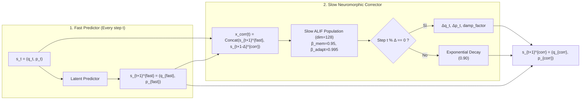

# Architettura del Correttore e Pipeline di Training (SPWM-v8.4)

Questo documento descrive in modo rigoroso, schematico ed esaustivo l'architettura del **Slow Neuromorphic Corrector** e la relativa pipeline di **Training & Model Selection** implementata in SPWM (*Spiking Predictive World Model*).

---

## 1. Visione d'Insieme: Paradigma a Due Scale Temporali (*Two-Timescale*)

Il sistema è strutturato come un'architettura **Predictor-Corrector** neuromorfa:
1. **Fast Predictor (Scala Veloce, $\Delta t = 1$):**
   - Rete neurale / ALIF dinamica veloce ($\beta_{mem} = 0.80$, $\beta_{adapt} = 0.90 / 0.985$).
   - Genera predizioni locali ad alta precisione e breve raggio: $\hat{s}_{t+1}^{fast} = \mathcal{P}(s_t)$.
2. **Slow Corrector (Scala Lenta, Cadenza $\Delta = 5$):**
   - Popolazione ALIF lenta indipendente ($\beta_{mem} = 0.95$, $\beta_{adapt} = 0.995$, $v_{th0} = 1.0$).
   - Opera *in-blind* (senza osservazioni sensoriali future durante i rollout autonomi).
   - Stabilizza la traiettoria sopprimendo l'accumulo asintotico di drift sui lunghi orizzonti ($H \ge 25, 50, 100$).



---

## 2. Struttura Dettagliata del Correttore (`SlowCorrector`)

Il correttore implementa una **politica stazionaria e non retroattiva**: la correzione si applica unicamente allo step corrente $s_t$ senza modificare il passato.

### 2.1 Input a Scala Lenta (Cadence-Aware)
Per catturare la divergenza cinematica accumulata lungo l'intervallo temporale della cadenza $\Delta$ (anziché una sola transizione istantanea $1$-step), l'input al correttore al passo $t$ confronta lo stato proposto con lo stato di ancoraggio all'ultima cadenza:
$$x_{corr}(t) = [s_t^{fast}, \, s_{t-\Delta}] \in \mathbb{R}^{2 \cdot D_{latent}}$$
*(con $D_{latent} = q_{dim} + p_{dim} = 32 + 96 = 128$, dove $s_{t-\Delta}$ è lo stato $z_{\text{cadence\_prev}}$ memorizzato e aggiornato ad ogni intervento cadenzato).*

### 2.2 Dinamica ALIF Continua
Ad **ogni singolo step** (non solo sulla cadenza), la popolazione ALIF integra la corrente sinaptica:
$$I_{syn}(t) = W_{in} x_{corr}(t) + b_{in}$$
$$v_t, a_t, S_t = \text{ALIFCell}(I_{syn}(t), v_{t-1}, a_{t-1})$$
Ciò garantisce continuità nelle tracce di membrana e nell'adattamento di soglia biologico.

### 2.3 Generazione degli Offset Correttivi ($\Delta q, \Delta p, \text{damp}$)
Se $t \pmod \Delta == 0$ (cadenza attiva, es. ogni 5 step):
$$u_t = \tanh(W_v v_t) + W_s S_t$$
- **Offset di Posizione/Velocità Coordinata:**
  $$\Delta q_t = \tanh(W_q u_t + b_q) \cdot g_{v}^{max} \quad (g_{v}^{max} = 0.45)$$
- **Offset di Momento/Fattore Latente:**
  $$\Delta p_t = \tanh(W_p u_t + b_p) \cdot g_{p}^{max} \quad (g_{p}^{max} = 0.45)$$
- **Fattore di Smorzamento (Damping):**
  $$\text{damp}_t = \sigma(W_d u_t + b_d) \cdot d^{max} \quad (d^{max} = 0.15)$$

Se $t \pmod \Delta \ne 0$ (tra due cadenze successive):
$$\Delta q_t = \Delta q_{t-1} \cdot \gamma_{decay}, \quad \Delta p_t = \Delta p_{t-1} \cdot \gamma_{decay}, \quad \text{damp}_t = \text{damp}_{t-1} \cdot \gamma_{decay} \quad (\gamma_{decay} = 0.90)$$
*Questo meccanismo preserva la continuità $\mathcal{C}^1$ della traiettoria evitando scatti discontinui.*

### 2.4 Accoppiamento Non-Distruttivo
Lo stato stabilizzato finale $\hat{s}_t^{corr} = [q_t^{corr}, p_t^{corr}]$ è calcolato come:
$$q_t^{corr} = \text{clamp}(q_t^{fast} + \Delta q_t, -1.0, 1.0)$$
$$p_t^{corr} = p_t^{fast} \cdot (1.0 - \text{damp}_t) + \Delta p_t$$

---

## 3. Protocollo di Training in Due Fasi (*Decoupled Phase Training*)

Per evitare interferenze di gradiente tra la dinamica rapida e la stabilizzazione a lungo termine, l'addestramento è rigorosamente disaccoppiato in due modalità:

```
                  ┌────────────────────────────────────────┐
                  │ 1. Phase: 'train_predictor'            │
                  │    - Addestra: Encoder, Predictor,     │
                  │      Dynamics p, Kinematic Probe       │
                  │    - Correttore: COMPLETAMENTE SPENTO  │
                  └──────────────────┬─────────────────────┘
                                     │ Salva checkpoint
                                     ▼
                  ┌────────────────────────────────────────┐
                  │ 2. Phase: 'train_corrector' (v9)       │
                  │    - Modello Predittore: CONGELATO     │
                  │      (requires_grad = False, eval mode)│
                  │    - Allena: Slow ALIF Corrector       │
                  │      tramite Rollout Profondo (H=100)  │
                  │      e Isometria Latente Locale        │
                  └────────────────────────────────────────┘
```

---

## 4. Dettaglio del Training del Correttore (`train_corrector` & SPWM-v9)

Nella fase `train_corrector`, l'ottimizzatore calcola i gradienti esclusivamente per i parametri del correttore (popolazione lenta ALIF, `potential_net`, `force_to_momentum`, `momentum_to_pos`, `to_damp`).

### 4.1 Rimodellamento Energetico Hamiltoniano & Impulsive Jump System
1. **Predizione del Potenziale Scalare $\Delta\Phi(q_t)$:**
   La popolazione lenta produce $u_t$ che modula il potenziale scalare $\Delta\Phi(q_t; u_t) \in \mathbb{R}$.
2. **Forza Conservativa Differenziata:**
   $$\Delta p_{\text{cons}} = M (-\nabla_q \Delta\Phi(q_t))$$
   derivata con backpropagation spaziale esatta.
3. **Dissipazione Viscosa del Drift:**
   $$\Delta p = \Delta p_{\text{cons}} - \text{damp}_t \cdot p_t^{\text{fast}}$$
4. **Aggiornamento Simplettico di Posizione:**
   $$\Delta q = M^{-1} \Delta p, \quad q_t^{\text{corr}} = \text{clamp}(q_t^{\text{fast}} + \Delta q, -1.0, 1.0)$$
5. **Impulsive Jump Paradigm:**
   - Per $t \pmod \Delta \ne 0$: Fast Predictor completamente autonomo ($\Delta q = 0, \Delta p = 0, \text{damp} = 0$).
   - Per $t \pmod \Delta == 0$: Salto discreto istantaneo sullo stato latente, senza code esponenziali residue.

### 4.2 Rollout Profondo su Stati Perturbati ($H=100$)
- Nessun reset a $H=25$: il rollout viene unrollato continuamente fino a $H=100$ passi.
- Addestramento su stati latenti iniziali perturbati ($z_{\text{init}} + \mathcal{N}(0, \sigma^2)$) e traiettorie con iniezione di drift per garantire l'invarianza del bacino di attrazione.

### 4.3 Vincolo di Isometria Cinematica Locale (Preservazione della Varietà Latente $Z$)
Per impedire al correttore di collassare le 124 dimensioni latenti ortogonali al decoder fisico ($128\text{D} \to 4\text{D}$):
$$\mathcal{L}_{\text{isometry}} = \text{MSE}\left(\| z^{\text{corr}} - z^{\text{fast}} \|^2, \; k \cdot \| \text{Decoder}(z^{\text{corr}}) - \text{Decoder}(z^{\text{fast}}) \|^2\right)$$

### 4.4 Funzione di Costo Totale del Correttore
$$\mathcal{L}_{\text{corr}} = \lambda_{\text{asymptotic}} \mathcal{L}_{\text{kin}} + \lambda_{\text{isometry}} \mathcal{L}_{\text{isometry}} + \lambda_{\text{quiescence}} \mathcal{L}_{\text{quiescence}}$$

---

## 5. Validazione e Criterio di Selezione del Modello (*Model Selection*)

Durante l'addestramento, ad ogni epoca viene eseguito un test di rollout autonomo su orizzonti multipli ($H \in \{1, 5, 10, 25, 50, 100\}$).

### 5.1 Metriche di Rollout
- **Rollout MAE:** Errore cinematico medio su tutte le lunghezze di rollout.
- **Drift Ratio:** Rapporto di divergenza dell'errore tra orizzonte lungo e breve:
  $$\text{Drift Ratio} = \frac{\text{PosError}(H=25)}{\text{PosError}(H=1)}$$

### 5.2 Dynamic Drift Score (Criterio Best Checkpoint)
La selezione del miglior checkpoint (`model.pt`) non si basa sulla loss di training istantanea, ma sullo score di stabilizzazione globale:
$$\text{Score} = \alpha \cdot \text{RolloutMeanMAE} + \beta \cdot \text{PosError}(H=25) + \gamma \cdot \text{DriftRatio}$$
Il checkpoint con score minimo viene salvato e utilizzato per la valutazione finale A/B (confronto *Predictor Only* vs *Predictor + Corrector*).
