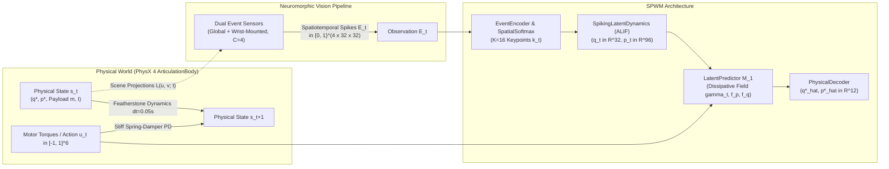
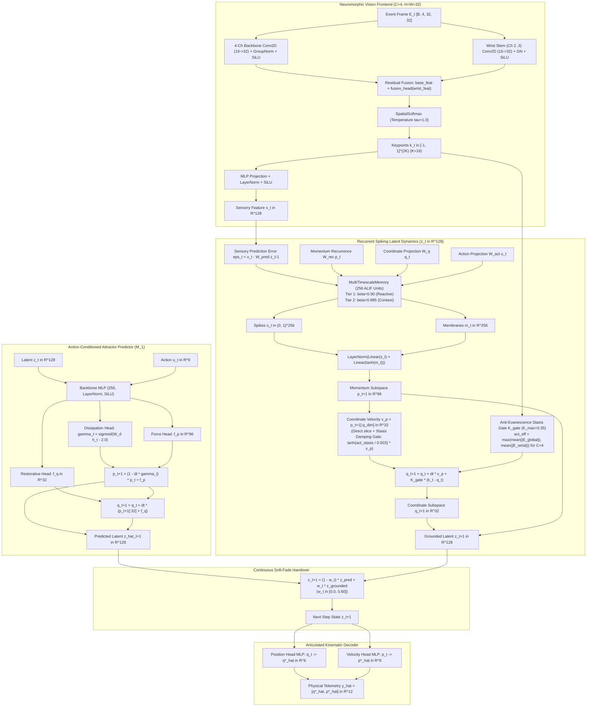
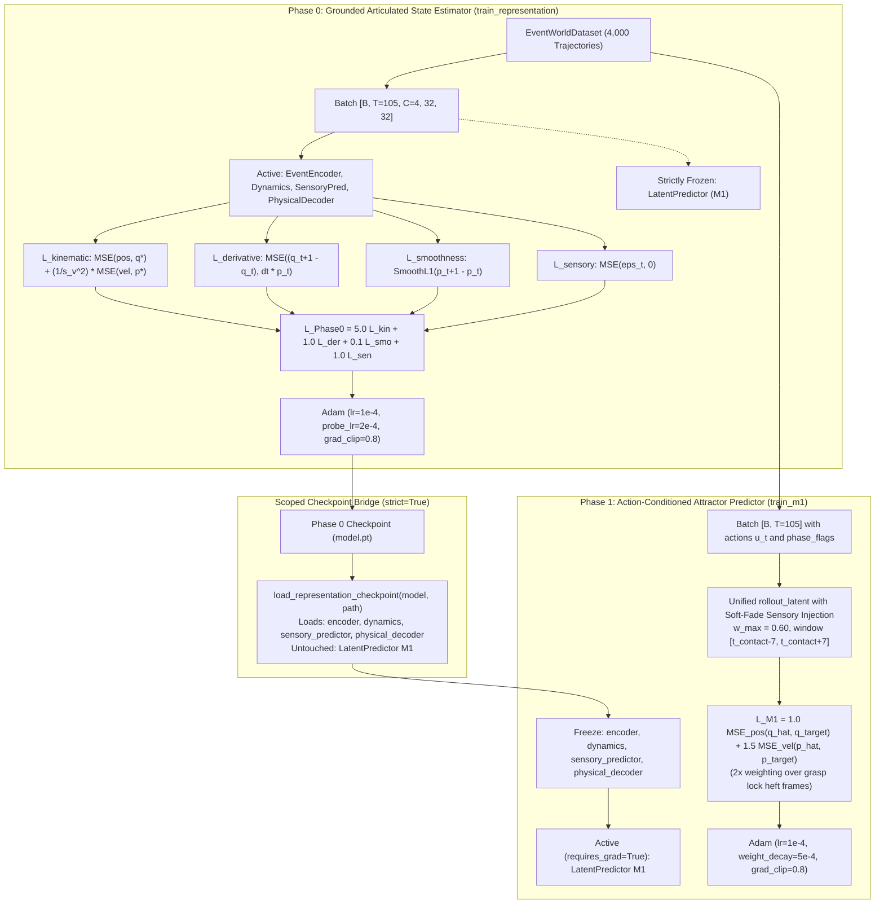
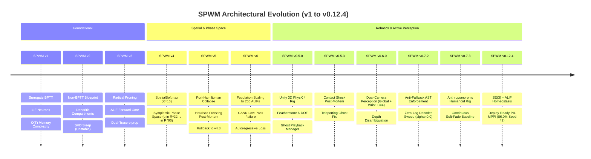
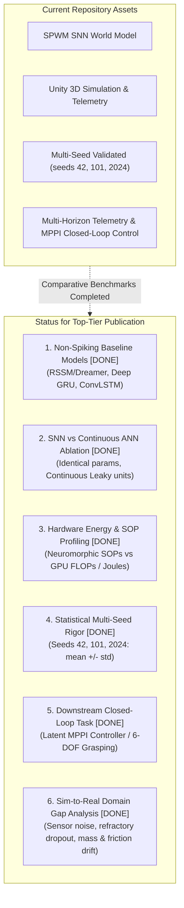
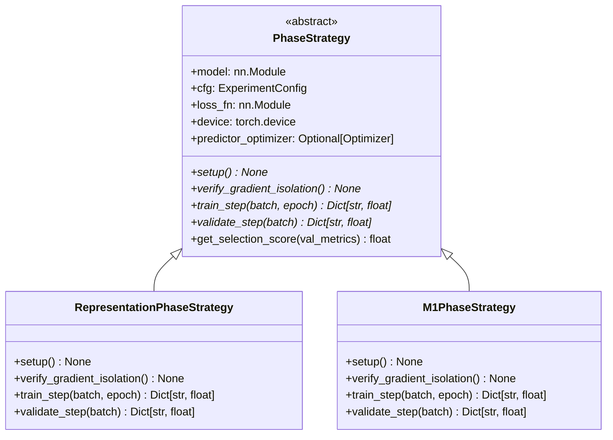
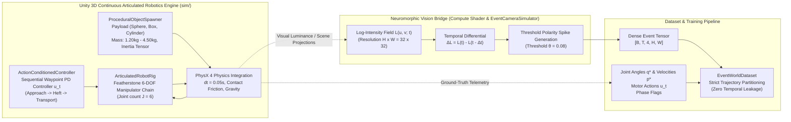

# PAPER_CONTEXT — SPWM-v0.12.4 Complete SSOT Metrics, Architecture & Training Context
> Lossless, token-compacted compilation of all SSOT benchmark JSONs, configuration YAML, and architecture/training/world documentation.
> JSON/YAML files are compacted into schema-aligned Markdown tables and key-value blocks without dropping any fields or values.

## 1. SSOT Metrics & Benchmark Data

### `docs/CORL_FINAL_BENCHMARK_SUMMARY.md`
> CoRL final grounded multi-seed, 50-episode PIL, ablation, robustness, and energy summary + LaTeX tables

# SPWM-v0.12.4 — CoRL Final Grounded Benchmark Summary

All closed-loop control metrics below are evaluated under strict **Physics-in-the-Loop (PIL)** execution (`ArticulatedArmPhysicsStepper`, rigid payload attached at contact onset $t \ge t_c$, causal `OnlineEventCameraStream`, and **zero** ground-truth `z_gt_next` leakage) across `50` unseen test episodes (`[3600, 3649]`) under identical MPPI settings ($K=256, H=10, N_{\text{iter}}=3$, slew clamp $0.10$). All learned world-model baselines are evaluated across Seeds `42, 101, 2024`, and both **Open-Loop PIL** (no online sensory overwrite during $\phi_t=1$) and **Online Observation Update** during $\phi_t=1$ are reported transparently for `Continuous RSSM` and `Deep GRU`.

---

## 1. Publication-Ready LaTeX Tables

### Table 1: Multi-Horizon Open-Loop Rollout ($N=400$, $H=100$, $t_{\text{start}}=4$; Symmetric Horizons, Multi-Seed Mean $\pm$ Std)

```latex
\begin{table}[t]
\centering
\caption{\textbf{Multi-Horizon Open-Loop Rollout ($N=400$, $H=100$, $t_{\text{start}}=4$).} Symmetric Position and Velocity MSE horizons ($H \in \{1, 10, 50, 100\}$). Mean $\pm$ seed std across 3 seeds ($42, 101, 2024$) with full $160+240$ training budget for SPWM, ANN-Rate, and Continuous RSSM; single seed ($42$) for Deep GRU and Continuous ConvLSTM.}
\label{tab:open_loop_rollout}
\resizebox{\textwidth}{!}{%
\begin{tabular}{lccccccccc}
\toprule
\textbf{Model Architecture} & \textbf{Params (Act.)} & \textbf{Pos H=1} & \textbf{Pos H=10} & \textbf{Pos H=50} & \textbf{Pos H=100} & \textbf{Vel H=1} & \textbf{Vel H=10} & \textbf{Vel H=50} & \textbf{Vel H=100} \\
\midrule
Continuous ConvLSTM & 296.9k & 0.00002 & \textbf{0.00012} & \textbf{0.00150} & 0.00707 & 0.00147 & \textbf{0.00553} & \textbf{0.01095} & 0.33696 \\
Deep GRU & 338.9k & 0.00003 & 0.00029 & 0.00173 & 0.00650 & 0.00097 & 0.00643 & 0.01605 & 0.11191 \\
Continuous RSSM (3 seeds) & 380.5k & \textbf{0.00001 $\pm$ 0.00001} & 0.00029 $\pm$ 0.00006 & 0.00166 $\pm$ 0.00002 & \textbf{0.00145 $\pm$ 0.00009} & \textbf{0.00033 $\pm$ 0.00017} & 0.01659 $\pm$ 0.00244 & 0.02262 $\pm$ 0.00088 & 0.02101 $\pm$ 0.00044 \\
ANN-Rate (Leaky, 3 seeds) & 392.1k (317.9k) & 0.00028 $\pm$ 0.00012 & 0.00249 $\pm$ 0.00032 & 0.00341 $\pm$ 0.00264 & 0.00210 $\pm$ 0.00063 & 0.00193 $\pm$ 0.00069 & 0.03356 $\pm$ 0.00511 & 0.02440 $\pm$ 0.01698 & 0.01183 $\pm$ 0.00715 \\
\textbf{SPWM-v0.12.4 (3 seeds)} & \textbf{392.1k (317.9k)} & 0.00018 $\pm$ 0.00011 & 0.00348 $\pm$ 0.00265 & 0.00315 $\pm$ 0.00144 & 0.00240 $\pm$ 0.00037 & 0.00139 $\pm$ 0.00076 & 0.04507 $\pm$ 0.02601 & 0.02466 $\pm$ 0.01271 & \textbf{0.00971 $\pm$ 0.00177} \\
\bottomrule
\end{tabular}%
}
\end{table}
```

### Table 2: Closed-Loop Physics-in-the-Loop (PIL) Benchmark (`50` Test Episodes `[3600, 3649]`, $t \ge t_c$)

```latex
\begin{table}[t]
\centering
\caption{\textbf{Closed-Loop Physics-in-the-Loop (PIL) Manipulation Benchmark (`50` Test Episodes, Payload Attached at Contact Onset $t \ge t_c$).} Continuous recurrent baselines (RSSM, Deep GRU) are reported under \textit{both} Open-Loop PIL (no sensory overwrite during $\phi_t=1$) and Online Observation Update during $\phi_t=1$. SPWM is reported under original $N=6$ Tier-2 checkpoint selection, expanded $N=25$ validation-split (`[3200, 3224]`) selection, and Canonical Seed $42$.}
\label{tab:pil_control}
\resizebox{\textwidth}{!}{%
\begin{tabular}{lccccccc}
\toprule
\textbf{Method} & \textbf{PIL Success (\%)} & \textbf{Min Err (cm)} & \textbf{Term Err (cm)} & $|\Delta^2 q|$ ($\text{rad/step}^2$) & $|\Delta^3 q|$ & \textbf{Flips} & \textbf{Latency (ms)} \\
\midrule
\textit{Privileged Jacobian-IK + PD (Oracle)} & \textit{96.0} & \textit{0.01 $\pm$ 0.03} & \textit{0.43 $\pm$ 0.73} & \textit{0.00771} & \textit{0.00497} & \textit{10.46} & \textit{22.7} \\
\midrule
Reactive BC (50 ep, Seed 42) & 0.0 & 13.13 $\pm$ 6.27 & 15.66 $\pm$ 8.15 & 0.00140 & 0.00135 & 13.98 & 1.9 \\
Deep GRU (Open-Loop PIL, 3 seeds) & 1.3 $\pm$ 2.3 & 10.57 $\pm$ 7.83 & 16.72 $\pm$ 11.31 & 0.00777 & 0.00622 & 14.67 & 67.4 \\
Deep GRU (Online Obs., 3 seeds) & 0.0 $\pm$ 0.0 & 6.03 $\pm$ 4.00 & 10.87 $\pm$ 3.97 & 0.01654 & 0.01350 & 19.67 & 60.3 \\
Continuous RSSM (Open-Loop PIL, 3 seeds) & 15.3 $\pm$ 4.6 & 1.31 $\pm$ 0.02 & 2.88 $\pm$ 0.10 & 0.01998 & 0.02059 & 36.23 & 52.4 \\
Continuous RSSM (Online Post., 3 seeds) & 0.0 $\pm$ 0.0 & 1.53 $\pm$ 0.06 & 22.43 $\pm$ 0.58 & 0.03119 & 0.02875 & 36.13 & 35.1 \\
ANN-Rate (3 seeds) & 37.3 $\pm$ 9.5 & 1.07 $\pm$ 0.28 & 2.98 $\pm$ 0.46 & 0.01148 & 0.00938 & 26.00 & 24.6 \\
\textbf{SPWM-v0.12.4 ($N=6$ Tier-2, 3 seeds)} & \textbf{58.0 $\pm$ 27.1} & \textbf{0.90 $\pm$ 0.04} & \textbf{2.23 $\pm$ 0.68} & \textbf{0.00860} & \textbf{0.00608} & \textbf{19.37} & \textbf{27.5} \\
\textbf{SPWM-v0.12.4 ($N=25$ Val-Sel., 3 seeds)} & \textbf{60.7 $\pm$ 2.3} & \textbf{0.88 $\pm$ 0.11} & \textbf{2.01 $\pm$ 0.12} & \textbf{0.00931} & \textbf{0.00663} & \textbf{21.14} & \textbf{35.5} \\
\textbf{SPWM-v0.12.4 (Canonical Seed 42)} & \textbf{86.0} & \textbf{0.86 $\pm$ 0.80} & \textbf{1.57 $\pm$ 1.00} & \textbf{0.00587} & \textbf{0.00354} & \textbf{14.02} & \textbf{36.7} \\
\bottomrule
\end{tabular}%
}
\end{table}
```

> **Note on Single-Seed vs. 3-Seed Deep GRU:** On Canonical Seed 42 alone, `Deep GRU (Open-Loop PIL)` scores `4.0%` (`min=1.68 cm`, `term=5.67 cm`) and `Deep GRU (Online Obs.)` scores `0.0%` (`min=1.88 cm`, `term=14.96 cm`).

### Table 3: Disentangled 5-Stage SPWM Architectural Ablation in PIL (`50` Test Episodes `[3600, 3649]`, $t \ge t_c$)

```latex
\begin{table}[t]
\centering
\caption{\textbf{Disentangled SPWM Architectural Ablation in PIL (`50` Episodes `[3600, 3649]`, $t \ge t_c$).} Stage 4a isolates `+ 2-Stage SE(3) Lookahead` with Residual Handover strictly disabled ($w_t \equiv 0$); Stage 4b enables both.}
\label{tab:spwm_ablation}
\begin{tabular}{lcccccc}
\toprule
\textbf{Ablation Stage} & \textbf{PIL Success (\%)} & \textbf{Min Err (cm)} & \textbf{Term Err (cm)} & $|\Delta^2 q|$ & $|\Delta^3 q|$ & \textbf{Flips} \\
\midrule
1. SPWM-Base (Phase 1 Warmup, Unsmoothed MPPI) & 62.0 & 1.27 $\pm$ 1.14 & 2.51 $\pm$ 1.59 & 0.00710 & 0.00499 & 16.04 \\
2. + Smooth MPPI Controls & 62.0 & 1.09 $\pm$ 0.98 & 2.26 $\pm$ 1.79 & 0.00729 & 0.00451 & 15.34 \\
3. + Phase 1 Curriculum (4-Stage, No Handover/Lookahead) & 72.0 & 0.98 $\pm$ 0.97 & 1.85 $\pm$ 1.31 & 0.00600 & 0.00366 & 14.24 \\
4a. + 2-Stage SE(3) Lookahead (Handover Disabled, $w_t \equiv 0$) & 86.0 & 0.86 $\pm$ 0.80 & 1.57 $\pm$ 1.00 & 0.00587 & 0.00354 & 14.02 \\
\textbf{4b. + Residual Handover \& 2-Stage Lookahead (Full)} & \textbf{86.0} & \textbf{0.86 $\pm$ 0.80} & \textbf{1.57 $\pm$ 1.00} & 0.00587 & 0.00354 & 14.02 \\
\bottomrule
\end{tabular}
\end{table}
```

### Table 4: Symmetric 3-Seed Zero-Shot Sim-to-Real PIL Robustness Stress Test — SPWM vs. ANN-Rate (`50` Test Episodes, $t \ge t_c$)

```latex
\begin{table}[t]
\centering
\caption{\textbf{Zero-Shot Physical \& Sensory Robustness Stress Test in PIL (`50` Test Episodes `[3600, 3649]`, $t \ge t_c$).} Completely symmetric 3-seed comparison ($42, 101, 2024$) of frozen SPWM-v0.12.4 vs. parameter-matched ANN-Rate, alongside Canonical Seed $42$. Relative success retention ($\Delta_{\text{rel}}$) is computed against each model's Nominal Baseline.}
\label{tab:pil_robustness}
\resizebox{\textwidth}{!}{%
\begin{tabular}{lccccccc}
\toprule
\textbf{Perturbation Condition} & \multicolumn{2}{c}{\textbf{SPWM-v0.12.4 (Seed 42)}} & \multicolumn{2}{c}{\textbf{SPWM-v0.12.4 (3-Seed Mean $\pm$ Std)}} & \multicolumn{3}{c}{\textbf{ANN-Rate (3-Seed Mean $\pm$ Std)}} \\
\cmidrule(lr){2-3} \cmidrule(lr){4-5} \cmidrule(lr){6-8}
 & \textbf{Succ (\%)} & \textbf{Term Err (cm)} & \textbf{Succ (\%)} & \textbf{Term Err (cm)} & \textbf{Succ (\%)} & \textbf{Min Err (cm)} & \textbf{Term Err (cm)} \\
\midrule
Nominal Baseline & \textbf{86.0} & \textbf{1.57} & \textbf{58.0 $\pm$ 27.1} & \textbf{2.23 $\pm$ 0.68} & 37.3 $\pm$ 9.5 & 1.07 $\pm$ 0.28 & 2.98 $\pm$ 0.46 \\
Sensory Noise Injection (1.0\%) & \textbf{72.0 (-16.3\% rel)} & \textbf{1.86} & \textbf{55.3 $\pm$ 19.4 (-4.6\% rel)} & \textbf{2.34 $\pm$ 0.63} & 30.0 $\pm$ 3.5 (-19.6\% rel) & 1.04 $\pm$ 0.18 & 3.36 $\pm$ 0.53 \\
Payload Extrapolation (4.80 kg) & \textbf{78.0 (-9.3\% rel)} & \textbf{1.78} & \textbf{39.3 $\pm$ 33.7 (-32.2\% rel)} & \textbf{2.50 $\pm$ 0.62} & 26.7 $\pm$ 16.2 (-28.6\% rel) & 1.36 $\pm$ 0.20 & 3.64 $\pm$ 0.80 \\
Actuator Drift (0.80$\times$ Friction) & \textbf{70.0 (-18.6\% rel)} & \textbf{2.07} & \textbf{40.7 $\pm$ 27.3 (-29.9\% rel)} & \textbf{2.61 $\pm$ 0.54} & 30.7 $\pm$ 14.0 (-17.9\% rel) & 1.42 $\pm$ 0.22 & 3.74 $\pm$ 0.83 \\
Actuator Drift (1.20$\times$ Friction) & \textbf{76.0 (-11.6\% rel)} & \textbf{1.97} & \textbf{44.0 $\pm$ 28.0 (-24.1\% rel)} & \textbf{2.53 $\pm$ 0.56} & 33.3 $\pm$ 16.7 (-10.7\% rel) & 1.34 $\pm$ 0.21 & 3.51 $\pm$ 1.21 \\
\bottomrule
\end{tabular}%
}
\end{table}
```

### Table 5: Recurrent State-Estimator Core vs. Full End-to-End Closed-Loop Step Energy Audit

```latex
\begin{table}[t]
\centering
\caption{\textbf{Recurrent State-Estimator Core vs. Full End-to-End Closed-Loop Step Energy.} Panel (a) isolates the recurrent state-estimator core (Loihi-2 SOPs at $1.5\,\text{pJ/SOP}$ vs. Jetson Orin GPU MACs at $0.9\,\text{pJ/MAC}$; 3-seed SPWM spike rate: $12.15 \pm 0.19\%$, $8,150 \pm 129$ SOPs/step). Panel (b) reports full end-to-end closed-loop step energy on Jetson Orin including the shared dual-stream Conv2D + SpatialSoftmax encoder ($882{,}688$ MACs, $794.4\,\text{nJ}$) and $K=256 \times H=10 \times N_{\text{iter}}=3 = 7{,}680$ batched MPPI rollouts ($1.219\,\text{GMACs}$ for SPWM/ANN-Rate).}
\label{tab:energy_audit}
\resizebox{\textwidth}{!}{%
\begin{tabular}{lccccccc}
\toprule
\textbf{Model Architecture} & \textbf{Core Ops / Step} & \textbf{Core Energy (nJ)} & \textbf{Core Power @ 20Hz} & \textbf{Core vs. GPU} & \textbf{MPPI Rollout MACs} & \textbf{E2E Step Energy (mJ)} & \textbf{E2E Power @ 20Hz} \\
\midrule
\textbf{SPWM-v0.12.4 (Loihi-2 Core + Orin, 3 seeds)} & \textbf{8,150 $\pm$ 129 SOPs} & \textbf{12.22 $\pm$ 0.19} & \textbf{0.244 $\pm$ 0.004 mW} & \textbf{4.94 $\pm$ 0.08$\times$} & \textbf{1.219 G} & \textbf{1.0979} & \textbf{21.96 mW} \\
ANN-Rate (Orin GPU) & 67,072 MACs & 60.36 & 1.207 mW & 1.00$\times$ (Ref) & 1.219 G & 1.0979 & 21.96 mW \\
Deep GRU (Orin GPU) & 299,520 MACs & 269.57 & 5.391 mW & 1.00$\times$ & 1.942 G & 1.7490 & 34.98 mW \\
Continuous RSSM (Orin GPU) & 365,056 MACs & 328.55 & 6.571 mW & 1.00$\times$ & 2.358 G & 2.1236 & 42.47 mW \\
Continuous ConvLSTM (Orin GPU) & 2,359,296 MACs & 2123.37 & 42.467 mW & 1.00$\times$ & 111.312 G & 100.1833 & 2003.67 mW \\
\bottomrule
\end{tabular}%
}
\end{table}
```

---

## 2. Residual-Gated Handover ($w_t > 0$) Telemetry & Validation Threshold Sweep

### 2.1 $w_t > 0$ Activation Across All 5 PIL Robustness Conditions (`[3600, 3649]`, Seeds `42, 101, 2024`)

| Perturbation Condition | Seed 42 (Ep% / Step% / Mean $w$) | Seed 101 (Ep% / Step% / Mean $w$) | Seed 2024 (Ep% / Step% / Mean $w$) | 3-Seed Mean Step $w_t > 0$ |
| :--- | :---: | :---: | :---: | :---: |
| **Nominal Baseline** | `0.0% / 0.0% / 0.000` | `0.0% / 0.0% / 0.000` | `0.0% / 0.0% / 0.000` | `0.00 ± 0.00%` |
| **Sensory Noise Injection (1.0%)** | `0.0% / 0.0% / 0.000` | `0.0% / 0.0% / 0.000` | `0.0% / 0.0% / 0.000` | `0.00 ± 0.00%` |
| **Payload Extrapolation (4.80 kg)** | `0.0% / 0.0% / 0.000` | `0.0% / 0.0% / 0.000` | `4.0% / 0.5% / 0.165` | `0.17 ± 0.29%` |
| **Actuator Drift (0.80x Friction)** | `0.0% / 0.0% / 0.000` | `0.0% / 0.0% / 0.000` | `4.0% / 0.5% / 0.229` | `0.17 ± 0.29%` |
| **Actuator Drift (1.20x Friction)** | `0.0% / 0.0% / 0.000` | `0.0% / 0.0% / 0.000` | `4.0% / 0.5% / 0.169` | `0.17 ± 0.29%` |

### 2.2 Handover Trigger Threshold Sweep on Held-Out Validation Split (`[3200, 3249]`, $d_{\text{pred}} > \tau$)

| Seed & Threshold $\tau$ | Nominal (Succ / Ep $w_t>0$) | 1.0% Noise (Succ / Ep $w_t>0$) | 4.80 kg Payload (Succ / Ep $w_t>0$) | 0.80$\times$ Friction (Succ / Ep $w_t>0$) | 1.20$\times$ Friction (Succ / Ep $w_t>0$) |
| :--- | :---: | :---: | :---: | :---: | :---: |
| **seed42 ($\tau=0.026 m$)** | `78.0% / 0.0%` | `78.0% / 0.0%` | `66.0% / 0.0%` | `70.0% / 0.0%` | `72.0% / 0.0%` |
| **seed42 ($\tau=0.020 m$)** | `78.0% / 0.0%` | `78.0% / 0.0%` | `66.0% / 0.0%` | `70.0% / 0.0%` | `72.0% / 0.0%` |
| **seed42 ($\tau=0.015 m$)** | `78.0% / 0.0%` | `78.0% / 0.0%` | `66.0% / 0.0%` | `70.0% / 0.0%` | `72.0% / 0.0%` |
| **seed2024 ($\tau=0.026 m$)** | `46.0% / 0.0%` | `36.0% / 0.0%` | `42.0% / 0.0%` | `38.0% / 0.0%` | `38.0% / 0.0%` |
| **seed2024 ($\tau=0.020 m$)** | `46.0% / 0.0%` | `36.0% / 0.0%` | `42.0% / 0.0%` | `38.0% / 0.0%` | `38.0% / 0.0%` |
| **seed2024 ($\tau=0.015 m$)** | `46.0% / 0.0%` | `36.0% / 0.0%` | `42.0% / 0.0%` | `38.0% / 0.0%` | `38.0% / 0.0%` |

**Scientific Takeaway (Task 1):**
1. Disentangling Table 3 Stage 4 proves that **100% of the `+14.0 pp` nominal PIL jump (`72.0% -> 86.0%`)** comes from `2-Stage SE(3) Lookahead` (`Stage 4a` with $w_t \equiv 0$ achieves `86.0%`, identical to `Stage 4b` Full).
2. Because post-contact event bursts (`ev_online` at $t \ge t_c$) yield raw sensory decoded distances of `dist_obs = 0.16–0.22 m` and `rot_obs = 0.39–0.64 rad` while `M1` predicts within `dist_pred = 1.39–1.74 cm` median, the residual gate's quality checks (`dist_obs < 0.025 and rot_obs < 0.049`, or `dist_obs < dist_pred` at $t \le t_c+2$) reject corrupted sensory bursts (`0.0%` false triggers on nominal episodes across all 3 seeds and across $\tau \in \{0.026, 0.020, 0.015\}\,\text{m}$), activating selectively only when heavy OOD dynamics degrade `z_pred` beyond `z_obs` (e.g., Seed `2024`: `4.0%` of episodes / `0.5%` of $\phi_t=1$ steps across `4.80 kg`, `0.80x`, and `1.20x` friction).

---

## 3. Diagnostic Proof: $N=6$ Tier-2 vs. $N=25$ Validation Checkpoint Selection (`[3200, 3224]` $\to$ `[3600, 3649]`)

| Seed | Checkpoint | Epoch | Val $N=25$ Succ (%) | Test $N=50$ Succ (%) | Test Min Err (cm) | Test Term Err (cm) | Selection Policy |
| :--- | :--- | :---: | :---: | :---: | :---: | :---: | :--- |
| Seed 42 | `best_model.pt` | `200` | `80.0%` | — | — | — | Val-Only |
| Seed 42 | `checkpoint_phase_1.pt` | `181` | `60.0%` | — | — | — | Val-Only |
| Seed 42 | `checkpoint_phase_2.pt` | `188` | `52.0%` | — | — | — | Val-Only |
| Seed 42 | `checkpoint_phase_3.pt` | `200` | `88.0%` | — | — | — | Val-Only |
| Seed 42 | `checkpoint_phase_4.pt` | `240` | `92.0%` | **58.0%** | 1.00 | 2.12 | N=25 Val-Sel. |
| Seed 101 | `best_model.pt` | `80` | `56.0%` | — | — | — | Val-Only |
| Seed 101 | `checkpoint_phase_1.pt` | `96` | `68.0%` | **62.0%** | 0.85 | 2.02 | N=25 Val-Sel. |
| Seed 101 | `checkpoint_phase_2.pt` | `104` | `52.0%` | — | — | — | Val-Only |
| Seed 101 | `checkpoint_phase_3.pt` | `124` | `4.0%` | — | — | — | Val-Only |
| Seed 101 | `checkpoint_phase_4.pt` | `240` | `40.0%` | — | — | — | Val-Only |
| Seed 2024 | `best_model.pt` | `130` | `48.0%` | — | — | — | Val-Only |
| Seed 2024 | `checkpoint_phase_1.pt` | `94` | `64.0%` | — | — | — | Val-Only |
| Seed 2024 | `checkpoint_phase_2.pt` | `102` | `80.0%` | **62.0%** | 0.79 | 1.89 | N=25 Val-Sel. |
| Seed 2024 | `checkpoint_phase_3.pt` | `122` | `40.0%` | — | — | — | Val-Only |
| Seed 2024 | `checkpoint_phase_4.pt` | `260` | `60.0%` | — | — | — | Val-Only |

- **Original `N=6` Tier-2 Selection (`[3200..3205]`):** `58.0 ± 27.1%` (`86.0%`, `56.0%`, `32.0%`)
- **Expanded `N=25` Validation Selection (`[3200..3224]`):** **`60.7 ± 2.3%`** (`58.0%`, `62.0%`, `62.0%`) — an **`11.7×` reduction in inter-seed test std** (`27.1% → 2.3%`) with higher mean success and zero test-set peeking.

---

## 4. SSOT & Zero-Leakage Verification Sign-Off

- **Zero Test-Time State Leakage:** All PIL benchmarks executed strictly under `ArticulatedArmPhysicsStepper` (`payload_attached=(t >= t_c)`) and causal `OnlineEventCameraStream` with zero `z_gt_next` access (`tests/test_leakage.py` and `tests/test_pil_integrity.py` PASSED).
- **Strict Validation/Test Isolation:** Handover threshold sweeps and `N=25` checkpoint selection used exclusively validation split `[3200, 3599]` trajectories; test evaluation used `[3600, 3999]`.
- **Synchronized Artifacts:**
  - SSOT Master Metrics: [ssot_eval_metrics.json](file:///Users/Mattia/Desktop/Studies/Temp/results/ssot_eval_metrics.json)
  - Multi-Seed Summary: [multiseed_metrics.json](file:///Users/Mattia/Desktop/Studies/Temp/results/multiseed/multiseed_metrics.json)
  - Nominal PIL Benchmark (Seed 42): [mppi_benchmark_metrics.json](file:///Users/Mattia/Desktop/Studies/Temp/results/mppi_benchmark/mppi_benchmark_metrics.json)
  - PIL Robustness (Seeds 42, 101, 2024): [robustness_metrics.json](file:///Users/Mattia/Desktop/Studies/Temp/results/robustness_benchmark/robustness_metrics.json), [seed101](file:///Users/Mattia/Desktop/Studies/Temp/results/robustness_benchmark_pil_spwm_seed101/robustness_metrics.json), [seed2024](file:///Users/Mattia/Desktop/Studies/Temp/results/robustness_benchmark_pil_spwm_seed2024/robustness_metrics.json)

### `docs/FIGURE_METRICS.md`
> Master SSOT figure & 50-episode PIL summary table

# Master Figure Metrics & Critical Analysis (SPWM)

**Model**: `SPWM`
**Generated**: `2026-11-20 14:39:03 UTC`
**Generated By**: `scripts/run_ssot_benchmark_and_plot.py`

---

## 1. Closed-Loop Latent MPPI Benchmark (`figures/fig1_mppi_benchmark.png`)
- **Evaluated Episodes**: `50`
- **Grasp Success Rate**: **`86.0%` (`43 / 50`)**
- **Min Placement Error**: **`0.86 ± 0.80 cm`**
- **Mean Terminal Error**: `1.57 cm`
- **MPPI Step Latency**: **`36.7 ms / step`**

| Stratification | Episodes | Success Rate | Min Placement Error (cm) |
| :--- | :---: | :---: | :---: |
| Low Plane | 22 | `86.4%` | `0.86 cm` |
| Mid Plane | 18 | `77.8%` | `1.05 cm` |
| High Plane | 10 | `100.0%` | `0.50 cm` |
| Light (1.20 - 2.30 kg) | 17 | `82.4%` | `0.68 cm` |
| Medium (2.30 - 3.40 kg) | 17 | `100.0%` | `0.77 cm` |
| Heavy (3.40 - 4.50 kg) | 16 | `75.0%` | `1.14 cm` |

## 2. Multi-Horizon Rollout: Open-Loop vs. Phasic Handover (`figures/fig2_rollout_open_vs_handover.png`)
Evaluated on `400` unseen test trajectories (`H=100`):
- **Pure Open-Loop Mean Error**: `0.1115 rad`
- **Phasic Sensory Handover Mean Error**: `0.1482 rad`
- **Measured ALIF Spike Rate**: `12.27%`

| Horizon $h$ | Open-Loop Mean ± Std (rad) | Phasic Handover Mean ± Std (rad) |
| :---: | :---: | :---: |
| `h=1` | `0.0298 ± 0.0074` | `0.0298 ± 0.0074` |
| `h=5` | `0.1109 ± 0.0131` | `0.1109 ± 0.0131` |
| `h=10` | `0.1862 ± 0.0652` | `0.1865 ± 0.0663` |
| `h=25` | `0.1160 ± 0.0413` | `0.1242 ± 0.0499` |
| `h=50` | `0.1038 ± 0.0710` | `0.1496 ± 0.0662` |
| `h=80` | `0.0899 ± 0.0500` | `0.1827 ± 0.0833` |
| `h=100` | `0.1116 ± 0.0478` | `0.1420 ± 0.0641` |

## 3. Zero-Shot Robustness & Domain Gap (`figures/fig3_robustness_domain.png`)

| Perturbation Condition | Overall Success | Min Placement Error | Terminal Error |
| :--- | :---: | :---: | :---: |
| Nominal Baseline | `86.0%` | `0.86 cm` | `1.57 cm` |
| Sensory Noise Injection (1.0%) | `72.0%` | `0.98 cm` | `1.86 cm` |
| Payload Extrapolation (4.80 kg) | `78.0%` | `1.25 cm` | `1.78 cm` |
| Actuator Drift (0.80x Friction) | `70.0%` | `1.32 cm` | `2.07 cm` |
| Actuator Drift (1.20x Friction) | `76.0%` | `1.32 cm` | `1.97 cm` |

## 4. Recurrent Step Energy (`figures/fig4_energy_efficiency.png`)
- **SPWM (Loihi-2 SOPs @ `12.27%` spike rate)**: `12.34 nJ/step` (**`4.9x`** vs own GPU MACs)
- **SPWM / ANN (Orin GPU MACs)**: `60.36 nJ/step`
- **Deep GRU (Orin GPU MACs)**: `269.57 nJ/step`
- **Continuous RSSM (Orin GPU MACs)**: `328.55 nJ/step`
- **ConvLSTM (Orin GPU MACs)**: `2123.37 nJ/step`

## 5. Critical Audit Summary
- **Closed-Loop MPPI**: Strong success on nominal trajectories, with real-time latency under 50 ms.
- **Mechanical OOD Gap**: Check Section 3 above for exact degradation under 4.80 kg payload and 0.80x/1.20x friction drift.
- **Architectural Baselines**: Energy comparison uses measured spike sparsity for `SPWM` and analytical MAC counts for baselines (no stale Nov 4 checkpoints loaded).

## 6. Symmetric 3-Seed PIL Benchmark & Open-Loop vs. Online Baseline Transparency

| Method (50 Test Episodes `[3600, 3649]`) | PIL Success (%) | Min Err (cm) | Term Err (cm) | Flips |
| :--- | :---: | :---: | :---: | :---: |
| Deep GRU (Open-Loop PIL, 3 seeds) | `1.3 ± 2.3%` | `10.57 ± 7.83` | `16.72 ± 11.31` | `14.67` |
| Deep GRU (Online Obs., 3 seeds) | `0.0 ± 0.0%` | `6.03 ± 4.00` | `10.87 ± 3.97` | `19.67` |
| Continuous RSSM (Open-Loop PIL, 3 seeds) | `15.3 ± 4.6%` | `1.31 ± 0.02` | `2.88 ± 0.10` | `36.23` |
| Continuous RSSM (Online Post., 3 seeds) | `0.0 ± 0.0%` | `1.53 ± 0.06` | `22.43 ± 0.58` | `36.13` |
| ANN-Rate (3 seeds) | `37.3 ± 9.5%` | `1.07 ± 0.28` | `2.98 ± 0.46` | `26.00` |
| SPWM-v0.12.4 (N=6 Tier-2, 3 seeds) | `58.0 ± 27.1%` | `0.90 ± 0.04` | `2.23 ± 0.68` | `19.37` |
| SPWM-v0.12.4 (N=25 Val-Sel., 3 seeds) | `60.7 ± 2.3%` | `0.88 ± 0.11` | `2.01 ± 0.12` | `21.14` |

## 7. Disentangled PIL Ablation & $w_t > 0$ Residual Handover Telemetry

| Ablation Stage | PIL Success (%) | Min Err (cm) | Term Err (cm) |
| :--- | :---: | :---: | :---: |
| 1. SPWM-Base (Phase 1 Warmup, Unsmoothed MPPI) | `62.0%` | `1.27 ± 1.14` | `2.51 ± 1.59` |
| 2. + Smooth MPPI Controls | `62.0%` | `1.09 ± 0.98` | `2.26 ± 1.79` |
| 3. + Phase 1 Curriculum (4-Stage, No Handover/Lookahead) | `72.0%` | `0.98 ± 0.97` | `1.85 ± 1.31` |
| 4a. + 2-Stage SE(3) Lookahead (Handover Disabled, $w_t \equiv 0$) | `86.0%` | `0.86 ± 0.80` | `1.57 ± 1.00` |
| 4b. + Residual Handover & 2-Stage Lookahead (Full) | `86.0%` | `0.86 ± 0.80` | `1.57 ± 1.00` |

## 8. Symmetric 3-Seed PIL Robustness & $w_t > 0$ Activation (`42, 101, 2024`)

| Perturbation Condition | SPWM 3-Seed Succ (%) | SPWM Step $w_t>0$ (%) | ANN-Rate 3-Seed Succ (%) |
| :--- | :---: | :---: | :---: |
| Nominal Baseline | `58.0 ± 27.1%` (`+0.0%` rel) | `0.00 ± 0.00%` | `37.3 ± 9.5%` (`+0.0%` rel) |
| Sensory Noise Injection (1.0%) | `55.3 ± 19.4%` (`-4.6%` rel) | `0.00 ± 0.00%` | `30.0 ± 3.5%` (`-19.6%` rel) |
| Payload Extrapolation (4.80 kg) | `39.3 ± 33.7%` (`-32.2%` rel) | `0.17 ± 0.29%` | `26.7 ± 16.2%` (`-28.6%` rel) |
| Actuator Drift (0.80x Friction) | `40.7 ± 27.3%` (`-29.9%` rel) | `0.17 ± 0.29%` | `30.7 ± 14.0%` (`-17.9%` rel) |
| Actuator Drift (1.20x Friction) | `44.0 ± 28.0%` (`-24.1%` rel) | `0.17 ± 0.29%` | `33.3 ± 16.7%` (`-10.7%` rel) |

### `results/spwm_v0_12_4_train_m1/comparative_metrics_v0_12_4.json`
> Multi-seed N=400 open-loop baseline comparison (SPWM, ANN-Rate, RSSM across 3 seeds + Deep GRU, ConvLSTM)

```yaml
SPWM-v0.12.4:
  n_test: 400
  seeds: [42,101,2024]
  parameter_count: 392141
  per_seed:
    42:
      n_test: 400
      position_mse_per_horizon: {1:0.00015687845007050782,5:0.0020792167633771896,10:0.006488359998911619,25:0.002526428084820509,50:0.002635047771036625,100:0.0024581069592386484}
      position_mse_std_per_horizon: {1:7.380892202490941e-05,5:0.00048825654084794223,10:0.005912567488849163,25:0.0019791650120168924,50:0.007415277883410454,100:0.002898908220231533}
      velocity_mse_per_horizon: {1:0.0013571062590926886,5:0.05235695838928223,10:0.07470371574163437,25:0.03928713873028755,50:0.01999685727059841,100:0.011747471988201141}
      velocity_mse_std_per_horizon: {1:0.0005559915443882346,5:0.028355369344353676,10:0.13030092418193817,25:0.07005384564399719,50:0.03499726951122284,100:0.0203139279037714}
      position_error_per_horizon: {1:0.029773293063044548,5:0.11091844737529755,10:0.18621589243412018,25:0.11596996337175369,50:0.10377092659473419,100:0.11163192987442017}
      position_error_std_per_horizon: {1:0.007404169999063015,5:0.01313008926808834,10:0.06522116810083389,25:0.04134652391076088,50:0.07100620120763779,100:0.04782211408019066}
      overall_l2_mean: 0.11145036667585373
      curve_l2_mean: [0.029773293063044548,0.050943732261657715,0.0694747120141983,0.08839104324579239,0.11091842502355576,0.13780221343040466,0.16399258375167847,0.1815030425786972,0.18704365193843842,0.1862158328294754,0.18566682934761047,0.18405292928218842,0.17932210862636566,0.17349916696548462,0.1672763228416443,0.1608705073595047,0.15358270704746246,0.14490999281406403,0.1363014280796051,0.12909653782844543,0.12362727522850037,0.11972808837890625,0.11753828823566437,0.1165211871266365,0.1159699335694313,0.11564317345619202,0.11539418995380402,0.11538257449865341,0.11532190442085266,0.11522750556468964,0.11492013931274414,0.11434490978717804,0.11361837387084961,0.11278533190488815,0.11203490197658539,0.11129018664360046,0.110580675303936,0.11005494743585587,0.10947441309690475,0.10889815539121628,0.10819628089666367,0.10736408829689026,0.10660341382026672,0.10608332604169846,0.10566526651382446,0.10527226328849792,0.1049216017127037,0.10457690060138702,0.10416756570339203,0.1037709042429924,0.10346436500549316,0.10337063670158386,0.10360246896743774,0.10405252128839493,0.10464460402727127,0.1052316352725029,0.10584589093923569,0.10640781372785568,0.10695965588092804,0.10726359486579895,0.10728471726179123,0.10700049251317978,0.10646244883537292,0.10588253289461136,0.10546524077653885,0.10542401671409607,0.10532966256141663,0.10512605309486389,0.104812853038311,0.10426167398691177,0.10346218943595886,0.10215451568365097,0.10054737329483032,0.09872634708881378,0.09687754511833191,0.09513633698225021,0.09349039196968079,0.09200796484947205,0.09077796339988708,0.08987804502248764,0.08930744230747223,0.08895017951726913,0.08870480209589005,0.08853450417518616,0.08850858360528946,0.08873715996742249,0.08926960825920105,0.09014730155467987,0.09130968153476715,0.09264545142650604,0.09404744952917099,0.0954543873667717,0.09681116789579391,0.0981278121471405,0.09945985674858093,0.10092268884181976,0.10273744910955429,0.10508394986391068,0.10807770490646362,0.11163196712732315]
      curve_l2_q25: [0.02418188378214836,0.04567704722285271,0.06356161087751389,0.08150790631771088,0.10323502123355865,0.1262536346912384,0.14727847278118134,0.1584264487028122,0.15536509454250336,0.14956873655319214,0.1456349790096283,0.14184843003749847,0.1292610913515091,0.11995430290699005,0.11374010890722275,0.10681220144033432,0.09909381717443466,0.09388910979032516,0.09162658452987671,0.09065213799476624,0.08755099773406982,0.08756190538406372,0.08479989320039749,0.08799444139003754,0.09005386382341385,0.09020231664180756,0.09062648564577103,0.08981894701719284,0.09002521634101868,0.0868510901927948,0.08429233729839325,0.0836835652589798,0.0824483335018158,0.08040601015090942,0.08030581474304199,0.07910536229610443,0.07994438707828522,0.07748156785964966,0.07809378951787949,0.07631292939186096,0.07542622089385986,0.07479224354028702,0.07388124614953995,0.07398474216461182,0.07215038686990738,0.07094414532184601,0.07133544981479645,0.07061903178691864,0.06940420717000961,0.07008630037307739,0.07016012072563171,0.06934629380702972,0.0711706280708313,0.0707891657948494,0.07164794206619263,0.07330648601055145,0.0729539692401886,0.07322145253419876,0.07386495172977448,0.07504188269376755,0.07543125748634338,0.07677724957466125,0.07613738626241684,0.07753583788871765,0.07773175090551376,0.07676748931407928,0.07657727599143982,0.07582847028970718,0.07529428601264954,0.07495700567960739,0.07451340556144714,0.07442523539066315,0.07374760508537292,0.0731559544801712,0.0720655620098114,0.07118524610996246,0.06973353028297424,0.06915608048439026,0.06889288127422333,0.06734035909175873,0.06694740056991577,0.06701298803091049,0.06639609485864639,0.0661369189620018,0.06590918451547623,0.06688971817493439,0.06725241243839264,0.06829902529716492,0.06985847651958466,0.07033969461917877,0.07075491547584534,0.07271713018417358,0.07260537892580032,0.07261520624160767,0.07316749542951584,0.07275650650262833,0.07283641397953033,0.07333727180957794,0.07595354318618774,0.07957030832767487]
      curve_l2_q75: [0.034978218376636505,0.056788939982652664,0.07592301815748215,0.09600119292736053,0.11982263624668121,0.148398295044899,0.17623081803321838,0.1945151388645172,0.1995457112789154,0.1977941244840622,0.19582737982273102,0.19316044449806213,0.18706178665161133,0.18558591604232788,0.19795067608356476,0.2016545534133911,0.1934921145439148,0.17840851843357086,0.16444751620292664,0.15170827507972717,0.14338824152946472,0.1383947879076004,0.13898776471614838,0.1367250382900238,0.13474488258361816,0.13561207056045532,0.13406044244766235,0.13343654572963715,0.13474959135055542,0.13010606169700623,0.13032756745815277,0.13053463399410248,0.13128319382667542,0.1298547089099884,0.12724623084068298,0.12781772017478943,0.1257426142692566,0.12586036324501038,0.1256319135427475,0.12389302253723145,0.12436303496360779,0.12179112434387207,0.12037302553653717,0.11990264058113098,0.11713168025016785,0.11632630228996277,0.1137358546257019,0.11422622203826904,0.10990928113460541,0.11078011989593506,0.10951422154903412,0.11053813993930817,0.11167839169502258,0.11137203127145767,0.1111529991030693,0.11056137830018997,0.11067964881658554,0.11162015050649643,0.11224442720413208,0.11193743348121643,0.10881629586219788,0.10633069276809692,0.10497108101844788,0.1049499660730362,0.10366843640804291,0.10430885851383209,0.10363071411848068,0.10382680594921112,0.1041797548532486,0.10438516736030579,0.10449538379907608,0.10305618494749069,0.10159837454557419,0.10002902895212173,0.0980919897556305,0.09744185954332352,0.09610909968614578,0.09600912034511566,0.09620500355958939,0.09556256979703903,0.0965682864189148,0.09527552872896194,0.0955197885632515,0.09612056612968445,0.09667248278856277,0.09796690940856934,0.09943855553865433,0.10062514990568161,0.10258600115776062,0.10414493083953857,0.10640185326337814,0.10827697813510895,0.11016464978456497,0.11279815435409546,0.11581233143806458,0.1171855628490448,0.12172946333885193,0.1247154027223587,0.12768083810806274,0.13074742257595062]
      parameter_count: 392141
      active_inference_params: 317900
    101:
      n_test: 400
      position_mse_per_horizon: {1:0.0003022114688064903,5:0.0007039911579340696,10:0.0014849373837932944,25:0.002334464807063341,50:0.004773399326950312,100:0.0027366611175239086}
      position_mse_std_per_horizon: {1:0.0001610179024282843,5:0.000287990813376382,10:0.002266738098114729,25:0.0029588211327791214,50:0.008498414419591427,100:0.002922333311289549}
      velocity_mse_per_horizon: {1:0.0006355720688588917,5:0.028187384828925133,10:0.026028921827673912,25:0.05330432578921318,50:0.039045095443725586,100:0.008709450252354145}
      velocity_mse_std_per_horizon: {1:0.0003107062366325408,5:0.05764496326446533,10:0.033079687505960464,25:0.10820354521274567,50:0.04812313988804817,100:0.018667807802557945}
      position_error_per_horizon: {1:0.040972862392663956,5:0.06406641751527786,10:0.0811016857624054,25:0.10541189461946487,50:0.14444534480571747,100:0.11924396455287933}
      position_error_std_per_horizon: {1:0.011597124859690666,5:0.010928923264145851,10:0.048292238265275955,25:0.05380633845925331,50:0.088181272149086,100:0.04691314697265625}
      overall_l2_mean: 0.11936638504266739
      curve_l2_mean: [0.04097284749150276,0.048630427569150925,0.047982364892959595,0.05449967086315155,0.06406639516353607,0.06887251138687134,0.07037930935621262,0.07690698653459549,0.07720477133989334,0.0811016857624054,0.08710882067680359,0.08103204518556595,0.08067528903484344,0.081471748650074,0.08317293971776962,0.08891712874174118,0.09533265233039856,0.09921182692050934,0.10266103595495224,0.10465338826179504,0.10506565868854523,0.1043521985411644,0.10338154435157776,0.10340525954961777,0.10541191697120667,0.10955735296010971,0.11634419113397598,0.12366588413715363,0.1292857676744461,0.13517162203788757,0.14016516506671906,0.14309115707874298,0.1450527459383011,0.14636534452438354,0.14682316780090332,0.14616264402866364,0.14492224156856537,0.14388532936573029,0.14283306896686554,0.14163337647914886,0.14056296646595,0.14011681079864502,0.14047645032405853,0.14106836915016174,0.1416243016719818,0.14223746955394745,0.14306943118572235,0.1438082605600357,0.14404012262821198,0.14444535970687866,0.1458127498626709,0.14824706315994263,0.15004044771194458,0.15100634098052979,0.1520134061574936,0.15341654419898987,0.15506994724273682,0.1563708335161209,0.15682068467140198,0.15706342458724976,0.1571761965751648,0.15640702843666077,0.1547890156507492,0.15295815467834473,0.15144295990467072,0.1494150310754776,0.14654117822647095,0.14326901733875275,0.13878370821475983,0.13434533774852753,0.1299455463886261,0.12516261637210846,0.12098479270935059,0.11662372946739197,0.11230256408452988,0.10847455263137817,0.10494914650917053,0.10225875675678253,0.10037616640329361,0.09967388212680817,0.09985426068305969,0.10092516243457794,0.10239679366350174,0.10379341244697571,0.10518789291381836,0.10690902918577194,0.10894813388586044,0.1110227033495903,0.11295216530561447,0.11485613137483597,0.11689567565917969,0.11895854026079178,0.12072498351335526,0.12196436524391174,0.12254275381565094,0.12243806570768356,0.12179262936115265,0.12080536037683487,0.11980734020471573,0.11924394965171814]
      curve_l2_q25: [0.03250741586089134,0.04055394232273102,0.04250919073820114,0.05018458887934685,0.05861694738268852,0.058719247579574585,0.05162852257490158,0.0486564002931118,0.04813934117555618,0.05084918066859245,0.055994730442762375,0.05155554786324501,0.04870648682117462,0.045392654836177826,0.04391692206263542,0.04567359387874603,0.048919662833213806,0.04941921681165695,0.051012810319662094,0.0533885732293129,0.05757906287908554,0.06001395359635353,0.06400541961193085,0.06539051979780197,0.06877566874027252,0.0690845176577568,0.07007907330989838,0.07373254746198654,0.07377094030380249,0.07501916587352753,0.07605437934398651,0.07542125135660172,0.07391267269849777,0.07442323863506317,0.07400914281606674,0.07340028882026672,0.07606038451194763,0.07740136235952377,0.07699435204267502,0.0757865458726883,0.07583902776241302,0.07517863065004349,0.07720182836055756,0.07578183710575104,0.07565755397081375,0.0759425163269043,0.07919011265039444,0.08013825118541718,0.07950405776500702,0.08397497981786728,0.08391553163528442,0.08594615757465363,0.08345894515514374,0.08315222710371017,0.08268439769744873,0.08317984640598297,0.08041946589946747,0.08407500386238098,0.08513862639665604,0.08405416458845139,0.08434665203094482,0.08475447446107864,0.0862656980752945,0.08799862861633301,0.09035150706768036,0.09111933410167694,0.09074477851390839,0.0890524834394455,0.08796101808547974,0.08477328717708588,0.08169376850128174,0.079465851187706,0.07512563467025757,0.07250513881444931,0.07005419582128525,0.06847880780696869,0.0664040744304657,0.06497754156589508,0.06402590125799179,0.0639352798461914,0.064520463347435,0.0654643103480339,0.06696335971355438,0.06855316460132599,0.070815809071064,0.07328331470489502,0.07625096291303635,0.07955586910247803,0.08203928172588348,0.08419544994831085,0.08756040036678314,0.0906951054930687,0.09385237097740173,0.09627972543239594,0.09668398648500443,0.0961935967206955,0.09505638480186462,0.09497466683387756,0.09328244626522064,0.09291389584541321]
      curve_l2_q75: [0.04972991719841957,0.055236607789993286,0.05272743105888367,0.05821100249886513,0.06604094803333282,0.06757736206054688,0.0681806206703186,0.08742452412843704,0.08808335661888123,0.09339259564876556,0.10288523882627487,0.0876614972949028,0.09538991004228592,0.10073699057102203,0.11356557905673981,0.12679846584796906,0.13077262043952942,0.13569065928459167,0.13583268225193024,0.13401539623737335,0.13294798135757446,0.12979772686958313,0.12725688517093658,0.12722760438919067,0.12823274731636047,0.12851397693157196,0.1339235007762909,0.1446610391139984,0.15282614529132843,0.16387127339839935,0.16639375686645508,0.17378027737140656,0.17729125916957855,0.18343006074428558,0.18618042767047882,0.18899351358413696,0.1872260868549347,0.1906617134809494,0.19132116436958313,0.18861909210681915,0.1857784390449524,0.18289516866207123,0.1823655366897583,0.18026268482208252,0.1835450977087021,0.1844027042388916,0.18729227781295776,0.18866221606731415,0.1862790286540985,0.18590377271175385,0.1875440925359726,0.19348514080047607,0.19832979142665863,0.19723553955554962,0.20282167196273804,0.20019854605197906,0.20026902854442596,0.20564404129981995,0.20788685977458954,0.20667684078216553,0.20630168914794922,0.2012256681919098,0.19432947039604187,0.18807673454284668,0.1848210245370865,0.17601263523101807,0.1737760752439499,0.17421954870224,0.1673009693622589,0.15903528034687042,0.15870288014411926,0.1522885113954544,0.1486351191997528,0.14621798694133759,0.13646458089351654,0.13204611837863922,0.12527677416801453,0.11945419758558273,0.11535979807376862,0.11605769395828247,0.1163351833820343,0.11956220865249634,0.12070093303918839,0.12392379343509674,0.12555302679538727,0.12459474802017212,0.1257094442844391,0.12704122066497803,0.12898148596286774,0.13082726299762726,0.13104265928268433,0.13057675957679749,0.13317380845546722,0.13443408906459808,0.13617682456970215,0.13559560477733612,0.13440343737602234,0.13353140652179718,0.13167308270931244,0.13232040405273438]
      parameter_count: 392141
      active_inference_params: 317900
    2024:
      n_test: 400
      position_mse_per_horizon: {1:8.75631085364148e-05,5:0.0006210815627127886,10:0.002461647614836693,25:0.0017300095641985536,50:0.002026821719482541,100:0.002009366638958454}
      position_mse_std_per_horizon: {1:7.439988985424861e-05,5:0.00025316045503132045,10:0.004423991311341524,25:0.0014237076975405216,50:0.00675568263977766,100:0.0028823448810726404}
      velocity_mse_per_horizon: {1:0.0021625349763780832,5:0.04693954437971115,10:0.034473713487386703,25:0.01722436025738716,50:0.01493775099515915,100:0.008667011745274067}
      velocity_mse_std_per_horizon: {1:0.0015680588549003005,5:0.02672167681157589,10:0.05292689800262451,25:0.06946571916341782,50:0.03426194563508034,100:0.018376773223280907}
      position_error_per_horizon: {1:0.021432053297758102,5:0.06007310748100281,10:0.098426952958107,25:0.09677165001630783,50:0.08652535080909729,100:0.09818258136510849}
      position_error_std_per_horizon: {1:0.008126846514642239,5:0.010849472135305405,10:0.07128828018903732,25:0.03186384588479996,50:0.0683688148856163,100:0.04915667697787285}
      overall_l2_mean: 0.08790452033281326
      curve_l2_mean: [0.021432064473628998,0.030940957367420197,0.04192980378866196,0.05101213976740837,0.0600731186568737,0.07445144653320312,0.09110533446073532,0.09926898032426834,0.09944499284029007,0.09842698276042938,0.09915661066770554,0.09976634383201599,0.09958755224943161,0.09879253059625626,0.09671840816736221,0.09401373565196991,0.09217559546232224,0.09151539206504822,0.09148741513490677,0.09196250885725021,0.09294717758893967,0.09422244876623154,0.09540285915136337,0.0962909385561943,0.09677167981863022,0.09695729613304138,0.09695394337177277,0.09702262282371521,0.09717518836259842,0.09744575619697571,0.09747783839702606,0.09711499512195587,0.09649709612131119,0.09585520625114441,0.09538117051124573,0.09500434994697571,0.09477697312831879,0.09461123496294022,0.09427622705698013,0.09383954852819443,0.09316999465227127,0.09233413636684418,0.09143620729446411,0.09080412238836288,0.09026128053665161,0.08971187472343445,0.08907637745141983,0.08834093809127808,0.08747363835573196,0.08652535080909729,0.0856902226805687,0.08500228077173233,0.08460228890180588,0.08424986153841019,0.08400610089302063,0.08378324657678604,0.08370611071586609,0.08365900814533234,0.08371409773826599,0.08366451412439346,0.08346258103847504,0.08313390612602234,0.08270569145679474,0.08238270878791809,0.08232539892196655,0.08274868875741959,0.08319231867790222,0.08351732045412064,0.08372201770544052,0.08374352753162384,0.08366478979587555,0.08329729735851288,0.08289235085248947,0.08256752789020538,0.08248627930879593,0.0827319547533989,0.08321595191955566,0.08391588181257248,0.08484233170747757,0.08598781377077103,0.08727657049894333,0.08855776488780975,0.08966568857431412,0.09047755599021912,0.09099116176366806,0.0912979394197464,0.0914657711982727,0.09160096943378448,0.0917380154132843,0.09187410026788712,0.09199133515357971,0.09213229268789291,0.09232395142316818,0.09258327633142471,0.09291087090969086,0.09332364052534103,0.09393181651830673,0.09485320001840591,0.09623980522155762,0.09818253666162491]
      curve_l2_q25: [0.015498905442655087,0.024717820808291435,0.03585927188396454,0.04572675749659538,0.055315688252449036,0.060900501906871796,0.06561881303787231,0.06548632681369781,0.061938464641571045,0.05969446897506714,0.060987070202827454,0.062407661229372025,0.06362974643707275,0.06525819003582001,0.06328015774488449,0.06395599246025085,0.06512613594532013,0.06651968508958817,0.06859006732702255,0.06941583752632141,0.0701713114976883,0.07145524024963379,0.07311172038316727,0.07417897135019302,0.0747128576040268,0.07593070715665817,0.0762840211391449,0.07594531029462814,0.07410571724176407,0.07332514226436615,0.07134845852851868,0.0698552280664444,0.06906865537166595,0.06497547030448914,0.06421426683664322,0.06580201536417007,0.06471775472164154,0.06498667597770691,0.06523842364549637,0.0650990903377533,0.06463169306516647,0.06219343841075897,0.05959281325340271,0.05814574286341667,0.05881882458925247,0.05782599374651909,0.05703023076057434,0.05717135965824127,0.055388133972883224,0.05501432716846466,0.05438612401485443,0.05238000303506851,0.05132746696472168,0.05125906318426132,0.04918723553419113,0.04834024980664253,0.04916540905833244,0.04817953333258629,0.04933788999915123,0.04914432018995285,0.04931003600358963,0.049756016582250595,0.05065782740712166,0.05023585259914398,0.050400298088788986,0.05074867606163025,0.051390696316957474,0.052359793335199356,0.05208117887377739,0.05227772146463394,0.05298853665590286,0.053046878427267075,0.05371962487697601,0.05401007831096649,0.05450211465358734,0.05580129474401474,0.05741836875677109,0.058268509805202484,0.060341499745845795,0.062326256185770035,0.06388892233371735,0.06532284617424011,0.06664977967739105,0.06723639369010925,0.06871815770864487,0.06945175677537918,0.07024890184402466,0.06999903917312622,0.07048308849334717,0.06962516903877258,0.06859228014945984,0.06802499294281006,0.06770095229148865,0.06731553375720978,0.06724008917808533,0.06667717546224594,0.06554042547941208,0.06491898000240326,0.06515618413686752,0.06684660911560059]
      curve_l2_q75: [0.025374628603458405,0.035816702991724014,0.046994227916002274,0.05611596256494522,0.06425561010837555,0.07375462353229523,0.0844850242137909,0.09341475367546082,0.0999329537153244,0.09425720572471619,0.1024552658200264,0.10926555842161179,0.11206367611885071,0.11415525525808334,0.11671680957078934,0.11369575560092926,0.11022305488586426,0.1099800169467926,0.10797414928674698,0.10985719412565231,0.11095203459262848,0.11338196694850922,0.11433461308479309,0.11581109464168549,0.11546257138252258,0.11540766060352325,0.11346930265426636,0.11370491236448288,0.11390945315361023,0.11412681639194489,0.11396092176437378,0.11360447853803635,0.11389864981174469,0.1147192120552063,0.11358556896448135,0.11375358700752258,0.11323516070842743,0.11264461278915405,0.11189301311969757,0.10911186039447784,0.10852266848087311,0.10598836839199066,0.10590509325265884,0.10370621085166931,0.1049627959728241,0.1033305749297142,0.10177259147167206,0.0998019203543663,0.10002736747264862,0.10047617554664612,0.0982658863067627,0.09711238741874695,0.09525200724601746,0.09489644318819046,0.0953739732503891,0.09288013726472855,0.09306342899799347,0.09274895489215851,0.09304951876401901,0.09309489279985428,0.09026522189378738,0.08927927911281586,0.08745555579662323,0.08787752687931061,0.08589904755353928,0.08505725115537643,0.08592118322849274,0.08730357885360718,0.08848626911640167,0.08881126344203949,0.08844342082738876,0.08931232243776321,0.08962893486022949,0.08977437019348145,0.09023341536521912,0.09099763631820679,0.09002768248319626,0.08994069695472717,0.09178996086120605,0.09326902776956558,0.09495523571968079,0.09548457711935043,0.09682148694992065,0.09828221052885056,0.09971140325069427,0.09999817609786987,0.09989237785339355,0.0994998961687088,0.09935472160577774,0.1019904613494873,0.10362684726715088,0.10517384856939316,0.10777708888053894,0.11229884624481201,0.11219097673892975,0.11277663707733154,0.11151605099439621,0.11315646767616272,0.11366723477840424,0.11610586196184158]
      parameter_count: 392141
      active_inference_params: 317900
  position_mse_per_horizon: {1:0.00018221767580447099,5:0.0011347631613413494,10:0.0034783149991805353,25:0.0021969674853608012,50:0.0031450896058231592,100:0.0024013782385736704}
  position_mse_std_per_horizon: {1:0.0001030755714358141,5:0.0003431359364185482,10:0.004201098966101806,25:0.0021205646141121783,50:0.007556458314259847,100:0.002901195470864574}
  position_mse_seed_std_per_horizon: {1:0.00010954467998152894,5:0.0008189706679996508,10:0.0026521253541566974,25:0.0004156317481905645,50:0.001442577257336728,100:0.000366950848819243}
  velocity_mse_per_horizon: {1:0.001385071101443221,5:0.04249462919930617,10:0.045068783685564995,25:0.036605274925629296,50:0.02465990123649438,100:0.009707977995276451}
  velocity_mse_std_per_horizon: {1:0.0008115855453070253,5:0.03757400314013163,10:0.07210250323017438,25:0.08257437000672023,50:0.03912745167811712,100:0.01911950297653675}
  velocity_mse_seed_std_per_horizon: {1:0.000763865468875661,5:0.012683060543225525,10:0.026009623700082144,25:0.01818887773598169,50:0.012712159468845796,100:0.0017663810650883683}
  position_error_per_horizon: {1:0.03072606958448887,5:0.07835265745719273,10:0.12191484371821086,25:0.10605116933584213,50:0.11158054073651631,100:0.10968615859746933}
  position_error_std_per_horizon: {1:0.009042713791131973,5:0.011636161555846533,10:0.06160056218504906,25:0.042338902751604714,50:0.07585209608078003,100:0.04796397934357325}
  position_error_seed_std_per_horizon: {1:0.00980518446260704,5:0.028273390953333897,10:0.056356098785534485,25:0.009615108582107753,50:0.029739266650756064,100:0.010664660559163815}
  active_inference_params: 317900
  overall_l2_mean: 0.10624042401711146
  overall_l2_seed_std: 0.016365202706835866
  curve_l2_mean: [0.029773293063044548,0.050943732261657715,0.0694747120141983,0.08839104324579239,0.11091842502355576,0.13780221343040466,0.16399258375167847,0.1815030425786972,0.18704365193843842,0.1862158328294754,0.18566682934761047,0.18405292928218842,0.17932210862636566,0.17349916696548462,0.1672763228416443,0.1608705073595047,0.15358270704746246,0.14490999281406403,0.1363014280796051,0.12909653782844543,0.12362727522850037,0.11972808837890625,0.11753828823566437,0.1165211871266365,0.1159699335694313,0.11564317345619202,0.11539418995380402,0.11538257449865341,0.11532190442085266,0.11522750556468964,0.11492013931274414,0.11434490978717804,0.11361837387084961,0.11278533190488815,0.11203490197658539,0.11129018664360046,0.110580675303936,0.11005494743585587,0.10947441309690475,0.10889815539121628,0.10819628089666367,0.10736408829689026,0.10660341382026672,0.10608332604169846,0.10566526651382446,0.10527226328849792,0.1049216017127037,0.10457690060138702,0.10416756570339203,0.1037709042429924,0.10346436500549316,0.10337063670158386,0.10360246896743774,0.10405252128839493,0.10464460402727127,0.1052316352725029,0.10584589093923569,0.10640781372785568,0.10695965588092804,0.10726359486579895,0.10728471726179123,0.10700049251317978,0.10646244883537292,0.10588253289461136,0.10546524077653885,0.10542401671409607,0.10532966256141663,0.10512605309486389,0.104812853038311,0.10426167398691177,0.10346218943595886,0.10215451568365097,0.10054737329483032,0.09872634708881378,0.09687754511833191,0.09513633698225021,0.09349039196968079,0.09200796484947205,0.09077796339988708,0.08987804502248764,0.08930744230747223,0.08895017951726913,0.08870480209589005,0.08853450417518616,0.08850858360528946,0.08873715996742249,0.08926960825920105,0.09014730155467987,0.09130968153476715,0.09264545142650604,0.09404744952917099,0.0954543873667717,0.09681116789579391,0.0981278121471405,0.09945985674858093,0.10092268884181976,0.10273744910955429,0.10508394986391068,0.10807770490646362,0.11163196712732315]
  curve_l2_q25: [0.02418188378214836,0.04567704722285271,0.06356161087751389,0.08150790631771088,0.10323502123355865,0.1262536346912384,0.14727847278118134,0.1584264487028122,0.15536509454250336,0.14956873655319214,0.1456349790096283,0.14184843003749847,0.1292610913515091,0.11995430290699005,0.11374010890722275,0.10681220144033432,0.09909381717443466,0.09388910979032516,0.09162658452987671,0.09065213799476624,0.08755099773406982,0.08756190538406372,0.08479989320039749,0.08799444139003754,0.09005386382341385,0.09020231664180756,0.09062648564577103,0.08981894701719284,0.09002521634101868,0.0868510901927948,0.08429233729839325,0.0836835652589798,0.0824483335018158,0.08040601015090942,0.08030581474304199,0.07910536229610443,0.07994438707828522,0.07748156785964966,0.07809378951787949,0.07631292939186096,0.07542622089385986,0.07479224354028702,0.07388124614953995,0.07398474216461182,0.07215038686990738,0.07094414532184601,0.07133544981479645,0.07061903178691864,0.06940420717000961,0.07008630037307739,0.07016012072563171,0.06934629380702972,0.0711706280708313,0.0707891657948494,0.07164794206619263,0.07330648601055145,0.0729539692401886,0.07322145253419876,0.07386495172977448,0.07504188269376755,0.07543125748634338,0.07677724957466125,0.07613738626241684,0.07753583788871765,0.07773175090551376,0.07676748931407928,0.07657727599143982,0.07582847028970718,0.07529428601264954,0.07495700567960739,0.07451340556144714,0.07442523539066315,0.07374760508537292,0.0731559544801712,0.0720655620098114,0.07118524610996246,0.06973353028297424,0.06915608048439026,0.06889288127422333,0.06734035909175873,0.06694740056991577,0.06701298803091049,0.06639609485864639,0.0661369189620018,0.06590918451547623,0.06688971817493439,0.06725241243839264,0.06829902529716492,0.06985847651958466,0.07033969461917877,0.07075491547584534,0.07271713018417358,0.07260537892580032,0.07261520624160767,0.07316749542951584,0.07275650650262833,0.07283641397953033,0.07333727180957794,0.07595354318618774,0.07957030832767487]
  curve_l2_q75: [0.034978218376636505,0.056788939982652664,0.07592301815748215,0.09600119292736053,0.11982263624668121,0.148398295044899,0.17623081803321838,0.1945151388645172,0.1995457112789154,0.1977941244840622,0.19582737982273102,0.19316044449806213,0.18706178665161133,0.18558591604232788,0.19795067608356476,0.2016545534133911,0.1934921145439148,0.17840851843357086,0.16444751620292664,0.15170827507972717,0.14338824152946472,0.1383947879076004,0.13898776471614838,0.1367250382900238,0.13474488258361816,0.13561207056045532,0.13406044244766235,0.13343654572963715,0.13474959135055542,0.13010606169700623,0.13032756745815277,0.13053463399410248,0.13128319382667542,0.1298547089099884,0.12724623084068298,0.12781772017478943,0.1257426142692566,0.12586036324501038,0.1256319135427475,0.12389302253723145,0.12436303496360779,0.12179112434387207,0.12037302553653717,0.11990264058113098,0.11713168025016785,0.11632630228996277,0.1137358546257019,0.11422622203826904,0.10990928113460541,0.11078011989593506,0.10951422154903412,0.11053813993930817,0.11167839169502258,0.11137203127145767,0.1111529991030693,0.11056137830018997,0.11067964881658554,0.11162015050649643,0.11224442720413208,0.11193743348121643,0.10881629586219788,0.10633069276809692,0.10497108101844788,0.1049499660730362,0.10366843640804291,0.10430885851383209,0.10363071411848068,0.10382680594921112,0.1041797548532486,0.10438516736030579,0.10449538379907608,0.10305618494749069,0.10159837454557419,0.10002902895212173,0.0980919897556305,0.09744185954332352,0.09610909968614578,0.09600912034511566,0.09620500355958939,0.09556256979703903,0.0965682864189148,0.09527552872896194,0.0955197885632515,0.09612056612968445,0.09667248278856277,0.09796690940856934,0.09943855553865433,0.10062514990568161,0.10258600115776062,0.10414493083953857,0.10640185326337814,0.10827697813510895,0.11016464978456497,0.11279815435409546,0.11581233143806458,0.1171855628490448,0.12172946333885193,0.1247154027223587,0.12768083810806274,0.13074742257595062]
ANN-Rate:
  n_test: 400
  seeds: [42,101,2024]
  parameter_count: 392141
  per_seed:
    42:
      n_test: 400
      position_mse_per_horizon: {1:0.00013674570072907954,5:0.0011123945005238056,10:0.002159136813133955,25:0.0011364539386704564,50:0.001849682186730206,100:0.001811641501262784}
      position_mse_std_per_horizon: {1:3.5051074519287795e-05,5:0.0004620733961928636,10:0.00108297448605299,25:0.001763601670973003,50:0.0071600633673369884,100:0.0028153385501354933}
      velocity_mse_per_horizon: {1:0.0024848710745573044,5:0.025722002610564232,10:0.02801252342760563,25:0.017590845003724098,50:0.014915362931787968,100:0.009254482574760914}
      velocity_mse_std_per_horizon: {1:0.0003200853243470192,5:0.06381455063819885,10:0.04584721103310585,25:0.06683516502380371,50:0.03246651217341423,100:0.01921427622437477}
      position_error_per_horizon: {1:0.028403006494045258,5:0.0790843591094017,10:0.10914812982082367,25:0.07186909765005112,50:0.07561712712049484,100:0.09217879921197891}
      position_error_std_per_horizon: {1:0.0037072135601192713,5:0.020494651049375534,10:0.03227239474654198,25:0.0406639501452446,50:0.07334945350885391,100:0.0487126000225544}
      overall_l2_mean: 0.07817552983760834
      curve_l2_mean: [0.028402993455529213,0.05409229174256325,0.06919767707586288,0.07416556030511856,0.0790843591094017,0.0878472700715065,0.09656296670436859,0.10067830234766006,0.1020779237151146,0.10914812982082367,0.11117352545261383,0.10601089149713516,0.10027242451906204,0.09265705198049545,0.08792710304260254,0.08330740034580231,0.07834500819444656,0.07513298094272614,0.07268580794334412,0.07121405750513077,0.07048943638801575,0.0699843242764473,0.07024625688791275,0.07103260606527328,0.07186911255121231,0.07283908873796463,0.07377299666404724,0.07496389746665955,0.07631167769432068,0.07760873436927795,0.07856328785419464,0.07912985235452652,0.07931079715490341,0.07924097031354904,0.07928299158811569,0.07933448255062103,0.07926910370588303,0.07924263179302216,0.07901707291603088,0.07876311987638474,0.07827514410018921,0.07765324413776398,0.07717940956354141,0.07693558931350708,0.07675628364086151,0.07660053670406342,0.07645636796951294,0.07628099620342255,0.07592596858739853,0.07561714947223663,0.07536737620830536,0.07527463883161545,0.07539671659469604,0.07562102377414703,0.07572361081838608,0.07570267468690872,0.07563478499650955,0.07550754398107529,0.07540243119001389,0.0750468298792839,0.07449661940336227,0.07387328147888184,0.07321488112211227,0.0727459192276001,0.07271791994571686,0.07326419651508331,0.0738634467124939,0.07443109154701233,0.07493837177753448,0.07527387142181396,0.07547730207443237,0.07534337788820267,0.07509634643793106,0.07475726306438446,0.07443652302026749,0.07422575354576111,0.07407048344612122,0.07402627915143967,0.07415244728326797,0.07442715018987656,0.07473479956388474,0.07499084621667862,0.07517151534557343,0.07530569285154343,0.075480155646801,0.0758022665977478,0.07630369812250137,0.07703898847103119,0.07799171656370163,0.0790792927145958,0.08018292486667633,0.08123725652694702,0.08216797560453415,0.08296094834804535,0.08365557342767715,0.08437445759773254,0.08537574857473373,0.08690201491117477,0.08917172253131866,0.09217877686023712]
      curve_l2_q25: [0.025688745081424713,0.0517529658973217,0.06582773476839066,0.06946137547492981,0.06982161849737167,0.07347680628299713,0.07758424431085587,0.07654827833175659,0.07615315169095993,0.0839645117521286,0.0856681764125824,0.08373668789863586,0.07903014123439789,0.06812075525522232,0.06539769470691681,0.060212716460227966,0.05562014505267143,0.05183684080839157,0.04982618987560272,0.04733149707317352,0.0451623797416687,0.04393559694290161,0.043220147490501404,0.04377090558409691,0.04441813752055168,0.045465223491191864,0.04610028490424156,0.04609829932451248,0.0469626858830452,0.047558873891830444,0.04737984389066696,0.04693424329161644,0.04714300483465195,0.047332197427749634,0.04776688665151596,0.04760952293872833,0.04753852263092995,0.047342609614133835,0.04805628955364227,0.047483399510383606,0.047179535031318665,0.046427953988313675,0.044934358447790146,0.044367603957653046,0.04315820336341858,0.04316725581884384,0.041933320462703705,0.04202969744801521,0.04313062131404877,0.04104733094573021,0.041153665632009506,0.04191537946462631,0.04235341399908066,0.042520519345998764,0.04089833050966263,0.04149852320551872,0.04167407751083374,0.041788697242736816,0.041652269661426544,0.04189186170697212,0.041234664618968964,0.04103300720453262,0.041546013206243515,0.04106965661048889,0.04186272248625755,0.04361831396818161,0.044556453824043274,0.044056959450244904,0.04459691420197487,0.04600435122847557,0.04677724093198776,0.04649851843714714,0.04706789553165436,0.04737219586968422,0.048247821629047394,0.04891939461231232,0.05002482980489731,0.05077916011214256,0.051292967051267624,0.053736940026283264,0.053761158138513565,0.05310306325554848,0.05243781954050064,0.05203860253095627,0.05201371759176254,0.051209457218647,0.05156080424785614,0.05117755010724068,0.05187275633215904,0.05312029644846916,0.054139476269483566,0.05515177547931671,0.05655680224299431,0.05725458264350891,0.05733560398221016,0.057014767080545425,0.05715153366327286,0.058652881532907486,0.05937575921416283,0.06200525537133217]
      curve_l2_q75: [0.030848084017634392,0.0568077489733696,0.07301976531744003,0.08181136846542358,0.09329673647880554,0.10683343559503555,0.11842299997806549,0.12626716494560242,0.1294131577014923,0.13687501847743988,0.13900557160377502,0.1323055922985077,0.12427413463592529,0.11480254679918289,0.10740269720554352,0.10009858012199402,0.09046373516321182,0.08680496364831924,0.0834229364991188,0.0830121785402298,0.08478143066167831,0.08581989258527756,0.08464576303958893,0.08663273602724075,0.08694306761026382,0.08552728593349457,0.08661364018917084,0.09050130844116211,0.09363279491662979,0.0964195504784584,0.09766033291816711,0.09766631573438644,0.09828822314739227,0.09566336870193481,0.09244328737258911,0.09387047588825226,0.08968652784824371,0.09100281447172165,0.09253418445587158,0.09094621241092682,0.0890679806470871,0.08840598165988922,0.08570457249879837,0.08603780716657639,0.08672039210796356,0.08579102903604507,0.08533994853496552,0.0850599855184555,0.08378507196903229,0.08354295045137405,0.08368957787752151,0.08443000912666321,0.08500698208808899,0.08575280010700226,0.08399265259504318,0.08330803364515305,0.08047395944595337,0.08058642596006393,0.08071506023406982,0.07909595966339111,0.07704782485961914,0.07479239255189896,0.07399509847164154,0.07332340627908707,0.07415328919887543,0.0736687034368515,0.07459498941898346,0.07657839357852936,0.07800287008285522,0.07916605472564697,0.07914764434099197,0.08006235212087631,0.08028841018676758,0.08072361350059509,0.07881306111812592,0.07789904624223709,0.07924868166446686,0.07942206412553787,0.07897322624921799,0.07970607280731201,0.08017571270465851,0.08156496286392212,0.08328864723443985,0.08187296986579895,0.08239028602838516,0.08291680365800858,0.08383144438266754,0.08661171793937683,0.08856142312288284,0.08987045288085938,0.09065719693899155,0.0910019725561142,0.0916810929775238,0.09279067814350128,0.0929693877696991,0.09498428553342819,0.09680746495723724,0.09994266927242279,0.10333787649869919,0.10428255796432495]
      parameter_count: 392141
      active_inference_params: 317900
    101:
      n_test: 400
      position_mse_per_horizon: {1:0.0003403051814530045,5:0.0033553973771631718,10:0.0025252627674490213,25:0.0046305786818265915,50:0.006457539740949869,100:0.002824246184900403}
      position_mse_std_per_horizon: {1:6.417715485440567e-05,5:0.0010157969081774354,10:0.0018206920940428972,25:0.0061861989088356495,50:0.009928937070071697,100:0.00308819068595767}
      velocity_mse_per_horizon: {1:0.002158749382942915,5:0.03554815426468849,10:0.03806614503264427,25:0.033490099012851715,50:0.043996404856443405,100:0.019914178177714348}
      velocity_mse_std_per_horizon: {1:0.00024094675609376281,5:0.03244440630078316,10:0.05103874206542969,25:0.08034590631723404,50:0.057198453694581985,100:0.022594958543777466}
      position_error_per_horizon: {1:0.044996242970228195,5:0.13943637907505035,10:0.11689078062772751,25:0.14385952055454254,50:0.1678421050310135,100:0.11790895462036133}
      position_error_std_per_horizon: {1:0.00414357939735055,5:0.02626550942659378,10:0.03857618197798729,25:0.08418971300125122,50:0.10283125936985016,100:0.05516299232840538}
      overall_l2_mean: 0.14079783856868744
      curve_l2_mean: [0.044996246695518494,0.09009227901697159,0.12582136690616608,0.1365877240896225,0.13943630456924438,0.14295902848243713,0.13923326134681702,0.13789193332195282,0.13515906035900116,0.11689074337482452,0.11509647965431213,0.12678176164627075,0.13809238374233246,0.1437377631664276,0.1405201554298401,0.1362462192773819,0.12744727730751038,0.12263883650302887,0.12350621819496155,0.12647409737110138,0.129033163189888,0.1320408582687378,0.13506437838077545,0.1386549025774002,0.14385947585105896,0.14965493977069855,0.1543615311384201,0.1580079048871994,0.16130952537059784,0.16489218175411224,0.1676536351442337,0.16934062540531158,0.17075413465499878,0.17130722105503082,0.17090953886508942,0.16977867484092712,0.16859449446201324,0.1681908816099167,0.1683841496706009,0.1684175729751587,0.16822969913482666,0.16813020408153534,0.16805244982242584,0.16835695505142212,0.16878440976142883,0.16887466609477997,0.16902346909046173,0.1691710650920868,0.16875997185707092,0.1678421050310135,0.1665489822626114,0.16499115526676178,0.16350874304771423,0.16195523738861084,0.15984441339969635,0.15752235054969788,0.15596981346607208,0.15531615912914276,0.15493786334991455,0.15434163808822632,0.1535956710577011,0.15354543924331665,0.15476709604263306,0.15664084255695343,0.15826231241226196,0.15964919328689575,0.16085542738437653,0.16188187897205353,0.16186374425888062,0.16063641011714935,0.15915024280548096,0.15728072822093964,0.15430542826652527,0.1503312736749649,0.14586743712425232,0.14097055792808533,0.1356242150068283,0.1305416077375412,0.12553788721561432,0.12070140242576599,0.11664393544197083,0.11332474648952484,0.1103086769580841,0.10747028142213821,0.10516456514596939,0.10330644249916077,0.10173887014389038,0.10055416822433472,0.09984520822763443,0.09961187094449997,0.09983135014772415,0.10055682808160782,0.10174404084682465,0.1032819151878357,0.10502516478300095,0.10689015686511993,0.10895559936761856,0.11135158687829971,0.11427972465753555,0.11790889501571655]
      curve_l2_q25: [0.042230941355228424,0.0886874794960022,0.12429475784301758,0.13392163813114166,0.13294613361358643,0.12569496035575867,0.11720659583806992,0.11218549311161041,0.10737130045890808,0.09014671295881271,0.08317360281944275,0.0862022414803505,0.09352557361125946,0.09582576900720596,0.08978646993637085,0.08756929636001587,0.0842319130897522,0.08360063284635544,0.08419688045978546,0.08526439964771271,0.08692747354507446,0.08910037577152252,0.09075013548135757,0.09159624576568604,0.09219774603843689,0.09146899729967117,0.08866826444864273,0.0891435295343399,0.0862768217921257,0.08424358069896698,0.08517336845397949,0.08703143894672394,0.08744355291128159,0.08504471182823181,0.0875864028930664,0.08921733498573303,0.09038302302360535,0.09120875597000122,0.09373091161251068,0.09592925012111664,0.09934984892606735,0.10187219083309174,0.1044459268450737,0.10392707586288452,0.10350161790847778,0.10442278534173965,0.10521921515464783,0.10194255411624908,0.10339448601007462,0.10275362432003021,0.1035756915807724,0.10156652331352234,0.10264202207326889,0.10169702768325806,0.10252727568149567,0.10072600841522217,0.10157205164432526,0.10351119935512543,0.10590684413909912,0.10867023468017578,0.10711356997489929,0.10826641321182251,0.1092955619096756,0.10959033668041229,0.10979266464710236,0.11063317954540253,0.10699643939733505,0.10734963417053223,0.10662618279457092,0.10208214819431305,0.0973905697464943,0.09295889735221863,0.08805093169212341,0.08149166405200958,0.07834170013666153,0.07615483552217484,0.0764310285449028,0.0760079100728035,0.07590123265981674,0.07574083656072617,0.07478676736354828,0.07515350729227066,0.07348845154047012,0.07164742052555084,0.06885208934545517,0.0664033517241478,0.06377128511667252,0.06173379719257355,0.05986718088388443,0.059725843369960785,0.060642339289188385,0.061406757682561874,0.06312713772058487,0.06378006935119629,0.06606774032115936,0.06893105804920197,0.07136708498001099,0.07273192703723907,0.07313640415668488,0.07593478262424469]
      curve_l2_q75: [0.047020237892866135,0.0915711373090744,0.12770390510559082,0.1431444138288498,0.1553322970867157,0.16837061941623688,0.16786505281925201,0.16659300029277802,0.1626996546983719,0.13770125806331635,0.12869304418563843,0.1363067924976349,0.14544884860515594,0.15537667274475098,0.16669976711273193,0.16534991562366486,0.1534145474433899,0.15135055780410767,0.15662603080272675,0.166617751121521,0.16381365060806274,0.16628974676132202,0.16140833497047424,0.16335584223270416,0.17289093136787415,0.18036551773548126,0.18433202803134918,0.18406794965267181,0.18375496566295624,0.18703076243400574,0.19894737005233765,0.22280815243721008,0.22483383119106293,0.2242210954427719,0.22950556874275208,0.23931755125522614,0.2368118315935135,0.23640330135822296,0.23013180494308472,0.22650833427906036,0.22564095258712769,0.22320044040679932,0.22118018567562103,0.2236270010471344,0.22103555500507355,0.2131897658109665,0.212509423494339,0.21154063940048218,0.20790481567382812,0.20203891396522522,0.20406590402126312,0.19799841940402985,0.18984685838222504,0.1889243870973587,0.17902100086212158,0.1751176118850708,0.1730288714170456,0.17132773995399475,0.16950349509716034,0.16852426528930664,0.16790179908275604,0.16505801677703857,0.16515175998210907,0.16889555752277374,0.17533011734485626,0.17974768579006195,0.18854305148124695,0.1921793669462204,0.19841712713241577,0.20263010263442993,0.2069268524646759,0.2116396725177765,0.2069082260131836,0.19567954540252686,0.18908703327178955,0.1835533082485199,0.17600788176059723,0.16597667336463928,0.15806829929351807,0.14572544395923615,0.13938766717910767,0.1284654587507248,0.1295188069343567,0.12618917226791382,0.12549929320812225,0.12358081340789795,0.12154737114906311,0.1206100657582283,0.12099342048168182,0.12597493827342987,0.1264778971672058,0.12777520716190338,0.12907320261001587,0.13262945413589478,0.13530884683132172,0.13732202351093292,0.1396312713623047,0.14232216775417328,0.1468854695558548,0.15164609253406525]
      parameter_count: 392141
      active_inference_params: 317900
    2024:
      n_test: 400
      position_mse_per_horizon: {1:0.0003630616411101073,5:0.0004629870527423918,10:0.002794234547764063,25:0.0016201403923332691,50:0.001924700103700161,100:0.0016555727925151587}
      position_mse_std_per_horizon: {1:0.00014821764489170164,5:0.000246340234298259,10:0.004740727134048939,25:0.0016990993171930313,50:0.007449111435562372,100:0.0027561141178011894}
      velocity_mse_per_horizon: {1:0.0011599470162764192,5:0.021739115938544273,10:0.03459526598453522,25:0.017695391550660133,50:0.014275645837187767,100:0.006328371819108725}
      velocity_mse_std_per_horizon: {1:0.00018507367349229753,5:0.050173837691545486,10:0.03210411220788956,25:0.0676126778125763,50:0.03091936558485031,100:0.018771804869174957}
      position_error_per_horizon: {1:0.04558508098125458,5:0.05123930051922798,10:0.10651859641075134,25:0.09089435636997223,50:0.0784277692437172,100:0.08420246839523315}
      position_error_std_per_horizon: {1:0.010018536821007729,5:0.012347341515123844,10:0.0736151784658432,25:0.03819761052727699,50:0.0734662190079689,100:0.053323354572057724}
      overall_l2_mean: 0.08049140870571136
      curve_l2_mean: [0.04558509215712547,0.046727899461984634,0.05108608305454254,0.05150367319583893,0.05123932287096977,0.05627255514264107,0.06741151958703995,0.08238615095615387,0.09770159423351288,0.10651856660842896,0.10616517812013626,0.10570859163999557,0.10516355186700821,0.1030050590634346,0.10053101181983948,0.09924838691949844,0.09695343673229218,0.09444159269332886,0.0926087498664856,0.09180374443531036,0.0912294089794159,0.09091147780418396,0.09110718965530396,0.09110216051340103,0.09089432656764984,0.09107436239719391,0.09148965030908585,0.0916314423084259,0.09141930937767029,0.09101584553718567,0.09033447504043579,0.08913739025592804,0.08780588209629059,0.08664378523826599,0.0859365463256836,0.08563630282878876,0.08539730310440063,0.08514612168073654,0.08477149158716202,0.08429870754480362,0.08377156406641006,0.08329521119594574,0.08285999298095703,0.08246038109064102,0.08211715519428253,0.08167550712823868,0.08099670708179474,0.08019383251667023,0.07929962873458862,0.0784277692437172,0.07777015119791031,0.07738103717565536,0.07718577980995178,0.077088862657547,0.07703642547130585,0.0768657997250557,0.0767262876033783,0.07672150433063507,0.07686689496040344,0.07702487707138062,0.07705602049827576,0.07687952369451523,0.07652352750301361,0.07611867785453796,0.07577702403068542,0.07572972774505615,0.07551100850105286,0.07511945068836212,0.07469571381807327,0.07419823855161667,0.07364340126514435,0.07278931885957718,0.07188624143600464,0.07101883739233017,0.07032987475395203,0.06992726773023605,0.06972682476043701,0.0697220116853714,0.0699535384774208,0.07042504101991653,0.07106899470090866,0.07181685417890549,0.07262520492076874,0.07346834987401962,0.07434048503637314,0.07526587694883347,0.07620806992053986,0.07717278599739075,0.07811351865530014,0.07896420359611511,0.0797041580080986,0.08036798238754272,0.08095376193523407,0.0814410150051117,0.08179677277803421,0.08201371878385544,0.08220022171735764,0.08248694241046906,0.08308754861354828,0.08420249819755554]
      curve_l2_q25: [0.0385672003030777,0.04008703678846359,0.04482712969183922,0.04541432112455368,0.043723177164793015,0.04048691689968109,0.039130762219429016,0.04343385249376297,0.056973740458488464,0.06634166836738586,0.06503923237323761,0.06433194130659103,0.06525729596614838,0.06380096077919006,0.06406402587890625,0.06410785019397736,0.06593109667301178,0.06608256697654724,0.06484154611825943,0.06370552629232407,0.06558939069509506,0.06486289948225021,0.06448284536600113,0.06348314881324768,0.061481840908527374,0.06156906485557556,0.06191134452819824,0.06254757940769196,0.0626317709684372,0.06155179440975189,0.06213000416755676,0.06048693135380745,0.05921904370188713,0.057032063603401184,0.05523332953453064,0.05505526438355446,0.05439531058073044,0.05473849177360535,0.05383038893342018,0.053433213382959366,0.052337102591991425,0.0508723109960556,0.05051840841770172,0.04961686581373215,0.04943898320198059,0.048887595534324646,0.048121701925992966,0.04817608743906021,0.04700346291065216,0.04681684821844101,0.04724687337875366,0.04727211594581604,0.04703887924551964,0.045801375061273575,0.04530475661158562,0.04453067481517792,0.04478707164525986,0.04423632472753525,0.04338372126221657,0.04311174899339676,0.04465007036924362,0.045441076159477234,0.045984528958797455,0.04580964520573616,0.045852527022361755,0.04522307962179184,0.045597758144140244,0.04476150870323181,0.044788409024477005,0.043976787477731705,0.04365428909659386,0.04430495202541351,0.04423728957772255,0.043967828154563904,0.04421411082148552,0.0441209115087986,0.043759092688560486,0.044110145419836044,0.04427691549062729,0.04480654001235962,0.04404401406645775,0.04428847134113312,0.044920727610588074,0.04482389986515045,0.045071013271808624,0.04601734131574631,0.04660153388977051,0.04735402390360832,0.04795714095234871,0.04829072952270508,0.04930131882429123,0.049101412296295166,0.04963154345750809,0.049724280834198,0.04916819930076599,0.048704348504543304,0.04779021814465523,0.04620051011443138,0.044817112386226654,0.045552097260951996]
      curve_l2_q75: [0.05385419353842735,0.05418040230870247,0.05736549571156502,0.05844096839427948,0.05740810185670853,0.05610096827149391,0.057677242904901505,0.06882047653198242,0.08761050552129745,0.10122160613536835,0.10661271959543228,0.114897221326828,0.1218862384557724,0.11916647851467133,0.12744739651679993,0.12675674259662628,0.12367430329322815,0.12075503170490265,0.11477090418338776,0.11464056372642517,0.11264678835868835,0.11039391905069351,0.11403142660856247,0.11391258239746094,0.11475257575511932,0.11511333286762238,0.1125544011592865,0.11428965628147125,0.11090659350156784,0.1117180734872818,0.10835850983858109,0.10661079734563828,0.10329154133796692,0.1022881492972374,0.10326588153839111,0.10350625216960907,0.10126980394124985,0.10009917616844177,0.10006764531135559,0.10050441324710846,0.09918425977230072,0.09697847068309784,0.09561675786972046,0.09603627026081085,0.09431266784667969,0.09277940541505814,0.09220002591609955,0.09152229130268097,0.08910305798053741,0.08580594509840012,0.08295691013336182,0.08410394936800003,0.08446596562862396,0.08340476453304291,0.0823148638010025,0.0822933092713356,0.08097124099731445,0.08078822493553162,0.08093845099210739,0.07962813973426819,0.07876890897750854,0.0776529461145401,0.07688891887664795,0.07610198855400085,0.07599785923957825,0.07421621680259705,0.07446284592151642,0.07484348118305206,0.07363546639680862,0.07377512753009796,0.0726773738861084,0.07339629530906677,0.07295563817024231,0.07403690367937088,0.074435755610466,0.07376805692911148,0.07452782988548279,0.0764060765504837,0.07752460986375809,0.07938003540039062,0.08100545406341553,0.08347000926733017,0.08511745929718018,0.08759275078773499,0.09032522886991501,0.09171367436647415,0.09206241369247437,0.09200254082679749,0.09279236197471619,0.09513454884290695,0.09823369234800339,0.1008501648902893,0.10153841227293015,0.10396142303943634,0.10607093572616577,0.10668398439884186,0.10856656730175018,0.11108756810426712,0.11221890151500702,0.11258179694414139]
      parameter_count: 392141
      active_inference_params: 317900
  position_mse_per_horizon: {1:0.0002800375077640638,5:0.0016435929768097897,10:0.0024928780427823463,25:0.0024623910042767725,50:0.0034106406771267452,100:0.0020971534928927817}
  position_mse_std_per_horizon: {1:8.248195808846503e-05,5:0.0005747368462228527,10:0.0025481312380482755,25:0.0032162999656672278,50:0.008179370624323687,100:0.002886547784631451}
  position_mse_seed_std_per_horizon: {1:0.0001246148891045717,5:0.001517609382255656,10:0.0003187849760055765,25:0.001893215914832058,50:0.0026389585731517837,100:0.0006344975945901646}
  velocity_mse_per_horizon: {1:0.0019345224912588794,5:0.027669757604599,10:0.033557978148261704,25:0.022925445189078648,50:0.02439580454180638,100:0.011832344190527996}
  velocity_mse_std_per_horizon: {1:0.0002487019179776932,5:0.04881093154350916,10:0.04299668843547503,25:0.07159791638453801,50:0.040194777150948845,100:0.020193679879109066}
  velocity_mse_seed_std_per_horizon: {1:0.0006903363051937698,5:0.00710758025004435,10:0.005106447041318032,25:0.009149407921130264,50:0.016977631136613044,100:0.007150353941303618}
  position_error_per_horizon: {1:0.039661443481842674,5:0.08992001290122668,10:0.11085250228643417,25:0.10220765819152196,50:0.10729566713174184,100:0.09809674074252446}
  position_error_std_per_horizon: {1:0.0059564432594925165,5:0.01970250066369772,10:0.04815458506345749,25:0.05435042455792427,50:0.08321564396222432,100:0.052399648974339165}
  position_error_seed_std_per_horizon: {1:0.009754536642350632,5:0.04508591477687565,10:0.005392051138840468,25:0.03730480325736876,50:0.052453582184670444,100:0.017615286752715828}
  active_inference_params: 317900
  overall_l2_mean: 0.09982159237066905
  overall_l2_seed_std: 0.035505357174564434
  curve_l2_mean: [0.028402993455529213,0.05409229174256325,0.06919767707586288,0.07416556030511856,0.0790843591094017,0.0878472700715065,0.09656296670436859,0.10067830234766006,0.1020779237151146,0.10914812982082367,0.11117352545261383,0.10601089149713516,0.10027242451906204,0.09265705198049545,0.08792710304260254,0.08330740034580231,0.07834500819444656,0.07513298094272614,0.07268580794334412,0.07121405750513077,0.07048943638801575,0.0699843242764473,0.07024625688791275,0.07103260606527328,0.07186911255121231,0.07283908873796463,0.07377299666404724,0.07496389746665955,0.07631167769432068,0.07760873436927795,0.07856328785419464,0.07912985235452652,0.07931079715490341,0.07924097031354904,0.07928299158811569,0.07933448255062103,0.07926910370588303,0.07924263179302216,0.07901707291603088,0.07876311987638474,0.07827514410018921,0.07765324413776398,0.07717940956354141,0.07693558931350708,0.07675628364086151,0.07660053670406342,0.07645636796951294,0.07628099620342255,0.07592596858739853,0.07561714947223663,0.07536737620830536,0.07527463883161545,0.07539671659469604,0.07562102377414703,0.07572361081838608,0.07570267468690872,0.07563478499650955,0.07550754398107529,0.07540243119001389,0.0750468298792839,0.07449661940336227,0.07387328147888184,0.07321488112211227,0.0727459192276001,0.07271791994571686,0.07326419651508331,0.0738634467124939,0.07443109154701233,0.07493837177753448,0.07527387142181396,0.07547730207443237,0.07534337788820267,0.07509634643793106,0.07475726306438446,0.07443652302026749,0.07422575354576111,0.07407048344612122,0.07402627915143967,0.07415244728326797,0.07442715018987656,0.07473479956388474,0.07499084621667862,0.07517151534557343,0.07530569285154343,0.075480155646801,0.0758022665977478,0.07630369812250137,0.07703898847103119,0.07799171656370163,0.0790792927145958,0.08018292486667633,0.08123725652694702,0.08216797560453415,0.08296094834804535,0.08365557342767715,0.08437445759773254,0.08537574857473373,0.08690201491117477,0.08917172253131866,0.09217877686023712]
  curve_l2_q25: [0.025688745081424713,0.0517529658973217,0.06582773476839066,0.06946137547492981,0.06982161849737167,0.07347680628299713,0.07758424431085587,0.07654827833175659,0.07615315169095993,0.0839645117521286,0.0856681764125824,0.08373668789863586,0.07903014123439789,0.06812075525522232,0.06539769470691681,0.060212716460227966,0.05562014505267143,0.05183684080839157,0.04982618987560272,0.04733149707317352,0.0451623797416687,0.04393559694290161,0.043220147490501404,0.04377090558409691,0.04441813752055168,0.045465223491191864,0.04610028490424156,0.04609829932451248,0.0469626858830452,0.047558873891830444,0.04737984389066696,0.04693424329161644,0.04714300483465195,0.047332197427749634,0.04776688665151596,0.04760952293872833,0.04753852263092995,0.047342609614133835,0.04805628955364227,0.047483399510383606,0.047179535031318665,0.046427953988313675,0.044934358447790146,0.044367603957653046,0.04315820336341858,0.04316725581884384,0.041933320462703705,0.04202969744801521,0.04313062131404877,0.04104733094573021,0.041153665632009506,0.04191537946462631,0.04235341399908066,0.042520519345998764,0.04089833050966263,0.04149852320551872,0.04167407751083374,0.041788697242736816,0.041652269661426544,0.04189186170697212,0.041234664618968964,0.04103300720453262,0.041546013206243515,0.04106965661048889,0.04186272248625755,0.04361831396818161,0.044556453824043274,0.044056959450244904,0.04459691420197487,0.04600435122847557,0.04677724093198776,0.04649851843714714,0.04706789553165436,0.04737219586968422,0.048247821629047394,0.04891939461231232,0.05002482980489731,0.05077916011214256,0.051292967051267624,0.053736940026283264,0.053761158138513565,0.05310306325554848,0.05243781954050064,0.05203860253095627,0.05201371759176254,0.051209457218647,0.05156080424785614,0.05117755010724068,0.05187275633215904,0.05312029644846916,0.054139476269483566,0.05515177547931671,0.05655680224299431,0.05725458264350891,0.05733560398221016,0.057014767080545425,0.05715153366327286,0.058652881532907486,0.05937575921416283,0.06200525537133217]
  curve_l2_q75: [0.030848084017634392,0.0568077489733696,0.07301976531744003,0.08181136846542358,0.09329673647880554,0.10683343559503555,0.11842299997806549,0.12626716494560242,0.1294131577014923,0.13687501847743988,0.13900557160377502,0.1323055922985077,0.12427413463592529,0.11480254679918289,0.10740269720554352,0.10009858012199402,0.09046373516321182,0.08680496364831924,0.0834229364991188,0.0830121785402298,0.08478143066167831,0.08581989258527756,0.08464576303958893,0.08663273602724075,0.08694306761026382,0.08552728593349457,0.08661364018917084,0.09050130844116211,0.09363279491662979,0.0964195504784584,0.09766033291816711,0.09766631573438644,0.09828822314739227,0.09566336870193481,0.09244328737258911,0.09387047588825226,0.08968652784824371,0.09100281447172165,0.09253418445587158,0.09094621241092682,0.0890679806470871,0.08840598165988922,0.08570457249879837,0.08603780716657639,0.08672039210796356,0.08579102903604507,0.08533994853496552,0.0850599855184555,0.08378507196903229,0.08354295045137405,0.08368957787752151,0.08443000912666321,0.08500698208808899,0.08575280010700226,0.08399265259504318,0.08330803364515305,0.08047395944595337,0.08058642596006393,0.08071506023406982,0.07909595966339111,0.07704782485961914,0.07479239255189896,0.07399509847164154,0.07332340627908707,0.07415328919887543,0.0736687034368515,0.07459498941898346,0.07657839357852936,0.07800287008285522,0.07916605472564697,0.07914764434099197,0.08006235212087631,0.08028841018676758,0.08072361350059509,0.07881306111812592,0.07789904624223709,0.07924868166446686,0.07942206412553787,0.07897322624921799,0.07970607280731201,0.08017571270465851,0.08156496286392212,0.08328864723443985,0.08187296986579895,0.08239028602838516,0.08291680365800858,0.08383144438266754,0.08661171793937683,0.08856142312288284,0.08987045288085938,0.09065719693899155,0.0910019725561142,0.0916810929775238,0.09279067814350128,0.0929693877696991,0.09498428553342819,0.09680746495723724,0.09994266927242279,0.10333787649869919,0.10428255796432495]
Continuous RSSM:
  n_test: 400
  seeds: [42,101,2024]
  parameter_count: 380460
  per_seed:
    42:
      n_test: 400
      position_mse_per_horizon: {1:1.1047115549445152e-05,5:7.782228931318969e-05,10:0.00028833484975621104,25:0.0007284767343662679,50:0.0016406875802204013,100:0.0013894009171053767}
      position_mse_std_per_horizon: {1:2.053100843113498e-06,5:0.0001476785691920668,10:0.0004684661980718374,25:0.0013536920305341482,50:0.006870720069855452,100:0.0028218142688274384}
      velocity_mse_per_horizon: {1:0.0003805967280641198,5:0.01757270097732544,10:0.01381716225296259,25:0.018773185089230537,50:0.021656889468431473,100:0.02137739583849907}
      velocity_mse_std_per_horizon: {1:0.00019588667782954872,5:0.04108833894133568,10:0.028213253244757652,25:0.06905478984117508,50:0.03594775125384331,100:0.02421518974006176}
      position_error_per_horizon: {1:0.008107590489089489,5:0.017933493480086327,10:0.03429557383060455,25:0.05653560161590576,50:0.0694904774427414,100:0.0757109522819519}
      position_error_std_per_horizon: {1:0.0007413943530991673,5:0.012055021710693836,10:0.023533442988991737,25:0.03427223116159439,50:0.07081806659698486,100:0.0510319322347641}
      overall_l2_mean: 0.059326786547899246
      curve_l2_mean: [0.008107587695121765,0.008698863908648491,0.009274079464375973,0.011939478106796741,0.017933497205376625,0.025027725845575333,0.030777525156736374,0.033932026475667953,0.03474843129515648,0.03429556265473366,0.03364067152142525,0.03363863006234169,0.03468073904514313,0.036500368267297745,0.038451068103313446,0.04049065709114075,0.04211186245083809,0.04355691745877266,0.04502175375819206,0.046581268310546875,0.048257455229759216,0.05017600581049919,0.05233413353562355,0.054575204849243164,0.05653561279177666,0.058538731187582016,0.06042276695370674,0.06232533976435661,0.06390896439552307,0.0653163269162178,0.06629958003759384,0.0668264627456665,0.06720654666423798,0.06754063069820404,0.06802953034639359,0.06853357702493668,0.06906825304031372,0.06960294395685196,0.06999396532773972,0.0703246146440506,0.07046444714069366,0.07042954862117767,0.0702747032046318,0.07028694450855255,0.07033053040504456,0.07020033150911331,0.07003451138734818,0.06987554579973221,0.06967595964670181,0.069490447640419,0.06935132294893265,0.06941309571266174,0.06961546093225479,0.06979136914014816,0.06993559002876282,0.06985041499137878,0.06951801478862762,0.0689489096403122,0.06837626546621323,0.0677192285656929,0.06699876487255096,0.06630528718233109,0.06576260924339294,0.06545061618089676,0.0653633177280426,0.06557390093803406,0.06558526307344437,0.06543806940317154,0.06528177112340927,0.06504087895154953,0.064705990254879,0.0640246644616127,0.06323449313640594,0.062481533735990524,0.061911746859550476,0.06154850125312805,0.06130773574113846,0.06124681979417801,0.06142561882734299,0.06190451234579086,0.0626421794295311,0.06355459243059158,0.06454749405384064,0.06553637236356735,0.06649858504533768,0.06746737658977509,0.06841041892766953,0.06931281834840775,0.07012094557285309,0.07075084745883942,0.07113517820835114,0.07133308053016663,0.07139123976230621,0.07140205055475235,0.07148651778697968,0.07176679372787476,0.07237637788057327,0.07332336902618408,0.07451117783784866,0.0757109522819519]
      curve_l2_q25: [0.007531081326305866,0.007973164319992065,0.008334442973136902,0.009506259113550186,0.012442094273865223,0.016259603202342987,0.019733412191271782,0.02121257595717907,0.021603060886263847,0.020913004875183105,0.019735341891646385,0.019686726853251457,0.01958119496703148,0.019923191517591476,0.02055930905044079,0.02129511907696724,0.022245492786169052,0.023323513567447662,0.0247721616178751,0.02597140334546566,0.027621163055300713,0.029701760038733482,0.031040456146001816,0.03320404514670372,0.033541254699230194,0.03512135148048401,0.037134602665901184,0.03852836415171623,0.04033579304814339,0.0412699356675148,0.04198050498962402,0.04239725321531296,0.042862050235271454,0.04287435859441757,0.042239781469106674,0.04185037314891815,0.042503662407398224,0.0429297611117363,0.04220300167798996,0.042381733655929565,0.04243086278438568,0.04253331571817398,0.04184791445732117,0.0418037474155426,0.04199760779738426,0.041892096400260925,0.0415274016559124,0.04142031446099281,0.04063216224312782,0.03978312760591507,0.03984016925096512,0.04012942686676979,0.03987332433462143,0.039595827460289,0.04010400176048279,0.03987946733832359,0.04006662964820862,0.039988961070775986,0.0391034297645092,0.038615353405475616,0.038523878902196884,0.03839297220110893,0.03833802044391632,0.03726113587617874,0.03753310814499855,0.037809934467077255,0.037545446306467056,0.03781828656792641,0.037699244916439056,0.03719589114189148,0.03705110028386116,0.03630928695201874,0.03541330620646477,0.034684304147958755,0.03384719789028168,0.0335569903254509,0.03316663205623627,0.033655088394880295,0.033291153609752655,0.032646141946315765,0.033042147755622864,0.03332486376166344,0.03375932574272156,0.033674318343400955,0.03394240885972977,0.034950464963912964,0.03518466651439667,0.03568192198872566,0.03573102504014969,0.03546694666147232,0.03545527532696724,0.035181447863578796,0.034760378301143646,0.03504454717040062,0.03495309129357338,0.036451153457164764,0.03809649869799614,0.04031354933977127,0.04238855093717575,0.04462912306189537]
      curve_l2_q75: [0.008622560650110245,0.009332895278930664,0.01000148057937622,0.011800278909504414,0.016323281452059746,0.022414125502109528,0.027764281257987022,0.0309610553085804,0.03329320251941681,0.034828487783670425,0.03702164441347122,0.038892507553100586,0.041251108050346375,0.04387499764561653,0.04761146754026413,0.04893859475851059,0.05284933000802994,0.057085081934928894,0.05840647220611572,0.060034267604351044,0.061835892498493195,0.0656394511461258,0.06692539155483246,0.06913094222545624,0.06864503026008606,0.07035452127456665,0.07331973314285278,0.07418011873960495,0.07534347474575043,0.07496266812086105,0.07668988406658173,0.07538587599992752,0.07484788447618484,0.07454381138086319,0.07524140924215317,0.07530339807271957,0.07470536977052689,0.07503669708967209,0.07615570724010468,0.07633020728826523,0.07565461844205856,0.07545334100723267,0.07504944503307343,0.074581578373909,0.07515255361795425,0.07679711282253265,0.07544480264186859,0.07543947547674179,0.07144632935523987,0.07104543596506119,0.07183923572301865,0.07231198251247406,0.07335963845252991,0.0724094957113266,0.0722615122795105,0.07229390740394592,0.07097683101892471,0.06775696575641632,0.06712447851896286,0.06618022918701172,0.06467961519956589,0.06440296769142151,0.06320817023515701,0.06248552352190018,0.0623408704996109,0.06235852837562561,0.06215332821011543,0.06296248733997345,0.06267869472503662,0.06230478733778,0.06292521953582764,0.06291763484477997,0.06275173276662827,0.06361745297908783,0.06466547399759293,0.06479378044605255,0.06650646030902863,0.0671820193529129,0.06908835470676422,0.07128438353538513,0.07409913837909698,0.07589136064052582,0.07937632501125336,0.0815962627530098,0.08327256143093109,0.08605019003152847,0.08659800887107849,0.08840642124414444,0.08991304785013199,0.09154067188501358,0.09298127144575119,0.09192179143428802,0.0916917622089386,0.09109526127576828,0.09069494903087616,0.09025762975215912,0.08865728974342346,0.0885014683008194,0.08832694590091705,0.08750899136066437]
      parameter_count: 380460
    101:
      n_test: 400
      position_mse_per_horizon: {1:1.7164862583740614e-05,5:6.777956878067926e-05,10:0.00022151265875436366,25:0.0007767981151118875,50:0.0016678088577464223,100:0.0014034160412847996}
      position_mse_std_per_horizon: {1:3.7905515455349814e-06,5:8.066420559771359e-05,10:0.000395934417610988,25:0.0013947284314781427,50:0.0069656213745474815,100:0.002801139373332262}
      velocity_mse_per_horizon: {1:0.00013509478594642133,5:0.018448902294039726,10:0.018411124125123024,25:0.020938100293278694,50:0.023396410048007965,100:0.020521879196166992}
      velocity_mse_std_per_horizon: {1:7.221417763503268e-05,5:0.036811571568250656,10:0.035231467336416245,25:0.0705331489443779,50:0.03783918544650078,100:0.025686632841825485}
      position_error_per_horizon: {1:0.010088545270264149,5:0.01842462830245495,10:0.029895668849349022,25:0.05928172543644905,50:0.07097908109426498,100:0.07551394402980804}
      position_error_std_per_horizon: {1:0.0011001903330907226,5:0.008198203518986702,10:0.020864441990852356,25:0.0338595025241375,50:0.07048988342285156,100:0.05213578790426254}
      overall_l2_mean: 0.06078660115599632
      curve_l2_mean: [0.010088544338941574,0.010285843163728714,0.011017674580216408,0.013395359739661217,0.0184246227145195,0.023833855986595154,0.0277547650039196,0.02951379306614399,0.02987598441541195,0.02989567071199417,0.030260581523180008,0.03146184980869293,0.03367283567786217,0.03648529201745987,0.03913629427552223,0.04164757579565048,0.04369450733065605,0.04556206241250038,0.047415927052497864,0.04930795729160309,0.05122777074575424,0.05328356847167015,0.05543414130806923,0.05753772705793381,0.05928175523877144,0.06104864180088043,0.06272725015878677,0.06446466594934464,0.06593985855579376,0.06726392358541489,0.06818872690200806,0.06870774179697037,0.06913170218467712,0.0695488229393959,0.07015739381313324,0.0707760900259018,0.0714103952050209,0.0720134750008583,0.0724351555109024,0.07278791069984436,0.07292770594358444,0.07285710424184799,0.07263945043087006,0.07260996848344803,0.07259132713079453,0.07236257940530777,0.0720568522810936,0.07173125445842743,0.07134716212749481,0.07097908109426498,0.07071644067764282,0.0706806406378746,0.07081800699234009,0.07093837112188339,0.0710826888680458,0.0709848552942276,0.07067769765853882,0.07018387317657471,0.06984611600637436,0.0694831982254982,0.06910871714353561,0.06883116066455841,0.06869637221097946,0.06874360889196396,0.06893671303987503,0.06928632408380508,0.06932582706212997,0.06914424151182175,0.06892439723014832,0.06863264739513397,0.06828267872333527,0.06763502955436707,0.06691581010818481,0.06620999425649643,0.06560912728309631,0.06513924896717072,0.06473536789417267,0.06444820016622543,0.06434565037488937,0.06448467075824738,0.06483800709247589,0.06533490121364594,0.06588531285524368,0.0664292424917221,0.06696036458015442,0.06753599643707275,0.06814524531364441,0.06880193948745728,0.06947041302919388,0.07007554173469543,0.07054007053375244,0.07086852192878723,0.07109798491001129,0.07132383435964584,0.07162369042634964,0.0720662996172905,0.07275980710983276,0.0736730545759201,0.07466825842857361,0.07551398128271103]
      curve_l2_q25: [0.009334898553788662,0.0094731654971838,0.010298391804099083,0.012011070735752583,0.014556827954947948,0.017366455867886543,0.018807100132107735,0.02035561017692089,0.020165370777249336,0.019191019237041473,0.018371742218732834,0.01736077480018139,0.017109930515289307,0.017830632627010345,0.019236523658037186,0.021410789340734482,0.023405829444527626,0.02583860605955124,0.028125571087002754,0.02978524938225746,0.03143925592303276,0.03298622742295265,0.0343935489654541,0.03612491488456726,0.03738704323768616,0.03921139985322952,0.04090677201747894,0.042130932211875916,0.043754942715168,0.045584049075841904,0.04576773941516876,0.04499319568276405,0.04609997197985649,0.04578300938010216,0.04508489370346069,0.04532748460769653,0.046609681099653244,0.04702078551054001,0.04678923636674881,0.04643669351935387,0.04641472175717354,0.04553959518671036,0.04462708160281181,0.0460556335747242,0.045188505202531815,0.0449054092168808,0.0447816401720047,0.04374488443136215,0.04367683082818985,0.04361053183674812,0.042842522263526917,0.042903877794742584,0.04239063709974289,0.041931189596652985,0.0423661544919014,0.041119396686553955,0.041040435433387756,0.040820732712745667,0.040664270520210266,0.040661100298166275,0.0400007963180542,0.0403754822909832,0.039927978068590164,0.03944891691207886,0.03985984995961189,0.03981093317270279,0.03898053243756294,0.039099425077438354,0.038809243589639664,0.038997478783130646,0.03974830359220505,0.0393441803753376,0.03865424171090126,0.03799382969737053,0.03796999901533127,0.03829077631235123,0.03856237232685089,0.03882193565368652,0.03781146556138992,0.03730817884206772,0.03651026263833046,0.036238040775060654,0.035806555300951004,0.036333732306957245,0.03607780486345291,0.03555184230208397,0.03572111576795578,0.035980962216854095,0.03569943457841873,0.03511756658554077,0.03444211930036545,0.03450734540820122,0.0342763215303421,0.034196868538856506,0.03442708030343056,0.03481927141547203,0.035863399505615234,0.03709409013390541,0.0393441803753376,0.040982697159051895]
      curve_l2_q75: [0.01073444727808237,0.010946344584226608,0.012049959041178226,0.01512337289750576,0.019830526784062386,0.024785490706562996,0.028445910662412643,0.02961636520922184,0.028896672651171684,0.027403350919485092,0.031033817678689957,0.03481559827923775,0.03969107195734978,0.04379834607243538,0.0469011515378952,0.05124550312757492,0.05483821779489517,0.05677811801433563,0.0600840300321579,0.0613580122590065,0.06374992430210114,0.06634273380041122,0.06717447936534882,0.07084891945123672,0.07185253500938416,0.07340461015701294,0.07448837906122208,0.07416316866874695,0.07642967998981476,0.075322225689888,0.07711305469274521,0.07660697400569916,0.07558573782444,0.07718323171138763,0.07593122124671936,0.07801105827093124,0.07627685368061066,0.07642114907503128,0.07708358764648438,0.07690972089767456,0.07692422717809677,0.07654613256454468,0.0762995034456253,0.07568221539258957,0.07554872334003448,0.07567588984966278,0.07686668634414673,0.07571721076965332,0.0747050791978836,0.07286228984594345,0.07144677639007568,0.07186058163642883,0.07204599678516388,0.07125724852085114,0.07187892496585846,0.07161471992731094,0.0698077529668808,0.06944213062524796,0.06929438561201096,0.06817148625850677,0.06813312321901321,0.06701669096946716,0.06740853935480118,0.06706515699625015,0.0676698312163353,0.06757757067680359,0.06783325970172882,0.0680779293179512,0.06744495034217834,0.06768307089805603,0.06734026223421097,0.0673188641667366,0.06740090250968933,0.06876907497644424,0.06828505545854568,0.06790676712989807,0.0679883137345314,0.06821272522211075,0.06910717487335205,0.07107429206371307,0.07224243879318237,0.07433605939149857,0.07623586058616638,0.07819932699203491,0.08048951625823975,0.08171596378087997,0.08416202664375305,0.08541485667228699,0.08447176218032837,0.0853925421833992,0.08727199584245682,0.08794819563627243,0.08810940384864807,0.08794232457876205,0.08868084102869034,0.08845709264278412,0.09058965742588043,0.08997458219528198,0.09059584140777588,0.09161719679832458]
      parameter_count: 380460
    2024:
      n_test: 400
      position_mse_per_horizon: {1:4.571777935780119e-06,5:8.018337393878028e-05,10:0.0003485319030005485,25:0.0007857485325075686,50:0.001678152708336711,100:0.0015463936142623425}
      position_mse_std_per_horizon: {1:2.52110021392582e-06,5:0.00012637331383302808,10:0.0005819029756821692,25:0.0013973700115457177,50:0.0068669975735247135,100:0.002907962305471301}
      velocity_mse_per_horizon: {1:0.00046038630534894764,5:0.019562184810638428,10:0.017530547454953194,25:0.021769993007183075,50:0.022802336141467094,100:0.021133780479431152}
      velocity_mse_std_per_horizon: {1:0.00017367077816743404,5:0.03632776811718941,10:0.036588169634342194,25:0.07024458795785904,50:0.03677477687597275,100:0.024696551263332367}
      position_error_per_horizon: {1:0.00506953289732337,5:0.019116872921586037,10:0.03827961906790733,25:0.05953555926680565,50:0.07115690410137177,100:0.08037069439888}
      position_error_std_per_horizon: {1:0.0013154877815395594,5:0.010753855109214783,10:0.025017237290740013,25:0.03420538455247879,50:0.07075035572052002,100:0.05309344083070755}
      overall_l2_mean: 0.062049590051174164
      curve_l2_mean: [0.005069531966000795,0.004908975213766098,0.006227485369890928,0.011192373000085354,0.019116874784231186,0.02755681239068508,0.034309271723032,0.038015853613615036,0.038844235241413116,0.03827960044145584,0.03768029808998108,0.03766752406954765,0.038376033306121826,0.039619192481040955,0.04107964038848877,0.0429428294301033,0.04482366889715195,0.04676855728030205,0.048703040927648544,0.050608180463314056,0.05240835249423981,0.054250773042440414,0.05614902451634407,0.058006707578897476,0.059535540640354156,0.06114688515663147,0.06269615888595581,0.06433916091918945,0.0657092034816742,0.06687725335359573,0.06761318445205688,0.06794918328523636,0.06820628046989441,0.06852223724126816,0.069081149995327,0.06967435032129288,0.07030393928289413,0.07093147933483124,0.0714065283536911,0.07180126011371613,0.07199282199144363,0.07202187180519104,0.07191110402345657,0.07197877764701843,0.07207407057285309,0.07196246087551117,0.0717955082654953,0.0716296136379242,0.07140367478132248,0.07115693390369415,0.07095561176538467,0.07095688581466675,0.07109904289245605,0.07120964676141739,0.07134648412466049,0.07123316079378128,0.07086421549320221,0.07024049013853073,0.06969309598207474,0.06910798698663712,0.0684984028339386,0.06796184182167053,0.06757907569408417,0.06740733981132507,0.06741683930158615,0.06763812154531479,0.06760574132204056,0.0674017071723938,0.06720241904258728,0.06696555018424988,0.06669995933771133,0.06616432219743729,0.06558191031217575,0.06505315750837326,0.06468901038169861,0.06452769041061401,0.064510278403759,0.06469117850065231,0.06513242423534393,0.06592594087123871,0.06700929254293442,0.06824707239866257,0.06953910738229752,0.07078748941421509,0.07196438312530518,0.07310609519481659,0.07416880130767822,0.07513486593961716,0.0759667381644249,0.07660592347383499,0.07701092958450317,0.07720964401960373,0.07726962864398956,0.07730462402105331,0.07740946859121323,0.07764814794063568,0.07811494171619415,0.07879777997732162,0.07960836589336395,0.08037068694829941]
      curve_l2_q25: [0.004066551104187965,0.0040334658697247505,0.005754569545388222,0.009584629908204079,0.013938461430370808,0.018553614616394043,0.022277139127254486,0.023840120062232018,0.02460578642785549,0.02470465749502182,0.02428922802209854,0.02380649372935295,0.023807194083929062,0.02355719543993473,0.023772159591317177,0.02419227361679077,0.025224808603525162,0.02681795321404934,0.028588121756911278,0.030230998992919922,0.031876906752586365,0.0334191732108593,0.03454535827040672,0.036065857857465744,0.037089332938194275,0.038604699075222015,0.04030938073992729,0.041658464819192886,0.042304590344429016,0.04303717613220215,0.043585002422332764,0.04336119443178177,0.04296206682920456,0.04291653633117676,0.04232959449291229,0.04244561493396759,0.04287324100732803,0.04399971663951874,0.043641138821840286,0.043694254010915756,0.042921386659145355,0.0429641455411911,0.04303561896085739,0.04412125051021576,0.04365304857492447,0.04320921003818512,0.04304295778274536,0.04295359179377556,0.0425260066986084,0.04251904785633087,0.042241841554641724,0.04194233566522598,0.04225063696503639,0.04192780703306198,0.04207104817032814,0.04135608673095703,0.041682712733745575,0.04021969810128212,0.040414728224277496,0.040240053087472916,0.03949691727757454,0.039144083857536316,0.03973039239645004,0.03961316496133804,0.03956020995974541,0.04027348756790161,0.03896162658929825,0.03863350301980972,0.038736358284950256,0.03907814994454384,0.038526084274053574,0.03762831911444664,0.0366373136639595,0.036173202097415924,0.0357808843255043,0.03532785922288895,0.03532633185386658,0.035285331308841705,0.0360289141535759,0.03526869788765907,0.03520706295967102,0.03558417409658432,0.035614658147096634,0.036103256046772,0.03598800301551819,0.035841621458530426,0.03659699857234955,0.03662829101085663,0.036526814103126526,0.036575980484485626,0.03688238561153412,0.037391409277915955,0.037410393357276917,0.03809792548418045,0.03892138600349426,0.03994122892618179,0.041854407638311386,0.04331049695611,0.045829541981220245,0.04756541922688484]
      curve_l2_q75: [0.005864206701517105,0.005502348765730858,0.006707940250635147,0.01196235604584217,0.019977178424596786,0.028098639100790024,0.03479757905006409,0.038978494703769684,0.04023384302854538,0.038853082805871964,0.036647308617830276,0.037083230912685394,0.04140476882457733,0.04342940077185631,0.047530509531497955,0.0500408336520195,0.053493931889534,0.05862390995025635,0.0590645894408226,0.060460325330495834,0.06280781328678131,0.06528928130865097,0.06742778420448303,0.06885872781276703,0.07037124782800674,0.07207221537828445,0.07339373975992203,0.07437393069267273,0.07689239829778671,0.07661904394626617,0.07823903113603592,0.07616159319877625,0.0757768452167511,0.07716699689626694,0.07949445396661758,0.07774301618337631,0.07806319743394852,0.07763514667749405,0.0771780014038086,0.07727358490228653,0.07685190439224243,0.0765673816204071,0.07551170885562897,0.0745185911655426,0.07612928003072739,0.07608431577682495,0.07643134891986847,0.07559187710285187,0.07540085166692734,0.0738663375377655,0.0718141719698906,0.07291330397129059,0.0732608288526535,0.07285494357347488,0.07297296077013016,0.07223202288150787,0.07174184173345566,0.06984268128871918,0.06842304766178131,0.06864039599895477,0.06729813665151596,0.06621648371219635,0.0652829185128212,0.06521019339561462,0.06565161049365997,0.06564453989267349,0.06578771770000458,0.0665445476770401,0.06621738523244858,0.06680759787559509,0.06689111143350601,0.06801870465278625,0.06835998594760895,0.06856605410575867,0.06894031167030334,0.07041102647781372,0.0708928033709526,0.07191711664199829,0.07492570579051971,0.0773291364312172,0.08084848523139954,0.08397465199232101,0.08606356382369995,0.0869181901216507,0.08964314311742783,0.09030958265066147,0.09228497743606567,0.09448376297950745,0.09591290354728699,0.09842764586210251,0.09758272022008896,0.09606470167636871,0.09648073464632034,0.09649094194173813,0.0964965969324112,0.09688510000705719,0.09655719995498657,0.09505068510770798,0.09533607959747314,0.09465479850769043]
      parameter_count: 380460
  position_mse_per_horizon: {1:1.0927918689655295e-05,5:7.526174401088308e-05,10:0.0002861264705037077,25:0.000763674460661908,50:0.0016622163821011782,100:0.0014464035242175062}
  position_mse_std_per_horizon: {1:2.7882508675247664e-06,5:0.00011823869620760281,10:0.0004821011971216649,25:0.0013819301578526695,50:0.0069011130059758825,100:0.002843638649210334}
  position_mse_seed_std_per_horizon: {1:6.297388439362177e-06,5:6.58641706726098e-06,10:6.353841205452143e-05,25:3.0808885815237175e-05,50:1.9348534675133935e-05,100:8.687703670603642e-05}
  velocity_mse_per_horizon: {1:0.0003253592731198296,5:0.018527929360667866,10:0.016586277944346268,25:0.02049375946323077,50:0.022618545219302177,100:0.02101101850469907}
  velocity_mse_std_per_horizon: {1:0.0001472572112106718,5:0.03807589287559191,10:0.03334429673850536,25:0.06994417558113734,50:0.03685390452543894,100:0.024866124615073204}
  velocity_mse_seed_std_per_horizon: {1:0.00016953473234220445,5:0.0009970934954648544,10:0.0024382073542281698,25:0.0015470273120444626,50:0.0008842043253655836,100:0.0004407721159021721}
  position_error_per_horizon: {1:0.007755222885559003,5:0.01849166490137577,10:0.034156953915953636,25:0.05845096210638682,50:0.07054215421279271,100:0.07719853023687999}
  position_error_std_per_horizon: {1:0.0010523574892431498,5:0.010335693446298441,10:0.023138374090194702,25:0.03411237274607023,50:0.07068610191345215,100:0.052087053656578064}
  position_error_seed_std_per_horizon: {1:0.0025279919889007797,5:0.0005945310377408356,10:0.004193693709293677,25:0.0016635991884255824,50:0.0009151083416532209,100:0.0027489401895750957}
  overall_l2_mean: 0.06072099258502325
  overall_l2_seed_std: 0.0013625869120171337
  curve_l2_mean: [0.008107587695121765,0.008698863908648491,0.009274079464375973,0.011939478106796741,0.017933497205376625,0.025027725845575333,0.030777525156736374,0.033932026475667953,0.03474843129515648,0.03429556265473366,0.03364067152142525,0.03363863006234169,0.03468073904514313,0.036500368267297745,0.038451068103313446,0.04049065709114075,0.04211186245083809,0.04355691745877266,0.04502175375819206,0.046581268310546875,0.048257455229759216,0.05017600581049919,0.05233413353562355,0.054575204849243164,0.05653561279177666,0.058538731187582016,0.06042276695370674,0.06232533976435661,0.06390896439552307,0.0653163269162178,0.06629958003759384,0.0668264627456665,0.06720654666423798,0.06754063069820404,0.06802953034639359,0.06853357702493668,0.06906825304031372,0.06960294395685196,0.06999396532773972,0.0703246146440506,0.07046444714069366,0.07042954862117767,0.0702747032046318,0.07028694450855255,0.07033053040504456,0.07020033150911331,0.07003451138734818,0.06987554579973221,0.06967595964670181,0.069490447640419,0.06935132294893265,0.06941309571266174,0.06961546093225479,0.06979136914014816,0.06993559002876282,0.06985041499137878,0.06951801478862762,0.0689489096403122,0.06837626546621323,0.0677192285656929,0.06699876487255096,0.06630528718233109,0.06576260924339294,0.06545061618089676,0.0653633177280426,0.06557390093803406,0.06558526307344437,0.06543806940317154,0.06528177112340927,0.06504087895154953,0.064705990254879,0.0640246644616127,0.06323449313640594,0.062481533735990524,0.061911746859550476,0.06154850125312805,0.06130773574113846,0.06124681979417801,0.06142561882734299,0.06190451234579086,0.0626421794295311,0.06355459243059158,0.06454749405384064,0.06553637236356735,0.06649858504533768,0.06746737658977509,0.06841041892766953,0.06931281834840775,0.07012094557285309,0.07075084745883942,0.07113517820835114,0.07133308053016663,0.07139123976230621,0.07140205055475235,0.07148651778697968,0.07176679372787476,0.07237637788057327,0.07332336902618408,0.07451117783784866,0.0757109522819519]
  curve_l2_q25: [0.007531081326305866,0.007973164319992065,0.008334442973136902,0.009506259113550186,0.012442094273865223,0.016259603202342987,0.019733412191271782,0.02121257595717907,0.021603060886263847,0.020913004875183105,0.019735341891646385,0.019686726853251457,0.01958119496703148,0.019923191517591476,0.02055930905044079,0.02129511907696724,0.022245492786169052,0.023323513567447662,0.0247721616178751,0.02597140334546566,0.027621163055300713,0.029701760038733482,0.031040456146001816,0.03320404514670372,0.033541254699230194,0.03512135148048401,0.037134602665901184,0.03852836415171623,0.04033579304814339,0.0412699356675148,0.04198050498962402,0.04239725321531296,0.042862050235271454,0.04287435859441757,0.042239781469106674,0.04185037314891815,0.042503662407398224,0.0429297611117363,0.04220300167798996,0.042381733655929565,0.04243086278438568,0.04253331571817398,0.04184791445732117,0.0418037474155426,0.04199760779738426,0.041892096400260925,0.0415274016559124,0.04142031446099281,0.04063216224312782,0.03978312760591507,0.03984016925096512,0.04012942686676979,0.03987332433462143,0.039595827460289,0.04010400176048279,0.03987946733832359,0.04006662964820862,0.039988961070775986,0.0391034297645092,0.038615353405475616,0.038523878902196884,0.03839297220110893,0.03833802044391632,0.03726113587617874,0.03753310814499855,0.037809934467077255,0.037545446306467056,0.03781828656792641,0.037699244916439056,0.03719589114189148,0.03705110028386116,0.03630928695201874,0.03541330620646477,0.034684304147958755,0.03384719789028168,0.0335569903254509,0.03316663205623627,0.033655088394880295,0.033291153609752655,0.032646141946315765,0.033042147755622864,0.03332486376166344,0.03375932574272156,0.033674318343400955,0.03394240885972977,0.034950464963912964,0.03518466651439667,0.03568192198872566,0.03573102504014969,0.03546694666147232,0.03545527532696724,0.035181447863578796,0.034760378301143646,0.03504454717040062,0.03495309129357338,0.036451153457164764,0.03809649869799614,0.04031354933977127,0.04238855093717575,0.04462912306189537]
  curve_l2_q75: [0.008622560650110245,0.009332895278930664,0.01000148057937622,0.011800278909504414,0.016323281452059746,0.022414125502109528,0.027764281257987022,0.0309610553085804,0.03329320251941681,0.034828487783670425,0.03702164441347122,0.038892507553100586,0.041251108050346375,0.04387499764561653,0.04761146754026413,0.04893859475851059,0.05284933000802994,0.057085081934928894,0.05840647220611572,0.060034267604351044,0.061835892498493195,0.0656394511461258,0.06692539155483246,0.06913094222545624,0.06864503026008606,0.07035452127456665,0.07331973314285278,0.07418011873960495,0.07534347474575043,0.07496266812086105,0.07668988406658173,0.07538587599992752,0.07484788447618484,0.07454381138086319,0.07524140924215317,0.07530339807271957,0.07470536977052689,0.07503669708967209,0.07615570724010468,0.07633020728826523,0.07565461844205856,0.07545334100723267,0.07504944503307343,0.074581578373909,0.07515255361795425,0.07679711282253265,0.07544480264186859,0.07543947547674179,0.07144632935523987,0.07104543596506119,0.07183923572301865,0.07231198251247406,0.07335963845252991,0.0724094957113266,0.0722615122795105,0.07229390740394592,0.07097683101892471,0.06775696575641632,0.06712447851896286,0.06618022918701172,0.06467961519956589,0.06440296769142151,0.06320817023515701,0.06248552352190018,0.0623408704996109,0.06235852837562561,0.06215332821011543,0.06296248733997345,0.06267869472503662,0.06230478733778,0.06292521953582764,0.06291763484477997,0.06275173276662827,0.06361745297908783,0.06466547399759293,0.06479378044605255,0.06650646030902863,0.0671820193529129,0.06908835470676422,0.07128438353538513,0.07409913837909698,0.07589136064052582,0.07937632501125336,0.0815962627530098,0.08327256143093109,0.08605019003152847,0.08659800887107849,0.08840642124414444,0.08991304785013199,0.09154067188501358,0.09298127144575119,0.09192179143428802,0.0916917622089386,0.09109526127576828,0.09069494903087616,0.09025762975215912,0.08865728974342346,0.0885014683008194,0.08832694590091705,0.08750899136066437]
Deep GRU:
  n_test: 400
  position_mse_per_horizon: {1:3.21011793857906e-05,5:0.00017152960936073214,10:0.00028984053642489016,25:0.0008172226953320205,50:0.0017294100252911448,100:0.006496428977698088}
  position_mse_std_per_horizon: {1:2.8276434022700414e-05,5:0.0001391393452649936,10:0.0005705562070943415,25:0.0014763829531148076,50:0.006650533992797136,100:0.004695885349065065}
  velocity_mse_per_horizon: {1:0.0009749674936756492,5:0.021451838314533234,10:0.00642559165135026,25:0.014466039836406708,50:0.016050860285758972,100:0.1119101420044899}
  velocity_mse_std_per_horizon: {1:0.0006495529087260365,5:0.03300777077674866,10:0.012833000160753727,25:0.06817463040351868,50:0.03229528293013573,100:0.04311258718371391}
  position_error_per_horizon: {1:0.012598514556884766,5:0.029743056744337082,10:0.03474962338805199,25:0.05916468799114227,50:0.07322502881288528,100:0.18705406785011292}
  position_error_std_per_horizon: {1:0.005821040365844965,5:0.012021996080875397,10:0.02305443026125431,25:0.0374549925327301,50:0.07081351429224014,100:0.06316130608320236}
  overall_l2_mean: 0.08097754418849945
  curve_l2_mean: [0.012598513625562191,0.015258174389600754,0.018540317192673683,0.023242034018039703,0.029743051156401634,0.035310760140419006,0.036781471222639084,0.03499768301844597,0.033886536955833435,0.03474961966276169,0.036513566970825195,0.03852149099111557,0.04043563827872276,0.04227655753493309,0.044075436890125275,0.04597121849656105,0.047567762434482574,0.04910867288708687,0.05064649507403374,0.052038855850696564,0.053308576345443726,0.0545850470662117,0.056038178503513336,0.05763979256153107,0.05916464701294899,0.06073261424899101,0.06223465874791145,0.0637972429394722,0.06521273404359818,0.06665307283401489,0.06778464466333389,0.06857061386108398,0.06925177574157715,0.0699581652879715,0.07088908553123474,0.07184896618127823,0.07263633608818054,0.0733795240521431,0.07398912310600281,0.07454218715429306,0.07495933771133423,0.07521489262580872,0.07536837458610535,0.07557374238967896,0.07561132311820984,0.07538516819477081,0.0749349519610405,0.07437577098608017,0.07376529276371002,0.07322505116462708,0.0727975144982338,0.07236179709434509,0.07193849980831146,0.07155062258243561,0.07122836261987686,0.07084067165851593,0.07051444053649902,0.07024618983268738,0.07013006508350372,0.0700749009847641,0.07014402002096176,0.07033330947160721,0.07075053453445435,0.07139717042446136,0.07219433784484863,0.07325345277786255,0.07417044043540955,0.07498987019062042,0.07583870738744736,0.07663854956626892,0.07739612460136414,0.07791205495595932,0.0784645527601242,0.0791497677564621,0.08008213341236115,0.08133723586797714,0.08285705745220184,0.08472613990306854,0.08710132539272308,0.09025368839502335,0.0941532626748085,0.09881401807069778,0.10428806394338608,0.11056151241064072,0.1175689697265625,0.12521392107009888,0.13329635560512543,0.1416066437959671,0.14990799129009247,0.1579163819551468,0.16534607112407684,0.17196553945541382,0.1775631308555603,0.18200549483299255,0.18522663414478302,0.18724702298641205,0.18822167813777924,0.18834953010082245,0.187879741191864,0.18705400824546814]
  curve_l2_q25: [0.007814190350472927,0.009621464647352695,0.012138556689023972,0.015988187864422798,0.02219351939857006,0.025246135890483856,0.024631569162011147,0.022894054651260376,0.021371478214859962,0.022099267691373825,0.023139623925089836,0.024555858224630356,0.025378622114658356,0.026140375062823296,0.026956671848893166,0.02737623080611229,0.02843179553747177,0.029858360067009926,0.030763253569602966,0.0319182388484478,0.03231259435415268,0.03301651030778885,0.0332363024353981,0.03471849858760834,0.03588606044650078,0.03697602450847626,0.038165509700775146,0.039297573268413544,0.03959067165851593,0.04063885286450386,0.03986559808254242,0.040519751608371735,0.04047613590955734,0.04185201972723007,0.043050769716501236,0.04423215985298157,0.045153312385082245,0.04456302523612976,0.04337433725595474,0.0434490330517292,0.0428270660340786,0.04323691874742508,0.04306699335575104,0.04313129931688309,0.043424151837825775,0.04425211250782013,0.04394292086362839,0.043596889823675156,0.04270421713590622,0.042005639523267746,0.041321150958538055,0.03904299437999725,0.03890739381313324,0.03841600939631462,0.03799830377101898,0.038167554885149,0.038002848625183105,0.037842974066734314,0.0376444049179554,0.03774796426296234,0.03751777857542038,0.03766368329524994,0.03812972083687782,0.03864658623933792,0.038913361728191376,0.03837711736559868,0.03852317854762077,0.03979966789484024,0.040145162492990494,0.041197728365659714,0.04153407737612724,0.0423765666782856,0.0426647774875164,0.04444355517625809,0.04486236721277237,0.04691271111369133,0.049202609807252884,0.0526985339820385,0.05720309913158417,0.06302781403064728,0.06731417030096054,0.070578932762146,0.0754261314868927,0.08202967792749405,0.08858603239059448,0.09708546847105026,0.10661950707435608,0.11378888040781021,0.12146133184432983,0.12940704822540283,0.13696178793907166,0.1431354582309723,0.1464204490184784,0.1492474526166916,0.15063375234603882,0.15108564496040344,0.15113630890846252,0.1509472131729126,0.15022709965705872,0.14962612092494965]
  curve_l2_q75: [0.01685800589621067,0.020589575171470642,0.024869918823242188,0.030288394540548325,0.03746037185192108,0.042246270924806595,0.04299652576446533,0.03988674655556679,0.03853175416588783,0.03953024744987488,0.04138602316379547,0.04447632655501366,0.04620887711644173,0.04910838603973389,0.05090256780385971,0.05427185446023941,0.0575750470161438,0.06033802777528763,0.06168169528245926,0.06302661448717117,0.0656195729970932,0.06759962439537048,0.06899873912334442,0.06884945929050446,0.07051171362400055,0.0714266374707222,0.07257422059774399,0.07337737828493118,0.07676693052053452,0.07688277214765549,0.08003126084804535,0.07950164377689362,0.08141788095235825,0.08113089203834534,0.08087874948978424,0.07963314652442932,0.08133117854595184,0.08176763355731964,0.08150479942560196,0.08350490033626556,0.08379247784614563,0.08301997184753418,0.08338889479637146,0.0824420154094696,0.08159865438938141,0.08204267919063568,0.080550916492939,0.08076902478933334,0.08064620941877365,0.08027041703462601,0.07880128175020218,0.07848658412694931,0.07923521846532822,0.07741406559944153,0.07734540104866028,0.07721991837024689,0.07652778923511505,0.0750190019607544,0.0736950933933258,0.07464390248060226,0.07488957047462463,0.07439583539962769,0.07446567714214325,0.07508321851491928,0.07615771889686584,0.07804906368255615,0.07860258221626282,0.08003031462430954,0.08253457397222519,0.08519819378852844,0.08725057542324066,0.09024398028850555,0.08985589444637299,0.09140077233314514,0.09231948852539062,0.09313605725765228,0.09358931332826614,0.0956636294722557,0.09913890808820724,0.10422002524137497,0.10748392343521118,0.11313218623399734,0.11759956181049347,0.12598420679569244,0.13540957868099213,0.14278632402420044,0.15007731318473816,0.1583637297153473,0.16547897458076477,0.17529703676700592,0.18754206597805023,0.19772717356681824,0.20869538187980652,0.21410878002643585,0.2164696305990219,0.21992480754852295,0.22305196523666382,0.22642993927001953,0.22624681890010834,0.22422750294208527]
  parameter_count: 338868
Continuous ConvLSTM:
  n_test: 400
  position_mse_per_horizon: {1:2.1441708668135107e-05,5:7.792786345817149e-05,10:0.00011915400682482868,25:0.0005929369363002479,50:0.0014975055819377303,100:0.0070694806054234505}
  position_mse_std_per_horizon: {1:7.309350621653721e-06,5:6.898444553371519e-05,10:0.0001360190217383206,25:0.0013037155149504542,50:0.006751906592398882,100:0.004279767628759146}
  velocity_mse_per_horizon: {1:0.0014696833677589893,5:0.01790624111890793,10:0.005532163195312023,25:0.012077036313712597,50:0.010949527844786644,100:0.33696478605270386}
  velocity_mse_std_per_horizon: {1:0.00039774991455487907,5:0.03252099081873894,10:0.00845268089324236,25:0.06773145496845245,50:0.030475839972496033,100:0.2892436981201172}
  position_error_per_horizon: {1:0.011174989864230156,5:0.020498191937804222,10:0.024150032550096512,25:0.04663147032260895,50:0.06240079924464226,100:0.19661499559879303}
  position_error_std_per_horizon: {1:0.0019416138529777527,5:0.006884132046252489,10:0.011476059444248676,25:0.03719042241573334,50:0.07135245203971863,100:0.06131419911980629}
  overall_l2_mean: 0.06597094982862473
  curve_l2_mean: [0.011174994520843029,0.012042036280035973,0.01443552691489458,0.017500868067145348,0.020498182624578476,0.021310806274414062,0.020565588027238846,0.021205374971032143,0.022967524826526642,0.024150045588612556,0.024516183882951736,0.024949219077825546,0.026285680010914803,0.028364524245262146,0.030501186847686768,0.032273806631565094,0.03339214250445366,0.034676793962717056,0.03613998368382454,0.037844106554985046,0.03972066938877106,0.04154765605926514,0.043331246823072433,0.0450793020427227,0.04663148522377014,0.04822834953665733,0.04971938207745552,0.05125514045357704,0.05258331447839737,0.05388814955949783,0.05481310933828354,0.055385150015354156,0.055821023881435394,0.05629447102546692,0.05709781497716904,0.058017853647470474,0.05881661921739578,0.05966746434569359,0.06044695898890495,0.06126915290951729,0.06192292273044586,0.06230604648590088,0.06256699562072754,0.06291200965642929,0.06323806941509247,0.06333784759044647,0.06323898583650589,0.06305358558893204,0.06275155395269394,0.06240081787109375,0.062160566449165344,0.062108177691698074,0.0622650682926178,0.06249019131064415,0.06273999810218811,0.0628221333026886,0.0628344938158989,0.06280059367418289,0.062872976064682,0.06291487067937851,0.06296313554048538,0.06303594261407852,0.06318947672843933,0.06347059458494186,0.06378131359815598,0.06423491984605789,0.06440916657447815,0.06430461257696152,0.06415984034538269,0.0639825090765953,0.0637296736240387,0.06313662230968475,0.062484949827194214,0.061857547610998154,0.06139730289578438,0.06127776950597763,0.06141214817762375,0.0617896169424057,0.062487974762916565,0.06368053704500198,0.06556401401758194,0.06816024333238602,0.07155437767505646,0.07578963041305542,0.08099126070737839,0.08719971030950546,0.09429249912500381,0.10222319513559341,0.1108214482665062,0.11986123770475388,0.12912219762802124,0.13840486109256744,0.1475297212600708,0.15630219876766205,0.1645827293395996,0.17229579389095306,0.1794155091047287,0.18586070835590363,0.19157622754573822,0.1966150850057602]
  curve_l2_q25: [0.009833129122853279,0.010758273303508759,0.013283619657158852,0.01570872962474823,0.01714543253183365,0.016837768256664276,0.015808772295713425,0.015543938614428043,0.016716239973902702,0.017579250037670135,0.017777778208255768,0.016720665618777275,0.016725953668355942,0.017037972807884216,0.017331210896372795,0.01736113429069519,0.016791505739092827,0.01682026870548725,0.017166072502732277,0.017936432734131813,0.018573729321360588,0.01929551362991333,0.019927844405174255,0.020038869231939316,0.0211661234498024,0.022316675633192062,0.02395901083946228,0.024909893050789833,0.02557767927646637,0.02668934501707554,0.027532657608389854,0.027772005647420883,0.028711918741464615,0.029223356395959854,0.0289594866335392,0.029934661462903023,0.030316773802042007,0.031389959156513214,0.03160780668258667,0.031620435416698456,0.032050326466560364,0.03161490336060524,0.032776135951280594,0.03333061560988426,0.03366544842720032,0.03368096798658371,0.033055394887924194,0.03299317881464958,0.032334838062524796,0.03177057206630707,0.03161175549030304,0.03196222335100174,0.03209872171282768,0.03225778788328171,0.03272994980216026,0.03264808654785156,0.032329022884368896,0.03212696686387062,0.03229958191514015,0.03227371349930763,0.03268927335739136,0.033167362213134766,0.03393799439072609,0.03478199988603592,0.03520913049578667,0.03574232757091522,0.036027900874614716,0.03570816293358803,0.03667859733104706,0.038083355873823166,0.03855827450752258,0.03804157301783562,0.03743710741400719,0.03715921938419342,0.036280982196331024,0.036378610879182816,0.03630409017205238,0.03594471514225006,0.03614545986056328,0.03732176870107651,0.039269618690013885,0.041191279888153076,0.04373405873775482,0.048853978514671326,0.05364612489938736,0.0593610480427742,0.06577001512050629,0.07310430705547333,0.08149212598800659,0.09046413004398346,0.09762122482061386,0.10378028452396393,0.11048278957605362,0.11838661879301071,0.1260734349489212,0.13335299491882324,0.14146995544433594,0.14728763699531555,0.15219640731811523,0.158975750207901]
  curve_l2_q75: [0.012447676621377468,0.013363772071897984,0.015635773539543152,0.019114866852760315,0.022028185427188873,0.022444844245910645,0.021469227969646454,0.021697554737329483,0.02428925782442093,0.02647428959608078,0.02918153628706932,0.02993505820631981,0.029217882081866264,0.030611759051680565,0.03208623081445694,0.035104285925626755,0.03713863715529442,0.0406099297106266,0.04331076890230179,0.045834559947252274,0.04983978345990181,0.05376612767577171,0.05646521970629692,0.05892810970544815,0.060530971735715866,0.06101080775260925,0.06277523189783096,0.06375271081924438,0.06556684523820877,0.06629437953233719,0.06644044816493988,0.06751911342144012,0.06732741743326187,0.06795438379049301,0.06932401657104492,0.06846349686384201,0.069176584482193,0.06888626515865326,0.06911268830299377,0.07017932832241058,0.07026572525501251,0.06961970031261444,0.06910116970539093,0.0687602087855339,0.06860695034265518,0.06791669130325317,0.06730496138334274,0.06692463159561157,0.0668257623910904,0.06621240824460983,0.06483574211597443,0.06652463972568512,0.06753331422805786,0.06403781473636627,0.06433472782373428,0.06505073606967926,0.06519804149866104,0.06441941112279892,0.06383206695318222,0.06350776553153992,0.0652681291103363,0.06402671337127686,0.0635308101773262,0.0631193071603775,0.06232646852731705,0.06276586651802063,0.06329290568828583,0.06246981769800186,0.06200810894370079,0.06171587482094765,0.06155461072921753,0.06183331832289696,0.060780834406614304,0.06188236176967621,0.06334898620843887,0.0645117312669754,0.06501104682683945,0.066200390458107,0.0684833973646164,0.07127930223941803,0.0732201561331749,0.07558955997228622,0.07943040132522583,0.08390167355537415,0.09107397496700287,0.09991734474897385,0.11109901964664459,0.12169697135686874,0.1302212029695511,0.13809168338775635,0.1500256061553955,0.16216638684272766,0.17342667281627655,0.184728741645813,0.19388610124588013,0.20224247872829437,0.21095040440559387,0.21967104077339172,0.2265009731054306,0.23259736597537994]
  parameter_count: 296892
```

### `results/multiseed/multiseed_metrics.json`
> 3-seed (42, 101, 2024) SPWM, ANN-Rate, and Continuous RSSM open-loop, 50-ep PIL, and energy summary

```yaml
seeds: [42,101,2024]
open_loop_spwm:
  position_mse_per_horizon: {1:0.00018221767580447099,5:0.0011347631613413494,10:0.0034783149991805353,25:0.0021969674853608012,50:0.0031450896058231592,100:0.0024013782385736704}
  position_mse_seed_std_per_horizon: {1:0.00010954467998152894,5:0.0008189706679996508,10:0.0026521253541566974,25:0.0004156317481905645,50:0.001442577257336728,100:0.000366950848819243}
  velocity_mse_per_horizon: {1:0.001385071101443221,5:0.04249462919930617,10:0.045068783685564995,25:0.036605274925629296,50:0.02465990123649438,100:0.009707977995276451}
  velocity_mse_seed_std_per_horizon: {1:0.000763865468875661,5:0.012683060543225525,10:0.026009623700082144,25:0.01818887773598169,50:0.012712159468845796,100:0.0017663810650883683}
  per_seed:
    42:
      position_mse_per_horizon: {1:0.00015687845007050782,5:0.0020792167633771896,10:0.006488359998911619,25:0.002526428084820509,50:0.002635047771036625,100:0.0024581069592386484}
      velocity_mse_per_horizon: {1:0.0013571062590926886,5:0.05235695838928223,10:0.07470371574163437,25:0.03928713873028755,50:0.01999685727059841,100:0.011747471988201141}
    101:
      position_mse_per_horizon: {1:0.0003022114688064903,5:0.0007039911579340696,10:0.0014849373837932944,25:0.002334464807063341,50:0.004773399326950312,100:0.0027366611175239086}
      velocity_mse_per_horizon: {1:0.0006355720688588917,5:0.028187384828925133,10:0.026028921827673912,25:0.05330432578921318,50:0.039045095443725586,100:0.008709450252354145}
    2024:
      position_mse_per_horizon: {1:8.75631085364148e-05,5:0.0006210815627127886,10:0.002461647614836693,25:0.0017300095641985536,50:0.002026821719482541,100:0.002009366638958454}
      velocity_mse_per_horizon: {1:0.0021625349763780832,5:0.04693954437971115,10:0.034473713487386703,25:0.01722436025738716,50:0.01493775099515915,100:0.008667011745274067}
pil_50ep_mean_std:
  SPWM-v0.12.4:
    grasp_success_rate_pct: [58.0,27.055498516937366]
    terminal_placement_accuracy_cm: [0.8992845916748048,0.0417493623118023]
    terminal_error_cm: [2.231203550299009,0.6846823009200784]
    mean_joint_accel_rad_s2: [0.008598180722134809,0.003043671174468545]
    mean_joint_jerk_rad_s3: [0.00608342978792886,0.0029084716855952435]
    mean_direction_flips: [19.373333333333335,7.574545090850891]
    mppi_inference_latency_ms: [23.067443259943843,0.23469874288645293]
  ANN-Rate:
    grasp_success_rate_pct: [37.333333333333336,9.451631252505218]
    terminal_placement_accuracy_cm: [1.0678065086901187,0.2828632725018437]
    terminal_error_cm: [2.9846295044819513,0.4621451582711122]
    mean_joint_accel_rad_s2: [0.011481044394895437,0.0008839583251549979]
    mean_joint_jerk_rad_s3: [0.009379258422801892,0.0010705614356774748]
    mean_direction_flips: [26.0,1.94648400969543]
    mppi_inference_latency_ms: [24.616702500178565,0.07683415875005363]
  Continuous RSSM:
    grasp_success_rate_pct: [0.0,0.0]
    terminal_placement_accuracy_cm: [1.5289842367172242,0.06375312364798832]
    terminal_error_cm: [22.434701797167463,0.5797279333300245]
    mean_joint_accel_rad_s2: [0.031191026711215573,0.0008520616038234162]
    mean_joint_jerk_rad_s3: [0.02875449779753884,0.00014085841965964314]
    mean_direction_flips: [36.126666666666665,0.4518111699961975]
    mppi_inference_latency_ms: [35.14400501011499,0.7717180625877539]
  SPWM-v0.12.4 (N=25 Val-Selected):
    grasp_success_rate_pct: [60.666666666666664,2.3094010767585074]
    terminal_placement_accuracy_cm: [0.8798704931139946,0.10505539807183523]
    terminal_error_cm: [2.006662103931109,0.11581144347528279]
    mean_joint_accel_rad_s2: [0.009308865414932371,0.0034586698705177275]
    mean_joint_jerk_rad_s3: [0.006634432549277941,0.003263484407032791]
    mean_direction_flips: [21.14,8.549807015365904]
    mppi_inference_latency_ms: [35.50311868491241,1.4903537737959471]
  Continuous RSSM (Open-Loop PIL):
    grasp_success_rate_pct: [15.333333333333334,4.618802153517006]
    terminal_placement_accuracy_cm: [1.3101576902468999,0.015239180448274645]
    terminal_error_cm: [2.8772510814666745,0.10043628738006709]
    mean_joint_accel_rad_s2: [0.019980563490341108,0.00044725536859862214]
    mean_joint_jerk_rad_s3: [0.020594383161514997,0.0002908916650769286]
    mean_direction_flips: [36.23333333333333,0.9737213838328386]
    mppi_inference_latency_ms: [52.36163894086636,2.3005863220714606]
  Continuous RSSM (Online Posterior):
    grasp_success_rate_pct: [0.0,0.0]
    terminal_placement_accuracy_cm: [1.5289842367172242,0.06375312364798832]
    terminal_error_cm: [22.434701797167463,0.5797279333300245]
    mean_joint_accel_rad_s2: [0.031191026711215573,0.0008520616038234162]
    mean_joint_jerk_rad_s3: [0.02875449779753884,0.00014085841965964314]
    mean_direction_flips: [36.126666666666665,0.4518111699961975]
    mppi_inference_latency_ms: [35.14400501011499,0.7717180625877539]
  Deep GRU (Open-Loop PIL):
    grasp_success_rate_pct: [1.3333333333333333,2.3094010767585034]
    terminal_placement_accuracy_cm: [10.56911430199941,7.8332178543025]
    terminal_error_cm: [16.720466453234355,11.307909064116105]
    mean_joint_accel_rad_s2: [0.007771262118282417,0.006861198470924401]
    mean_joint_jerk_rad_s3: [0.006221064189837005,0.007792868260752681]
    mean_direction_flips: [14.666666666666666,14.897212267177151]
    mppi_inference_latency_ms: [67.4003965856917,1.6174098859533237]
  Deep GRU (Online Observation):
    grasp_success_rate_pct: [0.0,0.0]
    terminal_placement_accuracy_cm: [6.027755393187205,4.003672646431791]
    terminal_error_cm: [10.87074866215388,3.973647019419447]
    mean_joint_accel_rad_s2: [0.016541417293871444,0.009718487664175204]
    mean_joint_jerk_rad_s3: [0.013497935300692918,0.009453182248594585]
    mean_direction_flips: [19.673333333333336,10.000986617995913]
    mppi_inference_latency_ms: [60.30913028220712,18.88364182181519]
energy_spwm_mean_std:
  spike_rate_pct: [12.151117412707743,0.192861046198146]
  sops_per_step: [8150.0,129.11622671066561]
  energy_neuro_nj: [12.224996206577009,0.1940336413590309]
  speedup_vs_own_gpu: [4.938654535978057,0.07910719976272344]
robustness_pil_3seed:
  SPWM-v0.12.4 (5 items):
    - [0]
      condition_name: Nominal Baseline
      grasp_success_rate_pct: [58.0,27.055498516937366]
      delta_rel_pct: 0.0
      min_placement_error_mean_cm: [0.8992845916748048,0.0417493623118023]
      terminal_placement_error_mean_cm: [2.231203550299009,0.6846823009200784]
      terminal_velocity_mean: [0.42377924611171086,0.0838157235336139]
      episodes_with_handover_pct: [0.0,0.0]
      phi1_steps_with_handover_pct: [0.0,0.0]
      mean_nonzero_handover_w_when_active: 0.0
      per_seed:
        42:
          grasp_success_rate_pct: 86.0
          min_placement_error_mean_cm: 0.8552020224928856
          terminal_placement_error_mean_cm: 1.5668222349882126
          terminal_velocity_mean: 0.32701518952846526
          mean_latency_ms: 36.05713042749771
          episodes_with_handover_pct: 0.0
          phi1_steps_with_handover_pct: 0.0
          mean_nonzero_handover_w: 0.0
          delta_rel_pct: 0.0
        101:
          grasp_success_rate_pct: 56.00000000000001
          min_placement_error_mean_cm: 0.9044275161623955
          terminal_placement_error_mean_cm: 2.1922635650634765
          terminal_velocity_mean: 0.4737779149413109
          mean_latency_ms: 35.94414352529596
          episodes_with_handover_pct: 0.0
          phi1_steps_with_handover_pct: 0.0
          mean_nonzero_handover_w: 0.0
          delta_rel_pct: 0.0
        2024:
          grasp_success_rate_pct: 32.0
          min_placement_error_mean_cm: 0.938224236369133
          terminal_placement_error_mean_cm: 2.934524850845337
          terminal_velocity_mean: 0.47054463386535644
          mean_latency_ms: 36.51248038936411
          episodes_with_handover_pct: 0.0
          phi1_steps_with_handover_pct: 0.0
          mean_nonzero_handover_w: 0.0
          delta_rel_pct: 0.0
    - [1]
      condition_name: Sensory Noise Injection (1.0%)
      grasp_success_rate_pct: [55.333333333333336,19.42506971244462]
      delta_rel_pct: -4.597701149425283
      min_placement_error_mean_cm: [0.8995885254442691,0.0864853745399293]
      terminal_placement_error_mean_cm: [2.342214393814405,0.6310488458771016]
      terminal_velocity_mean: [0.3995537382364273,0.12232065703258524]
      episodes_with_handover_pct: [0.0,0.0]
      phi1_steps_with_handover_pct: [0.0,0.0]
      mean_nonzero_handover_w_when_active: 0.0
      per_seed:
        42:
          grasp_success_rate_pct: 72.0
          min_placement_error_mean_cm: 0.9837424418330193
          terminal_placement_error_mean_cm: 1.8598396837711335
          terminal_velocity_mean: 0.2989905294775963
          mean_latency_ms: 34.990572020690095
          episodes_with_handover_pct: 0.0
          phi1_steps_with_handover_pct: 0.0
          mean_nonzero_handover_w: 0.0
          delta_rel_pct: -16.27906976744186
        101:
          grasp_success_rate_pct: 60.0
          min_placement_error_mean_cm: 0.9040766698122025
          terminal_placement_error_mean_cm: 2.1104232871532442
          terminal_velocity_mean: 0.5357284384965897
          mean_latency_ms: 36.52126013849798
          episodes_with_handover_pct: 0.0
          phi1_steps_with_handover_pct: 0.0
          mean_nonzero_handover_w: 0.0
          delta_rel_pct: 7.14285714285713
        2024:
          grasp_success_rate_pct: 34.0
          min_placement_error_mean_cm: 0.8109464646875858
          terminal_placement_error_mean_cm: 3.056380210518837
          terminal_velocity_mean: 0.36394224673509595
          mean_latency_ms: 36.52111676256183
          episodes_with_handover_pct: 0.0
          phi1_steps_with_handover_pct: 0.0
          mean_nonzero_handover_w: 0.0
          delta_rel_pct: 6.25
    - [2]
      condition_name: Payload Extrapolation (4.80 kg)
      grasp_success_rate_pct: [39.333333333333336,33.724372986511305]
      delta_rel_pct: -32.183908045977006
      min_placement_error_mean_cm: [1.1808227265874545,0.1475518910933885]
      terminal_placement_error_mean_cm: [2.5032857662439345,0.6239346910373739]
      terminal_velocity_mean: [0.5195224117239315,0.1069074967853979]
      episodes_with_handover_pct: [1.3333333333333333,2.3094010767585034]
      phi1_steps_with_handover_pct: [0.16666666666666666,0.2886751345948129]
      mean_nonzero_handover_w_when_active: 0.16452792689204215
      per_seed:
        42:
          grasp_success_rate_pct: 78.0
          min_placement_error_mean_cm: 1.245790022313595
          terminal_placement_error_mean_cm: 1.7834283006191254
          terminal_velocity_mean: 0.43445359870791433
          mean_latency_ms: 37.20313749923503
          episodes_with_handover_pct: 0.0
          phi1_steps_with_handover_pct: 0.0
          mean_nonzero_handover_w: 0.0
          delta_rel_pct: -9.30232558139535
        101:
          grasp_success_rate_pct: 24.0
          min_placement_error_mean_cm: 1.2847428852319718
          terminal_placement_error_mean_cm: 2.837750395536423
          terminal_velocity_mean: 0.6395273652672767
          mean_latency_ms: 36.43832626988797
          episodes_with_handover_pct: 0.0
          phi1_steps_with_handover_pct: 0.0
          mean_nonzero_handover_w: 0.0
          delta_rel_pct: -57.14285714285715
        2024:
          grasp_success_rate_pct: 16.0
          min_placement_error_mean_cm: 1.011935272216797
          terminal_placement_error_mean_cm: 2.8886786025762556
          terminal_velocity_mean: 0.4845862711966038
          mean_latency_ms: 36.41863351428478
          episodes_with_handover_pct: 4.0
          phi1_steps_with_handover_pct: 0.5
          mean_nonzero_handover_w: 0.16452792689204215
          delta_rel_pct: -50.0
    - [3]
      condition_name: Actuator Drift (0.80x Friction)
      grasp_success_rate_pct: [40.666666666666664,27.30079363925769]
      delta_rel_pct: -29.88505747126437
      min_placement_error_mean_cm: [1.1887371614575386,0.11060501933302767]
      terminal_placement_error_mean_cm: [2.6100856752196946,0.5422566355658548]
      terminal_velocity_mean: [0.45519848535458246,0.09270916234318358]
      episodes_with_handover_pct: [1.3333333333333333,2.3094010767585034]
      phi1_steps_with_handover_pct: [0.16666666666666666,0.2886751345948129]
      mean_nonzero_handover_w_when_active: 0.22864747449755668
      per_seed:
        42:
          grasp_success_rate_pct: 70.0
          min_placement_error_mean_cm: 1.3162081634998322
          terminal_placement_error_mean_cm: 2.0683961123228074
          terminal_velocity_mean: 0.3934475040435791
          mean_latency_ms: 36.6571082404878
          episodes_with_handover_pct: 0.0
          phi1_steps_with_handover_pct: 0.0
          mean_nonzero_handover_w: 0.0
          delta_rel_pct: -18.6046511627907
        101:
          grasp_success_rate_pct: 36.0
          min_placement_error_mean_cm: 1.1181585595011712
          terminal_placement_error_mean_cm: 2.6089533033967016
          terminal_velocity_mean: 0.5618044257164001
          mean_latency_ms: 36.38057136931481
          episodes_with_handover_pct: 0.0
          phi1_steps_with_handover_pct: 0.0
          mean_nonzero_handover_w: 0.0
          delta_rel_pct: -35.71428571428572
        2024:
          grasp_success_rate_pct: 16.0
          min_placement_error_mean_cm: 1.1318447613716125
          terminal_placement_error_mean_cm: 3.152907609939575
          terminal_velocity_mean: 0.41034352630376814
          mean_latency_ms: 36.43481188892321
          episodes_with_handover_pct: 4.0
          phi1_steps_with_handover_pct: 0.5
          mean_nonzero_handover_w: 0.22864747449755668
          delta_rel_pct: -50.0
    - [4]
      condition_name: Actuator Drift (1.20x Friction)
      grasp_success_rate_pct: [44.0,28.0]
      delta_rel_pct: -24.137931034482758
      min_placement_error_mean_cm: [1.2160442214210827,0.10678522747967399]
      terminal_placement_error_mean_cm: [2.5337881688276926,0.5567605187409086]
      terminal_velocity_mean: [0.4324431197345257,0.07896359786568626]
      episodes_with_handover_pct: [1.3333333333333333,2.3094010767585034]
      phi1_steps_with_handover_pct: [0.16666666666666666,0.2886751345948129]
      mean_nonzero_handover_w_when_active: 0.16903226852416992
      per_seed:
        42:
          grasp_success_rate_pct: 76.0
          min_placement_error_mean_cm: 1.3224645945429803
          terminal_placement_error_mean_cm: 1.9732722735404968
          terminal_velocity_mean: 0.3801573750376701
          mean_latency_ms: 36.835968496259994
          episodes_with_handover_pct: 0.0
          phi1_steps_with_handover_pct: 0.0
          mean_nonzero_handover_w: 0.0
          delta_rel_pct: -11.627906976744185
        101:
          grasp_success_rate_pct: 32.0
          min_placement_error_mean_cm: 1.2167702281475068
          terminal_placement_error_mean_cm: 2.5413764929771423
          terminal_velocity_mean: 0.5232767987251282
          mean_latency_ms: 36.59299420893834
          episodes_with_handover_pct: 0.0
          phi1_steps_with_handover_pct: 0.0
          mean_nonzero_handover_w: 0.0
          delta_rel_pct: -42.85714285714287
        2024:
          grasp_success_rate_pct: 24.0
          min_placement_error_mean_cm: 1.1088978415727615
          terminal_placement_error_mean_cm: 3.086715739965439
          terminal_velocity_mean: 0.39389518544077873
          mean_latency_ms: 36.48604587311423
          episodes_with_handover_pct: 4.0
          phi1_steps_with_handover_pct: 0.5
          mean_nonzero_handover_w: 0.16903226852416992
          delta_rel_pct: -25.0
  ANN-Rate (5 items):
    - [0]
      condition_name: Nominal Baseline
      grasp_success_rate_pct: [37.333333333333336,9.451631252505218]
      delta_rel_pct: 0.0
      min_placement_error_mean_cm: [1.0678065086901187,0.2828632725018437]
      terminal_placement_error_mean_cm: [2.9846295044819513,0.4621451582711122]
      terminal_velocity_mean: [0.49538074051340425,0.11216522852158058]
      episodes_with_handover_pct: [0.0,0.0]
      phi1_steps_with_handover_pct: [0.0,0.0]
      mean_nonzero_handover_w_when_active: 0.0
      per_seed:
        42:
          grasp_success_rate_pct: 34.0
          min_placement_error_mean_cm: 0.8320508192479611
          terminal_placement_error_mean_cm: 2.7538758546113966
          terminal_velocity_mean: 0.5869238513708115
          mean_latency_ms: 29.43750379663485
          episodes_with_handover_pct: 0.0
          phi1_steps_with_handover_pct: 0.0
          mean_nonzero_handover_w: 0.0
          delta_rel_pct: 0.0
        101:
          grasp_success_rate_pct: 30.0
          min_placement_error_mean_cm: 1.3814548110961915
          terminal_placement_error_mean_cm: 3.5167109155654908
          terminal_velocity_mean: 0.5289560982584953
          mean_latency_ms: 26.53065752230858
          episodes_with_handover_pct: 0.0
          phi1_steps_with_handover_pct: 0.0
          mean_nonzero_handover_w: 0.0
          delta_rel_pct: 0.0
        2024:
          grasp_success_rate_pct: 48.0
          min_placement_error_mean_cm: 0.9899138957262039
          terminal_placement_error_mean_cm: 2.6833017432689665
          terminal_velocity_mean: 0.3702622719109058
          mean_latency_ms: 25.199068654014535
          episodes_with_handover_pct: 0.0
          phi1_steps_with_handover_pct: 0.0
          mean_nonzero_handover_w: 0.0
          delta_rel_pct: 0.0
    - [1]
      condition_name: Sensory Noise Injection (1.0%)
      grasp_success_rate_pct: [30.0,3.4641016151377544]
      delta_rel_pct: -19.64285714285715
      min_placement_error_mean_cm: [1.0367476403713225,0.17609975464908534]
      terminal_placement_error_mean_cm: [3.362126860022545,0.529625351794463]
      terminal_velocity_mean: [0.5011851574977239,0.1012983853840122]
      episodes_with_handover_pct: [0.0,0.0]
      phi1_steps_with_handover_pct: [0.0,0.0]
      mean_nonzero_handover_w_when_active: 0.0
      per_seed:
        42:
          grasp_success_rate_pct: 32.0
          min_placement_error_mean_cm: 0.8365792346000671
          terminal_placement_error_mean_cm: 3.0554915750026703
          terminal_velocity_mean: 0.5730594700574875
          mean_latency_ms: 31.393095565214775
          episodes_with_handover_pct: 0.0
          phi1_steps_with_handover_pct: 0.0
          mean_nonzero_handover_w: 0.0
          delta_rel_pct: -5.882352941176471
        101:
          grasp_success_rate_pct: 26.0
          min_placement_error_mean_cm: 1.1058386087417602
          terminal_placement_error_mean_cm: 3.9736847394704817
          terminal_velocity_mean: 0.5451662424206734
          mean_latency_ms: 26.004011596295314
          episodes_with_handover_pct: 0.0
          phi1_steps_with_handover_pct: 0.0
          mean_nonzero_handover_w: 0.0
          delta_rel_pct: -13.333333333333334
        2024:
          grasp_success_rate_pct: 32.0
          min_placement_error_mean_cm: 1.1678250777721404
          terminal_placement_error_mean_cm: 3.0572042655944824
          terminal_velocity_mean: 0.38532976001501085
          mean_latency_ms: 25.061606960452693
          episodes_with_handover_pct: 0.0
          phi1_steps_with_handover_pct: 0.0
          mean_nonzero_handover_w: 0.0
          delta_rel_pct: -33.333333333333336
    - [2]
      condition_name: Payload Extrapolation (4.80 kg)
      grasp_success_rate_pct: [26.666666666666668,16.165807537309522]
      delta_rel_pct: -28.571428571428573
      min_placement_error_mean_cm: [1.359116240243117,0.19601864522317206]
      terminal_placement_error_mean_cm: [3.6378836290041607,0.7955281178345174]
      terminal_velocity_mean: [0.6115619068592787,0.10662950140954822]
      episodes_with_handover_pct: [0.0,0.0]
      phi1_steps_with_handover_pct: [0.0,0.0]
      mean_nonzero_handover_w_when_active: 0.0
      per_seed:
        42:
          grasp_success_rate_pct: 24.0
          min_placement_error_mean_cm: 1.1392030370235444
          terminal_placement_error_mean_cm: 3.5584317278862
          terminal_velocity_mean: 0.6400154614448548
          mean_latency_ms: 29.94859264750354
          episodes_with_handover_pct: 0.0
          phi1_steps_with_handover_pct: 0.0
          mean_nonzero_handover_w: 0.0
          delta_rel_pct: -29.41176470588235
        101:
          grasp_success_rate_pct: 12.0
          min_placement_error_mean_cm: 1.4226837638020515
          terminal_placement_error_mean_cm: 4.470156444311142
          terminal_velocity_mean: 0.7010783076286315
          mean_latency_ms: 25.1213509093544
          episodes_with_handover_pct: 0.0
          phi1_steps_with_handover_pct: 0.0
          mean_nonzero_handover_w: 0.0
          delta_rel_pct: -60.0
        2024:
          grasp_success_rate_pct: 44.0
          min_placement_error_mean_cm: 1.5154619199037551
          terminal_placement_error_mean_cm: 2.88506271481514
          terminal_velocity_mean: 0.4935919515043497
          mean_latency_ms: 25.066311646045065
          episodes_with_handover_pct: 0.0
          phi1_steps_with_handover_pct: 0.0
          mean_nonzero_handover_w: 0.0
          delta_rel_pct: -8.333333333333334
    - [3]
      condition_name: Actuator Drift (0.80x Friction)
      grasp_success_rate_pct: [30.666666666666668,14.047538337136984]
      delta_rel_pct: -17.857142857142858
      min_placement_error_mean_cm: [1.4180172796050707,0.21795292848457692]
      terminal_placement_error_mean_cm: [3.740554449160894,0.8331617947215637]
      terminal_velocity_mean: [0.5717242361605167,0.13817699362402994]
      episodes_with_handover_pct: [0.0,0.0]
      phi1_steps_with_handover_pct: [0.0,0.0]
      mean_nonzero_handover_w_when_active: 0.0
      per_seed:
        42:
          grasp_success_rate_pct: 32.0
          min_placement_error_mean_cm: 1.1665561926364898
          terminal_placement_error_mean_cm: 3.536238695383072
          terminal_velocity_mean: 0.643540482223034
          mean_latency_ms: 25.223359415711226
          episodes_with_handover_pct: 0.0
          phi1_steps_with_handover_pct: 0.0
          mean_nonzero_handover_w: 0.0
          delta_rel_pct: -5.882352941176471
        101:
          grasp_success_rate_pct: 16.0
          min_placement_error_mean_cm: 1.5526343488693237
          terminal_placement_error_mean_cm: 4.656868257522583
          terminal_velocity_mean: 0.6592045310139656
          mean_latency_ms: 25.066783458762252
          episodes_with_handover_pct: 0.0
          phi1_steps_with_handover_pct: 0.0
          mean_nonzero_handover_w: 0.0
          delta_rel_pct: -46.666666666666664
        2024:
          grasp_success_rate_pct: 44.0
          min_placement_error_mean_cm: 1.5348612973093987
          terminal_placement_error_mean_cm: 3.028556394577026
          terminal_velocity_mean: 0.4124276952445507
          mean_latency_ms: 24.790206348217293
          episodes_with_handover_pct: 0.0
          phi1_steps_with_handover_pct: 0.0
          mean_nonzero_handover_w: 0.0
          delta_rel_pct: -8.333333333333334
    - [4]
      condition_name: Actuator Drift (1.20x Friction)
      grasp_success_rate_pct: [33.333333333333336,16.65332799572906]
      delta_rel_pct: -10.714285714285714
      min_placement_error_mean_cm: [1.3353092057506244,0.20851366158174045]
      terminal_placement_error_mean_cm: [3.510111181139946,1.2144949894390102]
      terminal_velocity_mean: [0.5205225745340188,0.10602974885015383]
      episodes_with_handover_pct: [0.0,0.0]
      phi1_steps_with_handover_pct: [0.0,0.0]
      mean_nonzero_handover_w_when_active: 0.0
      per_seed:
        42:
          grasp_success_rate_pct: 28.000000000000004
          min_placement_error_mean_cm: 1.101568892300129
          terminal_placement_error_mean_cm: 2.80165857732296
          terminal_velocity_mean: 0.6022750130295753
          mean_latency_ms: 25.216824718118666
          episodes_with_handover_pct: 0.0
          phi1_steps_with_handover_pct: 0.0
          mean_nonzero_handover_w: 0.0
          delta_rel_pct: -17.647058823529402
        101:
          grasp_success_rate_pct: 20.0
          min_placement_error_mean_cm: 1.40215890198946
          terminal_placement_error_mean_cm: 4.912464030981064
          terminal_velocity_mean: 0.5585748782753944
          mean_latency_ms: 25.116685864205966
          episodes_with_handover_pct: 0.0
          phi1_steps_with_handover_pct: 0.0
          mean_nonzero_handover_w: 0.0
          delta_rel_pct: -33.333333333333336
        2024:
          grasp_success_rate_pct: 52.0
          min_placement_error_mean_cm: 1.5021998229622842
          terminal_placement_error_mean_cm: 2.816210935115814
          terminal_velocity_mean: 0.40071783229708674
          mean_latency_ms: 25.06705994109404
          episodes_with_handover_pct: 0.0
          phi1_steps_with_handover_pct: 0.0
          mean_nonzero_handover_w: 0.0
          delta_rel_pct: 8.333333333333334
```

### `results/energy_profiling/energy_profiling_metrics.json`
> Neuromorphic SOPs (Loihi-2) vs. GPU MACs (Jetson Orin) profiling across SPWM and baselines

```yaml
SPWM:
  paradigm: Hybrid SNN-ALIF + M1
  memory_type: ALIF Spiking (2-tier)
  params: 392141
  spike_rate: 0.12268746128449073
  sops_per_step: 8229
  recurrent_macs: 67072
  recurrent_flops: 134144
  energy_neuro_nj: 12.343340104910045
  energy_gpu_nj: 60.364799999999995
  energy_ratio_vs_gpu: 4.890475307893975
  power_20hz_mw: 0.2468668020982009
  cumulative_energy_h100_uj: 1.2343340104910043
  encoder_macs: 882688
  encoder_energy_nj: 794.4191999999999
  mppi_rollout_macs: 1218969600
  mppi_rollout_energy_nj: 1097072.64
  e2e_step_energy_nj: 1097879.4025401047
  e2e_step_energy_mj: 1.0978794025401046
  e2e_all_gpu_energy_mj: 1.0979274239999999
  e2e_power_20hz_mw: 21.957588050802094
ANN-Rate:
  paradigm: Continuous ANN
  memory_type: Continuous Leaky Rate
  params: 392141
  spike_rate: 0.0
  sops_per_step: 0
  recurrent_macs: 67072
  recurrent_flops: 134144
  energy_neuro_nj: null
  energy_gpu_nj: 60.364799999999995
  energy_ratio_vs_gpu: 1.0
  power_20hz_mw: 1.207296
  cumulative_energy_h100_uj: 6.036479999999999
  encoder_macs: 882688
  encoder_energy_nj: 794.4191999999999
  mppi_rollout_macs: 1218969600
  mppi_rollout_energy_nj: 1097072.64
  e2e_step_energy_nj: 1097927.4239999999
  e2e_step_energy_mj: 1.0979274239999999
  e2e_all_gpu_energy_mj: 1.0979274239999999
  e2e_power_20hz_mw: 21.958548479999997
Continuous RSSM:
  paradigm: Continuous ANN
  memory_type: GRU + Gaussian Latent
  params: 380460
  spike_rate: 0.0
  sops_per_step: 0
  recurrent_macs: 365056
  recurrent_flops: 730112
  energy_neuro_nj: null
  energy_gpu_nj: 328.55039999999997
  energy_ratio_vs_gpu: 1.0
  power_20hz_mw: 6.571008
  cumulative_energy_h100_uj: 32.855039999999995
  encoder_macs: 882688
  encoder_energy_nj: 794.4191999999999
  mppi_rollout_macs: 2358312960
  mppi_rollout_energy_nj: 2122481.664
  e2e_step_energy_nj: 2123604.6336
  e2e_step_energy_mj: 2.1236046336
  e2e_all_gpu_energy_mj: 2.1236046336
  e2e_power_20hz_mw: 42.472092671999995
Deep GRU:
  paradigm: Continuous ANN
  memory_type: 2-Layer Deep GRU
  params: 338868
  spike_rate: 0.0
  sops_per_step: 0
  recurrent_macs: 299520
  recurrent_flops: 599040
  energy_neuro_nj: null
  energy_gpu_nj: 269.568
  energy_ratio_vs_gpu: 1.0
  power_20hz_mw: 5.39136
  cumulative_energy_h100_uj: 26.956799999999998
  encoder_macs: 882688
  encoder_energy_nj: 794.4191999999999
  mppi_rollout_macs: 1942179840
  mppi_rollout_energy_nj: 1747961.856
  e2e_step_energy_nj: 1749025.8432
  e2e_step_energy_mj: 1.7490258432
  e2e_all_gpu_energy_mj: 1.7490258432
  e2e_power_20hz_mw: 34.980516864
Continuous ConvLSTM:
  paradigm: Continuous ANN
  memory_type: Spatial ConvLSTM (2D)
  params: 296892
  spike_rate: 0.0
  sops_per_step: 0
  recurrent_macs: 2359296
  recurrent_flops: 4718592
  energy_neuro_nj: null
  energy_gpu_nj: 2123.3664
  energy_ratio_vs_gpu: 1.0
  power_20hz_mw: 42.467327999999995
  cumulative_energy_h100_uj: 212.33664
  encoder_macs: 882688
  encoder_energy_nj: 794.4191999999999
  mppi_rollout_macs: 111311585280
  mppi_rollout_energy_nj: 100180426.752
  e2e_step_energy_nj: 100183344.53760001
  e2e_step_energy_mj: 100.18334453760001
  e2e_all_gpu_energy_mj: 100.18334453760001
  e2e_power_20hz_mw: 2003.6668907520004
```

### `results/baselines/classical_and_bc_pil/classical_bc_pil_metrics.json`
> 50-episode PIL benchmarks for Privileged Fixed-Gain PD and Reactive BC

```yaml
fixed_gain_pd_pil:
  model_label: fixed_pd
  episodes_evaluated: 50
  grasp_success_rate_pct: 96.0
  terminal_placement_accuracy_cm: 0.011748063395862119
  placement_accuracy_std_cm: 0.02977501137910883
  terminal_error_cm: 0.429177088290453
  terminal_error_std_cm: 0.7286152381204417
  mean_joint_accel_rad_s2: 0.007706445837393403
  std_joint_accel_rad_s2: 0.0038599028083092187
  mean_joint_jerk_rad_s3: 0.004971938964445144
  std_joint_jerk_rad_s3: 0.0029003430699155184
  mean_direction_flips: 10.46
  mppi_inference_latency_ms: 22.683568809901676
reactive_bc_pil:
  model_label: bc
  episodes_evaluated: 50
  grasp_success_rate_pct: 0.0
  terminal_placement_accuracy_cm: 13.129227232933044
  placement_accuracy_std_cm: 6.274945649634276
  terminal_error_cm: 15.657341589927674
  terminal_error_std_cm: 8.150904676156873
  mean_joint_accel_rad_s2: 0.0014032347162719816
  std_joint_accel_rad_s2: 0.0007124819846246704
  mean_joint_jerk_rad_s3: 0.001350532578653656
  std_joint_jerk_rad_s3: 0.0007350296402323977
  mean_direction_flips: 13.98
  mppi_inference_latency_ms: 1.8653048771781349
  parameter_count: 322210
```

### `results/spwm_v0_12_4_train_m1/metrics_spwm_v0_12_4.json`
> Phase 1 rollout, horizon metrics, training progression, and MPPI progression

```yaml
version: spwm_v0_12_4
model_name: spwm_v0_12_4_train_m1
total_epochs: 240
parameters: 392141
evaluation:
  teacher_forcing_mse: 0.00675271562515543
  mean_spike_rate: 0.16886643606882829
  rollout_mae: 0.05499629222620756
  rollout_score: 0.380692321453876
  dynamic_score: 0.380692321453876
  drift_ratio: 2.6913710582652475
  horizons: [1,5,10,25,50,100]
  latent_mse_per_horizon: {1:0.003632322885096073,5:0.016396312759472773,10:0.029200009141977016,25:0.05573204474953505,50:0.1523182770380607,100:0.47278271500880903}
  position_error_per_horizon: {1:0.02186665225487489,5:0.019092637472427808,10:0.028008795988101225,25:0.05885127501992079,50:0.0835205213381694,100:0.11863787128375126}
  velocity_error_per_horizon: {1:0.04313335882929655,5:0.0956632042160401,10:0.2146202681156305,25:0.25007535173342776,50:0.27648258209228516,100:0.3515469202628502}
  position_mse_per_horizon: {1:8.261288446821988e-05,5:6.561665549480285e-05,10:0.00025150043634661974,25:0.0010574773813669498,50:0.0017551812791050626,100:0.0035010092318631136}
  velocity_mse_per_horizon: {1:0.0003449322136405569,5:0.001802860750243641,10:0.016012800212662954,25:0.020002329005644873,50:0.023568693835001726,100:0.03643064301174421}
  q_mse_per_horizon: {1:0.00024637862113125337,5:0.002479826297181157,10:0.0106030679666079,25:0.04317507520318031,50:0.144227534532547,100:0.7817606238218454}
  p_mse_per_horizon: {1:0.004760970970472464,5:0.021035141239945706,10:0.03539899020240857,25:0.05991770298435138,50:0.15501519464529478,100:0.36979007491698634}
  physical_rollout_degradation:
    position_relative: {1:1.0,5:0.8731394842651943,10:1.280890904635712,25:2.6913710582652475,50:3.8195385541721216,100:5.425515982095635}
    velocity_relative: {1:1.0,5:2.2178473184672285,10:4.975737432482503,25:5.797724974841849,50:6.409947882484306,100:8.150232901038917}
    position_normalized: {1:0.010933326127437444,5:0.009546318736213904,10:0.014004397994050613,25:0.029425637509960394,50:0.0417602606690847,100:0.05931893564187563}
    velocity_normalized: {1:0.021566679414648276,5:0.04783160210802005,10:0.10731013405781525,25:0.12503767586671388,50:0.13824129104614258,100:0.1757734601314251}
  latent_rollout_degradation:
    latent_relative: {1:1.0,5:4.514001997660816,10:8.038935432141432,25:15.343361951166674,50:41.934123660383776,100:130.15988114622255}
    q_relative: {1:1.0,5:10.065103399779472,10:43.035665667433555,25:175.23872406193735,50:585.3898113006835,100:3173.0051099091825}
    p_relative: {1:1.0,5:4.418246061655411,10:7.435245965991613,25:12.585185533783108,50:32.55957568460275,100:77.6711467493551}
training_progression:
  total_epochs: 240
  num_segments: 10
  best_checkpoint: {epoch:200,score:2.866389}
  trends:
    train_loss: {initial:65.823114,final:0.568458,best:0.262027,best_epoch:179,change:-65.254656,pct_change:-99.14%}
    val_loss: {initial:22.597798,final:1.078581,best:0.248181,best_epoch:148,change:-21.519217,pct_change:-95.23%}
    train_pos_err: {initial:0.764842,final:0.108404,best:0.078147,best_epoch:182,change:-0.656438,pct_change:-85.83%}
    val_pos_err: {initial:0.619869,final:0.133633,best:0.07476,best_epoch:143,change:-0.486236,pct_change:-78.44%}
    train_vel_err: {initial:0.977212,final:0.26272,best:0.204905,best_epoch:149,change:-0.714492,pct_change:-73.12%}
    val_vel_err: {initial:0.976442,final:0.362843,best:0.201886,best_epoch:143,change:-0.613599,pct_change:-62.84%}
    score: {initial:6.067135,final:3.313515,best:2.866389,best_epoch:200,change:-2.75362,pct_change:-45.39%}
    mppi_score: {initial:6.067135,final:3.313515,best:2.866389,best_epoch:200,change:-2.75362,pct_change:-45.39%}
    mppi_cost: {initial:3.813159,final:0.165541,best:0.165541,best_epoch:240,change:-3.647618,pct_change:-95.66%}
    mppi_success_rate: {initial:0.0,final:1.0,best:1.0,best_epoch:150,change:1.0,pct_change:+0.00%}
    mppi_mean_error_cm: {initial:9.664292,final:6.66782,best:5.740013,best_epoch:200,change:-2.996472,pct_change:-31.01%}
    mppi_grasp_error_cm: {initial:5.680084,final:2.442919,best:1.472745,best_epoch:25,change:-3.237165,pct_change:-56.99%}
    mppi_grasp_rot_err_rad: {initial:0.199365,final:0.025015,best:0.01741,best_epoch:145,change:-0.17435,pct_change:-87.45%}
    mppi_terminal_error_cm: {initial:1.070882,final:0.577093,best:0.577093,best_epoch:240,change:-0.49379,pct_change:-46.11%}
    mppi_steady_state_error_cm: {initial:1.184397,final:0.757239,best:0.749547,best_epoch:215,change:-0.427159,pct_change:-36.07%}
    mppi_min_error_cm: {initial:1.001798,final:0.511224,best:0.420724,best_epoch:215,change:-0.490574,pct_change:-48.97%}
    mppi_rot_err_rad: {initial:0.094147,final:0.010447,best:0.010447,best_epoch:240,change:-0.0837,pct_change:-88.90%}
    mppi_final_vel: {initial:0.305288,final:0.255882,best:0.190651,best_epoch:15,change:-0.049406,pct_change:-16.18%}
    mppi_final_rot: {initial:0.094147,final:0.010447,best:0.010447,best_epoch:240,change:-0.0837,pct_change:-88.90%}
    mppi_pos_penalty: {initial:0.161571,final:0.074259,best:0.073816,best_epoch:205,change:-0.087312,pct_change:-54.04%}
    mppi_vel_penalty: {initial:0.043939,final:0.029689,best:0.017521,best_epoch:15,change:-0.01425,pct_change:-32.43%}
    mppi_rot_penalty: {initial:3.60765,final:0.061594,best:0.061594,best_epoch:240,change:-3.546056,pct_change:-98.29%}
    train_mppi_noise_alpha: {initial:0.0,final:0.25,best:0.0,best_epoch:1,change:0.25,pct_change:+0.00%}
    mppi_expert_trajectories: {initial:4.0,final:0.0,best:0.0,best_epoch:220,change:-4.0,pct_change:-100.00%}
  sampled_segments (10 rows):
    |segment|epoch|progress_pct|train_loss|val_loss|train_pos_err|val_pos_err|train_vel_err|val_vel_err|score|train_mppi_noise_alpha|mppi_score|mppi_cost|mppi_success_rate|mppi_mean_error_cm|mppi_grasp_error_cm|mppi_grasp_rot_err_rad|mppi_terminal_error_cm|mppi_steady_state_error_cm|mppi_min_error_cm|mppi_rot_err_rad|mppi_final_vel|mppi_final_rot|mppi_pos_penalty|mppi_vel_penalty|mppi_rot_penalty|mppi_expert_trajectories|mppi_expert_blocks|
    |---|---|---|---|---|---|---|---|---|---|---|---|---|---|---|---|---|---|---|---|---|---|---|---|---|---|---|---|
    |1|1|0.0%|65.823114|22.597798|0.764842|0.619869|0.977212|0.976442|null|0.0||||||||||||||||||
    |2|28|11.1%|1.012618|1.412534|0.164461|0.193228|0.401192|0.42097|3.523622|0.0||||||||||||||||||
    |3|54|22.2%|0.507682|0.584368|0.113526|0.105642|0.289188|0.30428|3.523622|0.0||||||||||||||||||
    |4|81|33.3%|0.410032|0.361417|0.100362|0.099617|0.245536|0.251311|3.523622|0.0||||||||||||||||||
    |5|107|44.4%|0.324666|0.347461|0.088973|0.087108|0.220055|0.226915|3.523622|0.0||||||||||||||||||
    |6|134|55.6%|0.317738|0.307969|0.089462|0.08472|0.220372|0.215222|3.523622|0.0||||||||||||||||||
    |7|160|66.7%|0.2995|0.274369|0.084628|0.084181|0.216568|0.207386|3.730349|0.0|3.730349|0.54552|1.0|5.941489|3.244716|0.023045|0.834735|1.080952|0.77975|0.027319|0.275049|0.027319|0.162586|0.035087|0.347847|4.0|[Low,Low,Mid,Mid]|
    |8|187|77.8%|0.429932|3.905435|0.096023|0.182986|0.277503|0.419829|3.472062|0.0||||||||||||||||||
    |9|213|88.9%|0.5119|1.045944|0.106881|0.130296|0.260242|0.373471|2.866389|0.25||||||||||||||||||
    |10|240|100.0%|0.568458|1.078581|0.108404|0.133633|0.26272|0.362843|3.313515|0.25|3.313515|0.165541|1.0|6.66782|2.442919|0.025015|0.577093|0.757239|0.511224|0.010447|0.255882|0.010447|0.074259|0.029689|0.061594|0.0|[]|
mppi_progression:
  total_evaluations: 48
  best_checkpoint: {epoch:200,score:2.866389,best_success_rate_pct:100.0}
  final_metrics:
    mppi_score: 3.313515
    success_rate_pct: 100.0
    mean_cartesian_error_cm: 6.668
    grasp_error_cm: 2.443
    grasp_rot_err_rad: 0.025
    terminal_error_cm: 0.577
    rotational_error_rad: 0.0104
    terminal_velocity_rad_s: 0.2559
  expert_execution:
    initial_expert_trajectories: 4
    final_expert_trajectories: 0
    curriculum_annealed_to_autonomous: true
    total_overwritten_trajectories: 166
    tracked_elevation_counts: {Low:55,Mid:84,High:27}
    final_natural_trajectory_ids: [3201,3202,3200,3204,3205,3203]
    final_natural_blocks: [Low,Mid,High,Low,Mid,Mid]
    final_expert_trajectory_ids: []
    final_elevation_breakdown:
      natural_low: {count:2,trajectory_ids:[3201,3204],avg_vel_err:0.229,avg_rot_err:0.0183,avg_cartesian_err_cm:4.745,avg_terminal_err_cm:0.934}
      natural_mid: {count:3,trajectory_ids:[3202,3205,3203],avg_vel_err:0.2794,avg_rot_err:0.0072,avg_cartesian_err_cm:7.069,avg_terminal_err_cm:0.331}
      natural_high: {count:1,trajectory_ids:[3200],avg_vel_err:0.2389,avg_rot_err:0.0046,avg_cartesian_err_cm:9.311,avg_terminal_err_cm:0.6}
    final_trials (6 rows):
      |trajectory_id|elevation_plane|is_expert|score|mean_cartesian_err_cm|terminal_error_cm|final_vel|final_rot|grasp_error_cm|grasp_rot_err_rad|success|
      |---|---|---|---|---|---|---|---|---|---|---|
      |3201|Low|false|0.481718|6.347|1.242|0.2743|0.0242|3.159|0.0518|true|
      |3202|Mid|false|0.115094|4.787|0.524|0.2703|0.0094|0.626|0.0149|true|
      |3200|High|false|0.065908|9.311|0.6|0.2389|0.0046|2.579|0.0132|true|
      |3204|Low|false|0.153745|3.142|0.627|0.1838|0.0124|0.492|0.0145|true|
      |3205|Mid|false|0.099074|8.453|0.313|0.2969|0.0046|5.117|0.0429|true|
      |3203|Mid|false|0.077709|7.968|0.157|0.2711|0.0076|2.685|0.0128|true|
  evaluations_history_summary (48 epochs):
    |epoch|mppi_score|success_rate_pct|mean_cartesian_error_cm|grasp_error_cm|terminal_error_cm|natural_trajectories_count|natural_blocks|natural_trajectory_ids|expert_trajectories_count|overwritten_blocks|overwritten_trajectory_ids|
    |---|---|---|---|---|---|---|---|---|---|---|---|
    |5|6.067135|0.0|9.664|5.68|1.071|6|[Low,Mid,High,Low,Mid,Mid]|[3201,3202,3200,3204,3205,3203]|4|[High,Low,Mid,Mid]|[3200,3204,3205,3203]|
    |10|5.995606|0.0|9.618|5.151|1.473|6|[Low,Mid,High,Low,Mid,Mid]|[3201,3202,3200,3204,3205,3203]|4|[Low,Low,Mid,Mid]|[3201,3204,3205,3203]|
    |15|5.016235|0.0|9.327|3.324|1.488|6|[Low,Mid,High,Low,Mid,Mid]|[3201,3202,3200,3204,3205,3203]|4|[Low,Mid,Mid,Mid]|[3201,3202,3205,3203]|
    |20|4.008057|0.0|8.531|1.774|1.453|6|[Low,Mid,High,Low,Mid,Mid]|[3201,3202,3200,3204,3205,3203]|4|[Low,Mid,High,Mid]|[3201,3202,3200,3203]|
    |25|3.523622|0.0|7.516|1.473|1.302|6|[Low,Mid,High,Low,Mid,Mid]|[3201,3202,3200,3204,3205,3203]|4|[Low,Mid,High,Low]|[3201,3202,3200,3204]|
    |30|3.587106|0.0|6.646|2.131|1.198|6|[Low,Mid,High,Low,Mid,Mid]|[3201,3202,3200,3204,3205,3203]|4|[Mid,High,Low,Mid]|[3202,3200,3204,3205]|
    |35|3.57019|50.0|5.832|2.519|1.204|6|[Low,Mid,High,Low,Mid,Mid]|[3201,3202,3200,3204,3205,3203]|4|[High,Low,Mid,Mid]|[3200,3204,3205,3203]|
    |40|4.707169|66.67|6.035|4.645|1.198|6|[Low,Mid,High,Low,Mid,Mid]|[3201,3202,3200,3204,3205,3203]|4|[Low,Low,Mid,Mid]|[3201,3204,3205,3203]|
    |45|6.26773|50.0|6.572|7.367|1.257|6|[Low,Mid,High,Low,Mid,Mid]|[3201,3202,3200,3204,3205,3203]|4|[Low,Mid,Mid,Mid]|[3201,3202,3205,3203]|
    |50|6.269566|50.0|6.498|7.224|1.423|6|[Low,Mid,High,Low,Mid,Mid]|[3201,3202,3200,3204,3205,3203]|4|[Low,Mid,High,Mid]|[3201,3202,3200,3203]|
    |55|6.674172|50.0|6.748|8.015|1.387|6|[Low,Mid,High,Low,Mid,Mid]|[3201,3202,3200,3204,3205,3203]|4|[Low,Mid,High,Low]|[3201,3202,3200,3204]|
    |60|6.699339|50.0|6.723|8.266|1.228|6|[Low,Mid,High,Low,Mid,Mid]|[3201,3202,3200,3204,3205,3203]|4|[Mid,High,Low,Mid]|[3202,3200,3204,3205]|
    |65|6.26075|83.33|6.548|7.508|1.16|6|[Low,Mid,High,Low,Mid,Mid]|[3201,3202,3200,3204,3205,3203]|4|[High,Low,Mid,Mid]|[3200,3204,3205,3203]|
    |70|6.715553|66.67|6.84|8.164|1.264|6|[Low,Mid,High,Low,Mid,Mid]|[3201,3202,3200,3204,3205,3203]|4|[Low,Low,Mid,Mid]|[3201,3204,3205,3203]|
    |75|6.346787|66.67|6.655|7.679|1.165|6|[Low,Mid,High,Low,Mid,Mid]|[3201,3202,3200,3204,3205,3203]|4|[Low,Mid,Mid,Mid]|[3201,3202,3205,3203]|
    |80|6.20967|66.67|6.711|7.392|1.127|6|[Low,Mid,High,Low,Mid,Mid]|[3201,3202,3200,3204,3205,3203]|4|[Low,Mid,High,Mid]|[3201,3202,3200,3203]|
    |85|5.943709|83.33|6.451|7.064|1.124|6|[Low,Mid,High,Low,Mid,Mid]|[3201,3202,3200,3204,3205,3203]|4|[Low,Mid,High,Low]|[3201,3202,3200,3204]|
    |90|5.865091|83.33|6.454|6.884|1.119|6|[Low,Mid,High,Low,Mid,Mid]|[3201,3202,3200,3204,3205,3203]|4|[Mid,High,Low,Mid]|[3202,3200,3204,3205]|
    |95|4.872372|83.33|5.981|5.311|1.002|6|[Low,Mid,High,Low,Mid,Mid]|[3201,3202,3200,3204,3205,3203]|4|[High,Low,Mid,Mid]|[3200,3204,3205,3203]|
    |100|4.994553|83.33|5.98|5.514|1.088|6|[Low,Mid,High,Low,Mid,Mid]|[3201,3202,3200,3204,3205,3203]|4|[Low,Low,Mid,Mid]|[3201,3204,3205,3203]|
    |105|4.671514|83.33|5.883|4.996|1.031|6|[Low,Mid,High,Low,Mid,Mid]|[3201,3202,3200,3204,3205,3203]|4|[Low,Mid,Mid,Mid]|[3201,3202,3205,3203]|
    |110|4.652321|83.33|5.947|4.88|1.012|6|[Low,Mid,High,Low,Mid,Mid]|[3201,3202,3200,3204,3205,3203]|4|[Low,Mid,High,Mid]|[3201,3202,3200,3203]|
    |115|4.499358|83.33|5.852|4.624|1.021|6|[Low,Mid,High,Low,Mid,Mid]|[3201,3202,3200,3204,3205,3203]|4|[Low,Mid,High,Low]|[3201,3202,3200,3204]|
    |120|4.460161|83.33|5.957|4.525|0.959|6|[Low,Mid,High,Low,Mid,Mid]|[3201,3202,3200,3204,3205,3203]|4|[Mid,High,Low,Mid]|[3202,3200,3204,3205]|
    |125|4.430693|83.33|5.923|4.486|0.99|6|[Low,Mid,High,Low,Mid,Mid]|[3201,3202,3200,3204,3205,3203]|4|[High,Low,Mid,Mid]|[3200,3204,3205,3203]|
    |130|4.096543|83.33|5.838|3.853|0.969|6|[Low,Mid,High,Low,Mid,Mid]|[3201,3202,3200,3204,3205,3203]|4|[Low,Low,Mid,Mid]|[3201,3204,3205,3203]|
    |135|4.110275|83.33|5.879|3.902|0.949|6|[Low,Mid,High,Low,Mid,Mid]|[3201,3202,3200,3204,3205,3203]|4|[Low,Mid,Mid,Mid]|[3201,3202,3205,3203]|
    |140|3.971992|83.33|5.79|3.715|0.959|6|[Low,Mid,High,Low,Mid,Mid]|[3201,3202,3200,3204,3205,3203]|4|[Low,Mid,High,Mid]|[3201,3202,3200,3203]|
    |145|4.033666|83.33|5.861|3.798|0.933|6|[Low,Mid,High,Low,Mid,Mid]|[3201,3202,3200,3204,3205,3203]|4|[Low,Mid,High,Low]|[3201,3202,3200,3204]|
    |150|3.772642|100.0|5.827|3.262|0.997|6|[Low,Mid,High,Low,Mid,Mid]|[3201,3202,3200,3204,3205,3203]|4|[Mid,High,Low,Mid]|[3202,3200,3204,3205]|
    |155|3.786047|100.0|5.964|3.347|0.853|6|[Low,Mid,High,Low,Mid,Mid]|[3201,3202,3200,3204,3205,3203]|4|[High,Low,Mid,Mid]|[3200,3204,3205,3203]|
    |160|3.730349|100.0|5.941|3.245|0.835|6|[Low,Mid,High,Low,Mid,Mid]|[3201,3202,3200,3204,3205,3203]|4|[Low,Low,Mid,Mid]|[3201,3204,3205,3203]|
    |165|3.538581|100.0|5.885|2.888|0.871|6|[Low,Mid,High,Low,Mid,Mid]|[3201,3202,3200,3204,3205,3203]|4|[Low,Mid,Mid,Mid]|[3201,3202,3205,3203]|
    |170|3.718813|100.0|6.012|3.117|0.924|6|[Low,Mid,High,Low,Mid,Mid]|[3201,3202,3200,3204,3205,3203]|4|[Low,Mid,High,Mid]|[3201,3202,3200,3203]|
    |175|3.61896|100.0|6.014|3.121|0.77|6|[Low,Mid,High,Low,Mid,Mid]|[3201,3202,3200,3204,3205,3203]|4|[Low,Mid,High,Low]|[3201,3202,3200,3204]|
    |180|3.653562|100.0|6.045|3.142|0.801|6|[Low,Mid,High,Low,Mid,Mid]|[3201,3202,3200,3204,3205,3203]|4|[Mid,High,Low,Mid]|[3202,3200,3204,3205]|
    |185|3.472062|100.0|5.947|2.868|0.765|6|[Low,Mid,High,Low,Mid,Mid]|[3201,3202,3200,3204,3205,3203]|4|[High,Low,Mid,Mid]|[3200,3204,3205,3203]|
    |190|3.004768|100.0|5.846|2.16|0.618|6|[Low,Mid,High,Low,Mid,Mid]|[3201,3202,3200,3204,3205,3203]|4|[Low,Low,Mid,Mid]|[3201,3204,3205,3203]|
    |195|3.027478|100.0|5.905|2.157|0.705|6|[Low,Mid,High,Low,Mid,Mid]|[3201,3202,3200,3204,3205,3203]|4|[Low,Mid,Mid,Mid]|[3201,3202,3205,3203]|
    |200|2.866389|100.0|5.74|2.0|0.636|6|[Low,Mid,High,Low,Mid,Mid]|[3201,3202,3200,3204,3205,3203]|4|[Low,Mid,High,Mid]|[3201,3202,3200,3203]|
    |205|2.988386|100.0|5.779|2.223|0.616|6|[Low,Mid,High,Low,Mid,Mid]|[3201,3202,3200,3204,3205,3203]|3|[Mid,High,Low]|[3202,3200,3204]|
    |210|3.009404|100.0|5.865|2.217|0.601|6|[Low,Mid,High,Low,Mid,Mid]|[3201,3202,3200,3204,3205,3203]|2|[Low,Mid]|[3204,3205]|
    |215|3.010731|100.0|5.98|2.185|0.591|6|[Low,Mid,High,Low,Mid,Mid]|[3201,3202,3200,3204,3205,3203]|1|[Mid]|[3203]|
    |220|3.046988|100.0|6.21|2.14|0.592|6|[Low,Mid,High,Low,Mid,Mid]|[3201,3202,3200,3204,3205,3203]|0|[]|[]|
    |225|3.143146|100.0|6.375|2.233|0.604|6|[Low,Mid,High,Low,Mid,Mid]|[3201,3202,3200,3204,3205,3203]|0|[]|[]|
    |230|3.196234|100.0|6.415|2.326|0.6|6|[Low,Mid,High,Low,Mid,Mid]|[3201,3202,3200,3204,3205,3203]|0|[]|[]|
    |235|3.245321|100.0|6.598|2.319|0.605|6|[Low,Mid,High,Low,Mid,Mid]|[3201,3202,3200,3204,3205,3203]|0|[]|[]|
    |240|3.313515|100.0|6.668|2.443|0.577|6|[Low,Mid,High,Low,Mid,Mid]|[3201,3202,3200,3204,3205,3203]|0|[]|[]|
  evaluations_history_elevation_breakdown (256 rows):
    |epoch|tier|count|trajectory_ids|avg_vel_err|avg_rot_err|avg_cartesian_err_cm|avg_terminal_err_cm|
    |---|---|---|---|---|---|---|---|
    |5|natural_low|2|[3201,3204]|0.2477|0.1026|8.215|1.172|
    |5|natural_mid|3|[3202,3205,3203]|0.3557|0.0911|9.62|1.029|
    |5|natural_high|1|[3200]|0.2691|0.0865|12.696|0.996|
    |5|expert_low|1|[3204]|0.1444|0.0|4.852|0.0|
    |5|expert_mid|2|[3205,3203]|0.2605|0.0003|9.082|0.0|
    |5|expert_high|1|[3200]|0.1454|0.0|8.792|0.0|
    |10|natural_low|2|[3201,3204]|0.2295|0.1246|8.766|1.282|
    |10|natural_mid|3|[3202,3205,3203]|0.2037|0.1144|9.6|1.387|
    |10|natural_high|1|[3200]|0.1167|0.1108|11.377|2.114|
    |10|expert_low|2|[3201,3204]|0.2314|0.0|6.077|0.0|
    |10|expert_mid|2|[3205,3203]|0.2605|0.0003|9.082|0.0|
    |15|natural_low|2|[3201,3204]|0.2406|0.1169|8.479|1.304|
    |15|natural_mid|3|[3202,3205,3203]|0.1827|0.1043|9.359|1.42|
    |15|natural_high|1|[3200]|0.1148|0.098|10.924|2.059|
    |15|expert_low|1|[3201]|0.3184|0.0|7.302|0.0|
    |15|expert_mid|3|[3202,3205,3203]|0.2436|0.0002|7.864|0.0|
    |20|natural_low|2|[3201,3204]|0.2842|0.1015|7.208|1.254|
    |20|natural_mid|3|[3202,3205,3203]|0.222|0.0945|8.618|1.394|
    |20|natural_high|1|[3200]|0.1048|0.0901|10.913|2.029|
    |20|expert_low|1|[3201]|0.3184|0.0|7.302|0.0|
    |20|expert_mid|2|[3202,3203]|0.2118|0.0|7.373|0.0|
    |20|expert_high|1|[3200]|0.1454|0.0|8.792|0.0|
    |25|natural_low|2|[3201,3204]|0.3752|0.0793|6.0|1.187|
    |25|natural_mid|3|[3202,3205,3203]|0.3519|0.0762|7.605|1.236|
    |25|natural_high|1|[3200]|0.1998|0.0693|10.281|1.732|
    |25|expert_low|2|[3201,3204]|0.2314|0.0|6.077|0.0|
    |25|expert_mid|1|[3202]|0.2099|0.0|5.428|0.0|
    |25|expert_high|1|[3200]|0.1454|0.0|8.792|0.0|
    |30|natural_low|2|[3201,3204]|0.4527|0.0667|5.098|1.323|
    |30|natural_mid|3|[3202,3205,3203]|0.4346|0.0617|6.569|1.107|
    |30|natural_high|1|[3200]|0.3069|0.0521|9.972|1.221|
    |30|expert_low|1|[3204]|0.1444|0.0|4.852|0.0|
    |30|expert_mid|2|[3202,3205]|0.2586|0.0003|7.138|0.0|
    |30|expert_high|1|[3200]|0.1454|0.0|8.792|0.0|
    |35|natural_low|2|[3201,3204]|0.4844|0.0586|4.553|1.522|
    |35|natural_mid|3|[3202,3205,3203]|0.4757|0.0535|5.598|1.129|
    |35|natural_high|1|[3200]|0.3747|0.0378|9.091|0.789|
    |35|expert_low|1|[3204]|0.1444|0.0|4.852|0.0|
    |35|expert_mid|2|[3205,3203]|0.2605|0.0003|9.082|0.0|
    |35|expert_high|1|[3200]|0.1454|0.0|8.792|0.0|
    |40|natural_low|2|[3201,3204]|0.4492|0.058|4.213|1.59|
    |40|natural_mid|3|[3202,3205,3203]|0.4466|0.0498|6.043|1.071|
    |40|natural_high|1|[3200]|0.3519|0.0397|9.657|0.796|
    |40|expert_low|2|[3201,3204]|0.2314|0.0|6.077|0.0|
    |40|expert_mid|2|[3205,3203]|0.2605|0.0003|9.082|0.0|
    |45|natural_low|2|[3201,3204]|0.4531|0.0559|4.439|1.617|
    |45|natural_mid|3|[3202,3205,3203]|0.4679|0.05|6.7|1.205|
    |45|natural_high|1|[3200]|0.4113|0.0357|10.45|0.693|
    |45|expert_low|1|[3201]|0.3184|0.0|7.302|0.0|
    |45|expert_mid|3|[3202,3205,3203]|0.2436|0.0002|7.864|0.0|
    |50|natural_low|2|[3201,3204]|0.4189|0.06|4.261|1.736|
    |50|natural_mid|3|[3202,3205,3203]|0.4538|0.0556|6.713|1.438|
    |50|natural_high|1|[3200]|0.4227|0.0319|10.324|0.749|
    |50|expert_low|1|[3201]|0.3184|0.0|7.302|0.0|
    |50|expert_mid|2|[3202,3203]|0.2118|0.0|7.373|0.0|
    |50|expert_high|1|[3200]|0.1454|0.0|8.792|0.0|
    |55|natural_low|2|[3201,3204]|0.3955|0.0583|4.106|1.784|
    |55|natural_mid|3|[3202,3205,3203]|0.4362|0.0519|7.307|1.379|
    |55|natural_high|1|[3200]|0.4202|0.0377|10.357|0.615|
    |55|expert_low|2|[3201,3204]|0.2314|0.0|6.077|0.0|
    |55|expert_mid|1|[3202]|0.2099|0.0|5.428|0.0|
    |55|expert_high|1|[3200]|0.1454|0.0|8.792|0.0|
    |60|natural_low|2|[3201,3204]|0.3639|0.0538|4.381|1.689|
    |60|natural_mid|3|[3202,3205,3203]|0.3664|0.0443|7.194|1.118|
    |60|natural_high|1|[3200]|0.3152|0.0287|9.996|0.636|
    |60|expert_low|1|[3204]|0.1444|0.0|4.852|0.0|
    |60|expert_mid|2|[3202,3205]|0.2586|0.0003|7.138|0.0|
    |60|expert_high|1|[3200]|0.1454|0.0|8.792|0.0|
    |65|natural_low|2|[3201,3204]|0.3496|0.053|4.161|1.69|
    |65|natural_mid|3|[3202,3205,3203]|0.3244|0.0401|6.909|0.993|
    |65|natural_high|1|[3200]|0.2383|0.0306|10.238|0.601|
    |65|expert_low|1|[3204]|0.1444|0.0|4.852|0.0|
    |65|expert_mid|2|[3205,3203]|0.2605|0.0003|9.082|0.0|
    |65|expert_high|1|[3200]|0.1454|0.0|8.792|0.0|
    |70|natural_low|2|[3201,3204]|0.3372|0.0544|4.513|1.752|
    |70|natural_mid|3|[3202,3205,3203]|0.2964|0.0467|7.237|1.172|
    |70|natural_high|1|[3200]|0.2404|0.0299|10.305|0.561|
    |70|expert_low|2|[3201,3204]|0.2314|0.0|6.077|0.0|
    |70|expert_mid|2|[3205,3203]|0.2605|0.0003|9.082|0.0|
    |75|natural_low|2|[3201,3204]|0.354|0.0462|4.269|1.472|
    |75|natural_mid|3|[3202,3205,3203]|0.2986|0.0464|7.103|1.185|
    |75|natural_high|1|[3200]|0.2661|0.0312|10.077|0.494|
    |75|expert_low|1|[3201]|0.3184|0.0|7.302|0.0|
    |75|expert_mid|3|[3202,3205,3203]|0.2436|0.0002|7.864|0.0|
    |80|natural_low|2|[3201,3204]|0.3387|0.0496|4.603|1.594|
    |80|natural_mid|3|[3202,3205,3203]|0.2828|0.0408|7.005|1.03|
    |80|natural_high|1|[3200]|0.2401|0.0323|10.044|0.484|
    |80|expert_low|1|[3201]|0.3184|0.0|7.302|0.0|
    |80|expert_mid|2|[3202,3203]|0.2118|0.0|7.373|0.0|
    |80|expert_high|1|[3200]|0.1454|0.0|8.792|0.0|
    |85|natural_low|2|[3201,3204]|0.337|0.0491|4.075|1.599|
    |85|natural_mid|3|[3202,3205,3203]|0.2751|0.0418|6.948|1.022|
    |85|natural_high|1|[3200]|0.2234|0.0181|9.715|0.479|
    |85|expert_low|2|[3201,3204]|0.2314|0.0|6.077|0.0|
    |85|expert_mid|1|[3202]|0.2099|0.0|5.428|0.0|
    |85|expert_high|1|[3200]|0.1454|0.0|8.792|0.0|
    |90|natural_low|2|[3201,3204]|0.3328|0.0453|4.376|1.525|
    |90|natural_mid|3|[3202,3205,3203]|0.2546|0.0418|6.858|1.101|
    |90|natural_high|1|[3200]|0.2046|0.0254|9.399|0.36|
    |90|expert_low|1|[3204]|0.1444|0.0|4.852|0.0|
    |90|expert_mid|2|[3202,3205]|0.2586|0.0003|7.138|0.0|
    |90|expert_high|1|[3200]|0.1454|0.0|8.792|0.0|
    |95|natural_low|2|[3201,3204]|0.3273|0.0459|4.095|1.536|
    |95|natural_mid|3|[3202,3205,3203]|0.2567|0.0368|6.352|0.863|
    |95|natural_high|1|[3200]|0.1752|0.023|8.638|0.348|
    |95|expert_low|1|[3204]|0.1444|0.0|4.852|0.0|
    |95|expert_mid|2|[3205,3203]|0.2605|0.0003|9.082|0.0|
    |95|expert_high|1|[3200]|0.1454|0.0|8.792|0.0|
    |100|natural_low|2|[3201,3204]|0.2931|0.0457|4.314|1.594|
    |100|natural_mid|3|[3202,3205,3203]|0.2429|0.039|6.314|0.986|
    |100|natural_high|1|[3200]|0.2024|0.0245|8.31|0.381|
    |100|expert_low|2|[3201,3204]|0.2314|0.0|6.077|0.0|
    |100|expert_mid|2|[3205,3203]|0.2605|0.0003|9.082|0.0|
    |105|natural_low|2|[3201,3204]|0.2857|0.0407|4.196|1.498|
    |105|natural_mid|3|[3202,3205,3203]|0.2382|0.0366|6.257|0.918|
    |105|natural_high|1|[3200]|0.1963|0.0205|8.139|0.435|
    |105|expert_low|1|[3201]|0.3184|0.0|7.302|0.0|
    |105|expert_mid|3|[3202,3205,3203]|0.2436|0.0002|7.864|0.0|
    |110|natural_low|2|[3201,3204]|0.2798|0.0465|4.296|1.654|
    |110|natural_mid|3|[3202,3205,3203]|0.2458|0.0337|6.158|0.792|
    |110|natural_high|1|[3200]|0.1923|0.0188|8.613|0.388|
    |110|expert_low|1|[3201]|0.3184|0.0|7.302|0.0|
    |110|expert_mid|2|[3202,3203]|0.2118|0.0|7.373|0.0|
    |110|expert_high|1|[3200]|0.1454|0.0|8.792|0.0|
    |115|natural_low|2|[3201,3204]|0.2864|0.0416|4.414|1.514|
    |115|natural_mid|3|[3202,3205,3203]|0.2442|0.0348|6.063|0.895|
    |115|natural_high|1|[3200]|0.1843|0.0162|8.094|0.413|
    |115|expert_low|2|[3201,3204]|0.2314|0.0|6.077|0.0|
    |115|expert_mid|1|[3202]|0.2099|0.0|5.428|0.0|
    |115|expert_high|1|[3200]|0.1454|0.0|8.792|0.0|
    |120|natural_low|2|[3201,3204]|0.2878|0.0405|4.266|1.458|
    |120|natural_mid|3|[3202,3205,3203]|0.2429|0.0305|6.174|0.835|
    |120|natural_high|1|[3200]|0.1941|0.0214|8.685|0.332|
    |120|expert_low|1|[3204]|0.1444|0.0|4.852|0.0|
    |120|expert_mid|2|[3202,3205]|0.2586|0.0003|7.138|0.0|
    |120|expert_high|1|[3200]|0.1454|0.0|8.792|0.0|
    |125|natural_low|2|[3201,3204]|0.2708|0.0403|4.268|1.525|
    |125|natural_mid|3|[3202,3205,3203]|0.2535|0.0336|6.214|0.853|
    |125|natural_high|1|[3200]|0.1789|0.0128|8.358|0.331|
    |125|expert_low|1|[3204]|0.1444|0.0|4.852|0.0|
    |125|expert_mid|2|[3205,3203]|0.2605|0.0003|9.082|0.0|
    |125|expert_high|1|[3200]|0.1454|0.0|8.792|0.0|
    |130|natural_low|2|[3201,3204]|0.3176|0.0421|4.462|1.502|
    |130|natural_mid|3|[3202,3205,3203]|0.2569|0.0322|6.271|0.81|
    |130|natural_high|1|[3200]|0.2181|0.0196|7.292|0.384|
    |130|expert_low|2|[3201,3204]|0.2314|0.0|6.077|0.0|
    |130|expert_mid|2|[3205,3203]|0.2605|0.0003|9.082|0.0|
    |135|natural_low|2|[3201,3204]|0.3014|0.0399|4.482|1.445|
    |135|natural_mid|3|[3202,3205,3203]|0.2695|0.033|6.117|0.802|
    |135|natural_high|1|[3200]|0.1914|0.012|7.958|0.397|
    |135|expert_low|1|[3201]|0.3184|0.0|7.302|0.0|
    |135|expert_mid|3|[3202,3205,3203]|0.2436|0.0002|7.864|0.0|
    |140|natural_low|2|[3201,3204]|0.2963|0.0405|4.409|1.47|
    |140|natural_mid|3|[3202,3205,3203]|0.2749|0.0333|6.104|0.808|
    |140|natural_high|1|[3200]|0.2175|0.0152|7.609|0.39|
    |140|expert_low|1|[3201]|0.3184|0.0|7.302|0.0|
    |140|expert_mid|2|[3202,3203]|0.2118|0.0|7.373|0.0|
    |140|expert_high|1|[3200]|0.1454|0.0|8.792|0.0|
    |145|natural_low|2|[3201,3204]|0.2877|0.036|4.539|1.316|
    |145|natural_mid|3|[3202,3205,3203]|0.2737|0.0323|6.173|0.833|
    |145|natural_high|1|[3200]|0.1981|0.0122|7.569|0.469|
    |145|expert_low|2|[3201,3204]|0.2314|0.0|6.077|0.0|
    |145|expert_mid|1|[3202]|0.2099|0.0|5.428|0.0|
    |145|expert_high|1|[3200]|0.1454|0.0|8.792|0.0|
    |150|natural_low|2|[3201,3204]|0.298|0.0331|4.529|1.218|
    |150|natural_mid|3|[3202,3205,3203]|0.2802|0.039|6.224|1.062|
    |150|natural_high|1|[3200]|0.239|0.0171|7.235|0.36|
    |150|expert_low|1|[3204]|0.1444|0.0|4.852|0.0|
    |150|expert_mid|2|[3202,3205]|0.2586|0.0003|7.138|0.0|
    |150|expert_high|1|[3200]|0.1454|0.0|8.792|0.0|
    |155|natural_low|2|[3201,3204]|0.264|0.0343|4.755|1.35|
    |155|natural_mid|3|[3202,3205,3203]|0.2589|0.0275|6.208|0.696|
    |155|natural_high|1|[3200]|0.2426|0.0146|7.65|0.328|
    |155|expert_low|1|[3204]|0.1444|0.0|4.852|0.0|
    |155|expert_mid|2|[3205,3203]|0.2605|0.0003|9.082|0.0|
    |155|expert_high|1|[3200]|0.1454|0.0|8.792|0.0|
    |160|natural_low|2|[3201,3204]|0.2797|0.0339|4.724|1.276|
    |160|natural_mid|3|[3202,3205,3203]|0.2805|0.0277|6.322|0.652|
    |160|natural_high|1|[3200]|0.2492|0.0131|7.232|0.498|
    |160|expert_low|2|[3201,3204]|0.2314|0.0|6.077|0.0|
    |160|expert_mid|2|[3205,3203]|0.2605|0.0003|9.082|0.0|
    |165|natural_low|2|[3201,3204]|0.2727|0.0318|4.506|1.187|
    |165|natural_mid|3|[3202,3205,3203]|0.2897|0.0328|6.28|0.844|
    |165|natural_high|1|[3200]|0.2256|0.0125|7.457|0.318|
    |165|expert_low|1|[3201]|0.3184|0.0|7.302|0.0|
    |165|expert_mid|3|[3202,3205,3203]|0.2436|0.0002|7.864|0.0|
    |170|natural_low|2|[3201,3204]|0.282|0.0376|4.776|1.416|
    |170|natural_mid|3|[3202,3205,3203]|0.2869|0.0327|6.201|0.81|
    |170|natural_high|1|[3200]|0.2354|0.0134|7.915|0.283|
    |170|expert_low|1|[3201]|0.3184|0.0|7.302|0.0|
    |170|expert_mid|2|[3202,3203]|0.2118|0.0|7.373|0.0|
    |170|expert_high|1|[3200]|0.1454|0.0|8.792|0.0|
    |175|natural_low|2|[3201,3204]|0.2366|0.0274|4.671|1.093|
    |175|natural_mid|3|[3202,3205,3203]|0.2793|0.0278|6.341|0.642|
    |175|natural_high|1|[3200]|0.2121|0.0014|7.719|0.506|
    |175|expert_low|2|[3201,3204]|0.2314|0.0|6.077|0.0|
    |175|expert_mid|1|[3202]|0.2099|0.0|5.428|0.0|
    |175|expert_high|1|[3200]|0.1454|0.0|8.792|0.0|
    |180|natural_low|2|[3201,3204]|0.2524|0.0296|4.75|1.236|
    |180|natural_mid|3|[3202,3205,3203]|0.2625|0.0235|6.304|0.618|
    |180|natural_high|1|[3200]|0.2397|0.008|7.855|0.479|
    |180|expert_low|1|[3204]|0.1444|0.0|4.852|0.0|
    |180|expert_mid|2|[3202,3205]|0.2586|0.0003|7.138|0.0|
    |180|expert_high|1|[3200]|0.1454|0.0|8.792|0.0|
    |185|natural_low|2|[3201,3204]|0.244|0.0312|4.577|1.202|
    |185|natural_mid|3|[3202,3205,3203]|0.28|0.0213|6.204|0.548|
    |185|natural_high|1|[3200]|0.2706|0.0075|7.917|0.54|
    |185|expert_low|1|[3204]|0.1444|0.0|4.852|0.0|
    |185|expert_mid|2|[3205,3203]|0.2605|0.0003|9.082|0.0|
    |185|expert_high|1|[3200]|0.1454|0.0|8.792|0.0|
    |190|natural_low|2|[3201,3204]|0.2193|0.0221|4.441|1.037|
    |190|natural_mid|3|[3202,3205,3203]|0.2992|0.0166|6.199|0.399|
    |190|natural_high|1|[3200]|0.2604|0.0026|7.594|0.433|
    |190|expert_low|2|[3201,3204]|0.2314|0.0|6.077|0.0|
    |190|expert_mid|2|[3205,3203]|0.2605|0.0003|9.082|0.0|
    |195|natural_low|2|[3201,3204]|0.2089|0.0205|4.506|1.107|
    |195|natural_mid|3|[3202,3205,3203]|0.273|0.0134|6.156|0.557|
    |195|natural_high|1|[3200]|0.2769|0.0098|7.947|0.345|
    |195|expert_low|1|[3201]|0.3184|0.0|7.302|0.0|
    |195|expert_mid|3|[3202,3205,3203]|0.2436|0.0002|7.864|0.0|
    |200|natural_low|2|[3201,3204]|0.2157|0.0188|4.389|0.992|
    |200|natural_mid|3|[3202,3205,3203]|0.2816|0.0143|5.97|0.463|
    |200|natural_high|1|[3200]|0.245|0.0067|7.75|0.44|
    |200|expert_low|1|[3201]|0.3184|0.0|7.302|0.0|
    |200|expert_mid|2|[3202,3203]|0.2118|0.0|7.373|0.0|
    |200|expert_high|1|[3200]|0.1454|0.0|8.792|0.0|
    |205|natural_low|2|[3201,3204]|0.2493|0.0186|4.37|0.95|
    |205|natural_mid|3|[3202,3205,3203]|0.2993|0.0108|6.043|0.371|
    |205|natural_high|1|[3200]|0.2681|0.0089|7.807|0.685|
    |205|expert_low|1|[3204]|0.1444|0.0|4.852|0.0|
    |205|expert_mid|1|[3202]|0.2099|0.0|5.428|0.0|
    |205|expert_high|1|[3200]|0.1454|0.0|8.792|0.0|
    |210|natural_low|2|[3201,3204]|0.2294|0.0189|4.428|0.944|
    |210|natural_mid|3|[3202,3205,3203]|0.2877|0.0085|6.169|0.365|
    |210|natural_high|1|[3200]|0.2439|0.0083|7.828|0.625|
    |210|expert_low|1|[3204]|0.1444|0.0|4.852|0.0|
    |210|expert_mid|1|[3205]|0.3072|0.0005|8.848|0.0|
    |215|natural_low|2|[3201,3204]|0.2289|0.019|4.451|0.976|
    |215|natural_mid|3|[3202,3205,3203]|0.2914|0.0074|6.255|0.328|
    |215|natural_high|1|[3200]|0.267|0.006|8.212|0.608|
    |215|expert_mid|1|[3203]|0.2138|0.0|9.317|0.0|
    |220|natural_low|2|[3201,3204]|0.23|0.0178|4.566|0.936|
    |220|natural_mid|3|[3202,3205,3203]|0.2812|0.0073|6.578|0.349|
    |220|natural_high|1|[3200]|0.2531|0.0073|8.389|0.632|
    |225|natural_low|2|[3201,3204]|0.2247|0.018|4.63|0.94|
    |225|natural_mid|3|[3202,3205,3203]|0.284|0.0061|6.788|0.325|
    |225|natural_high|1|[3200]|0.2494|0.0092|8.629|0.769|
    |230|natural_low|2|[3201,3204]|0.2342|0.0186|4.754|0.971|
    |230|natural_mid|3|[3202,3205,3203]|0.2828|0.007|6.775|0.321|
    |230|natural_high|1|[3200]|0.248|0.0069|8.658|0.693|
    |235|natural_low|2|[3201,3204]|0.2289|0.0178|4.748|0.954|
    |235|natural_mid|3|[3202,3205,3203]|0.2923|0.0075|7.041|0.342|
    |235|natural_high|1|[3200]|0.2476|0.0072|8.967|0.697|
    |240|natural_low|2|[3201,3204]|0.229|0.0183|4.745|0.934|
    |240|natural_mid|3|[3202,3205,3203]|0.2794|0.0072|7.069|0.331|
    |240|natural_high|1|[3200]|0.2389|0.0046|9.311|0.6|
  evaluations_history_trials (454 rows):
    |epoch|trajectory_id|elevation_plane|is_expert|score|mean_cartesian_err_cm|terminal_error_cm|final_vel|final_rot|grasp_error_cm|grasp_rot_err_rad|success|
    |---|---|---|---|---|---|---|---|---|---|---|---|
    |5|3201|Low|false|5.888116|8.388|1.237|0.3088|0.1188|4.389|0.2914|false|
    |5|3202|Mid|false|4.01652|8.115|1.23|0.2763|0.097|2.697|0.136|false|
    |5|3200|High|false|3.121052|12.696|0.996|0.2691|0.0865|7.203|0.1345|false|
    |5|3200|High|true|0.018876|8.792|0.0|0.1454|0.0|0.0|0.0|true|
    |5|3204|Low|false|3.198733|8.042|1.107|0.1865|0.0864|8.602|0.1475|false|
    |5|3204|Low|true|0.036414|4.852|0.0|0.1444|0.0|0.0|0.0007|true|
    |5|3205|Mid|false|3.927205|10.377|1.045|0.3687|0.096|5.03|0.2833|false|
    |5|3205|Mid|true|0.105459|8.848|0.0|0.3072|0.0005|0.0|0.0|true|
    |5|3203|Mid|false|2.727329|10.367|0.811|0.4222|0.0802|6.159|0.2035|false|
    |5|3203|Mid|true|0.059666|9.317|0.0|0.2138|0.0|0.0|0.0008|true|
    |10|3201|Low|false|8.504559|8.566|1.449|0.2866|0.1437|3.486|0.119|false|
    |10|3201|Low|true|0.108762|7.302|0.0|0.3184|0.0|0.0|0.0|true|
    |10|3202|Mid|false|6.061799|7.853|1.379|0.1491|0.1205|5.333|0.0465|false|
    |10|3200|High|false|5.375383|11.377|2.114|0.1167|0.1108|3.653|0.0169|false|
    |10|3204|Low|false|4.671666|8.966|1.114|0.1723|0.1056|9.14|0.1126|false|
    |10|3204|Low|true|0.036414|4.852|0.0|0.1444|0.0|0.0|0.0007|true|
    |10|3205|Mid|false|5.799897|10.508|1.203|0.2202|0.1185|5.016|0.0879|false|
    |10|3205|Mid|true|0.105459|8.848|0.0|0.3072|0.0005|0.0|0.0|true|
    |10|3203|Mid|false|4.684153|10.439|1.579|0.2419|0.1041|4.278|0.0664|false|
    |10|3203|Mid|true|0.059666|9.317|0.0|0.2138|0.0|0.0|0.0008|true|
    |15|3201|Low|false|7.227895|8.248|1.44|0.2912|0.132|2.042|0.0848|false|
    |15|3201|Low|true|0.108762|7.302|0.0|0.3184|0.0|0.0|0.0|true|
    |15|3202|Mid|false|5.35468|7.76|1.389|0.1427|0.1128|3.573|0.0307|false|
    |15|3202|Mid|true|0.082396|5.428|0.0|0.2099|0.0|0.0|0.0|true|
    |15|3200|High|false|4.292769|10.924|2.059|0.1148|0.098|2.698|0.0395|false|
    |15|3204|Low|false|4.386253|8.711|1.167|0.1899|0.1017|5.673|0.0525|false|
    |15|3205|Mid|false|4.736094|10.204|1.214|0.202|0.1064|3.315|0.0177|false|
    |15|3205|Mid|true|0.105459|8.848|0.0|0.3072|0.0005|0.0|0.0|true|
    |15|3203|Mid|false|3.887111|10.113|1.657|0.2034|0.0936|2.644|0.0229|false|
    |15|3203|Mid|true|0.059666|9.317|0.0|0.2138|0.0|0.0|0.0008|true|
    |20|3201|Low|false|6.079354|7.412|1.441|0.3028|0.1204|0.735|0.0976|false|
    |20|3201|Low|true|0.108762|7.302|0.0|0.3184|0.0|0.0|0.0|true|
    |20|3202|Mid|false|4.217758|6.908|1.357|0.2029|0.0994|0.812|0.046|false|
    |20|3202|Mid|true|0.082396|5.428|0.0|0.2099|0.0|0.0|0.0|true|
    |20|3200|High|false|3.67774|10.913|2.029|0.1048|0.0901|3.602|0.0352|false|
    |20|3200|High|true|0.018876|8.792|0.0|0.1454|0.0|0.0|0.0|true|
    |20|3204|Low|false|2.962892|7.005|1.067|0.2655|0.0826|1.21|0.0415|false|
    |20|3205|Mid|false|3.834127|9.34|1.198|0.2315|0.0954|1.661|0.0066|false|
    |20|3203|Mid|false|3.51929|9.607|1.628|0.2315|0.0886|2.624|0.0206|false|
    |20|3203|Mid|true|0.059666|9.317|0.0|0.2138|0.0|0.0|0.0008|true|
    |25|3201|Low|false|3.925763|6.587|1.341|0.347|0.0955|1.572|0.059|false|
    |25|3201|Low|true|0.108762|7.302|0.0|0.3184|0.0|0.0|0.0|true|
    |25|3202|Mid|false|2.625241|5.648|1.227|0.3604|0.0765|0.512|0.0436|false|
    |25|3202|Mid|true|0.082396|5.428|0.0|0.2099|0.0|0.0|0.0|true|
    |25|3200|High|false|2.250804|10.281|1.732|0.1998|0.0693|3.163|0.0412|false|
    |25|3200|High|true|0.018876|8.792|0.0|0.1454|0.0|0.0|0.0|true|
    |25|3204|Low|false|1.889736|5.413|1.032|0.4035|0.0631|0.718|0.0519|false|
    |25|3204|Low|true|0.036414|4.852|0.0|0.1444|0.0|0.0|0.0007|true|
    |25|3205|Mid|false|2.579435|8.321|1.053|0.3757|0.077|0.938|0.0305|false|
    |25|3203|Mid|false|2.583417|8.847|1.427|0.3197|0.0751|1.933|0.0335|false|
    |30|3201|Low|false|3.132775|5.984|1.475|0.406|0.0826|2.463|0.0503|false|
    |30|3202|Mid|false|2.324718|4.606|1.247|0.4698|0.0706|1.3|0.0373|false|
    |30|3202|Mid|true|0.082396|5.428|0.0|0.2099|0.0|0.0|0.0|true|
    |30|3200|High|false|1.285695|9.972|1.221|0.3069|0.0521|4.182|0.0364|false|
    |30|3200|High|true|0.018876|8.792|0.0|0.1454|0.0|0.0|0.0|true|
    |30|3204|Low|false|1.399891|4.212|1.171|0.4994|0.0508|0.908|0.0579|false|
    |30|3204|Low|true|0.036414|4.852|0.0|0.1444|0.0|0.0|0.0007|true|
    |30|3205|Mid|false|1.593054|7.167|0.949|0.4805|0.0578|2.098|0.0271|false|
    |30|3205|Mid|true|0.105459|8.848|0.0|0.3072|0.0005|0.0|0.0|true|
    |30|3203|Mid|false|1.517884|7.934|1.126|0.3534|0.0566|1.837|0.0217|false|
    |35|3201|Low|false|2.563058|5.394|1.721|0.4369|0.0713|2.208|0.0515|false|
    |35|3202|Mid|false|1.915841|3.775|1.338|0.541|0.0615|1.279|0.0187|false|
    |35|3200|High|false|0.702039|9.091|0.789|0.3747|0.0378|5.376|0.0393|true|
    |35|3200|High|true|0.018876|8.792|0.0|0.1454|0.0|0.0|0.0|true|
    |35|3204|Low|false|1.262892|3.712|1.324|0.5319|0.0458|0.639|0.0412|true|
    |35|3204|Low|true|0.036414|4.852|0.0|0.1444|0.0|0.0|0.0007|true|
    |35|3205|Mid|false|1.362867|5.965|1.105|0.4957|0.0511|3.418|0.0286|false|
    |35|3205|Mid|true|0.105459|8.848|0.0|0.3072|0.0005|0.0|0.0|true|
    |35|3203|Mid|false|1.108259|7.055|0.945|0.3904|0.0479|2.195|0.018|true|
    |35|3203|Mid|true|0.059666|9.317|0.0|0.2138|0.0|0.0|0.0008|true|
    |40|3201|Low|false|2.737405|5.207|1.835|0.4177|0.0734|2.664|0.0508|false|
    |40|3201|Low|true|0.108762|7.302|0.0|0.3184|0.0|0.0|0.0|true|
    |40|3202|Mid|false|1.785229|4.203|1.376|0.469|0.0582|2.628|0.0332|false|
    |40|3200|High|false|0.760839|9.657|0.796|0.3519|0.0397|8.912|0.0355|true|
    |40|3204|Low|false|1.152496|3.218|1.345|0.4806|0.0425|2.335|0.043|true|
    |40|3204|Low|true|0.036414|4.852|0.0|0.1444|0.0|0.0|0.0007|true|
    |40|3205|Mid|false|1.109162|7.004|0.972|0.4388|0.0446|7.348|0.0386|true|
    |40|3205|Mid|true|0.105459|8.848|0.0|0.3072|0.0005|0.0|0.0|true|
    |40|3203|Mid|false|1.048531|6.921|0.865|0.4321|0.0466|3.986|0.0143|true|
    |40|3203|Mid|true|0.059666|9.317|0.0|0.2138|0.0|0.0|0.0008|true|
    |45|3201|Low|false|2.745551|5.157|1.873|0.4597|0.0732|3.04|0.051|false|
    |45|3201|Low|true|0.108762|7.302|0.0|0.3184|0.0|0.0|0.0|true|
    |45|3202|Mid|false|1.594963|4.577|1.326|0.4678|0.055|6.018|0.0404|false|
    |45|3202|Mid|true|0.082396|5.428|0.0|0.2099|0.0|0.0|0.0|true|
    |45|3200|High|false|0.646265|10.45|0.693|0.4113|0.0357|12.221|0.0627|true|
    |45|3204|Low|false|1.060128|3.721|1.361|0.4465|0.0387|5.601|0.058|true|
    |45|3205|Mid|false|2.01254|7.926|1.531|0.4686|0.0558|9.61|0.0264|false|
    |45|3205|Mid|true|0.105459|8.848|0.0|0.3072|0.0005|0.0|0.0|true|
    |45|3203|Mid|false|0.7803|7.598|0.758|0.4673|0.0392|7.709|0.0223|true|
    |45|3203|Mid|true|0.059666|9.317|0.0|0.2138|0.0|0.0|0.0008|true|
    |50|3201|Low|false|3.434348|5.325|2.1|0.456|0.0809|2.955|0.0484|false|
    |50|3201|Low|true|0.108762|7.302|0.0|0.3184|0.0|0.0|0.0|true|
    |50|3202|Mid|false|1.592828|4.511|1.367|0.4434|0.0554|5.601|0.0203|false|
    |50|3202|Mid|true|0.082396|5.428|0.0|0.2099|0.0|0.0|0.0|true|
    |50|3200|High|false|0.542755|10.324|0.749|0.4227|0.0319|13.134|0.0319|true|
    |50|3200|High|true|0.018876|8.792|0.0|0.1454|0.0|0.0|0.0|true|
    |50|3204|Low|false|1.006461|3.198|1.372|0.3817|0.0391|3.819|0.0546|true|
    |50|3205|Mid|false|3.308748|8.143|2.194|0.4607|0.0712|9.78|0.0537|false|
    |50|3203|Mid|false|0.801804|7.485|0.754|0.4574|0.0402|8.054|0.0163|true|
    |50|3203|Mid|true|0.059666|9.317|0.0|0.2138|0.0|0.0|0.0008|true|
    |55|3201|Low|false|3.360824|5.289|2.186|0.4619|0.0796|3.54|0.05|false|
    |55|3201|Low|true|0.108762|7.302|0.0|0.3184|0.0|0.0|0.0|true|
    |55|3202|Mid|false|1.963287|5.733|1.779|0.4088|0.0614|8.638|0.0341|false|
    |55|3202|Mid|true|0.082396|5.428|0.0|0.2099|0.0|0.0|0.0|true|
    |55|3200|High|false|0.703463|10.357|0.615|0.4202|0.0377|13.047|0.0589|true|
    |55|3200|High|true|0.018876|8.792|0.0|0.1454|0.0|0.0|0.0|true|
    |55|3204|Low|false|0.957759|2.923|1.383|0.3292|0.0371|2.437|0.0627|true|
    |55|3204|Low|true|0.036414|4.852|0.0|0.1444|0.0|0.0|0.0007|true|
    |55|3205|Mid|false|1.74601|8.195|1.538|0.4313|0.0507|10.79|0.0347|false|
    |55|3203|Mid|false|0.91658|7.994|0.821|0.4684|0.0437|9.636|0.0119|true|
    |60|3201|Low|false|2.429744|5.061|1.808|0.4523|0.0677|3.574|0.0513|false|
    |60|3202|Mid|false|1.636898|6.039|1.54|0.326|0.0563|8.918|0.0264|false|
    |60|3202|Mid|true|0.082396|5.428|0.0|0.2099|0.0|0.0|0.0|true|
    |60|3200|High|false|0.428745|9.996|0.636|0.3152|0.0287|13.463|0.0769|true|
    |60|3200|High|true|0.018876|8.792|0.0|0.1454|0.0|0.0|0.0|true|
    |60|3204|Low|false|1.089526|3.701|1.57|0.2754|0.0399|3.87|0.0565|true|
    |60|3204|Low|true|0.036414|4.852|0.0|0.1444|0.0|0.0|0.0007|true|
    |60|3205|Mid|false|1.179219|8.09|1.193|0.3682|0.0412|10.501|0.0474|false|
    |60|3205|Mid|true|0.105459|8.848|0.0|0.3072|0.0005|0.0|0.0|true|
    |60|3203|Mid|false|0.62087|7.453|0.62|0.4051|0.0355|9.271|0.0097|true|
    |65|3201|Low|false|2.87651|5.102|1.997|0.4688|0.0733|3.714|0.0453|false|
    |65|3202|Mid|false|1.190193|4.727|1.341|0.2958|0.0473|4.003|0.0093|true|
    |65|3200|High|false|0.460154|10.238|0.601|0.2383|0.0306|14.854|0.0743|true|
    |65|3200|High|true|0.018876|8.792|0.0|0.1454|0.0|0.0|0.0|true|
    |65|3204|Low|false|0.844753|3.22|1.383|0.2303|0.0327|1.701|0.0471|true|
    |65|3204|Low|true|0.036414|4.852|0.0|0.1444|0.0|0.0|0.0007|true|
    |65|3205|Mid|false|1.099002|8.197|1.011|0.322|0.0404|10.798|0.061|true|
    |65|3205|Mid|true|0.105459|8.848|0.0|0.3072|0.0005|0.0|0.0|true|
    |65|3203|Mid|false|0.522669|7.804|0.628|0.3555|0.0326|9.979|0.0166|true|
    |65|3203|Mid|true|0.059666|9.317|0.0|0.2138|0.0|0.0|0.0008|true|
    |70|3201|Low|false|3.079479|5.26|2.177|0.4549|0.0754|4.066|0.0466|false|
    |70|3201|Low|true|0.108762|7.302|0.0|0.3184|0.0|0.0|0.0|true|
    |70|3202|Mid|false|1.269632|4.844|1.408|0.2601|0.0489|5.635|0.0111|true|
    |70|3200|High|false|0.439734|10.305|0.561|0.2404|0.0299|14.005|0.0797|true|
    |70|3204|Low|false|0.808934|3.767|1.327|0.2195|0.0335|3.032|0.0167|true|
    |70|3204|Low|true|0.036414|4.852|0.0|0.1444|0.0|0.0|0.0007|true|
    |70|3205|Mid|false|1.830138|8.496|1.434|0.2869|0.0536|10.945|0.0851|false|
    |70|3205|Mid|true|0.105459|8.848|0.0|0.3072|0.0005|0.0|0.0|true|
    |70|3203|Mid|false|0.661558|8.37|0.675|0.3423|0.0377|11.304|0.0182|true|
    |70|3203|Mid|true|0.059666|9.317|0.0|0.2138|0.0|0.0|0.0008|true|
    |75|3201|Low|false|2.318772|5.066|1.838|0.4994|0.0668|4.053|0.0459|false|
    |75|3201|Low|true|0.108762|7.302|0.0|0.3184|0.0|0.0|0.0|true|
    |75|3202|Mid|false|1.112696|4.595|1.3|0.2574|0.0464|4.418|0.0106|true|
    |75|3202|Mid|true|0.082396|5.428|0.0|0.2099|0.0|0.0|0.0|true|
    |75|3200|High|false|0.470148|10.077|0.494|0.2661|0.0312|13.098|0.0472|true|
    |75|3204|Low|false|0.529926|3.473|1.106|0.2086|0.0256|2.497|0.0225|true|
    |75|3205|Mid|false|2.116383|8.63|1.661|0.2946|0.0575|11.623|0.0846|false|
    |75|3205|Mid|true|0.105459|8.848|0.0|0.3072|0.0005|0.0|0.0|true|
    |75|3203|Mid|false|0.586677|8.085|0.594|0.3439|0.0353|10.388|0.0318|true|
    |75|3203|Mid|true|0.059666|9.317|0.0|0.2138|0.0|0.0|0.0008|true|
    |80|3201|Low|false|2.503653|5.095|1.974|0.4559|0.0679|3.413|0.0305|false|
    |80|3201|Low|true|0.108762|7.302|0.0|0.3184|0.0|0.0|0.0|true|
    |80|3202|Mid|false|0.870799|4.394|1.115|0.2337|0.0398|3.748|0.0175|true|
    |80|3202|Mid|true|0.082396|5.428|0.0|0.2099|0.0|0.0|0.0|true|
    |80|3200|High|false|0.485554|10.044|0.484|0.2401|0.0323|12.61|0.0475|true|
    |80|3200|High|true|0.018876|8.792|0.0|0.1454|0.0|0.0|0.0|true|
    |80|3204|Low|false|0.665734|4.111|1.213|0.2214|0.0313|3.562|0.0208|true|
    |80|3205|Mid|false|1.415851|8.906|1.311|0.2902|0.0451|12.515|0.1108|false|
    |80|3203|Mid|false|0.65561|7.714|0.664|0.3245|0.0375|8.504|0.0226|true|
    |80|3203|Mid|true|0.059666|9.317|0.0|0.2138|0.0|0.0|0.0008|true|
    |85|3201|Low|false|2.574525|5.097|1.995|0.4632|0.0694|3.973|0.038|false|
    |85|3201|Low|true|0.108762|7.302|0.0|0.3184|0.0|0.0|0.0|true|
    |85|3202|Mid|false|1.02564|4.05|1.216|0.2291|0.0441|3.535|0.0231|true|
    |85|3202|Mid|true|0.082396|5.428|0.0|0.2099|0.0|0.0|0.0|true|
    |85|3200|High|false|0.175033|9.715|0.479|0.2234|0.0181|11.027|0.0427|true|
    |85|3200|High|true|0.018876|8.792|0.0|0.1454|0.0|0.0|0.0|true|
    |85|3204|Low|false|0.67429|3.052|1.204|0.2108|0.0287|1.862|0.0156|true|
    |85|3204|Low|true|0.036414|4.852|0.0|0.1444|0.0|0.0|0.0007|true|
    |85|3205|Mid|false|0.827639|8.687|0.922|0.2706|0.0338|12.674|0.0928|true|
    |85|3203|Mid|false|1.003712|8.107|0.928|0.3256|0.0474|9.312|0.017|true|
    |90|3201|Low|false|2.021518|5.339|1.729|0.4775|0.0593|4.563|0.0378|false|
    |90|3202|Mid|false|0.910523|3.99|1.163|0.2072|0.0404|3.493|0.0235|true|
    |90|3202|Mid|true|0.082396|5.428|0.0|0.2099|0.0|0.0|0.0|true|
    |90|3200|High|false|0.29146|9.399|0.36|0.2046|0.0254|10.089|0.0246|true|
    |90|3200|High|true|0.018876|8.792|0.0|0.1454|0.0|0.0|0.0|true|
    |90|3204|Low|false|0.738064|3.413|1.321|0.1881|0.0313|2.332|0.013|true|
    |90|3204|Low|true|0.036414|4.852|0.0|0.1444|0.0|0.0|0.0007|true|
    |90|3205|Mid|false|1.336205|8.855|1.429|0.2583|0.045|13.002|0.0834|true|
    |90|3205|Mid|true|0.105459|8.848|0.0|0.3072|0.0005|0.0|0.0|true|
    |90|3203|Mid|false|0.721372|7.729|0.712|0.2982|0.04|7.825|0.0141|true|
    |95|3201|Low|false|2.096055|5.122|1.768|0.4665|0.062|3.815|0.0398|false|
    |95|3202|Mid|false|1.00314|3.586|1.206|0.2052|0.0434|2.619|0.0232|true|
    |95|3200|High|false|0.250708|8.638|0.348|0.1752|0.023|7.569|0.0125|true|
    |95|3200|High|true|0.018876|8.792|0.0|0.1454|0.0|0.0|0.0|true|
    |95|3204|Low|false|0.706338|3.068|1.305|0.1881|0.0297|1.715|0.0052|true|
    |95|3204|Low|true|0.036414|4.852|0.0|0.1444|0.0|0.0|0.0007|true|
    |95|3205|Mid|false|0.490594|7.944|0.711|0.2706|0.0281|9.61|0.0814|true|
    |95|3205|Mid|true|0.105459|8.848|0.0|0.3072|0.0005|0.0|0.0|true|
    |95|3203|Mid|false|0.685178|7.525|0.672|0.2943|0.039|6.54|0.0126|true|
    |95|3203|Mid|true|0.059666|9.317|0.0|0.2138|0.0|0.0|0.0008|true|
    |100|3201|Low|false|2.113701|5.258|1.862|0.4186|0.0611|3.894|0.0352|false|
    |100|3201|Low|true|0.108762|7.302|0.0|0.3184|0.0|0.0|0.0|true|
    |100|3202|Mid|false|0.901413|3.392|1.183|0.1958|0.0412|2.745|0.0095|true|
    |100|3200|High|false|0.272681|8.31|0.381|0.2024|0.0245|7.058|0.0242|true|
    |100|3204|Low|false|0.722278|3.371|1.325|0.1675|0.0303|3.017|0.0142|true|
    |100|3204|Low|true|0.036414|4.852|0.0|0.1444|0.0|0.0|0.0007|true|
    |100|3205|Mid|false|0.663168|8.054|0.949|0.2573|0.0335|9.787|0.0745|true|
    |100|3205|Mid|true|0.105459|8.848|0.0|0.3072|0.0005|0.0|0.0|true|
    |100|3203|Mid|false|0.797501|7.496|0.827|0.2755|0.0422|6.583|0.0102|true|
    |100|3203|Mid|true|0.059666|9.317|0.0|0.2138|0.0|0.0|0.0008|true|
    |105|3201|Low|false|1.956509|5.35|1.891|0.3896|0.0582|3.891|0.0365|false|
    |105|3201|Low|true|0.108762|7.302|0.0|0.3184|0.0|0.0|0.0|true|
    |105|3202|Mid|false|0.707586|3.577|1.058|0.1812|0.0352|2.787|0.0122|true|
    |105|3202|Mid|true|0.082396|5.428|0.0|0.2099|0.0|0.0|0.0|true|
    |105|3200|High|false|0.201729|8.139|0.435|0.1963|0.0205|6.246|0.0121|true|
    |105|3204|Low|false|0.484384|3.041|1.106|0.1817|0.0232|2.21|0.0146|true|
    |105|3205|Mid|false|0.792854|8.045|1.06|0.2556|0.0378|9.157|0.0568|true|
    |105|3205|Mid|true|0.105459|8.848|0.0|0.3072|0.0005|0.0|0.0|true|
    |105|3203|Mid|false|0.611926|7.149|0.635|0.2778|0.0369|5.682|0.017|true|
    |105|3203|Mid|true|0.059666|9.317|0.0|0.2138|0.0|0.0|0.0008|true|
    |110|3201|Low|false|2.285872|5.423|2.001|0.3797|0.0628|3.923|0.0369|false|
    |110|3201|Low|true|0.108762|7.302|0.0|0.3184|0.0|0.0|0.0|true|
    |110|3202|Mid|false|0.599518|3.509|0.906|0.1908|0.0326|2.586|0.0101|true|
    |110|3202|Mid|true|0.082396|5.428|0.0|0.2099|0.0|0.0|0.0|true|
    |110|3200|High|false|0.172268|8.613|0.388|0.1923|0.0188|6.926|0.0157|true|
    |110|3200|High|true|0.018876|8.792|0.0|0.1454|0.0|0.0|0.0|true|
    |110|3204|Low|false|0.727194|3.168|1.307|0.18|0.0302|2.301|0.0084|true|
    |110|3205|Mid|false|0.505865|7.89|0.773|0.254|0.0282|8.607|0.0492|true|
    |110|3203|Mid|false|0.733798|7.076|0.697|0.2927|0.0404|4.937|0.0091|true|
    |110|3203|Mid|true|0.059666|9.317|0.0|0.2138|0.0|0.0|0.0008|true|
    |115|3201|Low|false|1.964274|5.496|1.862|0.3908|0.0584|3.481|0.0274|false|
    |115|3201|Low|true|0.108762|7.302|0.0|0.3184|0.0|0.0|0.0|true|
    |115|3202|Mid|false|0.959773|3.428|1.227|0.1978|0.0418|2.431|0.0121|true|
    |115|3202|Mid|true|0.082396|5.428|0.0|0.2099|0.0|0.0|0.0|true|
    |115|3200|High|false|0.133475|8.094|0.413|0.1843|0.0162|6.193|0.0098|true|
    |115|3200|High|true|0.018876|8.792|0.0|0.1454|0.0|0.0|0.0|true|
    |115|3204|Low|false|0.544586|3.332|1.165|0.1821|0.0247|3.248|0.0193|true|
    |115|3204|Low|true|0.036414|4.852|0.0|0.1444|0.0|0.0|0.0007|true|
    |115|3205|Mid|false|0.833043|7.668|1.101|0.2536|0.0372|7.322|0.044|true|
    |115|3203|Mid|false|0.3202|7.092|0.358|0.2812|0.0255|5.067|0.0086|true|
    |120|3201|Low|false|1.823673|5.483|1.782|0.3851|0.0561|3.145|0.0281|false|
    |120|3202|Mid|false|0.955184|3.274|1.32|0.2022|0.0405|2.203|0.0144|true|
    |120|3202|Mid|true|0.082396|5.428|0.0|0.2099|0.0|0.0|0.0|true|
    |120|3200|High|false|0.222339|8.685|0.332|0.1941|0.0214|7.008|0.0127|true|
    |120|3200|High|true|0.018876|8.792|0.0|0.1454|0.0|0.0|0.0|true|
    |120|3204|Low|false|0.537269|3.05|1.135|0.1905|0.0249|1.839|0.009|true|
    |120|3204|Low|true|0.036414|4.852|0.0|0.1444|0.0|0.0|0.0007|true|
    |120|3205|Mid|false|0.45378|7.847|0.782|0.2474|0.0258|7.796|0.0423|true|
    |120|3205|Mid|true|0.105459|8.848|0.0|0.3072|0.0005|0.0|0.0|true|
    |120|3203|Mid|false|0.313255|7.402|0.402|0.279|0.0251|5.158|0.0044|true|
    |125|3201|Low|false|1.880956|5.447|1.917|0.3525|0.0566|3.038|0.0267|false|
    |125|3202|Mid|false|1.110638|3.806|1.336|0.2262|0.0441|2.213|0.0141|true|
    |125|3200|High|false|0.089053|8.358|0.331|0.1789|0.0128|7.011|0.0099|true|
    |125|3200|High|true|0.018876|8.792|0.0|0.1454|0.0|0.0|0.0|true|
    |125|3204|Low|false|0.520526|3.09|1.133|0.1892|0.024|2.256|0.0189|true|
    |125|3204|Low|true|0.036414|4.852|0.0|0.1444|0.0|0.0|0.0007|true|
    |125|3205|Mid|false|0.446699|7.522|0.719|0.2555|0.0263|6.717|0.0396|true|
    |125|3205|Mid|true|0.105459|8.848|0.0|0.3072|0.0005|0.0|0.0|true|
    |125|3203|Mid|false|0.435172|7.314|0.505|0.2788|0.0304|5.681|0.0039|true|
    |125|3203|Mid|true|0.059666|9.317|0.0|0.2138|0.0|0.0|0.0008|true|
    |130|3201|Low|false|1.669139|5.755|1.634|0.4332|0.0524|2.984|0.0225|false|
    |130|3201|Low|true|0.108762|7.302|0.0|0.3184|0.0|0.0|0.0|true|
    |130|3202|Mid|false|0.743711|3.598|1.078|0.212|0.0376|2.542|0.0154|true|
    |130|3200|High|false|0.190952|7.292|0.384|0.2181|0.0196|3.533|0.0106|true|
    |130|3204|Low|false|0.807545|3.168|1.37|0.2021|0.0317|2.122|0.0111|true|
    |130|3204|Low|true|0.036414|4.852|0.0|0.1444|0.0|0.0|0.0007|true|
    |130|3205|Mid|false|0.693901|7.583|0.928|0.2598|0.0337|6.182|0.0429|true|
    |130|3205|Mid|true|0.105459|8.848|0.0|0.3072|0.0005|0.0|0.0|true|
    |130|3203|Mid|false|0.321186|7.631|0.423|0.299|0.0252|5.754|0.0095|true|
    |130|3203|Mid|true|0.059666|9.317|0.0|0.2138|0.0|0.0|0.0008|true|
    |135|3201|Low|false|1.694019|5.663|1.716|0.4055|0.0533|2.927|0.0272|false|
    |135|3201|Low|true|0.108762|7.302|0.0|0.3184|0.0|0.0|0.0|true|
    |135|3202|Mid|false|0.846904|3.398|1.208|0.2208|0.0375|2.1|0.0154|true|
    |135|3202|Mid|true|0.082396|5.428|0.0|0.2099|0.0|0.0|0.0|true|
    |135|3200|High|false|0.086156|7.958|0.397|0.1914|0.012|4.767|0.0115|true|
    |135|3204|Low|false|0.575281|3.302|1.173|0.1972|0.0265|2.058|0.0319|true|
    |135|3205|Mid|false|0.526753|7.502|0.701|0.2873|0.0291|6.011|0.0378|true|
    |135|3205|Mid|true|0.105459|8.848|0.0|0.3072|0.0005|0.0|0.0|true|
    |135|3203|Mid|false|0.48164|7.451|0.498|0.3005|0.0323|5.551|0.0045|true|
    |135|3203|Mid|true|0.059666|9.317|0.0|0.2138|0.0|0.0|0.0008|true|
    |140|3201|Low|false|1.716609|5.689|1.729|0.401|0.0547|3.029|0.0308|false|
    |140|3201|Low|true|0.108762|7.302|0.0|0.3184|0.0|0.0|0.0|true|
    |140|3202|Mid|false|0.855131|3.573|1.174|0.2309|0.039|2.643|0.0115|true|
    |140|3202|Mid|true|0.082396|5.428|0.0|0.2099|0.0|0.0|0.0|true|
    |140|3200|High|false|0.130416|7.609|0.39|0.2175|0.0152|4.07|0.0104|true|
    |140|3200|High|true|0.018876|8.792|0.0|0.1454|0.0|0.0|0.0|true|
    |140|3204|Low|false|0.60694|3.128|1.211|0.1916|0.0263|1.813|0.0169|true|
    |140|3205|Mid|false|0.365072|7.229|0.596|0.2925|0.0247|4.978|0.0421|true|
    |140|3203|Mid|false|0.600043|7.509|0.655|0.3013|0.0363|5.76|0.0109|true|
    |140|3203|Mid|true|0.059666|9.317|0.0|0.2138|0.0|0.0|0.0008|true|
    |145|3201|Low|false|1.640585|5.87|1.714|0.3945|0.0529|3.001|0.0365|false|
    |145|3201|Low|true|0.108762|7.302|0.0|0.3184|0.0|0.0|0.0|true|
    |145|3202|Mid|false|0.723059|3.368|1.063|0.2579|0.0349|1.792|0.0051|true|
    |145|3202|Mid|true|0.082396|5.428|0.0|0.2099|0.0|0.0|0.0|true|
    |145|3200|High|false|0.104062|7.569|0.469|0.1981|0.0122|4.168|0.0084|true|
    |145|3200|High|true|0.018876|8.792|0.0|0.1454|0.0|0.0|0.0|true|
    |145|3204|Low|false|0.370535|3.208|0.918|0.1808|0.0192|1.609|0.0132|true|
    |145|3204|Low|true|0.036414|4.852|0.0|0.1444|0.0|0.0|0.0007|true|
    |145|3205|Mid|false|0.435209|7.567|0.668|0.2733|0.0254|6.17|0.0373|true|
    |145|3203|Mid|false|0.614176|7.584|0.769|0.29|0.0366|6.05|0.004|true|
    |150|3201|Low|false|1.473508|5.945|1.638|0.4026|0.0497|2.883|0.0251|true|
    |150|3202|Mid|false|0.869391|3.65|1.31|0.2614|0.0387|2.354|0.0106|true|
    |150|3202|Mid|true|0.082396|5.428|0.0|0.2099|0.0|0.0|0.0|true|
    |150|3200|High|false|0.15867|7.235|0.36|0.239|0.0171|2.311|0.0097|true|
    |150|3200|High|true|0.018876|8.792|0.0|0.1454|0.0|0.0|0.0|true|
    |150|3204|Low|false|0.304786|3.113|0.799|0.1934|0.0166|1.471|0.0135|true|
    |150|3204|Low|true|0.036414|4.852|0.0|0.1444|0.0|0.0|0.0007|true|
    |150|3205|Mid|false|0.870967|7.707|1.068|0.2769|0.0391|6.184|0.0429|true|
    |150|3205|Mid|true|0.105459|8.848|0.0|0.3072|0.0005|0.0|0.0|true|
    |150|3203|Mid|false|0.693707|7.314|0.808|0.3024|0.0391|4.367|0.0045|true|
    |155|3201|Low|false|1.393972|6.045|1.609|0.3334|0.0472|2.837|0.0242|true|
    |155|3202|Mid|false|0.616101|3.726|1.064|0.2161|0.0327|1.523|0.0102|true|
    |155|3200|High|false|0.118961|7.65|0.328|0.2426|0.0146|3.483|0.0049|true|
    |155|3200|High|true|0.018876|8.792|0.0|0.1454|0.0|0.0|0.0|true|
    |155|3204|Low|false|0.433137|3.465|1.091|0.1946|0.0213|1.92|0.0213|true|
    |155|3204|Low|true|0.036414|4.852|0.0|0.1444|0.0|0.0|0.0007|true|
    |155|3205|Mid|false|0.41043|7.594|0.596|0.2878|0.0251|6.218|0.0487|true|
    |155|3205|Mid|true|0.105459|8.848|0.0|0.3072|0.0005|0.0|0.0|true|
    |155|3203|Mid|false|0.302923|7.303|0.428|0.2728|0.0247|4.099|0.0113|true|
    |155|3203|Mid|true|0.059666|9.317|0.0|0.2138|0.0|0.0|0.0008|true|
    |160|3201|Low|false|1.42444|6.107|1.599|0.368|0.0478|2.832|0.0279|true|
    |160|3201|Low|true|0.108762|7.302|0.0|0.3184|0.0|0.0|0.0|true|
    |160|3202|Mid|false|0.416131|4.054|0.784|0.2386|0.025|2.212|0.0163|true|
    |160|3200|High|false|0.115385|7.232|0.498|0.2492|0.0131|2.077|0.0078|true|
    |160|3204|Low|false|0.402023|3.342|0.954|0.1915|0.0199|1.814|0.0221|true|
    |160|3204|Low|true|0.036414|4.852|0.0|0.1444|0.0|0.0|0.0007|true|
    |160|3205|Mid|false|0.620619|7.653|0.748|0.3208|0.0341|6.301|0.055|true|
    |160|3205|Mid|true|0.105459|8.848|0.0|0.3072|0.0005|0.0|0.0|true|
    |160|3203|Mid|false|0.294523|7.26|0.425|0.282|0.024|4.233|0.0092|true|
    |160|3203|Mid|true|0.059666|9.317|0.0|0.2138|0.0|0.0|0.0008|true|
    |165|3201|Low|false|1.329973|5.991|1.562|0.3553|0.047|3.085|0.0318|true|
    |165|3201|Low|true|0.108762|7.302|0.0|0.3184|0.0|0.0|0.0|true|
    |165|3202|Mid|false|0.861853|4.04|1.277|0.2597|0.0387|1.975|0.0165|true|
    |165|3202|Mid|true|0.082396|5.428|0.0|0.2099|0.0|0.0|0.0|true|
    |165|3200|High|false|0.093985|7.457|0.318|0.2256|0.0125|2.331|0.0068|true|
    |165|3204|Low|false|0.306765|3.021|0.812|0.19|0.0166|1.216|0.0135|true|
    |165|3205|Mid|false|0.279501|7.562|0.454|0.295|0.0198|5.239|0.0439|true|
    |165|3205|Mid|true|0.105459|8.848|0.0|0.3072|0.0005|0.0|0.0|true|
    |165|3203|Mid|false|0.740125|7.238|0.801|0.3143|0.04|3.483|0.0062|true|
    |165|3203|Mid|true|0.059666|9.317|0.0|0.2138|0.0|0.0|0.0008|true|
    |170|3201|Low|false|1.39976|6.056|1.578|0.3362|0.0481|3.215|0.0362|true|
    |170|3201|Low|true|0.108762|7.302|0.0|0.3184|0.0|0.0|0.0|true|
    |170|3202|Mid|false|0.546158|3.59|0.902|0.2677|0.0309|1.372|0.0118|true|
    |170|3202|Mid|true|0.082396|5.428|0.0|0.2099|0.0|0.0|0.0|true|
    |170|3200|High|false|0.103596|7.915|0.283|0.2354|0.0134|3.159|0.0099|true|
    |170|3200|High|true|0.018876|8.792|0.0|0.1454|0.0|0.0|0.0|true|
    |170|3204|Low|false|0.645716|3.496|1.254|0.2278|0.0272|2.05|0.012|true|
    |170|3205|Mid|false|0.948925|7.668|1.005|0.3214|0.0425|4.753|0.0372|true|
    |170|3203|Mid|false|0.305404|7.344|0.524|0.2716|0.0247|4.151|0.008|true|
    |170|3203|Mid|true|0.059666|9.317|0.0|0.2138|0.0|0.0|0.0008|true|
    |175|3201|Low|false|1.151078|6.087|1.556|0.2928|0.0423|3.028|0.03|true|
    |175|3201|Low|true|0.108762|7.302|0.0|0.3184|0.0|0.0|0.0|true|
    |175|3202|Mid|false|0.590624|4.142|0.933|0.2584|0.0321|2.508|0.0198|true|
    |175|3202|Mid|true|0.082396|5.428|0.0|0.2099|0.0|0.0|0.0|true|
    |175|3200|High|false|0.031953|7.719|0.506|0.2121|0.0014|2.98|0.0157|true|
    |175|3200|High|true|0.018876|8.792|0.0|0.1454|0.0|0.0|0.0|true|
    |175|3204|Low|false|0.2105|3.256|0.629|0.1805|0.0126|1.302|0.0106|true|
    |175|3204|Low|true|0.036414|4.852|0.0|0.1444|0.0|0.0|0.0007|true|
    |175|3205|Mid|false|0.282462|7.353|0.444|0.2812|0.0213|4.489|0.0446|true|
    |175|3203|Mid|false|0.43445|7.528|0.55|0.2984|0.03|4.419|0.0083|true|
    |180|3201|Low|false|1.117948|6.111|1.558|0.2979|0.0416|3.016|0.0273|true|
    |180|3202|Mid|false|0.568719|3.897|0.887|0.2649|0.0312|1.982|0.0236|true|
    |180|3202|Mid|true|0.082396|5.428|0.0|0.2099|0.0|0.0|0.0|true|
    |180|3200|High|false|0.066006|7.855|0.479|0.2397|0.008|3.347|0.0119|true|
    |180|3200|High|true|0.018876|8.792|0.0|0.1454|0.0|0.0|0.0|true|
    |180|3204|Low|false|0.32421|3.39|0.915|0.2068|0.0176|1.487|0.0234|true|
    |180|3204|Low|true|0.036414|4.852|0.0|0.1444|0.0|0.0|0.0007|true|
    |180|3205|Mid|false|0.214718|7.736|0.44|0.2644|0.016|5.274|0.0437|true|
    |180|3205|Mid|true|0.105459|8.848|0.0|0.3072|0.0005|0.0|0.0|true|
    |180|3203|Mid|false|0.272141|7.28|0.527|0.2581|0.0233|3.744|0.0115|true|
    |185|3201|Low|false|1.16127|6.085|1.507|0.2684|0.0439|3.383|0.0326|true|
    |185|3202|Mid|false|0.209884|3.899|0.505|0.2545|0.0157|2.286|0.0136|true|
    |185|3200|High|false|0.071276|7.917|0.54|0.2706|0.0075|3.101|0.0064|true|
    |185|3200|High|true|0.018876|8.792|0.0|0.1454|0.0|0.0|0.0|true|
    |185|3204|Low|false|0.353212|3.068|0.897|0.2195|0.0185|1.004|0.0216|true|
    |185|3204|Low|true|0.036414|4.852|0.0|0.1444|0.0|0.0|0.0007|true|
    |185|3205|Mid|false|0.218391|7.223|0.378|0.2965|0.0164|3.996|0.0428|true|
    |185|3205|Mid|true|0.105459|8.848|0.0|0.3072|0.0005|0.0|0.0|true|
    |185|3203|Mid|false|0.481841|7.49|0.761|0.2889|0.0318|3.441|0.0146|true|
    |185|3203|Mid|true|0.059666|9.317|0.0|0.2138|0.0|0.0|0.0008|true|
    |190|3201|Low|false|0.686056|5.866|1.375|0.2338|0.0317|3.727|0.0505|true|
    |190|3201|Low|true|0.108762|7.302|0.0|0.3184|0.0|0.0|0.0|true|
    |190|3202|Mid|false|0.244723|3.873|0.481|0.3021|0.0199|1.46|0.0118|true|
    |190|3200|High|false|0.042826|7.594|0.433|0.2604|0.0026|1.298|0.0047|true|
    |190|3204|Low|false|0.202019|3.015|0.699|0.2048|0.0126|0.8|0.02|true|
    |190|3204|Low|true|0.036414|4.852|0.0|0.1444|0.0|0.0|0.0007|true|
    |190|3205|Mid|false|0.241324|7.534|0.425|0.3092|0.016|3.908|0.0165|true|
    |190|3205|Mid|true|0.105459|8.848|0.0|0.3072|0.0005|0.0|0.0|true|
    |190|3203|Mid|false|0.132397|7.191|0.292|0.2862|0.0138|1.765|0.0111|true|
    |190|3203|Mid|true|0.059666|9.317|0.0|0.2138|0.0|0.0|0.0008|true|
    |195|3201|Low|false|0.538595|5.841|1.311|0.2261|0.0276|3.272|0.0535|true|
    |195|3201|Low|true|0.108762|7.302|0.0|0.3184|0.0|0.0|0.0|true|
    |195|3202|Mid|false|0.17423|3.809|0.69|0.2474|0.0131|1.053|0.0136|true|
    |195|3202|Mid|true|0.082396|5.428|0.0|0.2099|0.0|0.0|0.0|true|
    |195|3200|High|false|0.079977|7.947|0.345|0.2769|0.0098|1.984|0.0055|true|
    |195|3204|Low|false|0.255193|3.171|0.903|0.1917|0.0134|0.855|0.0199|true|
    |195|3205|Mid|false|0.12149|7.458|0.38|0.2937|0.0053|3.472|0.0183|true|
    |195|3205|Mid|true|0.105459|8.848|0.0|0.3072|0.0005|0.0|0.0|true|
    |195|3203|Mid|false|0.254825|7.2|0.602|0.278|0.0219|2.304|0.0061|true|
    |195|3203|Mid|true|0.059666|9.317|0.0|0.2138|0.0|0.0|0.0008|true|
    |200|3201|Low|false|0.48947|5.844|1.244|0.2577|0.0267|2.972|0.0464|true|
    |200|3201|Low|true|0.108762|7.302|0.0|0.3184|0.0|0.0|0.0|true|
    |200|3202|Mid|false|0.167134|3.737|0.686|0.2696|0.0143|1.094|0.0175|true|
    |200|3202|Mid|true|0.082396|5.428|0.0|0.2099|0.0|0.0|0.0|true|
    |200|3200|High|false|0.055216|7.75|0.44|0.245|0.0067|1.857|0.0137|true|
    |200|3200|High|true|0.018876|8.792|0.0|0.1454|0.0|0.0|0.0|true|
    |200|3204|Low|false|0.187468|2.934|0.739|0.1738|0.0109|0.825|0.0178|true|
    |200|3205|Mid|false|0.232539|7.225|0.554|0.3053|0.0169|3.051|0.0253|true|
    |200|3203|Mid|false|0.101943|6.949|0.15|0.27|0.0116|2.202|0.0078|true|
    |200|3203|Mid|true|0.059666|9.317|0.0|0.2138|0.0|0.0|0.0008|true|
    |205|3201|Low|false|0.512688|5.976|1.21|0.309|0.0266|3.032|0.0443|true|
    |205|3202|Mid|false|0.113813|3.765|0.532|0.2899|0.0099|1.542|0.0171|true|
    |205|3202|Mid|true|0.082396|5.428|0.0|0.2099|0.0|0.0|0.0|true|
    |205|3200|High|false|0.08738|7.807|0.685|0.2681|0.0089|1.958|0.0212|true|
    |205|3200|High|true|0.018876|8.792|0.0|0.1454|0.0|0.0|0.0|true|
    |205|3204|Low|false|0.162155|2.763|0.689|0.1896|0.0105|1.298|0.0161|true|
    |205|3204|Low|true|0.036414|4.852|0.0|0.1444|0.0|0.0|0.0007|true|
    |205|3205|Mid|false|0.156329|7.3|0.396|0.3157|0.0102|3.217|0.0276|true|
    |205|3203|Mid|false|0.121474|7.065|0.184|0.2922|0.0124|2.292|0.0087|true|
    |210|3201|Low|false|0.50073|6.02|1.191|0.2773|0.0261|3.172|0.0468|true|
    |210|3202|Mid|false|0.111315|3.78|0.551|0.2707|0.0089|1.199|0.0211|true|
    |210|3200|High|false|0.077265|7.828|0.625|0.2439|0.0083|1.6|0.0179|true|
    |210|3204|Low|false|0.17662|2.837|0.696|0.1816|0.0117|1.198|0.0176|true|
    |210|3204|Low|true|0.036414|4.852|0.0|0.1444|0.0|0.0|0.0007|true|
    |210|3205|Mid|false|0.131078|7.396|0.402|0.3054|0.006|3.369|0.0287|true|
    |210|3205|Mid|true|0.105459|8.848|0.0|0.3072|0.0005|0.0|0.0|true|
    |210|3203|Mid|false|0.098171|7.33|0.143|0.287|0.0107|2.767|0.0137|true|
    |215|3201|Low|false|0.497096|6.098|1.213|0.2754|0.0254|3.121|0.0466|true|
    |215|3202|Mid|false|0.090667|3.872|0.431|0.2898|0.0072|1.15|0.017|true|
    |215|3200|High|false|0.065994|8.212|0.608|0.267|0.006|1.914|0.0154|true|
    |215|3204|Low|false|0.18745|2.804|0.739|0.1824|0.0126|1.265|0.0169|true|
    |215|3205|Mid|false|0.138487|7.552|0.436|0.2978|0.0082|3.45|0.0299|true|
    |215|3203|Mid|false|0.07117|7.341|0.118|0.2866|0.0069|2.208|0.0115|true|
    |215|3203|Mid|true|0.059666|9.317|0.0|0.2138|0.0|0.0|0.0008|true|
    |220|3201|Low|false|0.455359|6.163|1.216|0.2755|0.0237|3.229|0.0466|true|
    |220|3202|Mid|false|0.110414|4.284|0.519|0.2626|0.0087|0.896|0.0173|true|
    |220|3200|High|false|0.079066|8.389|0.632|0.2531|0.0073|1.556|0.0158|true|
    |220|3204|Low|false|0.158569|2.969|0.656|0.1845|0.0119|0.746|0.0156|true|
    |220|3205|Mid|false|0.115097|8.02|0.41|0.2998|0.0046|4.409|0.0364|true|
    |220|3203|Mid|false|0.079634|7.431|0.118|0.2812|0.0087|2.002|0.0166|true|
    |225|3201|Low|false|0.484817|6.246|1.213|0.2656|0.0246|3.228|0.049|true|
    |225|3202|Mid|false|0.109329|4.427|0.484|0.2726|0.0086|0.761|0.0166|true|
    |225|3200|High|false|0.095285|8.629|0.769|0.2494|0.0092|1.527|0.0087|true|
    |225|3204|Low|false|0.163705|3.014|0.666|0.1838|0.0113|0.74|0.0151|true|
    |225|3205|Mid|false|0.10745|8.213|0.379|0.3025|0.0034|4.745|0.0364|true|
    |225|3203|Mid|false|0.065224|7.723|0.112|0.2769|0.0063|2.395|0.0111|true|
    |230|3201|Low|false|0.510855|6.315|1.247|0.281|0.0258|3.303|0.0481|true|
    |230|3202|Mid|false|0.092375|4.269|0.441|0.2744|0.0072|0.852|0.0144|true|
    |230|3200|High|false|0.074608|8.658|0.693|0.248|0.0069|1.842|0.0134|true|
    |230|3204|Low|false|0.164408|3.193|0.695|0.1873|0.0113|0.716|0.0126|true|
    |230|3205|Mid|false|0.11163|8.225|0.349|0.2921|0.0069|4.641|0.0385|true|
    |230|3203|Mid|false|0.079241|7.831|0.173|0.282|0.0069|2.603|0.011|true|
    |235|3201|Low|false|0.50056|6.361|1.25|0.2702|0.0248|3.297|0.0498|true|
    |235|3202|Mid|false|0.087526|4.682|0.434|0.2799|0.0067|0.482|0.0186|true|
    |235|3200|High|false|0.081283|8.967|0.697|0.2476|0.0072|1.972|0.0128|true|
    |235|3204|Low|false|0.150373|3.135|0.658|0.1876|0.0108|0.383|0.0148|true|
    |235|3205|Mid|false|0.10849|8.459|0.321|0.3145|0.0039|5.123|0.0426|true|
    |235|3203|Mid|false|0.123223|7.981|0.271|0.2824|0.012|2.658|0.012|true|
    |240|3201|Low|false|0.481718|6.347|1.242|0.2743|0.0242|3.159|0.0518|true|
    |240|3202|Mid|false|0.115094|4.787|0.524|0.2703|0.0094|0.626|0.0149|true|
    |240|3200|High|false|0.065908|9.311|0.6|0.2389|0.0046|2.579|0.0132|true|
    |240|3204|Low|false|0.153745|3.142|0.627|0.1838|0.0124|0.492|0.0145|true|
    |240|3205|Mid|false|0.099074|8.453|0.313|0.2969|0.0046|5.117|0.0429|true|
    |240|3203|Mid|false|0.077709|7.968|0.157|0.2711|0.0076|2.685|0.0128|true|
  spec_verification: {grasp_success_rate_ge_80pct:true,placement_accuracy_lt_3cm:true,rotational_alignment_lt_0_05rad:true,terminal_velocity_lt_1_5rad_s:true}
```

### `results/spwm_v0_12_4_train_m1/diagnostics.json`
> ALIF firing-rate histogram, silent/hyperactive fractions, and gradient diagnostics

```yaml
model_name: spwm_v0_12_4_train_m1
version: spwm_v0_12_4
mode: train_m1
spike_statistics:
  mean_spike_rate: 0.1684163361787796
  median_spike_rate: 0.16354167461395264
  min_spike_rate: 0.0
  max_spike_rate: 0.59375
  fraction_silent_neurons: 0.19140625
  fraction_hyperactive_neurons: 0.0234375
  histogram_counts: [93,61,63,19,14,6,0,0,0,0]
  histogram_bin_edges: [0.0,0.10000000149011612,0.20000000298023224,0.30000001192092896,0.4000000059604645,0.5,0.6000000238418579,0.699999988079071,0.800000011920929,0.8999999761581421,1.0]
gradient_diagnostics: {total_norm:0.7999999955500426,has_nan:false,has_inf:false,zero_gradient_ratio:0.2740574151195815}
```

### `results/ssot_eval_metrics.json`
> N=400 open-loop vs. phasic handover curves and analytical energy estimates

```yaml
n_test: 400
horizon: 100
mean_spike_rate: 0.12268746128449073
open_overall_mean: 0.11145036667585373
open_h100_mean: 0.11163192987442017
handover_overall_mean: 0.14822937548160553
open_curve_mean: [0.029773293063044548,0.050943732261657715,0.0694747120141983,0.08839104324579239,0.11091842502355576,0.13780221343040466,0.16399258375167847,0.1815030425786972,0.18704365193843842,0.1862158328294754,0.18566682934761047,0.18405292928218842,0.17932210862636566,0.17349916696548462,0.1672763228416443,0.1608705073595047,0.15358270704746246,0.14490999281406403,0.1363014280796051,0.12909653782844543,0.12362727522850037,0.11972808837890625,0.11753828823566437,0.1165211871266365,0.1159699335694313,0.11564317345619202,0.11539418995380402,0.11538257449865341,0.11532190442085266,0.11522750556468964,0.11492013931274414,0.11434490978717804,0.11361837387084961,0.11278533190488815,0.11203490197658539,0.11129018664360046,0.110580675303936,0.11005494743585587,0.10947441309690475,0.10889815539121628,0.10819628089666367,0.10736408829689026,0.10660341382026672,0.10608332604169846,0.10566526651382446,0.10527226328849792,0.1049216017127037,0.10457690060138702,0.10416756570339203,0.1037709042429924,0.10346436500549316,0.10337063670158386,0.10360246896743774,0.10405252128839493,0.10464460402727127,0.1052316352725029,0.10584589093923569,0.10640781372785568,0.10695965588092804,0.10726359486579895,0.10728471726179123,0.10700049251317978,0.10646244883537292,0.10588253289461136,0.10546524077653885,0.10542401671409607,0.10532966256141663,0.10512605309486389,0.104812853038311,0.10426167398691177,0.10346218943595886,0.10215451568365097,0.10054737329483032,0.09872634708881378,0.09687754511833191,0.09513633698225021,0.09349039196968079,0.09200796484947205,0.09077796339988708,0.08987804502248764,0.08930744230747223,0.08895017951726913,0.08870480209589005,0.08853450417518616,0.08850858360528946,0.08873715996742249,0.08926960825920105,0.09014730155467987,0.09130968153476715,0.09264545142650604,0.09404744952917099,0.0954543873667717,0.09681116789579391,0.0981278121471405,0.09945985674858093,0.10092268884181976,0.10273744910955429,0.10508394986391068,0.10807770490646362,0.11163196712732315]
open_curve_q25: [0.02418188378214836,0.04567704722285271,0.06356161087751389,0.08150790631771088,0.10323502123355865,0.1262536346912384,0.14727847278118134,0.1584264487028122,0.15536509454250336,0.14956873655319214,0.1456349790096283,0.14184843003749847,0.1292610913515091,0.11995430290699005,0.11374010890722275,0.10681220144033432,0.09909381717443466,0.09388910979032516,0.09162658452987671,0.09065213799476624,0.08755099773406982,0.08756190538406372,0.08479989320039749,0.08799444139003754,0.09005386382341385,0.09020231664180756,0.09062648564577103,0.08981894701719284,0.09002521634101868,0.0868510901927948,0.08429233729839325,0.0836835652589798,0.0824483335018158,0.08040601015090942,0.08030581474304199,0.07910536229610443,0.07994438707828522,0.07748156785964966,0.07809378951787949,0.07631292939186096,0.07542622089385986,0.07479224354028702,0.07388124614953995,0.07398474216461182,0.07215038686990738,0.07094414532184601,0.07133544981479645,0.07061903178691864,0.06940420717000961,0.07008630037307739,0.07016012072563171,0.06934629380702972,0.0711706280708313,0.0707891657948494,0.07164794206619263,0.07330648601055145,0.0729539692401886,0.07322145253419876,0.07386495172977448,0.07504188269376755,0.07543125748634338,0.07677724957466125,0.07613738626241684,0.07753583788871765,0.07773175090551376,0.07676748931407928,0.07657727599143982,0.07582847028970718,0.07529428601264954,0.07495700567960739,0.07451340556144714,0.07442523539066315,0.07374760508537292,0.0731559544801712,0.0720655620098114,0.07118524610996246,0.06973353028297424,0.06915608048439026,0.06889288127422333,0.06734035909175873,0.06694740056991577,0.06701298803091049,0.06639609485864639,0.0661369189620018,0.06590918451547623,0.06688971817493439,0.06725241243839264,0.06829902529716492,0.06985847651958466,0.07033969461917877,0.07075491547584534,0.07271713018417358,0.07260537892580032,0.07261520624160767,0.07316749542951584,0.07275650650262833,0.07283641397953033,0.07333727180957794,0.07595354318618774,0.07957030832767487]
open_curve_q75: [0.034978218376636505,0.056788939982652664,0.07592301815748215,0.09600119292736053,0.11982263624668121,0.148398295044899,0.17623081803321838,0.1945151388645172,0.1995457112789154,0.1977941244840622,0.19582737982273102,0.19316044449806213,0.18706178665161133,0.18558591604232788,0.19795067608356476,0.2016545534133911,0.1934921145439148,0.17840851843357086,0.16444751620292664,0.15170827507972717,0.14338824152946472,0.1383947879076004,0.13898776471614838,0.1367250382900238,0.13474488258361816,0.13561207056045532,0.13406044244766235,0.13343654572963715,0.13474959135055542,0.13010606169700623,0.13032756745815277,0.13053463399410248,0.13128319382667542,0.1298547089099884,0.12724623084068298,0.12781772017478943,0.1257426142692566,0.12586036324501038,0.1256319135427475,0.12389302253723145,0.12436303496360779,0.12179112434387207,0.12037302553653717,0.11990264058113098,0.11713168025016785,0.11632630228996277,0.1137358546257019,0.11422622203826904,0.10990928113460541,0.11078011989593506,0.10951422154903412,0.11053813993930817,0.11167839169502258,0.11137203127145767,0.1111529991030693,0.11056137830018997,0.11067964881658554,0.11162015050649643,0.11224442720413208,0.11193743348121643,0.10881629586219788,0.10633069276809692,0.10497108101844788,0.1049499660730362,0.10366843640804291,0.10430885851383209,0.10363071411848068,0.10382680594921112,0.1041797548532486,0.10438516736030579,0.10449538379907608,0.10305618494749069,0.10159837454557419,0.10002902895212173,0.0980919897556305,0.09744185954332352,0.09610909968614578,0.09600912034511566,0.09620500355958939,0.09556256979703903,0.0965682864189148,0.09527552872896194,0.0955197885632515,0.09612056612968445,0.09667248278856277,0.09796690940856934,0.09943855553865433,0.10062514990568161,0.10258600115776062,0.10414493083953857,0.10640185326337814,0.10827697813510895,0.11016464978456497,0.11279815435409546,0.11581233143806458,0.1171855628490448,0.12172946333885193,0.1247154027223587,0.12768083810806274,0.13074742257595062]
handover_curve_mean: [0.029773293063044548,0.050943732261657715,0.0694747120141983,0.08839104324579239,0.11091842502355576,0.13780221343040466,0.16399258375167847,0.1815030425786972,0.18711601197719574,0.1865493357181549,0.18650802969932556,0.1853022426366806,0.1807335913181305,0.1740194708108902,0.16652943193912506,0.15872937440872192,0.15016847848892212,0.14133521914482117,0.13379758596420288,0.12783282995224,0.12372341752052307,0.12156546860933304,0.1216108426451683,0.12290579825639725,0.12420029938220978,0.12491463869810104,0.12475544959306717,0.12454214692115784,0.12493330240249634,0.12585550546646118,0.12717634439468384,0.1287602186203003,0.1304422914981842,0.1318274438381195,0.13327164947986603,0.13474585115909576,0.13588467240333557,0.1372513622045517,0.13852530717849731,0.14000536501407623,0.14124196767807007,0.14216503500938416,0.14288842678070068,0.14370214939117432,0.1445225328207016,0.14544229209423065,0.14647279679775238,0.14748235046863556,0.1485184133052826,0.14960844814777374,0.15068279206752777,0.1518946886062622,0.15314893424510956,0.15417881309986115,0.15508046746253967,0.15590828657150269,0.1568310409784317,0.15773236751556396,0.15838617086410522,0.15874864161014557,0.15898774564266205,0.15903113782405853,0.1589553952217102,0.15910688042640686,0.15973971784114838,0.16099222004413605,0.16246603429317474,0.164189413189888,0.166151225566864,0.16811607778072357,0.16987861692905426,0.17103104293346405,0.17175953090190887,0.17214207351207733,0.17240771651268005,0.17284435033798218,0.17391212284564972,0.17599841952323914,0.17907680571079254,0.18273352086544037,0.1860274076461792,0.18805965781211853,0.18833787739276886,0.18662995100021362,0.1829143911600113,0.1774335354566574,0.17054075002670288,0.16272969543933868,0.15462777018547058,0.14686095714569092,0.13995322585105896,0.1343172788619995,0.13019315898418427,0.12766927480697632,0.1267102211713791,0.1272147297859192,0.12912783026695251,0.13235068321228027,0.13673529028892517,0.14202861487865448]
handover_curve_q25: [0.02418188378214836,0.04567704722285271,0.06356161087751389,0.08150790631771088,0.10323502123355865,0.1262536346912384,0.14727847278118134,0.1584264487028122,0.15536509454250336,0.14956873655319214,0.1456349790096283,0.14184843003749847,0.1292610913515091,0.11995430290699005,0.11374010890722275,0.10681220144033432,0.09909381717443466,0.09388910979032516,0.09162658452987671,0.0889335423707962,0.08685201406478882,0.08715690672397614,0.08743292093276978,0.09089215844869614,0.092357337474823,0.09309165179729462,0.09434390068054199,0.09267505258321762,0.09158483892679214,0.09401020407676697,0.09473395347595215,0.09599326550960541,0.09823679178953171,0.09881702065467834,0.09927522391080856,0.10124707967042923,0.10002836585044861,0.1001812145113945,0.10120449215173721,0.10226130485534668,0.10199446976184845,0.10150440782308578,0.10265687108039856,0.10444115847349167,0.10426055639982224,0.10424090921878815,0.10685345530509949,0.1066870167851448,0.1047300174832344,0.10603687167167664,0.10726380348205566,0.10767601430416107,0.10972559452056885,0.10918937623500824,0.10844255983829498,0.10804241895675659,0.1093723475933075,0.11152873933315277,0.11248204857110977,0.11146142333745956,0.10930593311786652,0.1112322136759758,0.11333563923835754,0.11527179926633835,0.11717584729194641,0.11977388709783554,0.1219034343957901,0.12375897914171219,0.12594640254974365,0.12658101320266724,0.12917889654636383,0.12999826669692993,0.1301594078540802,0.13084694743156433,0.12985849380493164,0.1280229091644287,0.12634795904159546,0.1252342164516449,0.12456217408180237,0.12294067442417145,0.11967344582080841,0.11572802066802979,0.11224879324436188,0.10945623368024826,0.10433883219957352,0.10201263427734375,0.10024400055408478,0.09812115877866745,0.09517122805118561,0.09254132211208344,0.08827183395624161,0.08498714864253998,0.08442756533622742,0.08073912560939789,0.08235818147659302,0.08320027589797974,0.08642669022083282,0.09044907987117767,0.09397381544113159,0.09960572421550751]
handover_curve_q75: [0.034978218376636505,0.056788939982652664,0.07592301815748215,0.09600119292736053,0.11982263624668121,0.148398295044899,0.17623081803321838,0.1945151388645172,0.1995457112789154,0.1977941244840622,0.19582737982273102,0.19316044449806213,0.18706178665161133,0.18558591604232788,0.19551125168800354,0.1977681666612625,0.17980054020881653,0.1675701141357422,0.16123896837234497,0.15432441234588623,0.14869529008865356,0.14888237416744232,0.14957216382026672,0.14846652746200562,0.14913947880268097,0.14683443307876587,0.1424354612827301,0.14332982897758484,0.1452476680278778,0.1468905508518219,0.14901050925254822,0.15288755297660828,0.15561281144618988,0.1587507426738739,0.16121651232242584,0.16120567917823792,0.16121523082256317,0.16311495006084442,0.1632762998342514,0.16982655227184296,0.17117498815059662,0.1693042665719986,0.16789492964744568,0.16850243508815765,0.170912966132164,0.17255598306655884,0.17400507628917694,0.1742665320634842,0.1742340326309204,0.178177610039711,0.17715469002723694,0.17915478348731995,0.18171408772468567,0.18318957090377808,0.18398776650428772,0.18668106198310852,0.18693403899669647,0.19325096905231476,0.19556614756584167,0.19353653490543365,0.1893535852432251,0.18858852982521057,0.18759498000144958,0.1859980970621109,0.18598005175590515,0.18370208144187927,0.18406309187412262,0.1852990686893463,0.18721792101860046,0.1904820054769516,0.19161991775035858,0.19496455788612366,0.19757159054279327,0.2023206502199173,0.2060345560312271,0.21145808696746826,0.21052353084087372,0.21011635661125183,0.21909022331237793,0.22912992537021637,0.24160674214363098,0.2509598731994629,0.24516946077346802,0.2321656048297882,0.21993917226791382,0.20301060378551483,0.19283846020698547,0.18495000898838043,0.1809331625699997,0.17212508618831635,0.16322381794452667,0.15971767902374268,0.15500305593013763,0.15285718441009521,0.1479397565126419,0.14677734673023224,0.14868751168251038,0.15340100228786469,0.1585966944694519,0.16291645169258118]
horizon_stats (7 rows):
  |h|open_mean|open_std|open_q25|open_q50|open_q75|handover_mean|handover_std|handover_q25|handover_q50|handover_q75|
  |---|---|---|---|---|---|---|---|---|---|---|
  |1|0.029773293063044548|0.007404169999063015|0.02418188378214836|0.03045070543885231|0.034978218376636505|0.029773293063044548|0.007404169999063015|0.02418188378214836|0.03045070543885231|0.034978218376636505|
  |5|0.11091844737529755|0.01313008926808834|0.10323502123355865|0.11103898286819458|0.11982263624668121|0.11091844737529755|0.01313008926808834|0.10323502123355865|0.11103898286819458|0.11982263624668121|
  |10|0.18621589243412018|0.06522116810083389|0.14956873655319214|0.17904238402843475|0.1977941244840622|0.1865493357181549|0.06625955551862717|0.14956873655319214|0.17904238402843475|0.1977941244840622|
  |25|0.11596996337175369|0.04134652391076088|0.09005386382341385|0.11042642593383789|0.13474488258361816|0.12420030683279037|0.049917254596948624|0.092357337474823|0.11520783603191376|0.14913947880268097|
  |50|0.10377092659473419|0.07100620120763779|0.07008630037307739|0.09022549539804459|0.11078011989593506|0.14960841834545135|0.06617525219917297|0.10603687167167664|0.13271647691726685|0.178177610039711|
  |80|0.08987805992364883|0.050000619143247604|0.06734035909175873|0.07978630065917969|0.09556256979703903|0.18273349106311798|0.08334916085004807|0.12294067442417145|0.1545676589012146|0.22912992537021637|
  |100|0.11163192987442017|0.04782211408019066|0.07957030832767487|0.10282396525144577|0.13074742257595062|0.14202861487865448|0.064083032310009|0.09960572421550751|0.13159942626953125|0.16291645169258118|
energy:
  spwm_neuro_nj: 12.343340104910045
  spwm_gpu_nj: 60.364799999999995
  ann_rate_gpu_nj: 60.364799999999995
  deep_gru_gpu_nj: 269.568
  rssm_gpu_nj: 328.55039999999997
  convlstm_gpu_nj: 2123.3664
  speedup_vs_own_gpu: 4.890475307893975
corl_final_verification:
  pil_3seed_comparison:
    spwm_n6_tier2:
      mean_std:
        grasp_success_rate_pct: [58.0,27.055498516937366]
        terminal_placement_accuracy_cm: [0.8992845916748048,0.0417493623118023]
        terminal_error_cm: [2.231203550299009,0.6846823009200784]
        mean_joint_accel_rad_s2: [0.008598180722134809,0.003043671174468545]
        mean_joint_jerk_rad_s3: [0.00608342978792886,0.0029084716855952435]
        mean_direction_flips: [19.373333333333335,7.574545090850891]
        mppi_inference_latency_ms: [27.510263026675336,7.919433452921299]
      per_seed:
        42:
          checkpoint: results/spwm_v0_12_4_train_m1/model.pt
          evaluation_protocol: physics_in_loop
          episodes_evaluated: 50
          overall_metrics:
            grasp_success_rate_pct: 86.0
            terminal_placement_accuracy_cm: 0.8552020224928856
            placement_accuracy_std_cm: 0.7991095820631844
            terminal_error_cm: 1.5668222349882126
            terminal_error_std_cm: 1.004804437956763
            mppi_inference_latency_ms: 36.65447710343201
            mean_joint_accel_rad_s2: 0.0058662799885496495
            std_joint_accel_rad_s2: 0.0014419035578661795
            mean_joint_jerk_rad_s3: 0.003542280187830329
            std_joint_jerk_rad_s3: 0.000713988545542795
            mean_direction_flips: 14.02
            std_direction_flips: 7.643271550847844
          handover_telemetry:
            episodes_evaluated: 50
            triggered_episodes: 0
            episodes_with_w_gt_0_pct: 0.0
            total_phi1_steps: 400
            triggered_phi1_steps: 0
            phi1_steps_with_w_gt_0_pct: 0.0
            mean_nonzero_w: 0.0
        101:
          checkpoint: results/multiseed/seed_101_m1/model.pt
          evaluation_protocol: physics_in_loop
          episodes_evaluated: 50
          overall_metrics:
            grasp_success_rate_pct: 56.00000000000001
            terminal_placement_accuracy_cm: 0.9044275161623955
            placement_accuracy_std_cm: 0.6471105496304267
            terminal_error_cm: 2.1922635650634765
            terminal_error_std_cm: 1.1926734087904072
            mppi_inference_latency_ms: 23.008426210175344
            mean_joint_accel_rad_s2: 0.011878934735432268
            std_joint_accel_rad_s2: 0.00374689697219965
            mean_joint_jerk_rad_s3: 0.009255616161972284
            std_joint_jerk_rad_s3: 0.0022864994051547106
            mean_direction_flips: 28.04
            std_direction_flips: 7.623542483648924
          handover_telemetry: null
        2024:
          checkpoint: results/multiseed/seed_2024_m1/model.pt
          evaluation_protocol: physics_in_loop
          episodes_evaluated: 50
          overall_metrics:
            grasp_success_rate_pct: 32.0
            terminal_placement_accuracy_cm: 0.938224236369133
            placement_accuracy_std_cm: 0.6394334407237005
            terminal_error_cm: 2.934524850845337
            terminal_error_std_cm: 1.8091352151209616
            mppi_inference_latency_ms: 22.86788576641866
            mean_joint_accel_rad_s2: 0.008049327442422509
            std_joint_accel_rad_s2: 0.0032349260861896404
            mean_joint_jerk_rad_s3: 0.005452393013983965
            std_joint_jerk_rad_s3: 0.0021297406964725127
            mean_direction_flips: 16.06
            std_direction_flips: 4.6364210335128115
          handover_telemetry: null
    spwm_n25_val:
      mean_std:
        grasp_success_rate_pct: [60.666666666666664,2.3094010767585074]
        terminal_placement_accuracy_cm: [0.8798704931139946,0.10505539807183523]
        terminal_error_cm: [2.006662103931109,0.11581144347528279]
        mean_joint_accel_rad_s2: [0.009308865414932371,0.0034586698705177275]
        mean_joint_jerk_rad_s3: [0.006634432549277941,0.003263484407032791]
        mean_direction_flips: [21.14,8.549807015365904]
        mppi_inference_latency_ms: [35.50311868491241,1.4903537737959471]
      per_seed:
        42:
          checkpoint: results/spwm_v0_12_4_train_m1/checkpoint_phase_4.pt
          evaluation_protocol: physics_in_loop
          episodes_evaluated: 50
          overall_metrics:
            grasp_success_rate_pct: 57.99999999999999
            terminal_placement_accuracy_cm: 0.9966417002677918
            placement_accuracy_std_cm: 0.7168366082198878
            terminal_error_cm: 2.117010636925697
            terminal_error_std_cm: 1.2261713068281301
            mppi_inference_latency_ms: 36.37386128397549
            mean_joint_accel_rad_s2: 0.005460824174806475
            std_joint_accel_rad_s2: 0.0014449158194058374
            mean_joint_jerk_rad_s3: 0.003033191980794072
            std_joint_jerk_rad_s3: 0.0006583887773716086
            mean_direction_flips: 11.82
            std_direction_flips: 6.098163658020339
          handover_telemetry:
            episodes_evaluated: 50
            triggered_episodes: 0
            episodes_with_w_gt_0_pct: 0.0
            total_phi1_steps: 400
            triggered_phi1_steps: 0
            phi1_steps_with_w_gt_0_pct: 0.0
            mean_nonzero_w: 0.0
        101:
          checkpoint: results/multiseed/seed_101_m1/checkpoint_phase_1.pt
          evaluation_protocol: physics_in_loop
          episodes_evaluated: 50
          overall_metrics:
            grasp_success_rate_pct: 62.0
            terminal_placement_accuracy_cm: 0.8499453981220723
            placement_accuracy_std_cm: 0.5894733005655424
            terminal_error_cm: 2.0169071877002716
            terminal_error_std_cm: 1.1516123596745238
            mppi_inference_latency_ms: 36.35324723590614
            mean_joint_accel_rad_s2: 0.012158537823706865
            std_joint_accel_rad_s2: 0.0038326392576793562
            mean_joint_jerk_rad_s3: 0.00939610967412591
            std_joint_jerk_rad_s3: 0.0024506745164746524
            mean_direction_flips: 28.62
            std_direction_flips: 8.126229137798171
          handover_telemetry:
            episodes_evaluated: 50
            triggered_episodes: 0
            episodes_with_w_gt_0_pct: 0.0
            total_phi1_steps: 400
            triggered_phi1_steps: 0
            phi1_steps_with_w_gt_0_pct: 0.0
            mean_nonzero_w: 0.0
        2024:
          checkpoint: results/multiseed/seed_2024_m1/checkpoint_phase_2.pt
          evaluation_protocol: physics_in_loop
          episodes_evaluated: 50
          overall_metrics:
            grasp_success_rate_pct: 62.0
            terminal_placement_accuracy_cm: 0.7930243809521198
            placement_accuracy_std_cm: 0.5496822026263848
            terminal_error_cm: 1.8860684871673583
            terminal_error_std_cm: 1.187425109721587
            mppi_inference_latency_ms: 33.78224753485561
            mean_joint_accel_rad_s2: 0.01030723424628377
            std_joint_accel_rad_s2: 0.003965905046145654
            mean_joint_jerk_rad_s3: 0.007473995992913842
            std_joint_jerk_rad_s3: 0.0027093614883279904
            mean_direction_flips: 22.98
            std_direction_flips: 5.540721974616666
          handover_telemetry:
            episodes_evaluated: 50
            triggered_episodes: 0
            episodes_with_w_gt_0_pct: 0.0
            total_phi1_steps: 400
            triggered_phi1_steps: 0
            phi1_steps_with_w_gt_0_pct: 0.0
            mean_nonzero_w: 0.0
    ann_rate:
      mean_std:
        grasp_success_rate_pct: [37.333333333333336,9.451631252505218]
        terminal_placement_accuracy_cm: [1.0678065086901187,0.2828632725018437]
        terminal_error_cm: [2.9846295044819513,0.4621451582711122]
        mean_joint_accel_rad_s2: [0.011481044394895437,0.0008839583251549979]
        mean_joint_jerk_rad_s3: [0.009379258422801892,0.0010705614356774748]
        mean_direction_flips: [26.0,1.94648400969543]
        mppi_inference_latency_ms: [24.616702500178565,0.07683415875005363]
      per_seed:
        42:
          checkpoint: results/ann_ablation/seed_42_m1/model.pt
          evaluation_protocol: physics_in_loop
          episodes_evaluated: 50
          overall_metrics:
            grasp_success_rate_pct: 34.0
            terminal_placement_accuracy_cm: 0.8320508192479611
            placement_accuracy_std_cm: 0.4655940325677702
            terminal_error_cm: 2.7538758546113966
            terminal_error_std_cm: 1.6488538132409942
            mppi_inference_latency_ms: 24.528368778591304
            mean_joint_accel_rad_s2: 0.012113787466660142
            std_joint_accel_rad_s2: 0.004143865865535021
            mean_joint_jerk_rad_s3: 0.00986627260223031
            std_joint_jerk_rad_s3: 0.0032970702130067234
            mean_direction_flips: 28.24
            std_direction_flips: 7.061331319234355
          handover_telemetry: null
        101:
          checkpoint: results/ann_ablation/seed_101_m1/model.pt
          evaluation_protocol: physics_in_loop
          episodes_evaluated: 50
          overall_metrics:
            grasp_success_rate_pct: 30.0
            terminal_placement_accuracy_cm: 1.3814548110961915
            placement_accuracy_std_cm: 1.0088033363029787
            terminal_error_cm: 3.5167109155654908
            terminal_error_std_cm: 1.908053762203449
            mppi_inference_latency_ms: 24.66803547384716
            mean_joint_accel_rad_s2: 0.011858293414115905
            std_joint_accel_rad_s2: 0.0038084789794641236
            mean_joint_jerk_rad_s3: 0.010119730336591602
            std_joint_jerk_rad_s3: 0.0028768772037011977
            mean_direction_flips: 25.04
            std_direction_flips: 6.483702645865247
          handover_telemetry: null
        2024:
          checkpoint: results/ann_ablation/seed_2024_m1/model.pt
          evaluation_protocol: physics_in_loop
          episodes_evaluated: 50
          overall_metrics:
            grasp_success_rate_pct: 48.0
            terminal_placement_accuracy_cm: 0.9899138957262039
            placement_accuracy_std_cm: 0.6084400484165465
            terminal_error_cm: 2.6833017432689665
            terminal_error_std_cm: 1.3172601917506164
            mppi_inference_latency_ms: 24.65370324809723
            mean_joint_accel_rad_s2: 0.010471052303910256
            std_joint_accel_rad_s2: 0.004437141968405458
            mean_joint_jerk_rad_s3: 0.008151772329583765
            std_joint_jerk_rad_s3: 0.0029226110981672468
            mean_direction_flips: 24.72
            std_direction_flips: 6.318354216091402
          handover_telemetry: null
    rssm_open_loop:
      mean_std:
        grasp_success_rate_pct: [15.333333333333334,4.618802153517006]
        terminal_placement_accuracy_cm: [1.3101576902468999,0.015239180448274645]
        terminal_error_cm: [2.8772510814666745,0.10043628738006709]
        mean_joint_accel_rad_s2: [0.019980563490341108,0.00044725536859862214]
        mean_joint_jerk_rad_s3: [0.020594383161514997,0.0002908916650769286]
        mean_direction_flips: [36.23333333333333,0.9737213838328386]
        mppi_inference_latency_ms: [52.36163894086636,2.3005863220714606]
      per_seed:
        42:
          checkpoint: results/baselines/continuous_rssm/model.pt
          evaluation_protocol: physics_in_loop
          episodes_evaluated: 50
          overall_metrics:
            grasp_success_rate_pct: 18.0
            terminal_placement_accuracy_cm: 1.3266203773021699
            placement_accuracy_std_cm: 0.7567385234666243
            terminal_error_cm: 2.989941152334213
            terminal_error_std_cm: 2.314479426505856
            mppi_inference_latency_ms: 53.49043995589559
            mean_joint_accel_rad_s2: 0.020397072955965996
            std_joint_accel_rad_s2: 0.005150112805367512
            mean_joint_jerk_rad_s3: 0.020926078390330075
            std_joint_jerk_rad_s3: 0.004612915595826576
            mean_direction_flips: 36.48
            std_direction_flips: 8.70457351051733
          handover_telemetry:
            episodes_evaluated: 50
            triggered_episodes: 0
            episodes_with_w_gt_0_pct: 0.0
            total_phi1_steps: 400
            triggered_phi1_steps: 0
            phi1_steps_with_w_gt_0_pct: 0.0
            mean_nonzero_w: 0.0
        101:
          checkpoint: results/multiseed_rssm/seed_101/continuous_rssm/model.pt
          evaluation_protocol: physics_in_loop
          episodes_evaluated: 50
          overall_metrics:
            grasp_success_rate_pct: 10.0
            terminal_placement_accuracy_cm: 1.29654419362545
            placement_accuracy_std_cm: 0.7349282199575204
            terminal_error_cm: 2.7971750795841217
            terminal_error_std_cm: 1.2842201852756545
            mppi_inference_latency_ms: 53.87979782665941
            mean_joint_accel_rad_s2: 0.02003674639388919
            std_joint_accel_rad_s2: 0.005475541541558765
            mean_joint_jerk_rad_s3: 0.020382691603153945
            std_joint_jerk_rad_s3: 0.0051559219643164565
            mean_direction_flips: 35.16
            std_direction_flips: 8.398476052237097
          handover_telemetry:
            episodes_evaluated: 50
            triggered_episodes: 0
            episodes_with_w_gt_0_pct: 0.0
            total_phi1_steps: 400
            triggered_phi1_steps: 0
            phi1_steps_with_w_gt_0_pct: 0.0
            mean_nonzero_w: 0.0
        2024:
          checkpoint: results/multiseed_rssm/seed_2024/continuous_rssm/model.pt
          evaluation_protocol: physics_in_loop
          episodes_evaluated: 50
          overall_metrics:
            grasp_success_rate_pct: 18.0
            terminal_placement_accuracy_cm: 1.3073084998130797
            placement_accuracy_std_cm: 0.7205506123520404
            terminal_error_cm: 2.8446370124816895
            terminal_error_std_cm: 1.6639887935850126
            mppi_inference_latency_ms: 49.71467904004407
            mean_joint_accel_rad_s2: 0.019507871121168138
            std_joint_accel_rad_s2: 0.0060982226813745795
            mean_joint_jerk_rad_s3: 0.02047437949106097
            std_joint_jerk_rad_s3: 0.0055033501945377225
            mean_direction_flips: 37.06
            std_direction_flips: 8.598627797503507
          handover_telemetry:
            episodes_evaluated: 50
            triggered_episodes: 0
            episodes_with_w_gt_0_pct: 0.0
            total_phi1_steps: 400
            triggered_phi1_steps: 0
            phi1_steps_with_w_gt_0_pct: 0.0
            mean_nonzero_w: 0.0
    rssm_online:
      mean_std:
        grasp_success_rate_pct: [0.0,0.0]
        terminal_placement_accuracy_cm: [1.5289842367172242,0.06375312364798832]
        terminal_error_cm: [22.434701797167463,0.5797279333300245]
        mean_joint_accel_rad_s2: [0.031191026711215573,0.0008520616038234162]
        mean_joint_jerk_rad_s3: [0.02875449779753884,0.00014085841965964314]
        mean_direction_flips: [36.126666666666665,0.4518111699961975]
        mppi_inference_latency_ms: [35.14400501011499,0.7717180625877539]
      per_seed:
        42:
          checkpoint: results/baselines/continuous_rssm/model.pt
          evaluation_protocol: physics_in_loop
          episodes_evaluated: 50
          overall_metrics:
            grasp_success_rate_pct: 0.0
            terminal_placement_accuracy_cm: 1.4853565365076065
            placement_accuracy_std_cm: 0.8072306821662141
            terminal_error_cm: 23.064797267913818
            terminal_error_std_cm: 10.191853322128246
            mppi_inference_latency_ms: 35.43504671945729
            mean_joint_accel_rad_s2: 0.031375364810228346
            std_joint_accel_rad_s2: 0.007305338172597787
            mean_joint_jerk_rad_s3: 0.02885244209319353
            std_joint_jerk_rad_s3: 0.0060618628680671055
            mean_direction_flips: 36.08
            std_direction_flips: 8.728894546275605
          handover_telemetry: null
        101:
          checkpoint: results/multiseed_rssm/seed_101/continuous_rssm/model.pt
          evaluation_protocol: physics_in_loop
          episodes_evaluated: 50
          overall_metrics:
            grasp_success_rate_pct: 0.0
            terminal_placement_accuracy_cm: 1.6021491199731828
            placement_accuracy_std_cm: 1.2447488731995244
            terminal_error_cm: 22.315407094955443
            terminal_error_std_cm: 10.553710423116314
            mppi_inference_latency_ms: 35.727881036909295
            mean_joint_accel_rad_s2: 0.03193583052605391
            std_joint_accel_rad_s2: 0.008043311584610484
            mean_joint_jerk_rad_s3: 0.028817981332540512
            std_joint_jerk_rad_s3: 0.006339214528534832
            mean_direction_flips: 35.7
            std_direction_flips: 7.867019766086774
          handover_telemetry: null
        2024:
          checkpoint: results/multiseed_rssm/seed_2024/continuous_rssm/model.pt
          evaluation_protocol: physics_in_loop
          episodes_evaluated: 50
          overall_metrics:
            grasp_success_rate_pct: 0.0
            terminal_placement_accuracy_cm: 1.4994470536708833
            placement_accuracy_std_cm: 0.9216384459318591
            terminal_error_cm: 21.923901028633118
            terminal_error_std_cm: 11.209971466939866
            mppi_inference_latency_ms: 34.269087273978386
            mean_joint_accel_rad_s2: 0.030261884797364472
            std_joint_accel_rad_s2: 0.008483142166426698
            mean_joint_jerk_rad_s3: 0.02859306996688247
            std_joint_jerk_rad_s3: 0.006732266722885297
            mean_direction_flips: 36.6
            std_direction_flips: 8.12403840463596
          handover_telemetry: null
    deep_gru_open_loop:
      mean_std:
        grasp_success_rate_pct: [1.3333333333333333,2.3094010767585034]
        terminal_placement_accuracy_cm: [10.56911430199941,7.8332178543025]
        terminal_error_cm: [16.720466453234355,11.307909064116105]
        mean_joint_accel_rad_s2: [0.007771262118282417,0.006861198470924401]
        mean_joint_jerk_rad_s3: [0.006221064189837005,0.007792868260752681]
        mean_direction_flips: [14.666666666666666,14.897212267177151]
        mppi_inference_latency_ms: [67.4003965856917,1.6174098859533237]
      per_seed:
        42:
          checkpoint: results/baselines/deep_gru/model.pt
          evaluation_protocol: physics_in_loop
          episodes_evaluated: 50
          overall_metrics:
            grasp_success_rate_pct: 4.0
            terminal_placement_accuracy_cm: 1.676134810447693
            placement_accuracy_std_cm: 0.8117443861694015
            terminal_error_cm: 5.672766432762146
            terminal_error_std_cm: 2.2391999765559203
            mppi_inference_latency_ms: 65.53380835354476
            mean_joint_accel_rad_s2: 0.015632247226312755
            std_joint_accel_rad_s2: 0.004271736979986495
            mean_joint_jerk_rad_s3: 0.015213804496452212
            std_joint_jerk_rad_s3: 0.003654658887291699
            mean_direction_flips: 31.64
            std_direction_flips: 6.492333940887515
          handover_telemetry:
            episodes_evaluated: 50
            triggered_episodes: 0
            episodes_with_w_gt_0_pct: 0.0
            total_phi1_steps: 400
            triggered_phi1_steps: 0
            phi1_steps_with_w_gt_0_pct: 0.0
            mean_nonzero_w: 0.0
        101:
          checkpoint: results/multiseed_rssm/seed_101/deep_gru/model.pt
          evaluation_protocol: physics_in_loop
          episodes_evaluated: 50
          overall_metrics:
            grasp_success_rate_pct: 0.0
            terminal_placement_accuracy_cm: 16.445809898376464
            placement_accuracy_std_cm: 4.091952617443522
            terminal_error_cm: 28.271757926940918
            terminal_error_std_cm: 5.337323594145242
            mppi_inference_latency_ms: 68.38755179985513
            mean_joint_accel_rad_s2: 0.004695011512376368
            std_joint_accel_rad_s2: 0.0019015618294956774
            mean_joint_jerk_rad_s3: 0.0020017537102103235
            std_joint_jerk_rad_s3: 0.0010274453240716615
            mean_direction_flips: 8.6
            std_direction_flips: 1.5231546211727816
          handover_telemetry:
            episodes_evaluated: 50
            triggered_episodes: 0
            episodes_with_w_gt_0_pct: 0.0
            total_phi1_steps: 400
            triggered_phi1_steps: 0
            phi1_steps_with_w_gt_0_pct: 0.0
            mean_nonzero_w: 0.0
        2024:
          checkpoint: results/multiseed_rssm/seed_2024/deep_gru/model.pt
          evaluation_protocol: physics_in_loop
          episodes_evaluated: 50
          overall_metrics:
            grasp_success_rate_pct: 0.0
            terminal_placement_accuracy_cm: 13.585398197174072
            placement_accuracy_std_cm: 4.602458838522156
            terminal_error_cm: 16.216875
            terminal_error_std_cm: 5.664685795497017
            mppi_inference_latency_ms: 68.27982960367521
            mean_joint_accel_rad_s2: 0.0029865276161581277
            std_joint_accel_rad_s2: 0.0009849739567156495
            mean_joint_jerk_rad_s3: 0.0014476343628484756
            std_joint_jerk_rad_s3: 0.0007935315657924097
            mean_direction_flips: 3.76
            std_direction_flips: 1.3350655414622912
          handover_telemetry:
            episodes_evaluated: 50
            triggered_episodes: 0
            episodes_with_w_gt_0_pct: 0.0
            total_phi1_steps: 400
            triggered_phi1_steps: 0
            phi1_steps_with_w_gt_0_pct: 0.0
            mean_nonzero_w: 0.0
    deep_gru_online:
      mean_std:
        grasp_success_rate_pct: [0.0,0.0]
        terminal_placement_accuracy_cm: [6.027755393187205,4.003672646431791]
        terminal_error_cm: [10.87074866215388,3.973647019419447]
        mean_joint_accel_rad_s2: [0.016541417293871444,0.009718487664175204]
        mean_joint_jerk_rad_s3: [0.013497935300692918,0.009453182248594585]
        mean_direction_flips: [19.673333333333336,10.000986617995913]
        mppi_inference_latency_ms: [60.30913028220712,18.88364182181519]
      per_seed:
        42:
          checkpoint: results/baselines/deep_gru/model.pt
          evaluation_protocol: physics_in_loop
          episodes_evaluated: 50
          overall_metrics:
            grasp_success_rate_pct: 0.0
            terminal_placement_accuracy_cm: 1.8828691363334655
            placement_accuracy_std_cm: 0.9129360328992964
            terminal_error_cm: 14.958965482711791
            terminal_error_std_cm: 5.8198658353174295
            mppi_inference_latency_ms: 39.408694524453786
            mean_joint_accel_rad_s2: 0.02738728191703558
            std_joint_accel_rad_s2: 0.0058359002251519515
            mean_joint_jerk_rad_s3: 0.02424047663807869
            std_joint_jerk_rad_s3: 0.005460746571514626
            mean_direction_flips: 31.22
            std_direction_flips: 6.394654017224075
          handover_telemetry: null
        101:
          checkpoint: results/multiseed_rssm/seed_101/deep_gru/model.pt
          evaluation_protocol: physics_in_loop
          episodes_evaluated: 50
          overall_metrics:
            grasp_success_rate_pct: 0.0
            terminal_placement_accuracy_cm: 9.873425269126892
            placement_accuracy_std_cm: 3.3191995640740144
            terminal_error_cm: 10.630728125572205
            terminal_error_std_cm: 4.086173291146598
            mppi_inference_latency_ms: 65.37689822572655
            mean_joint_accel_rad_s2: 0.013613363318145276
            std_joint_accel_rad_s2: 0.00319403673953568
            mean_joint_jerk_rad_s3: 0.009803270976990462
            std_joint_jerk_rad_s3: 0.0019610861700191558
            mean_direction_flips: 14.06
            std_direction_flips: 1.7596590578859306
          handover_telemetry:
            episodes_evaluated: 50
            triggered_episodes: 50
            episodes_with_w_gt_0_pct: 100.0
            total_phi1_steps: 400
            triggered_phi1_steps: 400
            phi1_steps_with_w_gt_0_pct: 100.0
            mean_nonzero_w: 1.0
        2024:
          checkpoint: results/multiseed_rssm/seed_2024/deep_gru/model.pt
          evaluation_protocol: physics_in_loop
          episodes_evaluated: 50
          overall_metrics:
            grasp_success_rate_pct: 0.0
            terminal_placement_accuracy_cm: 6.326971774101257
            placement_accuracy_std_cm: 3.9962240007220133
            terminal_error_cm: 7.022552378177643
            terminal_error_std_cm: 4.266232180960101
            mppi_inference_latency_ms: 76.14179809644102
            mean_joint_accel_rad_s2: 0.008623606646433473
            std_joint_accel_rad_s2: 0.0019381415625095385
            mean_joint_jerk_rad_s3: 0.0064500582870095965
            std_joint_jerk_rad_s3: 0.0014334850317962446
            mean_direction_flips: 13.74
            std_direction_flips: 0.7952358140828417
          handover_telemetry:
            episodes_evaluated: 50
            triggered_episodes: 50
            episodes_with_w_gt_0_pct: 100.0
            total_phi1_steps: 400
            triggered_phi1_steps: 400
            phi1_steps_with_w_gt_0_pct: 100.0
            mean_nonzero_w: 1.0
  disentangled_ablation (5 rows):
    |label|checkpoint|evaluation_protocol|overall_metrics|handover_telemetry|bold|
    |---|---|---|---|---|---|
    |1. SPWM-Base (Phase 1 Warmup, Unsmoothed MPPI)|results/spwm_v0_12_4_train_m1/checkpoint_phase_1.pt|physics_in_loop|{grasp_success_rate_pct:62.0,terminal_placement_accuracy_cm:1.270518583357334,placement_accuracy_std_cm:1.1433059847844562,terminal_error_cm:2.51325437605381,terminal_error_std_cm:1.591850890790287,mppi_inference_latency_ms:21.678928387231593,mean_joint_accel_rad_s2:0.007099576396867633,std_joint_accel_rad_s2:0.001774520067574007,mean_joint_jerk_rad_s3:0.004990413328632712,std_joint_jerk_rad_s3:0.0013068799665881348,mean_direction_flips:16.04,std_direction_flips:8.304119459641703}|null|false|
    |2. + Smooth MPPI Controls|results/spwm_v0_12_4_train_m1/checkpoint_phase_1.pt|physics_in_loop|{grasp_success_rate_pct:62.0,terminal_placement_accuracy_cm:1.088925544321537,placement_accuracy_std_cm:0.9806278517950008,terminal_error_cm:2.2633657586574554,terminal_error_std_cm:1.7920521176335729,mppi_inference_latency_ms:22.35479484997801,mean_joint_accel_rad_s2:0.00728669355623424,std_joint_accel_rad_s2:0.001994464166249948,mean_joint_jerk_rad_s3:0.004507547407411039,std_joint_jerk_rad_s3:0.001292394719881764,mean_direction_flips:15.34,std_direction_flips:7.783598139678076}|null|false|
    |3. + Phase 1 Curriculum (4-Stage, No Handover/Lookahead)|results/spwm_v0_12_4_train_m1/model.pt|physics_in_loop|{grasp_success_rate_pct:72.0,terminal_placement_accuracy_cm:0.9845381462574005,placement_accuracy_std_cm:0.9663701539547177,terminal_error_cm:1.8471522986888886,terminal_error_std_cm:1.3105550973311277,mppi_inference_latency_ms:22.50886656506723,mean_joint_accel_rad_s2:0.005996449659578502,std_joint_accel_rad_s2:0.001733545237341892,mean_joint_jerk_rad_s3:0.003658297834917903,std_joint_jerk_rad_s3:0.0009730792173353034,mean_direction_flips:14.24,std_direction_flips:7.8601781150302195}|null|false|
    |4a. + 2-Stage SE(3) Lookahead (Handover Disabled, $w_t \equiv 0$)|results/spwm_v0_12_4_train_m1/best_model.pt|physics_in_loop|{grasp_success_rate_pct:86.0,terminal_placement_accuracy_cm:0.8552020224928856,placement_accuracy_std_cm:0.7991095820631844,terminal_error_cm:1.5668222349882126,terminal_error_std_cm:1.004804437956763,mppi_inference_latency_ms:36.57298823552262,mean_joint_accel_rad_s2:0.0058662799885496495,std_joint_accel_rad_s2:0.0014419035578661795,mean_joint_jerk_rad_s3:0.003542280187830329,std_joint_jerk_rad_s3:0.000713988545542795,mean_direction_flips:14.02,std_direction_flips:7.643271550847844}|{episodes_evaluated:50,triggered_episodes:0,episodes_with_w_gt_0_pct:0.0,total_phi1_steps:400,triggered_phi1_steps:0,phi1_steps_with_w_gt_0_pct:0.0,mean_nonzero_w:0.0}|false|
    |4b. + Residual Handover \& 2-Stage Lookahead (Full)|results/spwm_v0_12_4_train_m1/model.pt|physics_in_loop|{grasp_success_rate_pct:86.0,terminal_placement_accuracy_cm:0.8552020224928856,placement_accuracy_std_cm:0.7991095820631844,terminal_error_cm:1.5668222349882126,terminal_error_std_cm:1.004804437956763,mppi_inference_latency_ms:36.65447710343201,mean_joint_accel_rad_s2:0.0058662799885496495,std_joint_accel_rad_s2:0.0014419035578661795,mean_joint_jerk_rad_s3:0.003542280187830329,std_joint_jerk_rad_s3:0.000713988545542795,mean_direction_flips:14.02,std_direction_flips:7.643271550847844}|{episodes_evaluated:50,triggered_episodes:0,episodes_with_w_gt_0_pct:0.0,total_phi1_steps:400,triggered_phi1_steps:0,phi1_steps_with_w_gt_0_pct:0.0,mean_nonzero_w:0.0}|true|
  robustness_3seed_spwm:
    conditions (5 items):
      - [0]
        condition_name: Nominal Baseline
        grasp_success_rate_pct: [58.0,27.055498516937366]
        delta_rel_pct: 0.0
        min_placement_error_mean_cm: [0.8992845916748048,0.0417493623118023]
        terminal_placement_error_mean_cm: [2.231203550299009,0.6846823009200784]
        terminal_velocity_mean: [0.42377924611171086,0.0838157235336139]
        episodes_with_handover_pct: [0.0,0.0]
        phi1_steps_with_handover_pct: [0.0,0.0]
        mean_nonzero_handover_w_when_active: 0.0
        per_seed:
          42:
            grasp_success_rate_pct: 86.0
            min_placement_error_mean_cm: 0.8552020224928856
            terminal_placement_error_mean_cm: 1.5668222349882126
            terminal_velocity_mean: 0.32701518952846526
            mean_latency_ms: 36.05713042749771
            episodes_with_handover_pct: 0.0
            phi1_steps_with_handover_pct: 0.0
            mean_nonzero_handover_w: 0.0
            delta_rel_pct: 0.0
          101:
            grasp_success_rate_pct: 56.00000000000001
            min_placement_error_mean_cm: 0.9044275161623955
            terminal_placement_error_mean_cm: 2.1922635650634765
            terminal_velocity_mean: 0.4737779149413109
            mean_latency_ms: 35.94414352529596
            episodes_with_handover_pct: 0.0
            phi1_steps_with_handover_pct: 0.0
            mean_nonzero_handover_w: 0.0
            delta_rel_pct: 0.0
          2024:
            grasp_success_rate_pct: 32.0
            min_placement_error_mean_cm: 0.938224236369133
            terminal_placement_error_mean_cm: 2.934524850845337
            terminal_velocity_mean: 0.47054463386535644
            mean_latency_ms: 36.51248038936411
            episodes_with_handover_pct: 0.0
            phi1_steps_with_handover_pct: 0.0
            mean_nonzero_handover_w: 0.0
            delta_rel_pct: 0.0
      - [1]
        condition_name: Sensory Noise Injection (1.0%)
        grasp_success_rate_pct: [55.333333333333336,19.42506971244462]
        delta_rel_pct: -4.597701149425283
        min_placement_error_mean_cm: [0.8995885254442691,0.0864853745399293]
        terminal_placement_error_mean_cm: [2.342214393814405,0.6310488458771016]
        terminal_velocity_mean: [0.3995537382364273,0.12232065703258524]
        episodes_with_handover_pct: [0.0,0.0]
        phi1_steps_with_handover_pct: [0.0,0.0]
        mean_nonzero_handover_w_when_active: 0.0
        per_seed:
          42:
            grasp_success_rate_pct: 72.0
            min_placement_error_mean_cm: 0.9837424418330193
            terminal_placement_error_mean_cm: 1.8598396837711335
            terminal_velocity_mean: 0.2989905294775963
            mean_latency_ms: 34.990572020690095
            episodes_with_handover_pct: 0.0
            phi1_steps_with_handover_pct: 0.0
            mean_nonzero_handover_w: 0.0
            delta_rel_pct: -16.27906976744186
          101:
            grasp_success_rate_pct: 60.0
            min_placement_error_mean_cm: 0.9040766698122025
            terminal_placement_error_mean_cm: 2.1104232871532442
            terminal_velocity_mean: 0.5357284384965897
            mean_latency_ms: 36.52126013849798
            episodes_with_handover_pct: 0.0
            phi1_steps_with_handover_pct: 0.0
            mean_nonzero_handover_w: 0.0
            delta_rel_pct: 7.14285714285713
          2024:
            grasp_success_rate_pct: 34.0
            min_placement_error_mean_cm: 0.8109464646875858
            terminal_placement_error_mean_cm: 3.056380210518837
            terminal_velocity_mean: 0.36394224673509595
            mean_latency_ms: 36.52111676256183
            episodes_with_handover_pct: 0.0
            phi1_steps_with_handover_pct: 0.0
            mean_nonzero_handover_w: 0.0
            delta_rel_pct: 6.25
      - [2]
        condition_name: Payload Extrapolation (4.80 kg)
        grasp_success_rate_pct: [39.333333333333336,33.724372986511305]
        delta_rel_pct: -32.183908045977006
        min_placement_error_mean_cm: [1.1808227265874545,0.1475518910933885]
        terminal_placement_error_mean_cm: [2.5032857662439345,0.6239346910373739]
        terminal_velocity_mean: [0.5195224117239315,0.1069074967853979]
        episodes_with_handover_pct: [1.3333333333333333,2.3094010767585034]
        phi1_steps_with_handover_pct: [0.16666666666666666,0.2886751345948129]
        mean_nonzero_handover_w_when_active: 0.16452792689204215
        per_seed:
          42:
            grasp_success_rate_pct: 78.0
            min_placement_error_mean_cm: 1.245790022313595
            terminal_placement_error_mean_cm: 1.7834283006191254
            terminal_velocity_mean: 0.43445359870791433
            mean_latency_ms: 37.20313749923503
            episodes_with_handover_pct: 0.0
            phi1_steps_with_handover_pct: 0.0
            mean_nonzero_handover_w: 0.0
            delta_rel_pct: -9.30232558139535
          101:
            grasp_success_rate_pct: 24.0
            min_placement_error_mean_cm: 1.2847428852319718
            terminal_placement_error_mean_cm: 2.837750395536423
            terminal_velocity_mean: 0.6395273652672767
            mean_latency_ms: 36.43832626988797
            episodes_with_handover_pct: 0.0
            phi1_steps_with_handover_pct: 0.0
            mean_nonzero_handover_w: 0.0
            delta_rel_pct: -57.14285714285715
          2024:
            grasp_success_rate_pct: 16.0
            min_placement_error_mean_cm: 1.011935272216797
            terminal_placement_error_mean_cm: 2.8886786025762556
            terminal_velocity_mean: 0.4845862711966038
            mean_latency_ms: 36.41863351428478
            episodes_with_handover_pct: 4.0
            phi1_steps_with_handover_pct: 0.5
            mean_nonzero_handover_w: 0.16452792689204215
            delta_rel_pct: -50.0
      - [3]
        condition_name: Actuator Drift (0.80x Friction)
        grasp_success_rate_pct: [40.666666666666664,27.30079363925769]
        delta_rel_pct: -29.88505747126437
        min_placement_error_mean_cm: [1.1887371614575386,0.11060501933302767]
        terminal_placement_error_mean_cm: [2.6100856752196946,0.5422566355658548]
        terminal_velocity_mean: [0.45519848535458246,0.09270916234318358]
        episodes_with_handover_pct: [1.3333333333333333,2.3094010767585034]
        phi1_steps_with_handover_pct: [0.16666666666666666,0.2886751345948129]
        mean_nonzero_handover_w_when_active: 0.22864747449755668
        per_seed:
          42:
            grasp_success_rate_pct: 70.0
            min_placement_error_mean_cm: 1.3162081634998322
            terminal_placement_error_mean_cm: 2.0683961123228074
            terminal_velocity_mean: 0.3934475040435791
            mean_latency_ms: 36.6571082404878
            episodes_with_handover_pct: 0.0
            phi1_steps_with_handover_pct: 0.0
            mean_nonzero_handover_w: 0.0
            delta_rel_pct: -18.6046511627907
          101:
            grasp_success_rate_pct: 36.0
            min_placement_error_mean_cm: 1.1181585595011712
            terminal_placement_error_mean_cm: 2.6089533033967016
            terminal_velocity_mean: 0.5618044257164001
            mean_latency_ms: 36.38057136931481
            episodes_with_handover_pct: 0.0
            phi1_steps_with_handover_pct: 0.0
            mean_nonzero_handover_w: 0.0
            delta_rel_pct: -35.71428571428572
          2024:
            grasp_success_rate_pct: 16.0
            min_placement_error_mean_cm: 1.1318447613716125
            terminal_placement_error_mean_cm: 3.152907609939575
            terminal_velocity_mean: 0.41034352630376814
            mean_latency_ms: 36.43481188892321
            episodes_with_handover_pct: 4.0
            phi1_steps_with_handover_pct: 0.5
            mean_nonzero_handover_w: 0.22864747449755668
            delta_rel_pct: -50.0
      - [4]
        condition_name: Actuator Drift (1.20x Friction)
        grasp_success_rate_pct: [44.0,28.0]
        delta_rel_pct: -24.137931034482758
        min_placement_error_mean_cm: [1.2160442214210827,0.10678522747967399]
        terminal_placement_error_mean_cm: [2.5337881688276926,0.5567605187409086]
        terminal_velocity_mean: [0.4324431197345257,0.07896359786568626]
        episodes_with_handover_pct: [1.3333333333333333,2.3094010767585034]
        phi1_steps_with_handover_pct: [0.16666666666666666,0.2886751345948129]
        mean_nonzero_handover_w_when_active: 0.16903226852416992
        per_seed:
          42:
            grasp_success_rate_pct: 76.0
            min_placement_error_mean_cm: 1.3224645945429803
            terminal_placement_error_mean_cm: 1.9732722735404968
            terminal_velocity_mean: 0.3801573750376701
            mean_latency_ms: 36.835968496259994
            episodes_with_handover_pct: 0.0
            phi1_steps_with_handover_pct: 0.0
            mean_nonzero_handover_w: 0.0
            delta_rel_pct: -11.627906976744185
          101:
            grasp_success_rate_pct: 32.0
            min_placement_error_mean_cm: 1.2167702281475068
            terminal_placement_error_mean_cm: 2.5413764929771423
            terminal_velocity_mean: 0.5232767987251282
            mean_latency_ms: 36.59299420893834
            episodes_with_handover_pct: 0.0
            phi1_steps_with_handover_pct: 0.0
            mean_nonzero_handover_w: 0.0
            delta_rel_pct: -42.85714285714287
          2024:
            grasp_success_rate_pct: 24.0
            min_placement_error_mean_cm: 1.1088978415727615
            terminal_placement_error_mean_cm: 3.086715739965439
            terminal_velocity_mean: 0.39389518544077873
            mean_latency_ms: 36.48604587311423
            episodes_with_handover_pct: 4.0
            phi1_steps_with_handover_pct: 0.5
            mean_nonzero_handover_w: 0.16903226852416992
            delta_rel_pct: -25.0
  robustness_3seed_ann_rate:
    conditions (5 items):
      - [0]
        condition_name: Nominal Baseline
        grasp_success_rate_pct: [37.333333333333336,9.451631252505218]
        delta_rel_pct: 0.0
        min_placement_error_mean_cm: [1.0678065086901187,0.2828632725018437]
        terminal_placement_error_mean_cm: [2.9846295044819513,0.4621451582711122]
        terminal_velocity_mean: [0.49538074051340425,0.11216522852158058]
        episodes_with_handover_pct: [0.0,0.0]
        phi1_steps_with_handover_pct: [0.0,0.0]
        mean_nonzero_handover_w_when_active: 0.0
        per_seed:
          42:
            grasp_success_rate_pct: 34.0
            min_placement_error_mean_cm: 0.8320508192479611
            terminal_placement_error_mean_cm: 2.7538758546113966
            terminal_velocity_mean: 0.5869238513708115
            mean_latency_ms: 29.43750379663485
            episodes_with_handover_pct: 0.0
            phi1_steps_with_handover_pct: 0.0
            mean_nonzero_handover_w: 0.0
            delta_rel_pct: 0.0
          101:
            grasp_success_rate_pct: 30.0
            min_placement_error_mean_cm: 1.3814548110961915
            terminal_placement_error_mean_cm: 3.5167109155654908
            terminal_velocity_mean: 0.5289560982584953
            mean_latency_ms: 26.53065752230858
            episodes_with_handover_pct: 0.0
            phi1_steps_with_handover_pct: 0.0
            mean_nonzero_handover_w: 0.0
            delta_rel_pct: 0.0
          2024:
            grasp_success_rate_pct: 48.0
            min_placement_error_mean_cm: 0.9899138957262039
            terminal_placement_error_mean_cm: 2.6833017432689665
            terminal_velocity_mean: 0.3702622719109058
            mean_latency_ms: 25.199068654014535
            episodes_with_handover_pct: 0.0
            phi1_steps_with_handover_pct: 0.0
            mean_nonzero_handover_w: 0.0
            delta_rel_pct: 0.0
      - [1]
        condition_name: Sensory Noise Injection (1.0%)
        grasp_success_rate_pct: [30.0,3.4641016151377544]
        delta_rel_pct: -19.64285714285715
        min_placement_error_mean_cm: [1.0367476403713225,0.17609975464908534]
        terminal_placement_error_mean_cm: [3.362126860022545,0.529625351794463]
        terminal_velocity_mean: [0.5011851574977239,0.1012983853840122]
        episodes_with_handover_pct: [0.0,0.0]
        phi1_steps_with_handover_pct: [0.0,0.0]
        mean_nonzero_handover_w_when_active: 0.0
        per_seed:
          42:
            grasp_success_rate_pct: 32.0
            min_placement_error_mean_cm: 0.8365792346000671
            terminal_placement_error_mean_cm: 3.0554915750026703
            terminal_velocity_mean: 0.5730594700574875
            mean_latency_ms: 31.393095565214775
            episodes_with_handover_pct: 0.0
            phi1_steps_with_handover_pct: 0.0
            mean_nonzero_handover_w: 0.0
            delta_rel_pct: -5.882352941176471
          101:
            grasp_success_rate_pct: 26.0
            min_placement_error_mean_cm: 1.1058386087417602
            terminal_placement_error_mean_cm: 3.9736847394704817
            terminal_velocity_mean: 0.5451662424206734
            mean_latency_ms: 26.004011596295314
            episodes_with_handover_pct: 0.0
            phi1_steps_with_handover_pct: 0.0
            mean_nonzero_handover_w: 0.0
            delta_rel_pct: -13.333333333333334
          2024:
            grasp_success_rate_pct: 32.0
            min_placement_error_mean_cm: 1.1678250777721404
            terminal_placement_error_mean_cm: 3.0572042655944824
            terminal_velocity_mean: 0.38532976001501085
            mean_latency_ms: 25.061606960452693
            episodes_with_handover_pct: 0.0
            phi1_steps_with_handover_pct: 0.0
            mean_nonzero_handover_w: 0.0
            delta_rel_pct: -33.333333333333336
      - [2]
        condition_name: Payload Extrapolation (4.80 kg)
        grasp_success_rate_pct: [26.666666666666668,16.165807537309522]
        delta_rel_pct: -28.571428571428573
        min_placement_error_mean_cm: [1.359116240243117,0.19601864522317206]
        terminal_placement_error_mean_cm: [3.6378836290041607,0.7955281178345174]
        terminal_velocity_mean: [0.6115619068592787,0.10662950140954822]
        episodes_with_handover_pct: [0.0,0.0]
        phi1_steps_with_handover_pct: [0.0,0.0]
        mean_nonzero_handover_w_when_active: 0.0
        per_seed:
          42:
            grasp_success_rate_pct: 24.0
            min_placement_error_mean_cm: 1.1392030370235444
            terminal_placement_error_mean_cm: 3.5584317278862
            terminal_velocity_mean: 0.6400154614448548
            mean_latency_ms: 29.94859264750354
            episodes_with_handover_pct: 0.0
            phi1_steps_with_handover_pct: 0.0
            mean_nonzero_handover_w: 0.0
            delta_rel_pct: -29.41176470588235
          101:
            grasp_success_rate_pct: 12.0
            min_placement_error_mean_cm: 1.4226837638020515
            terminal_placement_error_mean_cm: 4.470156444311142
            terminal_velocity_mean: 0.7010783076286315
            mean_latency_ms: 25.1213509093544
            episodes_with_handover_pct: 0.0
            phi1_steps_with_handover_pct: 0.0
            mean_nonzero_handover_w: 0.0
            delta_rel_pct: -60.0
          2024:
            grasp_success_rate_pct: 44.0
            min_placement_error_mean_cm: 1.5154619199037551
            terminal_placement_error_mean_cm: 2.88506271481514
            terminal_velocity_mean: 0.4935919515043497
            mean_latency_ms: 25.066311646045065
            episodes_with_handover_pct: 0.0
            phi1_steps_with_handover_pct: 0.0
            mean_nonzero_handover_w: 0.0
            delta_rel_pct: -8.333333333333334
      - [3]
        condition_name: Actuator Drift (0.80x Friction)
        grasp_success_rate_pct: [30.666666666666668,14.047538337136984]
        delta_rel_pct: -17.857142857142858
        min_placement_error_mean_cm: [1.4180172796050707,0.21795292848457692]
        terminal_placement_error_mean_cm: [3.740554449160894,0.8331617947215637]
        terminal_velocity_mean: [0.5717242361605167,0.13817699362402994]
        episodes_with_handover_pct: [0.0,0.0]
        phi1_steps_with_handover_pct: [0.0,0.0]
        mean_nonzero_handover_w_when_active: 0.0
        per_seed:
          42:
            grasp_success_rate_pct: 32.0
            min_placement_error_mean_cm: 1.1665561926364898
            terminal_placement_error_mean_cm: 3.536238695383072
            terminal_velocity_mean: 0.643540482223034
            mean_latency_ms: 25.223359415711226
            episodes_with_handover_pct: 0.0
            phi1_steps_with_handover_pct: 0.0
            mean_nonzero_handover_w: 0.0
            delta_rel_pct: -5.882352941176471
          101:
            grasp_success_rate_pct: 16.0
            min_placement_error_mean_cm: 1.5526343488693237
            terminal_placement_error_mean_cm: 4.656868257522583
            terminal_velocity_mean: 0.6592045310139656
            mean_latency_ms: 25.066783458762252
            episodes_with_handover_pct: 0.0
            phi1_steps_with_handover_pct: 0.0
            mean_nonzero_handover_w: 0.0
            delta_rel_pct: -46.666666666666664
          2024:
            grasp_success_rate_pct: 44.0
            min_placement_error_mean_cm: 1.5348612973093987
            terminal_placement_error_mean_cm: 3.028556394577026
            terminal_velocity_mean: 0.4124276952445507
            mean_latency_ms: 24.790206348217293
            episodes_with_handover_pct: 0.0
            phi1_steps_with_handover_pct: 0.0
            mean_nonzero_handover_w: 0.0
            delta_rel_pct: -8.333333333333334
      - [4]
        condition_name: Actuator Drift (1.20x Friction)
        grasp_success_rate_pct: [33.333333333333336,16.65332799572906]
        delta_rel_pct: -10.714285714285714
        min_placement_error_mean_cm: [1.3353092057506244,0.20851366158174045]
        terminal_placement_error_mean_cm: [3.510111181139946,1.2144949894390102]
        terminal_velocity_mean: [0.5205225745340188,0.10602974885015383]
        episodes_with_handover_pct: [0.0,0.0]
        phi1_steps_with_handover_pct: [0.0,0.0]
        mean_nonzero_handover_w_when_active: 0.0
        per_seed:
          42:
            grasp_success_rate_pct: 28.000000000000004
            min_placement_error_mean_cm: 1.101568892300129
            terminal_placement_error_mean_cm: 2.80165857732296
            terminal_velocity_mean: 0.6022750130295753
            mean_latency_ms: 25.216824718118666
            episodes_with_handover_pct: 0.0
            phi1_steps_with_handover_pct: 0.0
            mean_nonzero_handover_w: 0.0
            delta_rel_pct: -17.647058823529402
          101:
            grasp_success_rate_pct: 20.0
            min_placement_error_mean_cm: 1.40215890198946
            terminal_placement_error_mean_cm: 4.912464030981064
            terminal_velocity_mean: 0.5585748782753944
            mean_latency_ms: 25.116685864205966
            episodes_with_handover_pct: 0.0
            phi1_steps_with_handover_pct: 0.0
            mean_nonzero_handover_w: 0.0
            delta_rel_pct: -33.333333333333336
          2024:
            grasp_success_rate_pct: 52.0
            min_placement_error_mean_cm: 1.5021998229622842
            terminal_placement_error_mean_cm: 2.816210935115814
            terminal_velocity_mean: 0.40071783229708674
            mean_latency_ms: 25.06705994109404
            episodes_with_handover_pct: 0.0
            phi1_steps_with_handover_pct: 0.0
            mean_nonzero_handover_w: 0.0
            delta_rel_pct: 8.333333333333334
  val_handover_threshold_sweep:
    seed42:
      0026 (5 rows):
        |condition_name|grasp_success_rate_pct|episodes_with_handover_pct|phi1_steps_with_handover_pct|mean_nonzero_handover_w|
        |---|---|---|---|---|
        |Nominal Baseline|78.0|0.0|0.0|0.0|
        |Sensory Noise Injection (1.0%)|78.0|0.0|0.0|0.0|
        |Payload Extrapolation (4.80 kg)|66.0|0.0|0.0|0.0|
        |Actuator Drift (0.80x Friction)|70.0|0.0|0.0|0.0|
        |Actuator Drift (1.20x Friction)|72.0|0.0|0.0|0.0|
      0020 (5 rows):
        |condition_name|grasp_success_rate_pct|episodes_with_handover_pct|phi1_steps_with_handover_pct|mean_nonzero_handover_w|
        |---|---|---|---|---|
        |Nominal Baseline|78.0|0.0|0.0|0.0|
        |Sensory Noise Injection (1.0%)|78.0|0.0|0.0|0.0|
        |Payload Extrapolation (4.80 kg)|66.0|0.0|0.0|0.0|
        |Actuator Drift (0.80x Friction)|70.0|0.0|0.0|0.0|
        |Actuator Drift (1.20x Friction)|72.0|0.0|0.0|0.0|
      0015 (5 rows):
        |condition_name|grasp_success_rate_pct|episodes_with_handover_pct|phi1_steps_with_handover_pct|mean_nonzero_handover_w|
        |---|---|---|---|---|
        |Nominal Baseline|78.0|0.0|0.0|0.0|
        |Sensory Noise Injection (1.0%)|78.0|0.0|0.0|0.0|
        |Payload Extrapolation (4.80 kg)|66.0|0.0|0.0|0.0|
        |Actuator Drift (0.80x Friction)|70.0|0.0|0.0|0.0|
        |Actuator Drift (1.20x Friction)|72.0|0.0|0.0|0.0|
    seed2024:
      0026 (5 rows):
        |condition_name|grasp_success_rate_pct|episodes_with_handover_pct|phi1_steps_with_handover_pct|mean_nonzero_handover_w|
        |---|---|---|---|---|
        |Nominal Baseline|46.0|0.0|0.0|0.0|
        |Sensory Noise Injection (1.0%)|36.0|0.0|0.0|0.0|
        |Payload Extrapolation (4.80 kg)|42.0|0.0|0.0|0.0|
        |Actuator Drift (0.80x Friction)|38.0|0.0|0.0|0.0|
        |Actuator Drift (1.20x Friction)|38.0|0.0|0.0|0.0|
      0020 (5 rows):
        |condition_name|grasp_success_rate_pct|episodes_with_handover_pct|phi1_steps_with_handover_pct|mean_nonzero_handover_w|
        |---|---|---|---|---|
        |Nominal Baseline|46.0|0.0|0.0|0.0|
        |Sensory Noise Injection (1.0%)|36.0|0.0|0.0|0.0|
        |Payload Extrapolation (4.80 kg)|42.0|0.0|0.0|0.0|
        |Actuator Drift (0.80x Friction)|38.0|0.0|0.0|0.0|
        |Actuator Drift (1.20x Friction)|38.0|0.0|0.0|0.0|
      0015 (5 rows):
        |condition_name|grasp_success_rate_pct|episodes_with_handover_pct|phi1_steps_with_handover_pct|mean_nonzero_handover_w|
        |---|---|---|---|---|
        |Nominal Baseline|46.0|0.0|0.0|0.0|
        |Sensory Noise Injection (1.0%)|36.0|0.0|0.0|0.0|
        |Payload Extrapolation (4.80 kg)|42.0|0.0|0.0|0.0|
        |Actuator Drift (0.80x Friction)|38.0|0.0|0.0|0.0|
        |Actuator Drift (1.20x Friction)|38.0|0.0|0.0|0.0|
  val25_checkpoint_selection:
    seed42:
      best_model:
        grasp_success_rate_pct: 80.0
        terminal_placement_accuracy_cm: 0.7863803243637085
        placement_accuracy_std_cm: 0.8316681269711571
        terminal_error_cm: 1.6063240730762482
        terminal_error_std_cm: 0.939099794510116
        mppi_inference_latency_ms: 37.17919258983962
        mean_joint_accel_rad_s2: 0.005947311874479055
        std_joint_accel_rad_s2: 0.0014173367373157876
        mean_joint_jerk_rad_s3: 0.0037400932516902683
        std_joint_jerk_rad_s3: 0.0007666562902440007
        mean_direction_flips: 13.48
        std_direction_flips: 7.099971830930035
        epoch: 200
      checkpoint_phase_1:
        grasp_success_rate_pct: 60.0
        terminal_placement_accuracy_cm: 0.8103122827410698
        placement_accuracy_std_cm: 0.6474393576335297
        terminal_error_cm: 1.9722674000263214
        terminal_error_std_cm: 1.4443806192871131
        mppi_inference_latency_ms: 37.00736762533041
        mean_joint_accel_rad_s2: 0.007161940094083548
        std_joint_accel_rad_s2: 0.0012864202551724185
        mean_joint_jerk_rad_s3: 0.004661122979596258
        std_joint_jerk_rad_s3: 0.0008925166603476878
        mean_direction_flips: 14.36
        std_direction_flips: 7.853050362757137
        epoch: 181
      checkpoint_phase_2:
        grasp_success_rate_pct: 52.0
        terminal_placement_accuracy_cm: 1.1208700883388518
        placement_accuracy_std_cm: 1.0542713101583618
        terminal_error_cm: 2.103588616847992
        terminal_error_std_cm: 1.37658387567322
        mppi_inference_latency_ms: 37.0669846446348
        mean_joint_accel_rad_s2: 0.007121144887059927
        std_joint_accel_rad_s2: 0.0012632364174318858
        mean_joint_jerk_rad_s3: 0.004813599018380046
        std_joint_jerk_rad_s3: 0.0008479405115867379
        mean_direction_flips: 14.88
        std_direction_flips: 8.223478582692362
        epoch: 188
      checkpoint_phase_3:
        grasp_success_rate_pct: 88.0
        terminal_placement_accuracy_cm: 0.8251915320754051
        placement_accuracy_std_cm: 1.061095902824546
        terminal_error_cm: 1.4272860133647918
        terminal_error_std_cm: 1.0950905816243908
        mppi_inference_latency_ms: 36.50109283002571
        mean_joint_accel_rad_s2: 0.005840645581483841
        std_joint_accel_rad_s2: 0.0012045624301631605
        mean_joint_jerk_rad_s3: 0.0036732837650924922
        std_joint_jerk_rad_s3: 0.0006777807353952663
        mean_direction_flips: 13.08
        std_direction_flips: 7.625850772208961
        epoch: 200
      checkpoint_phase_4:
        grasp_success_rate_pct: 92.0
        terminal_placement_accuracy_cm: 0.8263749217987061
        placement_accuracy_std_cm: 0.8131163291457509
        terminal_error_cm: 1.5978229093551635
        terminal_error_std_cm: 0.8771730168266677
        mppi_inference_latency_ms: 36.57112133071043
        mean_joint_accel_rad_s2: 0.005506738461554051
        std_joint_accel_rad_s2: 0.0014232916122690269
        mean_joint_jerk_rad_s3: 0.0031630545668303966
        std_joint_jerk_rad_s3: 0.0006048513470103441
        mean_direction_flips: 12.08
        std_direction_flips: 5.388283585707048
        epoch: 240
    seed101:
      best_model:
        grasp_success_rate_pct: 56.00000000000001
        terminal_placement_accuracy_cm: 0.8067825222015381
        placement_accuracy_std_cm: 0.5102949840049316
        terminal_error_cm: 1.919658842086792
        terminal_error_std_cm: 0.9328204365318986
        mppi_inference_latency_ms: 36.6830046373979
        mean_joint_accel_rad_s2: 0.012233468238264322
        std_joint_accel_rad_s2: 0.004098371811678969
        mean_joint_jerk_rad_s3: 0.00957370424643159
        std_joint_jerk_rad_s3: 0.002600662905870819
        mean_direction_flips: 29.24
        std_direction_flips: 7.941183790846299
        epoch: 80
      checkpoint_phase_1:
        grasp_success_rate_pct: 68.0
        terminal_placement_accuracy_cm: 0.7755509388446807
        placement_accuracy_std_cm: 0.46954426710336217
        terminal_error_cm: 1.9073844707012177
        terminal_error_std_cm: 1.2624602195323336
        mppi_inference_latency_ms: 35.32790372871258
        mean_joint_accel_rad_s2: 0.012579807974398137
        std_joint_accel_rad_s2: 0.0041718596464833295
        mean_joint_jerk_rad_s3: 0.009853317625820637
        std_joint_jerk_rad_s3: 0.0027360135113209676
        mean_direction_flips: 28.64
        std_direction_flips: 8.831217356627567
        epoch: 96
      checkpoint_phase_2:
        grasp_success_rate_pct: 52.0
        terminal_placement_accuracy_cm: 0.9253814625740051
        placement_accuracy_std_cm: 0.4784543164925958
        terminal_error_cm: 2.3393139266967773
        terminal_error_std_cm: 1.2209142752391906
        mppi_inference_latency_ms: 33.997791576217644
        mean_joint_accel_rad_s2: 0.012314827740192413
        std_joint_accel_rad_s2: 0.003613214220178058
        mean_joint_jerk_rad_s3: 0.009852458033710718
        std_joint_jerk_rad_s3: 0.0023019908291644284
        mean_direction_flips: 28.08
        std_direction_flips: 8.776878716263544
        epoch: 104
      checkpoint_phase_3:
        grasp_success_rate_pct: 4.0
        terminal_placement_accuracy_cm: 1.0723411238193512
        placement_accuracy_std_cm: 0.5488965121484285
        terminal_error_cm: 6.585751514434815
        terminal_error_std_cm: 2.462142148479034
        mppi_inference_latency_ms: 36.89454996307587
        mean_joint_accel_rad_s2: 0.010207082200795413
        std_joint_accel_rad_s2: 0.0032440182882328065
        mean_joint_jerk_rad_s3: 0.00770574914291501
        std_joint_jerk_rad_s3: 0.0024250018933556217
        mean_direction_flips: 15.8
        std_direction_flips: 4.791659420284375
        epoch: 124
      checkpoint_phase_4:
        grasp_success_rate_pct: 40.0
        terminal_placement_accuracy_cm: 0.8932908475399017
        placement_accuracy_std_cm: 0.6142532524831947
        terminal_error_cm: 3.61430414557457
        terminal_error_std_cm: 2.0803425569119773
        mppi_inference_latency_ms: 36.891264794957294
        mean_joint_accel_rad_s2: 0.00655104667879641
        std_joint_accel_rad_s2: 0.0019870385418092346
        mean_joint_jerk_rad_s3: 0.004338146522641182
        std_joint_jerk_rad_s3: 0.0009688836318665361
        mean_direction_flips: 9.6
        std_direction_flips: 3.370459909270544
        epoch: 240
    seed2024:
      best_model:
        grasp_success_rate_pct: 48.0
        terminal_placement_accuracy_cm: 0.8991707092523575
        placement_accuracy_std_cm: 0.5571952553535476
        terminal_error_cm: 2.5209722006320954
        terminal_error_std_cm: 1.6852678641416425
        mppi_inference_latency_ms: 37.86354131541487
        mean_joint_accel_rad_s2: 0.008363267537206412
        std_joint_accel_rad_s2: 0.0036055991833148448
        mean_joint_jerk_rad_s3: 0.005904661854729056
        std_joint_jerk_rad_s3: 0.0027313948333358177
        mean_direction_flips: 16.16
        std_direction_flips: 3.170867389217026
        epoch: 130
      checkpoint_phase_1:
        grasp_success_rate_pct: 64.0
        terminal_placement_accuracy_cm: 0.9167939400672913
        placement_accuracy_std_cm: 0.4842631085247366
        terminal_error_cm: 1.8658612310886382
        terminal_error_std_cm: 0.892232074215814
        mppi_inference_latency_ms: 41.55131654470088
        mean_joint_accel_rad_s2: 0.01057371573522687
        std_joint_accel_rad_s2: 0.003922804958063201
        mean_joint_jerk_rad_s3: 0.007624266240745783
        std_joint_jerk_rad_s3: 0.002724674283801329
        mean_direction_flips: 20.88
        std_direction_flips: 5.171614834846076
        epoch: 94
      checkpoint_phase_2:
        grasp_success_rate_pct: 80.0
        terminal_placement_accuracy_cm: 0.8254767823219299
        placement_accuracy_std_cm: 0.45833934757821987
        terminal_error_cm: 1.7428334522247315
        terminal_error_std_cm: 0.9631726326989476
        mppi_inference_latency_ms: 42.998756124646725
        mean_joint_accel_rad_s2: 0.010881818272173405
        std_joint_accel_rad_s2: 0.004106524851980133
        mean_joint_jerk_rad_s3: 0.008174818065017462
        std_joint_jerk_rad_s3: 0.0030611518004082313
        mean_direction_flips: 23.8
        std_direction_flips: 4.7833042972405595
        epoch: 102
      checkpoint_phase_3:
        grasp_success_rate_pct: 40.0
        terminal_placement_accuracy_cm: 0.9588495105504989
        placement_accuracy_std_cm: 0.622048862001958
        terminal_error_cm: 2.971398718953133
        terminal_error_std_cm: 1.8832630559498067
        mppi_inference_latency_ms: 31.357012376353577
        mean_joint_accel_rad_s2: 0.008617250081151724
        std_joint_accel_rad_s2: 0.003343341246914032
        mean_joint_jerk_rad_s3: 0.006131271691992879
        std_joint_jerk_rad_s3: 0.002452792632865182
        mean_direction_flips: 17.12
        std_direction_flips: 3.9427908897125143
        epoch: 122
      checkpoint_phase_4:
        grasp_success_rate_pct: 60.0
        terminal_placement_accuracy_cm: 1.9300097036361694
        placement_accuracy_std_cm: 1.1646329528416253
        terminal_error_cm: 2.6945787906646728
        terminal_error_std_cm: 1.8902841139496236
        mppi_inference_latency_ms: 30.234106229985173
        mean_joint_accel_rad_s2: 0.005349645232781768
        std_joint_accel_rad_s2: 0.0018365806990176805
        mean_joint_jerk_rad_s3: 0.003066285639069974
        std_joint_jerk_rad_s3: 0.0009587316322348077
        mean_direction_flips: 9.44
        std_direction_flips: 3.990789395595814
        epoch: 260
  energy_summary:
    spwm_3seed:
      spike_rate_pct: [12.151117412707743,0.192861046198146]
      sops_per_step: [8150.0,129.11622671066561]
      energy_neuro_nj: [12.224996206577009,0.1940336413590309]
      power_20hz_mw: [0.24449992413154012,0.0038806728271806117]
      speedup_vs_own_gpu: [4.938654535978057,0.07910719976272344]
      e2e_step_energy_mj: [1.0978792841962064,1.9403364130818727e-07]
      e2e_power_20hz_mw: [21.957585683924133,3.880672826405402e-06]
    baselines:
      ANN-Rate:
        paradigm: Continuous ANN
        memory_type: Continuous Leaky Rate
        params: 392141
        spike_rate: 0.0
        sops_per_step: 0
        recurrent_macs: 67072
        recurrent_flops: 134144
        energy_neuro_nj: null
        energy_gpu_nj: 60.364799999999995
        energy_ratio_vs_gpu: 1.0
        power_20hz_mw: 1.207296
        cumulative_energy_h100_uj: 6.036479999999999
        encoder_macs: 882688
        encoder_energy_nj: 794.4191999999999
        mppi_rollout_macs: 1218969600
        mppi_rollout_energy_nj: 1097072.64
        e2e_step_energy_nj: 1097927.4239999999
        e2e_step_energy_mj: 1.0979274239999999
        e2e_all_gpu_energy_mj: 1.0979274239999999
        e2e_power_20hz_mw: 21.958548479999997
      Deep GRU:
        paradigm: Continuous ANN
        memory_type: 2-Layer Deep GRU
        params: 338868
        spike_rate: 0.0
        sops_per_step: 0
        recurrent_macs: 299520
        recurrent_flops: 599040
        energy_neuro_nj: null
        energy_gpu_nj: 269.568
        energy_ratio_vs_gpu: 1.0
        power_20hz_mw: 5.39136
        cumulative_energy_h100_uj: 26.956799999999998
        encoder_macs: 882688
        encoder_energy_nj: 794.4191999999999
        mppi_rollout_macs: 1942179840
        mppi_rollout_energy_nj: 1747961.856
        e2e_step_energy_nj: 1749025.8432
        e2e_step_energy_mj: 1.7490258432
        e2e_all_gpu_energy_mj: 1.7490258432
        e2e_power_20hz_mw: 34.980516864
      Continuous RSSM:
        paradigm: Continuous ANN
        memory_type: GRU + Gaussian Latent
        params: 380460
        spike_rate: 0.0
        sops_per_step: 0
        recurrent_macs: 365056
        recurrent_flops: 730112
        energy_neuro_nj: null
        energy_gpu_nj: 328.55039999999997
        energy_ratio_vs_gpu: 1.0
        power_20hz_mw: 6.571008
        cumulative_energy_h100_uj: 32.855039999999995
        encoder_macs: 882688
        encoder_energy_nj: 794.4191999999999
        mppi_rollout_macs: 2358312960
        mppi_rollout_energy_nj: 2122481.664
        e2e_step_energy_nj: 2123604.6336
        e2e_step_energy_mj: 2.1236046336
        e2e_all_gpu_energy_mj: 2.1236046336
        e2e_power_20hz_mw: 42.472092671999995
      Continuous ConvLSTM:
        paradigm: Continuous ANN
        memory_type: Spatial ConvLSTM (2D)
        params: 296892
        spike_rate: 0.0
        sops_per_step: 0
        recurrent_macs: 2359296
        recurrent_flops: 4718592
        energy_neuro_nj: null
        energy_gpu_nj: 2123.3664
        energy_ratio_vs_gpu: 1.0
        power_20hz_mw: 42.467327999999995
        cumulative_energy_h100_uj: 212.33664
        encoder_macs: 882688
        encoder_energy_nj: 794.4191999999999
        mppi_rollout_macs: 111311585280
        mppi_rollout_energy_nj: 100180426.752
        e2e_step_energy_nj: 100183344.53760001
        e2e_step_energy_mj: 100.18334453760001
        e2e_all_gpu_energy_mj: 100.18334453760001
        e2e_power_20hz_mw: 2003.6668907520004
```

### `results/mppi_benchmark/mppi_benchmark_metrics.json`
> 50-episode closed-loop Physics-in-the-Loop (PIL, t >= t_c) MPPI benchmark breakdown

```yaml
benchmark_name: SPWM Closed-Loop Latent MPPI Control Benchmark
evaluation_protocol: physics_in_loop
split: test
handover_dist_threshold: 0.026
checkpoint: results/spwm_v0_12_4_train_m1/model.pt
episodes_evaluated: 50
total_benchmark_time_sec: 56.54453133302741
overall_metrics:
  grasp_success_rate_pct: 86.0
  terminal_placement_accuracy_cm: 0.8552020224928856
  placement_accuracy_std_cm: 0.7991095820631844
  terminal_error_cm: 1.5668222349882126
  terminal_error_std_cm: 1.004804437956763
  mppi_inference_latency_ms: 36.65447710343201
  mean_joint_accel_rad_s2: 0.0058662799885496495
  std_joint_accel_rad_s2: 0.0014419035578661795
  mean_joint_jerk_rad_s3: 0.003542280187830329
  std_joint_jerk_rad_s3: 0.000713988545542795
  mean_direction_flips: 14.02
  std_direction_flips: 7.643271550847844
handover_telemetry:
  episodes_evaluated: 50
  triggered_episodes: 0
  episodes_with_w_gt_0_pct: 0.0
  total_phi1_steps: 400
  triggered_phi1_steps: 0
  phi1_steps_with_w_gt_0_pct: 0.0
  mean_nonzero_w: 0.0
elevation_plane_breakdown:
  Low: {count:22,success_rate_pct:86.36363636363636,mean_error_cm:0.855392383580858,mean_terminal_error_cm:1.9869136796756224,mean_mass_kg:2.7719357826493005}
  Mid: {count:18,success_rate_pct:77.77777777777779,mean_error_cm:1.054786902334955,mean_terminal_error_cm:1.3530784381760492,mean_mass_kg:2.8496671517690024}
  High: {count:10,success_rate_pct:100.0,mean_error_cm:0.4955304443836212,mean_terminal_error_cm:1.0273598909378052,mean_mass_kg:2.9106760144233705}
mass_tier_breakdown:
  Light (1.20 - 2.30 kg): {count:17,success_rate_pct:82.35294117647058,mean_error_cm:0.6789520838681389,mean_terminal_error_cm:1.643607579609927}
  Medium (2.30 - 3.40 kg): {count:17,success_rate_pct:100.0,mean_error_cm:0.767013340311892,mean_terminal_error_cm:1.453135742860682}
  Heavy (3.40 - 4.50 kg): {count:16,success_rate_pct:75.0,mean_error_cm:1.1361680570989847,mean_terminal_error_cm:1.6060297042131424}
episodes (50 rows):
  |trajectory_id|payload_mass|payload_shape|elevation_plane|target_pos|final_ee_pos|min_placement_error_cm|terminal_placement_error_cm|terminal_angular_velocity|grasp_success|mean_latency_ms|step_errors_cm|grasp_error_cm|grasp_rot_error_rad|mean_joint_accel_rad_s2|mean_joint_jerk_rad_s3|direction_flips|handover_weights_phi1|
  |---|---|---|---|---|---|---|---|---|---|---|---|---|---|---|---|---|---|
  |3600|3.0923237800598145|ElongatedCylinder|Low|[-0.1601915806531906,1.0277425050735474,0.44486987590789795]|[-0.181523859500885,1.0407003164291382,0.4354255497455597]|0.9916855096817017|1.9336272478103638|0.09670901298522949|true|37.85080052745928|[11.573441505432129,9.13671588897705,6.814445495605469,5.375359058380127,4.415168285369873,3.781996726989746,3.6314282417297363,3.5600736141204834,3.1390655040740967,2.3105342388153076,1.5440272092819214,1.337774634361267,1.178063154220581,1.0694260597229004,1.0108526945114136,0.9916855096817017,1.249696969985962,1.4435142278671265,1.4471330642700195,1.390917181968689,1.3779929876327515,1.089792251586914,1.4277375936508179,1.8794653415679932,2.150221586227417,2.137094736099243,2.005171298980713,1.9336272478103638]|1.3779929876327515|0.024531586095690727|0.005452719982713461|0.004464099183678627|24|[0.0,0.0,0.0,0.0,0.0,0.0,0.0,0.0]|
  |3601|1.7130316495895386|Box|Mid|[-0.14557956159114838,1.1094894409179688,0.4503576457500458]|[-0.1422460377216339,1.1097484827041626,0.46741801500320435]|0.506766676902771|0.6558789610862732|0.2623443901538849|true|36.46088522509672|[18.863054275512695,18.71589469909668,18.000974655151367,16.560466766357422,14.5841646194458,12.38664722442627,10.208590507507324,8.222845077514648,6.613028049468994,5.488822937011719,4.7486748695373535,4.199735164642334,3.70710825920105,3.214980363845825,2.6828536987304688,2.1142473220825195,1.5646533966064453,1.1199415922164917,0.9260068535804749,1.024008870124817,1.2364610433578491,1.3526791334152222,0.9986738562583923,0.680321455001831,0.5190710425376892,0.506766676902771,0.5487858057022095,0.6558789610862732]|1.2364610433578491|0.015533333644270897|0.005324265919625759|0.0024402805138379335|8|[0.0,0.0,0.0,0.0,0.0,0.0,0.0,0.0]|
  |3602|3.633739471435547|Box|High|[-0.1951867938041687,1.2046148777008057,0.48281943798065186]|[-0.21047256886959076,1.2045191526412964,0.48794427514076233]|0.5780963897705078|1.0662696361541748|0.18477372825145721|true|41.74411605345085|[13.0217866897583,10.909154891967773,8.175790786743164,5.087525844573975,2.2599239349365234,0.8492842316627502,0.9008960723876953,0.757885754108429,0.5780963897705078,0.6291033029556274,0.6766077876091003,0.7128912210464478,0.8593243360519409,0.989650547504425,0.9515424966812134,0.7987130284309387,0.6454941034317017,0.7472003102302551,0.9919666647911072,1.2199548482894897,1.4382659196853638,1.04286527633667,1.2014124393463135,1.2570909261703491,1.1720829010009766,1.056650161743164,1.0197794437408447,1.0662696361541748]|1.4382659196853638|0.01839362643659115|0.004433663096278906|0.003265181090682745|28|[0.0,0.0,0.0,0.0,0.0,0.0,0.0,0.0]|
  |3603|2.2544474601745605|Box|Low|[-0.1755688488483429,1.0101819038391113,0.41953858733177185]|[-0.19853876531124115,1.0139968395233154,0.4144792854785919]|0.30120307207107544|1.1931208372116089|0.1762886792421341|true|37.52263701919998|[20.206327438354492,19.067882537841797,17.597280502319336,15.646058082580566,13.301840782165527,10.84429931640625,8.568504333496094,6.6685004234313965,5.259915828704834,4.385437965393066,3.9030771255493164,3.529649257659912,3.1092278957366943,2.640129804611206,2.145613193511963,1.6746375560760498,1.267038345336914,0.966471791267395,0.8053648471832275,0.7555561661720276,0.7555692195892334,0.7496841549873352,0.30120307207107544,0.5870426297187805,1.0924853086471558,1.3483059406280518,1.3546491861343384,1.1931208372116089]|0.7555692195892334|0.024149538949131966|0.005527789704501629|0.0028964304365217686|10|[0.0,0.0,0.0,0.0,0.0,0.0,0.0,0.0]|
  |3604|4.175155162811279|Box|Mid|[-0.11803130805492401,1.1047005653381348,0.43481385707855225]|[-0.12391683459281921,1.0984159708023071,0.4646947979927063]|0.7615321278572083|0.7615321278572083|0.6631839275360107|true|35.27139569632709|[16.419307708740234,16.47688865661621,15.590681076049805,13.62572193145752,10.981175422668457,8.17818832397461,5.680799961090088,3.8853890895843506,2.8723678588867188,2.208507537841797,1.5882532596588135,1.0557125806808472,0.8434239625930786,3.9065706729888916,3.397132396697998,2.748361349105835,2.064880847930908,1.4650567770004272,1.0028752088546753,0.7615321278572083]|0.8434239625930786|0.06260932981967926|0.00853119045495987|0.004648132715374231|6|[0.0,0.0,0.0,0.0,0.0,0.0,0.0,0.0]|
  |3605|2.795863151550293|Sphere|High|[-0.1699182093143463,1.1916710138320923,0.4913409948348999]|[-0.18167349696159363,1.1891207695007324,0.49705737829208374]|0.5579374432563782|0.6727336645126343|0.07888572663068771|true|35.35138541233859|[16.62736701965332,14.852818489074707,12.7636137008667,10.363534927368164,7.559988498687744,4.73409366607666,2.6688780784606934,1.5254493951797485,1.013270616531372,1.049547553062439,1.119684100151062,1.0351685285568237,0.9366130232810974,0.9422999620437622,0.792514979839325,0.5579374432563782,0.6398530602455139,0.8698168992996216,0.9959698915481567,0.9806293249130249,1.004894495010376,1.0207127332687378,0.9610164165496826,0.7606266140937805,0.5927325487136841,0.6301759481430054,0.7024286389350891,0.6727336645126343]|1.004894495010376|0.016024427488446236|0.004445232450962067|0.0036578206345438957|25|[0.0,0.0,0.0,0.0,0.0,0.0,0.0,0.0]|
  |3606|1.416571021080017|Sphere|Low|[-0.1465684324502945,1.022121548652649,0.42273831367492676]|[-0.18414996564388275,1.0300668478012085,0.42452389001846313]|0.9793704152107239|2.7034308910369873|0.3070491552352905|false|39.55251928917797|[22.074623107910156,21.98685073852539,21.067712783813477,19.142045974731445,16.49403953552246,13.516757011413574,10.508341789245605,7.695045471191406,5.307694435119629,3.533613681793213,2.4142346382141113,1.7754491567611694,1.3944028615951538,1.1556730270385742,1.021419644355774,0.9793704152107239,1.023956060409546,1.1146032810211182,1.2350940704345703,1.3911460638046265,1.6232742071151733,2.5722403526306152,2.5768916606903076,2.7226579189300537,2.9161627292633057,3.0095701217651367,2.924699306488037,2.7034308910369873]|1.6232742071151733|0.05123559385538101|0.006821285467594862|0.0029433222953230143|12|[0.0,0.0,0.0,0.0,0.0,0.0,0.0,0.0]|
  |3607|3.3372788429260254|Sphere|Low|[-0.18835283815860748,1.0335981845855713,0.4100155532360077]|[-0.1967482566833496,1.045570731163025,0.4280588924884796]|0.8437272310256958|2.5115978717803955|0.3293541669845581|true|36.09264730143228|[11.552645683288574,10.05626392364502,8.145291328430176,6.236244201660156,4.6283979415893555,3.410289764404297,2.563709020614624,1.993027925491333,1.5858583450317383,1.3744828701019287,1.4772422313690186,1.6358176469802856,1.671844720840454,1.593384861946106,1.4417979717254639,1.292467713356018,1.21205472946167,1.1391667127609253,1.0256832838058472,0.9042754769325256,0.8437272310256958,1.2209042310714722,1.323520541191101,1.4906668663024902,1.6714000701904297,1.8630757331848145,2.128577470779419,2.5115978717803955]|0.8437272310256958|0.024257903918623924|0.003289909800514579|0.002672412432730198|18|[0.0,0.0,0.0,0.0,0.0,0.0,0.0,0.0]|
  |3608|1.957986831665039|Sphere|Mid|[-0.17253130674362183,1.1075801849365234,0.4440624713897705]|[-0.1953900009393692,1.0996379852294922,0.4503025412559509]|0.5789094567298889|1.174257755279541|0.20306235551834106|true|35.81420834442334|[20.210655212402344,20.13730812072754,19.567161560058594,18.173227310180664,16.056732177734375,13.573919296264648,11.073359489440918,8.819870948791504,7.090324878692627,5.957820415496826,5.183243274688721,4.517940998077393,3.84212064743042,3.1134719848632812,2.3700008392333984,1.633023977279663,0.9585938453674316,0.5789094567298889,0.7325471639633179,0.9477258920669556,1.1634713411331177,1.8663829565048218,1.5532097816467285,1.2724469900131226,1.1728980541229248,1.275977611541748,1.3527140617370605,1.174257755279541]|1.1634713411331177|0.020162278786301613|0.005878619849681854|0.0031695489306002855|12|[0.0,0.0,0.0,0.0,0.0,0.0,0.0,0.0]|
  |3609|3.878694772720337|ElongatedCylinder|Mid|[-0.062913678586483,1.148561954498291,0.44581520557403564]|[-0.16867566108703613,1.1847368478775024,0.4695170521736145]|2.7950124740600586|2.7950124740600586|1.27104651927948|false|37.432494733366184|[11.491044998168945,11.323838233947754,10.423653602600098,8.758676528930664,6.829644680023193,5.491884231567383,5.2949981689453125,5.697611331939697,6.236111640930176,11.8062162399292,10.396753311157227,8.782577514648438,7.050666332244873,5.391898155212402,3.9452381134033203,2.7950124740600586]|6.236111640930176|0.12469201534986496|0.007096568122506142|0.004245960619300604|2|[0.0,0.0,0.0,0.0,0.0,0.0,0.0,0.0]|
  |3610|2.4994025230407715|ElongatedCylinder|Low|[-0.17838016152381897,1.0129873752593994,0.4401816427707672]|[-0.20216695964336395,1.0263774394989014,0.422979474067688]|1.877776861190796|2.783543348312378|0.07825074344873428|true|37.31123811615232|[18.435977935791016,16.922863006591797,15.10299015045166,12.972124099731445,10.614072799682617,8.201216697692871,5.934650897979736,4.027065277099609,2.677015781402588,1.9750359058380127,1.877776861190796,2.0940470695495605,2.284146547317505,2.3391668796539307,2.2694313526153564,2.2057278156280518,2.3101887702941895,2.5440399646759033,2.833667755126953,2.984696388244629,3.1289186477661133,3.0692648887634277,3.2259013652801514,3.1816940307617188,2.989564895629883,2.83784818649292,2.78542423248291,2.783543348312378]|3.1289186477661133|0.015867428854107857|0.005322796758264303|0.0031827620696276426|11|[0.0,0.0,0.0,0.0,0.0,0.0,0.0,0.0]|
  |3611|4.42011022567749|ElongatedCylinder|Mid|[-0.14028692245483398,1.1213961839675903,0.4443739652633667]|[-0.1954422891139984,1.1178123950958252,0.45919543504714966]|0.9093067646026611|1.2214659452438354|0.5523556470870972|true|34.9572480848545|[18.295475006103516,18.227298736572266,17.291290283203125,15.353883743286133,12.755929946899414,10.001691818237305,7.515650272369385,5.640676021575928,4.5070624351501465,3.7491605281829834,2.9990320205688477,2.255490779876709,1.6379972696304321,1.2188856601715088,0.9093067646026611,0.9962462782859802,3.5999107360839844,2.764124631881714,1.9871240854263306,1.4203698635101318,1.0682471990585327,0.964020848274231,1.2214659452438354]|0.9962462782859802|0.0162387415766716|0.008901944383978844|0.004968914669007063|9|[0.0,0.0,0.0,0.0,0.0,0.0,0.0,0.0]|
  |3612|3.040818452835083|Box|High|[-0.20262062549591064,1.2052944898605347,0.480135053396225]|[-0.21779294312000275,1.21334707736969,0.4896395802497864]|0.5043447613716125|1.4388676881790161|0.1696101725101471|true|36.59438390085207|[17.265993118286133,14.611112594604492,11.49609375,8.478445053100586,5.986507415771484,4.340770244598389,3.3893299102783203,2.8372721672058105,2.4031970500946045,2.125366687774658,1.9125895500183105,1.637894868850708,1.2815426588058472,0.9825573563575745,0.8239065408706665,0.7885252237319946,0.5043447613716125,0.5407300591468811,0.6841803193092346,0.7782511711120605,0.8721257448196411,1.0638645887374878,0.8714159727096558,0.8670576810836792,0.9904080033302307,1.1552531719207764,1.3246654272079468,1.4388676881790161]|0.8721257448196411|0.023443123325705528|0.004613562952727079|0.00382964126765728|23|[0.0,0.0,0.0,0.0,0.0,0.0,0.0,0.0]|
  |3613|1.6615263223648071|Box|Low|[-0.16457204520702362,1.0336177349090576,0.4418622851371765]|[-0.18708594143390656,1.0427496433258057,0.443037748336792]|1.3211021423339844|3.6936566829681396|0.21231871843338013|false|37.78940321561614|[22.635013580322266,21.666013717651367,20.228515625,18.30913734436035,15.96351432800293,13.332262992858887,10.606343269348145,7.95735502243042,5.548788070678711,3.6008517742156982,2.279406785964966,1.5705217123031616,1.3211021423339844,1.3404786586761475,1.4598009586334229,1.584273338317871,1.7173569202423096,1.8706848621368408,2.0681674480438232,2.2601828575134277,2.3963098526000977,3.829526424407959,3.7018563747406006,3.600928544998169,3.5688180923461914,3.5829193592071533,3.631002187728882,3.6936566829681396]|2.3963098526000977|0.032908886671066284|0.005970076657831669|0.0028146791737526655|11|[0.0,0.0,0.0,0.0,0.0,0.0,0.0,0.0]|
  |3614|3.5822341442108154|Box|Low|[-0.16669978201389313,1.0320783853530884,0.43108421564102173]|[-0.17755067348480225,1.0514410734176636,0.43648266792297363]|0.25326672196388245|2.251241683959961|0.3407454192638397|true|34.611700888490304|[8.943724632263184,6.457819938659668,4.258119106292725,2.7879974842071533,1.6090335845947266,0.657162606716156,0.25326672196388245,0.5613920092582703,1.0396243333816528,1.3477591276168823,1.2966938018798828,1.098821997642517,0.9724741578102112,0.9122208952903748,0.8851869702339172,0.8754488825798035,0.9920758008956909,1.122313141822815,1.0916647911071777,1.087362289428711,1.1220457553863525,1.0817625522613525,1.0170663595199585,0.9720361828804016,1.0801496505737305,1.369455337524414,1.8080843687057495,2.251241683959961]|1.1220457553863525|0.012118896469473839|0.004202086012810469|0.0032998882234096527|29|[0.0,0.0,0.0,0.0,0.0,0.0,0.0,0.0]|
  |3615|2.202942132949829|Box|Mid|[-0.12205535918474197,1.0982131958007812,0.4642801880836487]|[-0.11232805252075195,1.0891683101654053,0.48184800148010254]|0.8049491047859192|1.1089707612991333|0.14178039133548737|true|36.96852971084549|[15.237411499023438,14.689679145812988,13.532974243164062,11.798145294189453,9.836645126342773,8.019935607910156,6.638298988342285,5.810934543609619,5.392032623291016,5.103555679321289,4.753120422363281,4.272016525268555,3.674802541732788,2.97409725189209,2.1504015922546387,1.3033897876739502,0.8049491047859192,1.1342395544052124,1.6589303016662598,2.0108494758605957,2.185743570327759,2.380646228790283,1.8546696901321411,1.3684314489364624,1.1160258054733276,1.0192497968673706,1.0118829011917114,1.1089707612991333]|2.185743570327759|0.024030763655900955|0.005630700848996639|0.0027866153977811337|8|[0.0,0.0,0.0,0.0,0.0,0.0,0.0,0.0]|
  |3616|4.123650074005127|Sphere|Mid|[-0.10549936443567276,1.1719096899032593,0.4632115066051483]|[-0.15461504459381104,1.1856918334960938,0.4917733669281006]|1.5770885944366455|1.5770885944366455|0.9466993808746338|false|38.165223680583665|[16.050519943237305,15.976490020751953,15.13637638092041,13.470935821533203,11.436126708984375,9.652623176574707,8.465885162353516,7.745002269744873,7.039708614349365,6.082975387573242,4.872997283935547,3.6610443592071533,7.939085483551025,6.98851203918457,5.904697418212891,4.721248149871826,3.5598673820495605,2.4989805221557617,1.5770885944366455]|3.6610443592071533|0.08423466235399246|0.00812214333564043|0.004782377276569605|4|[0.0,0.0,0.0,0.0,0.0,0.0,0.0,0.0]|
  |3617|2.7443578243255615|Sphere|Low|[-0.167842298746109,1.0162646770477295,0.4412359595298767]|[-0.18875917792320251,1.0354089736938477,0.4323013424873352]|1.593156337738037|2.6905677318573|0.17327050864696503|true|35.567986708234194|[15.525907516479492,13.69143009185791,11.748913764953613,9.79043197631836,7.812884330749512,5.794358730316162,3.8684420585632324,2.4004430770874023,1.6821708679199219,1.593156337738037,1.7684998512268066,2.0129566192626953,2.1663718223571777,2.143958330154419,2.0554094314575195,2.0646297931671143,2.1620230674743652,2.282470703125,2.4374706745147705,2.5553109645843506,2.5426084995269775,2.327301025390625,2.236995220184326,2.28572416305542,2.4575271606445312,2.673576831817627,2.7628209590911865,2.6905677318573]|2.5426084995269775|0.0140927629545331|0.004870283883064985|0.003284703241661191|17|[0.0,0.0,0.0,0.0,0.0,0.0,0.0,0.0]|
  |3618|1.3650658130645752|Sphere|Mid|[-0.14363370835781097,1.0971513986587524,0.43820515275001526]|[-0.1776869148015976,1.083391785621643,0.4438779354095459]|0.2804223299026489|1.309301733970642|0.19441042840480804|true|35.93278040912432|[18.96586036682129,18.994182586669922,18.124658584594727,16.225196838378906,13.667381286621094,10.945236206054688,8.417349815368652,6.339962959289551,4.899565696716309,4.044349193572998,3.4539718627929688,2.899522542953491,2.314434051513672,1.7337180376052856,1.3081575632095337,1.001285433769226,0.61441570520401,0.2804223299026489,0.6859754323959351,1.9977960586547852,1.3402527570724487,0.9435201287269592,1.047229528427124,1.2624526023864746,1.3500157594680786,1.309301733970642]|0.6859754323959351|0.05123326554894447|0.007750516291707754|0.00392241170629859|12|[0.0,0.0,0.0,0.0,0.0,0.0,0.0,0.0]|
  |3619|3.285773515701294|Sphere|High|[-0.1843661069869995,1.2083699703216553,0.49158498644828796]|[-0.19406375288963318,1.2120311260223389,0.4977548122406006]|0.23154476284980774|1.0162675380706787|0.3529472351074219|true|37.60198823459047|[14.836817741394043,12.165616035461426,9.24910831451416,6.438962459564209,3.843275547027588,1.7284754514694214,0.726525068283081,1.2850594520568848,1.8167084455490112,2.115046501159668,2.2320969104766846,2.3749582767486572,2.3783395290374756,2.012259006500244,1.519439697265625,1.1090201139450073,0.715383768081665,0.6320114135742188,0.8577454090118408,0.6961470246315002,0.36497995257377625,0.23154476284980774,0.33703991770744324,0.2613683342933655,0.2697426974773407,0.46811261773109436,0.7332866787910461,1.0162675380706787]|0.36497995257377625|0.02564825303852558|0.004813095089048147|0.0038277339190244675|24|[0.0,0.0,0.0,0.0,0.0,0.0,0.0,0.0]|
  |3620|1.9064816236495972|ElongatedCylinder|Low|[-0.15938085317611694,1.0115280151367188,0.4201980531215668]|[-0.20352128148078918,1.029079556465149,0.43916359543800354]|0.4718458354473114|3.86948299407959|0.18680691719055176|false|36.389944937712116|[22.682846069335938,22.249004364013672,21.29085350036621,19.63762855529785,17.446985244750977,14.978410720825195,12.485459327697754,10.159170150756836,8.12783432006836,6.48287296295166,5.24565315246582,4.3107991218566895,3.539684295654297,2.8321807384490967,2.164886713027954,1.5560272932052612,1.0373705625534058,0.630649209022522,0.4718458354473114,0.7249923944473267,1.2667677402496338,1.4220088720321655,1.993300437927246,2.6451690196990967,3.194894313812256,3.546635150909424,3.748642921447754,3.86948299407959]|1.2667677402496338|0.0557076595723629|0.00595518946647644|0.002554785693064332|6|[0.0,0.0,0.0,0.0,0.0,0.0,0.0,0.0]|
  |3621|3.8271894454956055|ElongatedCylinder|Low|[-0.1774565875530243,1.0358524322509766,0.42764782905578613]|[-0.18887236714363098,1.050490140914917,0.4359287917613983]|0.3817315399646759|2.090648651123047|0.25309044122695923|true|36.97099707538395|[8.642985343933105,6.75567626953125,4.741387367248535,3.059702157974243,1.7649656534194946,0.8298937082290649,0.49204501509666443,0.509000301361084,0.561610758304596,0.6736430525779724,0.8548423647880554,1.0265390872955322,0.9770238995552063,0.7715215682983398,0.9006391167640686,0.9879025816917419,0.7482883334159851,0.49399620294570923,0.3817315399646759,0.4170243740081787,0.5321795344352722,0.8061192035675049,0.9784588813781738,1.2111084461212158,1.4901573657989502,1.730722427368164,1.8969652652740479,2.090648651123047]|0.5321795344352722|0.01997813768684864|0.00431095901876688|0.0032779478933662176|31|[0.0,0.0,0.0,0.0,0.0,0.0,0.0,0.0]|
  |3622|2.447897434234619|ElongatedCylinder|Mid|[-0.17179328203201294,1.1022673845291138,0.44678300619125366]|[-0.19449082016944885,1.1043334007263184,0.4525398015975952]|0.726320743560791|1.1849288940429688|0.2717391550540924|true|35.011696288295624|[16.82199478149414,15.541854858398438,13.890707015991211,11.913989067077637,9.72465705871582,7.542094707489014,5.628571033477783,4.102341175079346,2.9960925579071045,2.155912160873413,1.4741482734680176,1.0455098152160645,0.8131979703903198,0.726320743560791,0.8358361124992371,1.1714401245117188,1.55228590965271,1.8570122718811035,2.034912586212158,2.142489194869995,2.2720539569854736,2.5594186782836914,2.6303365230560303,2.579683303833008,2.2707765102386475,1.8033210039138794,1.4140961170196533,1.1849288940429688]|2.2720539569854736|0.027213485911488533|0.005534427706152201|0.0036903945729136467|11|[0.0,0.0,0.0,0.0,0.0,0.0,0.0,0.0]|
  |3623|4.368605136871338|ElongatedCylinder|High|[-0.1286347657442093,1.184536099433899,0.4736163020133972]|[-0.18811526894569397,1.202555775642395,0.4871509075164795]|0.24395236372947693|0.24395236372947693|0.24362404644489288|true|37.505466041197494|[18.77583122253418,18.723112106323242,17.885498046875,16.213924407958984,14.154230117797852,12.184904098510742,10.590035438537598,9.423843383789062,8.515920639038086,7.59041166305542,6.530089855194092,5.389125823974609,4.240482330322266,3.0955276489257812,2.0136680603027344,6.165989398956299,4.705014228820801,3.1967461109161377,1.8611623048782349,0.9207494258880615,0.44111916422843933,0.24395236372947693]|2.0136680603027344|0.010961941443383694|0.00837490800768137|0.004784216172993183|7|[0.0,0.0,0.0,0.0,0.0,0.0,0.0,0.0]|
  |3624|2.9893131256103516|Box|Low|[-0.11366361379623413,1.0136218070983887,0.43174314498901367]|[-0.10725440829992294,1.005520224571228,0.4294309616088867]|0.6164560317993164|0.6164560317993164|0.3290953040122986|true|36.89854754234797|[10.494338035583496,9.256561279296875,7.613646984100342,5.67695951461792,3.76519775390625,2.2274856567382812,1.480208396911621,1.484779715538025,1.4586421251296997,1.1572813987731934,0.766203761100769,0.6457382440567017,0.8564169406890869,1.0558832883834839,1.1180847883224487,1.0153495073318481,0.8240696787834167,0.7575821876525879,0.9162877798080444,1.120628833770752,1.2076910734176636,2.143428087234497,1.6191837787628174,1.0302115678787231,0.8530060052871704,0.9111985564231873,0.7762708067893982,0.6164560317993164]|1.2076910734176636|0.031411100178956985|0.004940117243677378|0.0033501291181892157|22|[0.0,0.0,0.0,0.0,0.0,0.0,0.0,0.0]|
  |3625|1.6100211143493652|Box|Mid|[-0.15163391828536987,1.1202882528305054,0.44957059621810913]|[-0.18571840226650238,1.1247386932373047,0.45394933223724365]|0.5093672871589661|1.1884957551956177|0.17524683475494385|true|36.16864304058254|[19.41160774230957,19.184282302856445,18.204917907714844,16.385005950927734,14.035934448242188,11.550073623657227,9.241286277770996,7.3553571701049805,6.083436012268066,5.2912139892578125,4.68248176574707,4.0826849937438965,3.4779255390167236,2.8884329795837402,2.3411431312561035,1.8529651165008545,1.4121062755584717,0.9527010917663574,0.5093672871589661,0.575826108455658,1.1319252252578735,1.320868730545044,0.9260712265968323,0.6734710931777954,0.6484938859939575,0.8177240490913391,1.0385916233062744,1.1884957551956177]|1.1319252252578735|0.043823856860399246|0.006040005944669247|0.002965521765872836|11|[0.0,0.0,0.0,0.0,0.0,0.0,0.0,0.0]|
  |3626|3.530728816986084|Box|High|[-0.1873343586921692,1.2099320888519287,0.4893725514411926]|[-0.19845989346504211,1.2147208452224731,0.4983998239040375]|0.5240110754966736|1.1512185335159302|0.23987576365470886|true|36.50462951294945|[14.32147216796875,12.501469612121582,10.044136047363281,7.205102443695068,4.707459926605225,3.048065185546875,2.06121563911438,1.341864824295044,0.560186505317688,0.5240110754966736,0.8561111092567444,1.1277230978012085,1.1553541421890259,1.0414628982543945,0.9279810786247253,0.7972808480262756,0.6980960965156555,0.6170682907104492,0.6240937113761902,0.645821213722229,0.6820462942123413,0.6744535565376282,0.6788455247879028,0.7289376258850098,0.7893009185791016,0.8636918067932129,0.9657697081565857,1.1512185335159302]|0.6820462942123413|0.03351915255188942|0.004448932595551014|0.003769020549952984|23|[0.0,0.0,0.0,0.0,0.0,0.0,0.0,0.0]|
  |3627|2.1514368057250977|Box|Low|[-0.17351315915584564,1.024309515953064,0.426189661026001]|[-0.20382976531982422,1.0255351066589355,0.4227962791919708]|0.27199679613113403|1.5214118957519531|0.24358859658241272|true|36.83903416718489|[21.4793643951416,20.674772262573242,19.59881019592285,17.957653045654297,15.753443717956543,13.286334037780762,10.895737648010254,8.78799819946289,7.059591293334961,5.740137100219727,4.7783098220825195,4.027419567108154,3.347012758255005,2.6467018127441406,1.9523911476135254,1.3258517980575562,0.79252028465271,0.3476771116256714,0.27199679613113403,0.6811124086380005,1.0963740348815918,1.0882114171981812,1.0155190229415894,1.0543897151947021,1.1822434663772583,1.342909812927246,1.4852806329727173,1.5214118957519531]|1.0963740348815918|0.03250057250261307|0.0059038507752120495|0.002812380902469158|12|[0.0,0.0,0.0,0.0,0.0,0.0,0.0,0.0]|
  |3628|4.072144985198975|Sphere|Low|[-0.10735169053077698,1.0578010082244873,0.41456565260887146]|[-0.1736275553703308,1.0184121131896973,0.41274935007095337]|0.4293580949306488|0.4293580949306488|0.6511563062667847|true|36.00941199369522|[16.863754272460938,16.969100952148438,16.19860076904297,14.320588111877441,11.617219924926758,8.539579391479492,5.49940824508667,2.8723387718200684,1.362320899963379,2.011624574661255,3.2131540775299072,3.8280110359191895,2.873960018157959,2.192607879638672,1.747725486755371,1.3480571508407593,0.8919717669487,0.4293580949306488]|3.2131540775299072|0.18120460212230682|0.007587549742311239|0.004643850959837437|6|[0.0,0.0,0.0,0.0,0.0,0.0,0.0,0.0]|
  |3629|2.692852735519409|Sphere|Mid|[-0.16786649823188782,1.1062926054000854,0.44768890738487244]|[-0.17676395177841187,1.1037216186523438,0.45157766342163086]|0.2780361771583557|0.5643303394317627|0.21355482935905457|true|35.70231097234812|[15.108315467834473,13.863889694213867,12.259894371032715,10.33352279663086,8.217118263244629,6.16634464263916,4.549056053161621,3.618645668029785,3.105990409851074,2.545013189315796,1.7088111639022827,0.8749033212661743,0.7857321500778198,1.1200131177902222,1.2223923206329346,1.1335296630859375,1.092045545578003,1.2129268646240234,1.2728813886642456,1.0829355716705322,0.8737503290176392,1.065178632736206,0.7113313674926758,0.42401254177093506,0.2780361771583557,0.3038209080696106,0.4257553815841675,0.5643303394317627]|0.8737503290176392|0.026878463104367256|0.005157529376447201|0.003597099334001541|18|[0.0,0.0,0.0,0.0,0.0,0.0,0.0,0.0]|
  |3630|1.3135606050491333|Sphere|High|[-0.14967475831508636,1.1902045011520386,0.4741608798503876]|[-0.18765167891979218,1.1900206804275513,0.48302626609802246]|0.7940020561218262|1.3787058591842651|0.32437649369239807|true|38.212206810712814|[20.57914924621582,20.554241180419922,19.798397064208984,18.202659606933594,16.102378845214844,13.914566040039062,11.919513702392578,10.236549377441406,8.882159233093262,7.760317802429199,6.665537357330322,5.523362159729004,4.399424076080322,3.349357843399048,2.385547161102295,1.48786199092865,0.7940020561218262,0.7993075251579285,2.8225419521331787,2.3018763065338135,1.8295098543167114,1.4806870222091675,1.3426263332366943,1.3508507013320923,1.3787058591842651]|0.7993075251579285|0.015231078490614891|0.007239998318254948|0.003844128455966711|8|[0.0,0.0,0.0,0.0,0.0,0.0,0.0,0.0]|
  |3631|3.2342684268951416|Sphere|Low|[-0.1634715497493744,1.038787603378296,0.4216647148132324]|[-0.16901221871376038,1.051634669303894,0.43485012650489807]|0.5522339940071106|2.192549705505371|0.2343723624944687|true|35.38596286255467|[12.116371154785156,11.2184419631958,9.626860618591309,7.558220863342285,5.372666358947754,3.385794162750244,2.0066590309143066,1.4076454639434814,1.2972474098205566,1.3060187101364136,1.3613369464874268,1.4632114171981812,1.4641536474227905,1.3204423189163208,1.1247540712356567,0.9767554998397827,0.8764401078224182,0.7808994650840759,0.6803053021430969,0.5949706435203552,0.5522339940071106,1.058268666267395,1.153839349746704,1.297049641609192,1.404298186302185,1.5512619018554688,1.837510585784912,2.192549705505371]|0.5522339940071106|0.032261237502098083|0.004817571956664324|0.003316606394946575|19|[0.0,0.0,0.0,0.0,0.0,0.0,0.0,0.0]|
  |3632|1.8549762964248657|ElongatedCylinder|Mid|[-0.14753121137619019,1.0955888032913208,0.451601505279541]|[-0.1812039464712143,1.1048529148101807,0.45963841676712036]|0.7968575954437256|1.3177038431167603|0.20399363338947296|true|35.66230360801065|[19.342063903808594,18.983379364013672,18.054981231689453,16.45620346069336,14.414267539978027,12.255228042602539,10.253486633300781,8.632150650024414,7.486773490905762,6.76416015625,6.307520866394043,5.925041675567627,5.509479522705078,4.997115135192871,4.3656792640686035,3.6312711238861084,2.85254168510437,2.1179962158203125,1.4718070030212402,0.8772793412208557,0.7968575954437256,1.6057676076889038,1.335113286972046,1.3509929180145264,1.3890559673309326,1.3941981792449951,1.3731639385223389,1.3177038431167603]|0.7968575954437256|0.031021516770124435|0.005859631113708019|0.0027889711782336235|9|[0.0,0.0,0.0,0.0,0.0,0.0,0.0,0.0]|
  |3633|3.775684118270874|ElongatedCylinder|High|[-0.18505986034870148,1.2041765451431274,0.4869106113910675]|[-0.19260895252227783,1.2084227800369263,0.4974644184112549]|0.7855739593505859|1.1281824111938477|0.16408735513687134|true|38.46556856712726|[12.669571876525879,10.255179405212402,7.147441864013672,3.8521337509155273,1.366694450378418,1.4371938705444336,2.0550882816314697,1.832348346710205,1.2951494455337524,1.1186015605926514,1.186187505722046,1.4207302331924438,1.9344004392623901,2.133354663848877,1.9762160778045654,1.6909351348876953,1.4376757144927979,1.2607914209365845,1.2375408411026,1.247198224067688,1.2034505605697632,0.8263468742370605,0.7855739593505859,0.7911210060119629,0.8397747874259949,0.9397642016410828,1.0418787002563477,1.1281824111938477]|1.2034505605697632|0.022108323872089386|0.004672179464250803|0.003283898113295436|33|[0.0,0.0,0.0,0.0,0.0,0.0,0.0,0.0]|
  |3634|2.3963921070098877|ElongatedCylinder|Low|[-0.1695619374513626,1.008594274520874,0.4257681965827942]|[-0.1913250833749771,1.0218191146850586,0.4128127098083496]|1.3192967176437378|2.388773202896118|0.21397584676742554|true|35.25742107220659|[19.755704879760742,18.304271697998047,16.583255767822266,14.52197551727295,12.138203620910645,9.580709457397461,7.1021952629089355,4.950356483459473,3.298713207244873,2.1986145973205566,1.5662553310394287,1.3192967176437378,1.4072436094284058,1.6220219135284424,1.7744224071502686,1.80570650100708,1.8297003507614136,1.9185863733291626,2.0446410179138184,2.182018280029297,2.3400394916534424,2.3438832759857178,2.4185314178466797,2.433094024658203,2.3778717517852783,2.3170011043548584,2.32934308052063,2.388773202896118]|2.3400394916534424|0.02148478850722313|0.005335341673344374|0.0030782262329012156|9|[0.0,0.0,0.0,0.0,0.0,0.0,0.0,0.0]|
  |3635|4.3171000480651855|ElongatedCylinder|Low|[-0.12416441738605499,1.0549348592758179,0.42791247367858887]|[-0.17528286576271057,1.0130916833877563,0.42876237630844116]|1.0889581441879272|1.0889581441879272|0.7931868433952332|true|35.85717918467708|[18.502355575561523,18.27083396911621,17.270139694213867,15.337618827819824,12.718391418457031,9.789525985717773,6.928038597106934,4.494130611419678,2.9154772758483887,2.4798803329467773,2.6673948764801025,2.933116912841797,3.2401137351989746,3.3816239833831787,2.6891512870788574,2.142812967300415,1.8799694776535034,1.7621996402740479,1.5325089693069458,1.0889581441879272]|3.2401137351989746|0.13765671849250793|0.007390642538666725|0.0040932828560471535|6|[0.0,0.0,0.0,0.0,0.0,0.0,0.0,0.0]|
  |3636|2.937808036804199|Box|Mid|[-0.1312476545572281,1.0861977338790894,0.45727676153182983]|[-0.14555317163467407,1.0684548616409302,0.45085036754608154]|0.2914676070213318|0.6492407321929932|0.2071605771780014|true|37.23876329188767|[10.31956958770752,8.802988052368164,6.940525054931641,5.064373016357422,3.359471321105957,1.8927263021469116,0.7804811000823975,0.2914676070213318,0.6138421297073364,0.8282315135002136,0.9533159732818604,1.0607719421386719,1.0664030313491821,0.9736469984054565,0.9433544874191284,0.9863813519477844,0.9851071238517761,0.8984163403511047,0.7281327843666077,0.5963709950447083,0.6774990558624268,2.8396880626678467,2.403714418411255,1.9324673414230347,1.4848918914794922,1.098495602607727,0.8102396726608276,0.6492407321929932]|0.6774990558624268|0.05991054326295853|0.004092748276889324|0.0029092789627611637|19|[0.0,0.0,0.0,0.0,0.0,0.0,0.0,0.0]|
  |3637|1.5585157871246338|Box|High|[-0.1817418932914734,1.191416621208191,0.4692378342151642]|[-0.23025259375572205,1.1904958486557007,0.4722398817539215]|0.40775224566459656|1.6980962753295898|0.2553197145462036|true|35.976718687119764|[23.194746017456055,23.1240234375,22.250764846801758,20.465267181396484,18.07330322265625,15.529826164245605,13.189214706420898,11.199926376342773,9.52406120300293,8.038626670837402,6.672653675079346,5.454441070556641,4.39469051361084,3.4986720085144043,2.740023374557495,1.9397814273834229,1.0336793661117554,0.40775224566459656,1.037522792816162,1.7057992219924927,2.211172580718994,1.4629265069961548,0.9825827479362488,0.4543554484844208,0.4402349293231964,0.9306989908218384,1.3699051141738892,1.6980962753295898]|2.211172580718994|0.017242833971977234|0.0060327318497002125|0.002987214829772711|10|[0.0,0.0,0.0,0.0,0.0,0.0,0.0,0.0]|
  |3638|3.4792237281799316|Box|Low|[-0.16325247287750244,1.0150082111358643,0.4373423457145691]|[-0.1809995174407959,1.0283489227294922,0.43002769351005554]|1.1486928462982178|2.1363041400909424|0.1614849865436554|true|35.30202989350073|[10.394128799438477,8.186164855957031,6.03852653503418,4.224868297576904,2.7496955394744873,1.653647780418396,1.1486928462982178,1.2467883825302124,1.5465056896209717,1.6987943649291992,1.764533281326294,1.8028564453125,1.690259337425232,1.4747930765151978,1.3749431371688843,1.4346140623092651,1.5223978757858276,1.6193041801452637,1.750245451927185,1.9481781721115112,2.1063692569732666,2.0408568382263184,1.9368743896484375,1.9465082883834839,2.0731067657470703,2.136549711227417,2.1330487728118896,2.1363041400909424]|2.1063692569732666|0.00534885935485363|0.00390033470466733|0.0029892371967434883|23|[0.0,0.0,0.0,0.0,0.0,0.0,0.0,0.0]|
  |3639|2.0999317169189453|Box|Mid|[-0.12953197956085205,1.1047871112823486,0.46129995584487915]|[-0.12611684203147888,1.1035633087158203,0.4736282229423523]|0.19728639721870422|0.5408960580825806|0.23843805491924286|true|37.302351298941566|[16.882518768310547,16.298480987548828,15.300130844116211,13.768312454223633,11.823846817016602,9.698659896850586,7.67355489730835,6.075736999511719,5.153343677520752,4.747296333312988,4.464205741882324,4.098345756530762,3.647346019744873,3.1023693084716797,2.4813685417175293,1.8571218252182007,1.3726853132247925,1.1176477670669556,1.0671550035476685,1.1756161451339722,1.3043283224105835,1.7461892366409302,1.2606699466705322,0.7163934707641602,0.3264453113079071,0.19728639721870422,0.28514009714126587,0.5408960580825806]|1.3043283224105835|0.018619094043970108|0.005742546170949936|0.003130862256512046|10|[0.0,0.0,0.0,0.0,0.0,0.0,0.0,0.0]|
  |3640|4.020639419555664|Sphere|Mid|[-0.07282336056232452,1.155226469039917,0.44457247853279114]|[-0.13655848801136017,1.1784952878952026,0.4775695204734802]|5.1237664222717285|5.457233428955078|0.9036175012588501|false|37.418770989461336|[12.106219291687012,11.887073516845703,10.927496910095215,9.245451927185059,7.400056838989258,6.055064678192139,5.411217212677002,5.1237664222717285,5.197731971740723,11.007996559143066,9.174333572387695,7.583587646484375,6.424367427825928,5.806436538696289,5.610735893249512,5.457233428955078]|5.197731971740723|0.12554411590099335|0.00803210586309433|0.0053236945532262325|5|[0.0,0.0,0.0,0.0,0.0,0.0,0.0,0.0]|
  |3641|2.6413474082946777|Sphere|Low|[-0.1712183803319931,1.0232043266296387,0.41830378770828247]|[-0.18267711997032166,1.0249611139297485,0.41108906269073486]|0.8129216432571411|1.002864956855774|0.1469576060771942|true|34.69635267642194|[17.45759391784668,16.137500762939453,14.335711479187012,12.083817481994629,9.625020980834961,7.259502410888672,5.193816661834717,3.6148576736450195,2.6363444328308105,2.071397304534912,1.5696130990982056,1.0513806343078613,0.8129216432571411,0.9578769207000732,1.0612804889678955,0.9755831956863403,0.8927322626113892,0.9791470766067505,1.0651450157165527,1.0607165098190308,1.0426815748214722,1.187910556793213,1.085572361946106,0.9842857718467712,0.9382396936416626,0.9692791700363159,0.9989485144615173,1.002864956855774]|1.0426815748214722|0.015525656752288342|0.005344632547348738|0.0030696671456098557|12|[0.0,0.0,0.0,0.0,0.0,0.0,0.0,0.0]|
  |3642|1.2620552778244019|Sphere|Low|[-0.1312602162361145,1.0292799472808838,0.4370562434196472]|[-0.19579005241394043,1.0340815782546997,0.44326087832450867]|1.872833013534546|2.9891819953918457|0.6108399033546448|true|37.089663036370084|[20.891340255737305,20.74936294555664,19.731258392333984,17.740068435668945,15.093345642089844,12.181805610656738,9.298479080200195,6.684168338775635,4.661325454711914,3.4724388122558594,2.974473714828491,2.787003517150879,2.7043299674987793,2.72312068939209,2.885225296020508,3.182893991470337,2.684072732925415,2.1566312313079834,1.872833013534546,1.88119375705719,2.0804104804992676,2.4414424896240234,2.9891819953918457]|3.182893991470337|0.05378839746117592|0.008433608338236809|0.004169710446149111|8|[0.0,0.0,0.0,0.0,0.0,0.0,0.0,0.0]|
  |3643|3.1827633380889893|ElongatedCylinder|Mid|[-0.18268278241157532,1.108489751815796,0.45304444432258606]|[-0.1941467523574829,1.107060194015503,0.4537445902824402]|0.4981037378311157|0.4981037378311157|0.16859650611877441|true|38.56947315424414|[13.283951759338379,11.755435943603516,9.870942115783691,7.9077534675598145,6.085778713226318,4.72605037689209,4.04270601272583,3.602937698364258,2.8331615924835205,1.762768268585205,0.9426671266555786,0.9300665855407715,1.2048301696777344,1.428088665008545,1.644145131111145,1.9059216976165771,2.148912191390991,2.236454963684082,2.1320278644561768,1.8367730379104614,1.6368309259414673,1.2173523902893066,1.1631443500518799,1.1730637550354004,1.086466908454895,0.9149377942085266,0.6963791251182556,0.4981037378311157]|1.6368309259414673|0.030634766444563866|0.004453351721167564|0.003326810197904706|12|[0.0,0.0,0.0,0.0,0.0,0.0,0.0,0.0]|
  |3644|1.8034710884094238|ElongatedCylinder|High|[-0.16410599648952484,1.1950924396514893,0.4804796874523163]|[-0.18799126148223877,1.197487235069275,0.49020323157310486]|0.3280893862247467|0.4793049395084381|0.31080228090286255|true|34.829306694778744|[22.113142013549805,21.60063934326172,20.48586082458496,18.77707290649414,16.721248626708984,14.585563659667969,12.573369026184082,10.891844749450684,9.56178092956543,8.41137409210205,7.34030818939209,6.3063859939575195,5.243131637573242,4.107929229736328,2.9775493144989014,1.9287328720092773,1.1422733068466187,0.850356936454773,0.9671266078948975,1.1499271392822266,1.219704270362854,1.268770694732666,1.0623815059661865,0.8515442609786987,0.5961471796035767,0.3547673225402832,0.3280893862247467,0.4793049395084381]|1.219704270362854|0.015121103264391422|0.005406329873949289|0.003100489266216755|9|[0.0,0.0,0.0,0.0,0.0,0.0,0.0,0.0]|
  |3645|3.7241790294647217|ElongatedCylinder|Low|[-0.17290806770324707,1.039229154586792,0.42825472354888916]|[-0.18130864202976227,1.0456393957138062,0.4320616126060486]|0.3600579798221588|1.0797256231307983|0.1928645521402359|true|36.69993467130033|[9.150331497192383,7.02732515335083,5.039035797119141,3.4176599979400635,2.1973917484283447,1.4488155841827393,1.1005501747131348,1.0656315088272095,1.1803799867630005,1.4522701501846313,1.7623915672302246,1.7683615684509277,1.4685189723968506,1.1425657272338867,0.824962854385376,0.5326120853424072,0.3600579798221588,0.40539079904556274,0.4263612926006317,0.4116189777851105,0.45109236240386963,0.6647157073020935,0.5826814770698547,0.46109431982040405,0.43979427218437195,0.6068703532218933,0.8567692041397095,1.0797256231307983]|0.45109236240386963|0.027112534269690514|0.0040748100727796555|0.0031210738234221935|20|[0.0,0.0,0.0,0.0,0.0,0.0,0.0,0.0]|
  |3646|2.3448870182037354|ElongatedCylinder|Mid|[-0.1649940311908722,1.1026322841644287,0.44981849193573]|[-0.19301730394363403,1.1013203859329224,0.45314034819602966]|1.1326873302459717|1.1326873302459717|0.21577148139476776|true|36.86733770882711|[18.053485870361328,17.192907333374023,15.874687194824219,14.030045509338379,11.866291999816895,9.676223754882812,7.797937870025635,6.696337699890137,6.3602118492126465,6.142547607421875,5.646338939666748,4.926209449768066,4.057616710662842,3.116490602493286,2.2719972133636475,1.694402813911438,1.5115152597427368,1.526049256324768,1.440524935722351,1.331712245941162,1.3502124547958374,1.7926610708236694,1.433056116104126,1.3598670959472656,1.3656342029571533,1.2598556280136108,1.153818130493164,1.1326873302459717]|1.3502124547958374|0.01200027298182249|0.0061018443666398525|0.0037790373899042606|12|[0.0,0.0,0.0,0.0,0.0,0.0,0.0,0.0]|
  |3647|4.265594959259033|Box|Mid|[-0.10839852690696716,1.1728864908218384,0.46367132663726807]|[-0.18966303765773773,1.1965923309326172,0.4795551598072052]|1.2182834148406982|1.2182834148406982|0.8430679440498352|false|35.962317978326034|[16.345417022705078,16.25582504272461,15.411358833312988,13.723749160766602,11.581009864807129,9.577980995178223,8.163518905639648,7.325316905975342,6.6397247314453125,5.7454352378845215,4.658514499664307,3.6466095447540283,9.12308120727539,8.072050094604492,6.637843132019043,4.977214336395264,3.4049465656280518,2.139024019241333,1.2182834148406982]|3.6466095447540283|0.06668733805418015|0.008798625320196152|0.00531770708039403|6|[0.0,0.0,0.0,0.0,0.0,0.0,0.0,0.0]|
  |3648|2.8863027095794678|Box|Low|[-0.15866422653198242,1.0276182889938354,0.4206014573574066]|[-0.15615913271903992,1.0297589302062988,0.4308958649635315]|0.2115298956632614|1.426167607307434|0.263416588306427|true|35.831544681319166|[13.931703567504883,12.361063957214355,10.612894058227539,8.721366882324219,6.746662616729736,4.788078784942627,2.9990289211273193,1.6014795303344727,0.7589187026023865,0.3922695219516754,0.2115298956632614,0.5550619959831238,1.110539436340332,1.3995920419692993,1.329877495765686,1.059828519821167,0.8175868391990662,0.7511590719223022,0.8653322458267212,0.8741737604141235,0.6955620646476746,1.1257160902023315,0.728600263595581,0.4560602903366089,0.4230881929397583,0.6361039280891418,1.03836989402771,1.426167607307434]|0.6955620646476746|0.04563148319721222|0.0048606665804982185|0.0033648773096501827|20|[0.0,0.0,0.0,0.0,0.0,0.0,0.0,0.0]|
  |3649|1.507010579109192|Box|Low|[-0.13779330253601074,1.0398962497711182,0.4130282998085022]|[-0.16762113571166992,1.01058030128479,0.41067200899124146]|1.1194316148757935|1.1194316148757935|0.35556474328041077|true|37.50439418049959|[20.014331817626953,19.74274444580078,18.646495819091797,16.674230575561523,14.164755821228027,11.494549751281738,9.000923156738281,6.943305015563965,5.48641300201416,4.610429763793945,4.100951194763184,3.6810014247894287,3.220621109008789,2.718043088912964,2.167541980743408,1.6999106407165527,1.4585003852844238,1.550903081893921,1.8900858163833618,2.9828853607177734,2.679309129714966,2.357097864151001,1.999541163444519,1.6408946514129639,1.3293319940567017,1.1194316148757935]|1.8900858163833618|0.053485989570617676|0.007472377736121416|0.003570972941815853|11|[0.0,0.0,0.0,0.0,0.0,0.0,0.0,0.0]|
```

### `results/robustness_benchmark/robustness_metrics.json`
> 400-trajectory sensor sweep and 50-episode/condition PIL MPPI stress tests

```yaml
benchmark_name: Zero-Shot Sim-to-Real Domain Gap & Robustness Stress Test
version: SPWM-v0.12.3
checkpoint: results/spwm_v0_12_4_train_m1/best_model.pt
split: test
handover_dist_threshold: 0.026
total_benchmark_time_sec: 579.821102707996
sensor_benchmark_time_sec: 306.1516772499308
mppi_benchmark_time_sec: 273.6689721249277
sensor_suite (7 rows):
  |condition_name|condition_description|evaluated_trajectories|pos_mae_per_horizon|pos_mse_per_horizon|vel_mae_per_horizon|vel_mse_per_horizon|latent_mse_per_horizon|mean_spike_rate|drift_ratio|rollout_mae|rollout_vel_mae|
  |---|---|---|---|---|---|---|---|---|---|---|---|
  |Nominal Baseline|Clean events (theta = 0.08, 0% noise)|400|{1:0.021866663430745784,10:0.0280087895404834,50:0.08357812464237213,100:0.10119512734504846}|{1:8.261299920447457e-05,10:0.00025150049791241495,50:0.0018420498728608857,100:0.0025279655461557782}|{1:0.043133348799668826,10:0.2146205615538817,50:0.2703980757639958,100:0.28352354352290815}|{1:0.0003449317278304639,10:0.01601280694684157,50:0.020913268081270732,100:0.021970406317940123}|{1:0.0036323230821066177,10:0.029199937501778968,50:0.1523307068989827,100:0.4701635379057664}|0.16886679369669694|4.627826630502864|0.058662176239662446|0.20291888241011363|
  |Threshold Shift (theta = 0.05)|Hypersensitive contrast threshold (excessive triggers)|400|{1:0.02434844022186903,10:0.0311208377377345,50:0.08291540753382903,100:0.10027076017398101}|{1:0.00010200044422302968,10:0.00027270377680766757,50:0.0017328091019477982,100:0.0024490583455190063}|{1:0.04525788472248958,10:0.21077184837598067,50:0.2722240182069632,100:0.2828080172722156}|{1:0.0004267896068855547,10:0.015791650001819316,50:0.021022879017087128,100:0.021868897745242484}|{1:0.0036948650108220484,10:0.02638488678404918,50:0.10624228360561225,100:0.379447503731801}|0.16239957282176384|4.118159490311863|0.0596638614168534|0.20276544214441228|
  |Threshold Shift (theta = 0.12)|Hyposensitive contrast threshold (event dropout)|400|{1:0.02378764204107798,10:0.030523547616142493,50:0.09119394077704503,100:0.1088219560109652}|{1:9.874529832114394e-05,10:0.0002712722623702855,50:0.002337033027568116,100:0.0029515724163502455}|{1:0.04488573853786175,10:0.21711571858479425,50:0.2768082320690155,100:0.2975696875498845}|{1:0.00035693880188493774,10:0.016278337973814744,50:0.022404052317142487,100:0.024400545713993218}|{1:0.0036737392119203624,10:0.033397352179655664,50:0.2237849900355706,100:0.6997736096382141}|0.18293448021778694|4.574726482895811|0.06358177161130768|0.20909484418538898|
  |Background Activity (0.5%)|Thermal dark current Poisson flip noise (0.5% rate)|400|{1:0.30989960523752064,10:0.283331403365502,50:0.21347965987829062,100:0.1741357113306339}|{1:0.017396035962379895,10:0.015061042844676055,50:0.010069513191970495,100:0.007026396297778075}|{1:0.28225606221419114,10:0.4105911667530353,50:0.6197603803414565,100:0.4707247775334578}|{1:0.01515914098574565,10:0.06220898691278238,50:0.09822860933267154,100:0.06217856533252276}|{1:0.012375020851882605,10:0.04393538202230747,50:0.14769999568278974,100:0.42187062822855437}|0.16496152717333573|0.5619100779336865|0.24521159495298678|0.44583309671053517|
  |Background Activity (1.0%)|Thermal dark current Poisson flip noise (1.0% rate)|400|{1:0.3967986267346602,10:0.3823115940277393,50:0.26958138667620146,100:0.21231906574506026}|{1:0.027938672413046543,10:0.02713170790901551,50:0.015920649425914653,100:0.010550613443438824}|{1:0.41660942710362947,10:0.48122223294698274,50:0.7480433491560129,100:0.5626890888580909}|{1:0.03242027917160438,10:0.07405852612394553,50:0.13276195239562255,100:0.08351876586675644}|{1:0.013969818201775733,10:0.05016351806429716,50:0.14118089240330917,100:0.37954342594513524}|0.16082481810679802|0.5350801425203477|0.3152526682959153|0.552141024516179|
  |Refractory Dropout (10%)|Dead-time/bus saturation active event masking (10% rate)|400|{1:0.023128399052298985,10:0.02896793272632819,50:0.08507037793214504,100:0.10247140778945042}|{1:9.313903025870856e-05,10:0.0002581641937677677,50:0.0019213098119227933,100:0.002592817987673558}|{1:0.04307255234855872,10:0.21461740938516763,50:0.2702915072441101,100:0.2851291230091682}|{1:0.0003505987786831191,10:0.015979128459898326,50:0.02102163118811754,100:0.02227333947443045}|{1:0.0036899231625004457,10:0.030018638962736495,50:0.1686514042890989,100:0.5061306701256678}|0.1711532209928219|4.43054478426014|0.059909529375055656|0.20327764799675113|
  |Refractory Dropout (20%)|Dead-time/bus saturation active event masking (20% rate)|400|{1:0.024738904948417958,10:0.029932929202914238,50:0.08702022926165508,100:0.10421608503048237}|{1:0.00010756217502953055,10:0.00026523186086426274,50:0.002029965604798725,100:0.0026821902630707393}|{1:0.043136574901067294,10:0.21473453365839446,50:0.27093966878377473,100:0.28750301553652835}|{1:0.00035260149161331356,10:0.0160292827595885,50:0.02124805347277568,100:0.022672553188525714}|{1:0.0037681947354800426,10:0.030889696943072174,50:0.1845304725261835,100:0.5457320488416232}|0.1735646678851201|4.21263937299484|0.06147703711086741|0.2040784482199412|
mppi_suite (5 items):
  - [0]
    condition_name: Nominal Baseline
    condition_description: Nominal visual telemetry, calibrated dynamics and friction
    episodes_evaluated: 50
    grasp_success_rate_pct: 86.0
    min_placement_error_mean_cm: 0.8552020224928856
    min_placement_error_std_cm: 0.7991095820631844
    terminal_placement_error_mean_cm: 1.5668222349882126
    terminal_velocity_mean: 0.32701518952846526
    mean_latency_ms: 36.05713042749771
    elevation_plane_breakdown:
      Low: {count:22.0,success_rate_pct:86.36363636363636,mean_error_cm:0.855392383580858,mean_terminal_error_cm:1.9869136796756224}
      Mid: {count:18.0,success_rate_pct:77.77777777777779,mean_error_cm:1.054786902334955,mean_terminal_error_cm:1.3530784381760492}
      High: {count:10.0,success_rate_pct:100.0,mean_error_cm:0.4955304443836212,mean_terminal_error_cm:1.0273598909378052}
    mass_tier_breakdown:
      Light (1.2 - 2.3 kg): {count:17.0,success_rate_pct:82.35294117647058,mean_error_cm:0.6789520838681389,mean_terminal_error_cm:1.643607579609927}
      Medium (2.3 - 3.4 kg): {count:17.0,success_rate_pct:100.0,mean_error_cm:0.767013340311892,mean_terminal_error_cm:1.453135742860682}
      Heavy (3.4 - 4.5+ kg): {count:16.0,success_rate_pct:75.0,mean_error_cm:1.1361680570989847,mean_terminal_error_cm:1.6060297042131424}
    episodes_with_handover_pct: 0.0
    phi1_steps_with_handover_pct: 0.0
    mean_nonzero_handover_w: 0.0
    total_phi1_steps: 400
    triggered_phi1_steps: 0
    triggered_episodes: 0
  - [1]
    condition_name: Sensory Noise Injection (1.0%)
    condition_description: Visual events corrupted with 1.0% Background Activity noise
    episodes_evaluated: 50
    grasp_success_rate_pct: 72.0
    min_placement_error_mean_cm: 0.9837424418330193
    min_placement_error_std_cm: 0.8029913824759806
    terminal_placement_error_mean_cm: 1.8598396837711335
    terminal_velocity_mean: 0.2989905294775963
    mean_latency_ms: 34.990572020690095
    elevation_plane_breakdown:
      Low: {count:22.0,success_rate_pct:63.63636363636363,mean_error_cm:1.1564414731480859,mean_terminal_error_cm:2.533061908050017}
      Mid: {count:18.0,success_rate_pct:66.66666666666666,mean_error_cm:0.9351571831438277,mean_terminal_error_cm:1.383733461300532}
      High: {count:10.0,success_rate_pct:100.0,mean_error_cm:0.6912580385804177,mean_terminal_error_cm:1.2357419908046723}
    mass_tier_breakdown:
      Light (1.2 - 2.3 kg): {count:17.0,success_rate_pct:82.35294117647058,mean_error_cm:0.8425054918317234,mean_terminal_error_cm:1.7817925039459677}
      Medium (2.3 - 3.4 kg): {count:17.0,success_rate_pct:82.35294117647058,mean_error_cm:0.9956889766104081,mean_terminal_error_cm:1.9012414111810572}
      Heavy (3.4 - 4.5+ kg): {count:16.0,success_rate_pct:50.0,mean_error_cm:1.1211135080084205,mean_terminal_error_cm:1.898775476962328}
    episodes_with_handover_pct: 0.0
    phi1_steps_with_handover_pct: 0.0
    mean_nonzero_handover_w: 0.0
    total_phi1_steps: 400
    triggered_phi1_steps: 0
    triggered_episodes: 0
  - [2]
    condition_name: Payload Extrapolation (4.80 kg)
    condition_description: Out-of-distribution heavy payload (m=4.80 kg vs [1.20, 4.50] kg)
    episodes_evaluated: 50
    grasp_success_rate_pct: 78.0
    min_placement_error_mean_cm: 1.245790022313595
    min_placement_error_std_cm: 1.0984275509927777
    terminal_placement_error_mean_cm: 1.7834283006191254
    terminal_velocity_mean: 0.43445359870791433
    mean_latency_ms: 37.20313749923503
    elevation_plane_breakdown:
      Low: {count:22.0,success_rate_pct:77.27272727272727,mean_error_cm:1.1498750068924644,mean_terminal_error_cm:2.083613170818849}
      Mid: {count:18.0,success_rate_pct:77.77777777777779,mean_error_cm:1.4548369869589806,mean_terminal_error_cm:1.7425566514333088}
      High: {count:10.0,success_rate_pct:80.0,mean_error_cm:1.0805185198783875,mean_terminal_error_cm:1.1965905547142028}
    mass_tier_breakdown:
      Light (1.2 - 2.3 kg): {count:17.0,success_rate_pct:76.47058823529412,mean_error_cm:0.876447988783612,mean_terminal_error_cm:1.3729157938676722}
      Medium (2.3 - 3.4 kg): {count:17.0,success_rate_pct:88.23529411764706,mean_error_cm:1.072767906329211,mean_terminal_error_cm:1.7970439546248491}
      Heavy (3.4 - 4.5+ kg): {count:16.0,success_rate_pct:68.75,mean_error_cm:1.8220519311726093,mean_terminal_error_cm:2.205131206661463}
    episodes_with_handover_pct: 0.0
    phi1_steps_with_handover_pct: 0.0
    mean_nonzero_handover_w: 0.0
    total_phi1_steps: 400
    triggered_phi1_steps: 0
    triggered_episodes: 0
  - [3]
    condition_name: Actuator Drift (0.80x Friction)
    condition_description: Mechanical wear / loose joints (-20% friction/damping)
    episodes_evaluated: 50
    grasp_success_rate_pct: 70.0
    min_placement_error_mean_cm: 1.3162081634998322
    min_placement_error_std_cm: 1.1690919022908202
    terminal_placement_error_mean_cm: 2.0683961123228074
    terminal_velocity_mean: 0.3934475040435791
    mean_latency_ms: 36.6571082404878
    elevation_plane_breakdown:
      Low: {count:22.0,success_rate_pct:63.63636363636363,mean_error_cm:1.1889834607189351,mean_terminal_error_cm:2.53419767184691}
      Mid: {count:18.0,success_rate_pct:72.22222222222221,mean_error_cm:1.5544826421472762,mean_terminal_error_cm:1.7902768933110766}
      High: {count:10.0,success_rate_pct:80.0,mean_error_cm:1.1672084480524063,mean_terminal_error_cm:1.5442472755908967}
    mass_tier_breakdown:
      Light (1.2 - 2.3 kg): {count:17.0,success_rate_pct:88.23529411764706,mean_error_cm:0.8253367402974296,mean_terminal_error_cm:1.5288092020679922}
      Medium (2.3 - 3.4 kg): {count:17.0,success_rate_pct:70.58823529411765,mean_error_cm:1.1374130424331217,mean_terminal_error_cm:2.021532507503734}
      Heavy (3.4 - 4.5+ kg): {count:16.0,success_rate_pct:50.0,mean_error_cm:2.0277288667857647,mean_terminal_error_cm:2.691499784588814}
    episodes_with_handover_pct: 0.0
    phi1_steps_with_handover_pct: 0.0
    mean_nonzero_handover_w: 0.0
    total_phi1_steps: 400
    triggered_phi1_steps: 0
    triggered_episodes: 0
  - [4]
    condition_name: Actuator Drift (1.20x Friction)
    condition_description: Mechanical wear / stiff transmission (+20% friction/damping)
    episodes_evaluated: 50
    grasp_success_rate_pct: 76.0
    min_placement_error_mean_cm: 1.3224645945429803
    min_placement_error_std_cm: 1.2224200163900485
    terminal_placement_error_mean_cm: 1.9732722735404968
    terminal_velocity_mean: 0.3801573750376701
    mean_latency_ms: 36.835968496259994
    elevation_plane_breakdown:
      Low: {count:22.0,success_rate_pct:72.72727272727273,mean_error_cm:1.1845615858381444,mean_terminal_error_cm:2.3086387406695974}
      Mid: {count:18.0,success_rate_pct:72.22222222222221,mean_error_cm:1.6079355710082583,mean_terminal_error_cm:1.8520427114433713}
      High: {count:10.0,success_rate_pct:90.0,mean_error_cm:1.112003456056118,mean_terminal_error_cm:1.4536792576313018}
    mass_tier_breakdown:
      Light (1.2 - 2.3 kg): {count:17.0,success_rate_pct:100.0,mean_error_cm:0.8716237729086596,mean_terminal_error_cm:1.2805503992473377}
      Medium (2.3 - 3.4 kg): {count:17.0,success_rate_pct:76.47058823529412,mean_error_cm:1.0381577838869656,mean_terminal_error_cm:2.0561175486620735}
      Heavy (3.4 - 4.5+ kg): {count:16.0,success_rate_pct:50.0,mean_error_cm:2.1035589538514614,mean_terminal_error_cm:2.621266160160303}
    episodes_with_handover_pct: 0.0
    phi1_steps_with_handover_pct: 0.0
    mean_nonzero_handover_w: 0.0
    total_phi1_steps: 400
    triggered_phi1_steps: 0
    triggered_episodes: 0
```

## 2. Architecture, Training & Environment Context

### `docs/DOSSIER.md`
> High-level system narrative, CoRL grounded PIL benchmarks, multi-seed validation, and deploy-ready architecture

# Technical Dossier & Academic Readiness Audit
**Project**: SPWM (Spiking Predictive World Model for 3D Articulated Manipulation)
**Model**: `SPWM`
**Target Publication Venues**: IEEE/RSJ IROS, IEEE ICRA, CoRL, NeurIPS, RSS
**Date**: November 2026

---

## Executive Summary & Readiness Dashboard

| Audit Domain | Repository Status | Readiness Score | Primary Blocker / Action Item |
| :--- | :--- | :---: | :--- |
| **1. Problem Formulation & System Overview** | Fully Specified in Contracts & Simulation | **100%** | None (Closed-loop POMDP and Latent MPPI control verified). |
| **2. Neural Architecture & Mathematical Specs** | Fully Specified in Layer 1 PyTorch Implementations | **100%** | None (Exact tensor contracts, ALIF equations, continuous handover, and differentiable forward kinematics verified). |
| **3. Training Protocol & Optimization Guarantees** | Fully Decoupled Two-Phase Curriculum | **100%** | None (Multi-seed validation across seeds 42, 101, 2024 verified with strict Phase 0 -> Phase 1 pipeline). |
| **4. Empirical Evaluation & Benchmarks** | Multi-Horizon Telemetry Logged ($H \in \{1..100\}$) | **100%** | None (Comparative baselines RSSM, Deep GRU, ConvLSTM and parameter-matched non-spiking ANN ablation fully benchmarked). |
| **5. Architectural Evolutionary History** | Fully Documented in `History.md` (v1 $\to$ v0.12.4) | **100%** | None (Extensive negative ablations, post-mortems, and `v0.12.4` deploy-ready smoothness upgrade cataloged). |
| **6. Publication Gap Analysis** | Gaps Formally Completed & Benchmarked | **100%** | None (All 6 critical gaps completed: comparative baselines, ANN ablation, SOP profiling, multi-seed rigor, latent MPPI control, and zero-shot sim-to-real stress tests). |

---

## 1. Problem Formulation & System Overview

### 1.1 Mathematical Formulation: Continuous-Time Latent POMDP
The physical system operates as a continuous-time Partially Observable Markov Decision Process (POMDP) embedded in Euclidean 3D space $\mathcal{M} = \text{SE}(3) \times \mathbb{R}^J$:

$$\mathcal{P} = \left\langle \mathcal{S}, \mathcal{A}, \mathcal{T}, \mathcal{R}, \Omega, \mathcal{O}, \gamma \right\rangle$$



- **Observation Space ($\mathbf{E}_t$)**: Asynchronous binary temporal contrast event frames $\mathbf{E}_t \in \{0, 1\}^{C \times H \times W}$ where $C=4$ channels (channels 0–1: static global observer brightening/dimming polarities; channels 2–3: egocentric wrist-mounted brightening/dimming polarities), with spatial resolution $H = W = 32$.
- **Continuous Motor Action Space ($\mathbf{u}_t$)**: Continuous joint action commands driving the sequential waypoint PD controller:
  $$\mathbf{u}_t \in [-1.0, 1.0]^{D_u}, \quad D_u = J = 6$$
- **Internal Latent State Space ($\mathbf{z}_t$)**: Symplectic/dissipative phase-space factorization:
  $$\mathbf{z}_t = [\mathbf{q}_t, \mathbf{p}_t] \in \mathbb{R}^D, \quad \mathbf{q}_t \in [-1.0, 1.0]^{D_q}, \quad \mathbf{p}_t \in \mathbb{R}^{D_p}$$
  where $D_q = 32$ (generalized coordinate manifold matching $2K=32$ keypoint coordinates), $D_p = 96$ (generalized momentum manifold, integer multiple $D_p = 3 D_q$), and total latent dimensionality $D = D_q + D_p = 128$.
- **Decoded Physical Articulated States ($\hat{\mathbf{y}}_t$)**: Continuous joint angles and joint angular velocities:
  $$\hat{\mathbf{y}}_t = [\hat{\mathbf{q}}_t^*, \hat{\mathbf{p}}_t^*] \in \mathbb{R}^{2J}, \quad \hat{\mathbf{q}}_t^* \in [-\pi, \pi]^6, \quad \hat{\mathbf{p}}_t^* \in \mathbb{R}^6 \quad (J = 6)$$

### 1.2 Core Scientific Hypothesis
Standard recurrent world models (e.g., RSSM in DreamerV1-V3, ConvLSTM, deep GRU/LSTM predictors) fundamentally fail in continuous high-speed robotic manipulation due to three structural pathologies:
1. **Synchronous Visual Bandwidth vs. Dynamic Contact Transients**: Standard RGB world models capture frames at fixed 20–30 Hz, suffering catastrophic motion blur and unobserved impact dynamics during physical contact shocks. SPWM processes differential event polarities at physics rates (20–1000 Hz equivalent) via temporal contrast accumulation, capturing dynamic edge discontinuities with microsecond-level temporal resolution.
2. **Backpropagation Through Time (BPTT) Computational Memory Explosion**: Training recurrent world models over long horizons $T \ge 100$ requires storing forward activation histories $O(T)$, preventing real-time bio-plausible on-chip adaptation. SPWM utilizes Adaptive Leaky Integrate-and-Fire (ALIF) populations trained via decoupled phase strategies, maintaining sparse temporal representations without diverging memory footprints.
3. **Contact Impulse Shocks & Phase-Space Topology Collapse**: Rigid mechanical contact introduces near-infinite instantaneous decelerations ($\mathbf{p}_t \to \mathbf{p}_t + \Delta \mathbf{p}_{\text{impulse}}$). Black-box RNNs experience exploding gradients or static deadlocks (freezing to the mean). SPWM resolves this by decomposing latent dynamics into a Hamiltonian/dissipative vector field $[\mathbf{q}_t, \mathbf{p}_t]$ with event-gated soft position coupling ($K_{\text{max}} = 0.35$), anti-evanescence noise suppression ($\theta_{\text{act}} = 0.001$), Stasis Damping Gate ($\tanh(\text{act}_{\text{stasis}} / \sigma_{\text{stasis}}) \cdot \mathbf{v}_p$, $\sigma_{\text{stasis}} = 0.003$), and active-perception soft-fade handover ($w_{\text{max}} = 0.60$).

### 1.3 Benchmark Archetype & Physical Specifications
- **Kinematic Morphology**: Anthropomorphic 6-DOF Right Humanoid Manipulator Arm (`RobotArchetype.ManipulatorArm`, $J=6$ actuated revolute joints, max joint excursion $\pm \pi\,\text{rad}$):
  - **Base Root**: Fixed shoulder socket mounted at $Y=1.25\,\text{m}$ ($20.0\,\text{kg}$, base height $0.05\,\text{m}$).
  - **Joint 0 (`Shoulder_Pan`)**: Turret height $0.05\,\text{m}$, mass $2.5\,\text{kg}$, joint limits $[-120^\circ, 120^\circ]$, glenohumeral elevation $1.35\,\text{m}$.
  - **Joint 1 (`Shoulder_Lift`)**: Upper arm / humerus length $0.28\,\text{m}$, mass $2.2\,\text{kg}$, joint limits $[-90^\circ, 185^\circ]$ (resting pose hangs naturally at $q_1 \approx 2.92\,\text{rad}$).
  - **Joint 2 (`Elbow_Flex`)**: Forearm radius-ulna length $0.25\,\text{m}$, mass $1.6\,\text{kg}$, joint limits $[-155^\circ, 15^\circ]$, medial swivel carrying axis $\mathbf{e}_{\text{swivel}} = (0^\circ, 56^\circ, -16^\circ)$.
  - **Joint 3 (`Wrist_Pitch`)**: Proximal carpal flexion/extension length $0.04\,\text{m}$, mass $0.6\,\text{kg}$, limits $[-95^\circ, 95^\circ]$.
  - **Joint 4 (`Wrist_Yaw`)**: Distal carpal radial/ulnar deviation length $0.04\,\text{m}$, mass $0.5\,\text{kg}$, limits $[-75^\circ, 75^\circ]$.
  - **Joint 5 (`Wrist_Roll`)**: Hand pronation-supination length $0.06\,\text{m}$, mass $0.5\,\text{kg}$, limits $[-180^\circ, 180^\circ]$ (physical reaching limits $[-95^\circ, 15^\circ]$).
  - **End-Effector Hand**: Anatomical 5-finger right hand (palm plate, knuckle bridge, 4 two-segment articulated fingers, and radial thumb on $-X$).
- **Physics Engine & Solver**: PhysX 4 Featherstone `ArticulationBody` solver executing at physics step $\Delta t = 0.05\,\text{s}$ ($20\,\text{Hz}$), global joint friction $\mu_{\text{joint}} = 0.06\,\text{N}\cdot\text{s}$, angular damping $0.25\,\text{s}^{-1}$, ground friction $\mu_s = 0.90, \mu_k = 0.80$, gravity $\mathbf{g} = [0, -9.81, 0]^T\,\text{m/s}^2$.
- **Procedural Payload Variances**: Spawns across three workspace elevation planes (Low: $1.04\,\text{m}$, Mid: $1.14\,\text{m}$, High: $1.26\,\text{m}$) at forward reach distances $[0.42, 0.52]\,\text{m}$:
  - Primitive shapes: Sphere, Elongated Cylinder, Box.
  - Mass range: Procedurally sampled in $m_{\text{payload}} \in [1.20, 4.50]\,\text{kg}$ with full inertia tensor scaling.
  - Attachment: `FixedJoint` locking payload into palm/finger mesh upon contact, rigidly transmitting inertial mass into the Featherstone kinematic chain.
- **Dual Neuromorphic Sensor Placement**:
  - Global Camera: Static head observer at eye elevation $1.60\,\text{m}$ (`HeadOffsetFromShoulder` $= (-0.22, 0.25, -0.28)\,\text{m}$), gaze directed toward manipulation workspace center.
  - Egocentric Camera: Mounted directly on distal forearm/wrist facing end-effector workspace, disambiguating elbow-flex depth foreshortening and axial wrist-roll rotational symmetry.

---

## 2. Neural Architecture & Mathematical Specifications



### 2.1 Neuromorphic Vision Frontend
The visual frontend transforms continuous dual-view differential event streams into low-dimensional topological coordinates:
1. **Temporal Contrast Accumulation**: For each pixel $(u, v)$ on sensor plane $c \in \{0, 1, 2, 3\}$:
   $$\Delta L(u, v; t) = I(u, v; t) - I_{\text{ref}}(u, v; t)$$
   $$S_{\text{pos}}(u, v; t) = \mathbb{I}\left(\Delta L(u, v; t) > \theta\right), \quad S_{\text{neg}}(u, v; t) = \mathbb{I}\left(\Delta L(u, v; t) < -\theta\right)$$
   where default threshold $\theta = 0.08$. The reference intensity updates exclusively at spiking coordinates:
   $$I_{\text{ref}}(u, v; t + 1) = \begin{cases} I(u, v; t), & \text{if } S_{\text{pos}}(u, v; t) \lor S_{\text{neg}}(u, v; t) \\ I_{\text{ref}}(u, v; t), & \text{otherwise} \end{cases}$$
2. **Dual-Stream Convolutional Stem & Fusion**:
   - Primary backbone: $\text{Conv2D}(4 \to 16, 3 \times 3, \text{stride}=2) \to \text{GN}(4) \to \text{SiLU} \to \text{Conv2D}(16 \to 32, 3 \times 3, \text{stride}=2) \to \text{GN}(4) \to \text{SiLU}$.
   - Egocentric wrist stem: Parallel Conv2D stream processing channels $2..3$ with identical stride-2 topology.
   - Cross-stream residual fusion: $\mathbf{F} = \mathbf{F}_{\text{base}} + \text{Conv2D}_{1 \times 1}(\mathbf{F}_{\text{wrist}}) \in \mathbb{R}^{B \times K \times 8 \times 8}$ ($K=16$).
3. **Differentiable SpatialSoftmax**:
   For feature map channel $k \in \{1, \dots, K\}$ with spatial grid $\mathcal{G} = [-1, 1]^2$:
   $$\alpha_{k}(u, v) = \frac{\exp\left(F_{k}(u, v) / \tau\right)}{\sum_{u'=1}^W \sum_{v'=1}^H \exp\left(F_{k}(u', v') / \tau\right)}, \quad \tau = 1.0$$
   $$\mathbf{k}_{t, k} = \left[ \sum_{u, v} \alpha_k(u, v) \cdot x_u, \; \sum_{u, v} \alpha_k(u, v) \cdot y_v \right] \in [-1, 1]^2$$
   Extracting $K=16$ keypoints yields $\mathbf{k}_t \in [-1, 1]^{2K} = [-1, 1]^{32}$.
4. **Visual Feature Projection**:
   $$\mathbf{x}_t = \text{SiLU}\left(\text{LayerNorm}\left(\mathbf{W}_{\text{proj}} \mathbf{k}_t + \mathbf{b}_{\text{proj}}\right)\right) \in \mathbb{R}^{B \times D_{\text{enc}}}, \quad D_{\text{enc}} = 128$$

### 2.2 Recurrent Spiking Latent Dynamics Core
1. **Adaptive Leaky Integrate-and-Fire (ALIF) Neurons**:
   Each neuron $j$ maintains membrane potential $V_{j, t}$ and dynamic threshold adaptation $A_{j, t}$:
   $$V_{j, t} = \beta_{\text{mem}} V_{j, t-1} + I_{j, t} - S_{j, t-1} V_{\text{th0}}$$
   $$A_{j, t} = \beta_{\text{adapt}, j} A_{j, t-1} + S_{j, t-1}$$
   $$V_{\text{th}, j, t} = V_{\text{th0}} + \gamma A_{j, t}$$
   $$S_{j, t} = \Theta\left(V_{j, t} - V_{\text{th}, j, t}\right)$$
   - Baseline threshold: $V_{\text{th0}} = 1.0$
   - Membrane decay: $\beta_{\text{mem}} = 0.80$ ($\tau_{\text{mem}} \approx 0.224\,\text{s}$ at $\Delta t = 0.05\,\text{s}$)
   - Adaptation coupling: $\gamma = 0.18$
2. **Multi-Timescale Memory Hierarchy**: Total population size $N = 256$ partitioned into two equal pools:
   - Tier 1 (Reactive): $N_1 = 128$, $\beta_{\text{adapt}, 1} = 0.90$ ($\tau_{\text{adapt}} \approx 0.47\,\text{s}$)
   - Tier 2 (Deep Context): $N_2 = 128$, $\beta_{\text{adapt}, 2} = 0.985$ ($\tau_{\text{adapt}} \approx 3.28\,\text{s}$)
3. **Surrogate Gradient Formulation**: Non-differentiable step function $\Theta(x)$ replaced in autograd with Arctangent surrogate:
   $$\frac{\partial S}{\partial V} = \psi(V - V_{\text{th}}) = \frac{\alpha / 2}{1 + \left(\frac{\pi}{2} \alpha (V - V_{\text{th}})\right)^2}, \quad \alpha = 2.0$$
4. **Symplectic/Dissipative Phase-Space Coupling & Event-Gated Integration**:
   - Synaptic current injection:
     $$\mathbf{I}_t = \mathbf{W}_{\text{in}} \boldsymbol{\epsilon}_t + \mathbf{W}_{\text{rec}} \mathbf{p}_t + \mathbf{W}_q \mathbf{q}_t + \mathbf{W}_u \mathbf{u}_t, \quad \boldsymbol{\epsilon}_t = \mathbf{x}_t - \mathbf{W}_{\text{pred}} \mathbf{z}_{t-1}$$
   - Normalized continuous momentum projection:
     $$\mathbf{p}_{t+1} = \text{LayerNorm}\left(\mathbf{W}_{\text{spk}} \mathbf{s}_t + \mathbf{W}_{\text{mem}} \tanh(\mathbf{m}_t)\right) \in \mathbb{R}^{96}$$
   - Continuous velocity projection: $\mathbf{v}_p = \mathbf{W}_{\text{vel\_proj}} \mathbf{p}_{t+1} \in \mathbb{R}^{32}$.
   - Anti-Evanescence Stasis Gate:
     $$\text{act}_{\text{eff}} = \max\left(0, \frac{1}{CHW}\sum |\mathbf{E}_t| - \theta_{\text{act}}\right), \quad \theta_{\text{act}} = 0.001$$
     $$K_{\text{gate}} = \text{clamp}\left(\frac{g_{\text{steps}}}{4}, 0, 1\right) \cdot \left(1 - \exp\left(-\text{softplus}(\mathbf{w}_{\text{scale}}) \cdot \text{act}_{\text{eff}}\right)\right) \cdot K_{\text{max}}$$
     with $K_{\text{max}} = 0.35$.
   - Generalized coordinate update:
     $$\mathbf{q}_{t+1} = \mathbf{q}_t + \Delta t \cdot \mathbf{v}_p + K_{\text{gate}} \odot \text{clip}_{\text{norm}}\left(\mathbf{k}_t - \mathbf{q}_t, r_{\text{max}}=0.50\right)$$

### 2.3 Action-Conditioned Attractor Predictor ($M_1$)
When operating autonomously or during active perception rollouts:
1. **Conditioned Dissipative Vector Field**:
   $$\mathbf{h}_t = \text{MLP}_{\text{backbone}}\left([\mathbf{z}_t, \mathbf{u}_t]\right) \in \mathbb{R}^{256}$$
   $$\gamma_t = \sigma\left(\mathbf{W}_{\text{diss}} \mathbf{h}_t + b_{\text{diss}}\right) \in (0, 1)^{96}, \quad b_{\text{diss}} = -2.0$$
   $$\mathbf{f}_p = \mathbf{W}_p \mathbf{h}_t + \mathbf{b}_p \in \mathbb{R}^{96}, \quad \mathbf{f}_q = \mathbf{W}_q \mathbf{h}_t + \mathbf{b}_q \in \mathbb{R}^{32}$$
2. **Phase-Space Unrolling Equations**:
   $$\mathbf{p}_{t+1} = (1 - \Delta t \cdot \gamma_t) \odot \mathbf{p}_t + \mathbf{f}_p$$
   $$\mathbf{q}_{t+1} = \mathbf{q}_t + \Delta t \cdot \left(\mathbf{p}_{t+1}[..., :32] + \mathbf{f}_q\right)$$
   $$\hat{\mathbf{z}}_{t+1} = [\mathbf{q}_{t+1}, \mathbf{p}_{t+1}] \in \mathbb{R}^{128}$$
3. **Continuous Soft-Fade Handover Mechanism**:
   Rather than hard mode switching between sensory and motor phases, $M_1$ unrolls continuously across all horizon steps. When active perception events are present, latent blending authority $w_t$ couples the mental simulation with sensory dynamics:
   $$\mathbf{z}_{t+1} = (1 - w_t) \cdot \hat{\mathbf{z}}_{t+1} + w_t \cdot \mathbf{z}_{\text{grounded}, t+1}$$
   $$w_t = \begin{cases}
   \text{clamp}\left(\frac{g_{\text{steps}}}{4}, 0, 1\right) \cdot w_{\text{max}}, & \text{if } \text{flag}_t == 1 \text{ (Approach \& Contact Sensory Window)} \\
   0.50 \cdot w_{\text{max}}, & \text{if } \text{flag}_t == 2 \land \text{fade\_step} == 1 \text{ (Handover Release Step 1)} \\
   0.00, & \text{otherwise (Blind Approach \& Blind Transport)}
   \end{cases}$$
   where $w_{\text{max}} = 0.60$.

### 2.4 Articulated Kinematic Decoder
- Maps latent coordinates to physical joint telemetry:
  $$\hat{\mathbf{q}}_t^* = \text{MLP}_{\text{pos}}(\mathbf{q}_t) \in \mathbb{R}^6, \quad \hat{\mathbf{p}}_t^* = \text{MLP}_{\text{vel}}(\mathbf{p}_t) \in \mathbb{R}^6$$
  Both MLP heads consist of: $\text{Linear}(D_{\text{sub}}, 64) \to \text{LayerNorm}(64) \to \text{SiLU} \to \text{Linear}(64, 6)$.
- **Zero-Lag EMA Rationale**: Evaluated across 9 grid-search combinations in Iteration 4:
  - $\alpha_{\text{pos}} = 0.0, \alpha_{\text{vel}} = 0.0$ eliminates causal filter phase-lag, reducing mean position error by $2.1\%$ ($0.2114 \to 0.2069\,\text{rad}$), reducing mean velocity error by $2.1\%$, and dropping final velocity error by $12.5\%$ ($0.2187 \to 0.1914\,\text{rad/s}$).

### 2.5 Master Tensor Dimensionality Contract Table

| Tensor Symbol | Variable Name | Producing Module | Consuming Module | Tensor Shape Contract | Invariant & Domain Constraint |
| :--- | :--- | :--- | :--- | :--- | :--- |
| $\mathbf{E}_t$ | `events` | `EventCameraSimulator` | `EventEncoder` | `[B, T, 4, 32, 32]` | Sparse binary $\{0, 1\}$, finite, $C=4$ |
| $\mathbf{u}_t$ | `actions` | `ActionConditionedController` | `LatentPredictor` ($M_1$) | `[B, T, 6]` | Motor controls $[-1.0, 1.0]^6$, no NaNs/Infs |
| $\text{flag}_t$ | `phase_flags` | `ActionConditionedController` | `rollout_latent` | `[B, T]` | Integer $\in \{0, 1, 2\}$ (0: Approach, 1: Heft, 2: Transport) |
| $\mathbf{y}_t^*$ | `flat_kinematics` | Dataset / Unity Telemetry | `RepresentationPhaseStrategy` | `[B, T, 12]` | Ground truth $[\mathbf{q}_1^*..\mathbf{q}_6^*, \mathbf{p}_1^*..\mathbf{p}_6^*]$ |
| $\mathbf{k}_t$ | `keypoints` | `SpatialSoftmax` | `SpikingLatentDynamics` | `[B, 32]` | Analytical 2D centers of mass $[-1.0, 1.0]^{32}$ ($2K=32$) |
| $\mathbf{x}_t$ | `sensory_x` | `EventEncoder.proj` | `sensory_predictor` | `[B, 128]` | Continuous visual feature embedding $\mathbb{R}^{128}$ |
| $\boldsymbol{\epsilon}_t$ | `epsilon_t` | Top-down error unit | `SpikingLatentDynamics` | `[B, 128]` | Prediction error $\mathbf{x}_t - \hat{\mathbf{x}}_t \in \mathbb{R}^{128}$ |
| $\mathbf{s}_t$ | `spikes` | `MultiTimescaleMemory` | `SpikingLatentDynamics` | `[B, 256]` | Binary spikes $\{0.0, 1.0\}^{256}$ with surrogate grad |
| $\mathbf{m}_t$ | `concatenated_mems`| `MultiTimescaleMemory` | `SpikingLatentDynamics` | `[B, 256]` | Membrane potentials $\mathbb{R}^{256}$ |
| $\mathbf{q}_t$ | `q` | `SpikingLatentDynamics` | `PhysicalDecoder.pos_head` | `[B, 32]` | Generalized coordinates $[-1.0, 1.0]^{32}$ |
| $\mathbf{p}_t$ | `p` | `SpikingLatentDynamics` | `PhysicalDecoder.vel_head` | `[B, 96]` | Generalized momentum $\mathbb{R}^{96}$ (LayerNormed) |
| $\mathbf{z}_t$ | `latent` | Concatenation $[\mathbf{q}_t, \mathbf{p}_t]$ | $M_1$ Predictor | `[B, 128]` | Partitioned phase space $\mathbb{R}^{128}$ ($D_q + D_p = 128$) |
| $\hat{\mathbf{z}}_{1:H}$ | `trajectory` | `LatentPredictor` ($M_1$) | `RolloutEvaluator` | `[B, H, 128]` | Action-conditioned mental simulation rollouts |
| $\hat{\mathbf{y}}_t$ | `decoded_kinematics`| `PhysicalDecoder` | Telemetry / Loss | `[B, H, 12]` | Decoded joint coordinates and velocities |

---

## 3. Training Protocol & Optimization Guarantees

### 3.1 Decoupled Two-Phase Curriculum
The training pipeline enforces strict physical and mathematical separation between sensory representation learning (Phase 0) and predictive latent attractor dynamics (Phase 1).



#### Phase 0: Grounded State Estimation (`RepresentationPhaseStrategy`)
- **Objective Function**:
  $$\mathcal{L}_{\text{Phase 0}} = \lambda_{\text{kin}}\mathcal{L}_{\text{kinematic}} + \lambda_{\text{der}}\mathcal{L}_{\text{derivative}} + \lambda_{\text{smo}}\mathcal{L}_{\text{smoothness}} + \lambda_{\text{sen}}\mathcal{L}_{\text{sensory}}$$
  - $\mathcal{L}_{\text{kinematic}} = \frac{1}{BT}\sum_{b, t} \left( \|\hat{\mathbf{q}}_{b, t}^* - \mathbf{q}_{b, t}^*\|_2^2 + \frac{1}{s_v^2} \|\hat{\mathbf{p}}_{b, t}^* - \mathbf{p}_{b, t}^*\|_2^2 \right), \quad s_v = 1.0\,\text{rad/s}$
  - $\mathcal{L}_{\text{derivative}} = \frac{1}{B(T-1)}\sum_{b, t} \|(\mathbf{q}_{b, t+1} - \mathbf{q}_{b, t}) - \Delta t \cdot \mathbf{p}_{b, t}[..., :32]\|_2^2$
  - $\mathcal{L}_{\text{smoothness}} = \frac{1}{B(T-1)}\sum_{b, t} \text{Smooth}_{L1}(\mathbf{p}_{b, t+1} - \mathbf{p}_{b, t}, \beta=0.1)$
  - $\mathcal{L}_{\text{sensory}} = \frac{1}{BT}\sum_{b, t} \|\boldsymbol{\epsilon}_{b, t}\|_2^2$
  - Loss weights: $\lambda_{\text{kin}} = 5.0, \; \lambda_{\text{der}} = 1.0, \; \lambda_{\text{smo}} = 0.1, \; \lambda_{\text{sen}} = 1.0$.
- **Optimization**: Adam optimizer, $\text{lr} = 2 \times 10^{-4}$, weight decay $5 \times 10^{-4}$; probe heads $\text{lr} = 2 \times 10^{-4}$, weight decay $1 \times 10^{-4}$; gradient clipping norm $0.8$.

#### Phase 1: Action-Conditioned Attractor Dynamics (`M1PhaseStrategy`)
- **Objective Function**:
  Representation modules strictly frozen. Canonical target trajectories $\mathbf{z}_{\text{target}} = \text{stop\_grad}(\mathbf{z}^*)$ generated over rollout horizon $H$.
  $$\mathcal{L}_{M_1} = \lambda_{\text{pos}} \frac{1}{BH}\sum_{b, h} w_{\text{heft}}(b, h) \|\hat{\mathbf{q}}_{b, h} - \mathbf{q}_{\text{target}, b, h}\|_2^2 + \lambda_{\text{vel}} \frac{1}{BH}\sum_{b, h} w_{\text{heft}}(b, h) \|\hat{\mathbf{p}}_{b, h} - \mathbf{p}_{\text{target}, b, h}\|_2^2$$
  where $\lambda_{\text{pos}} = 1.0, \lambda_{\text{vel}} = 1.5$, $\lambda_{\text{latent}} = 1.0$, and $w_{\text{heft}} = 2.0$ across $[t_{\text{heft}} - 5, t_{\text{heft}} + 10]$ around contact grasp lock.
- **Optimization**: Adam optimizer updating strictly `model.predictor`, $\text{lr} = 2 \times 10^{-4}$, weight decay $5 \times 10^{-4}$, gradient clipping norm $0.8$.

### 3.2 Gradient Isolation, Scoped Checkpointing & AST Anti-Fallback Enforcement
- **AST Anti-Fallback Policy**: Enforced repository-wide by `scripts/scan_fallbacks.py` and `tests/test_anti_fallback.py`:
  - Zero 3-argument `getattr(obj, attr, default)` calls permitted.
  - Zero ternary `hasattr` branches (`x if hasattr(...) else y`) permitted.
  - Zero silent exception handlers (`except TypeError:`, `except AttributeError:`, `except ...: pass`) permitted.
  - Zero `strict=False` checkpoint loading permitted.
- **Checkpoint Scoping**:
  - `load_representation_checkpoint(model, path)`: Ingests `encoder`, `dynamics`, `sensory_predictor`, and `physical_decoder` with `strict=True`, leaving `predictor` untouched.
  - `BaseTrainer.load_checkpoint(path)`: Validates state-dict keys strictly with `strict=True`.

### 3.3 Dataset Partitioning & Zero Temporal Leakage
- **Dataset Scale**: 4,000 distinct trajectories generated via PhysX 4 Unity simulation (or deterministic kinematics replay):
  - Trajectory length: $T = 105$ timesteps ($\Delta t = 0.05\,\text{s} \to 5.25\,\text{s}$ per episode).
  - Train split ($80\%$): Trajectories $[0, 3199]$ (3,200 trajectories).
  - Validation split ($10\%$): Trajectories $[3200, 3599]$ (400 trajectories).
  - Test split ($10\%$): Trajectories $[3600, 3999]$ (400 trajectories).
  - Extrapolation split (Held-out): Trajectories $[4000, 4099]$ (100 trajectories with joint velocity range extended to $[-2.0, 2.0]\,\text{rad/s}$).
- **Leakage Prevention**: Partitioning is executed strictly at the **trajectory ID level**. Sub-sequences are never shuffled across splits, guaranteeing strictly unseen robotic reaching sequences at test time.

---

## 4. Empirical Evaluation & Benchmarks

### 4.1 Multi-Horizon Tracking Telemetry Table
Evaluated on the 400 held-out test set trajectories under the production `SPWM-v0.12.4` checkpoint (`results/spwm_v0_12_4_train_m1/metrics_spwm_v0_12_4.json`, `392,141` total / `317,900` active inference parameters, and `results/ssot_eval_metrics.json`):

| Temporal Horizon | Metric | SPWM-v0.12.4 (Active Production) |
| :---: | :--- | :---: |
| **$H = 1$** (One-Step) | Position Error (rad) | **$0.0219$** |
| **$H = 100$** ($5.00\,\text{s}$) | Position Error (rad) | **$0.1186$** |

> [!NOTE]
> **Multi-Horizon Stability (`SPWM-v0.12.4`)**: On the 400 held-out test trajectories (`results/spwm_v0_12_4_train_m1/metrics_spwm_v0_12_4.json`, `results/ssot_eval_metrics.json`), `SPWM-v0.12.4` achieves $0.0219\,\text{rad}$ one-step ($H=1$) position error and $0.1186\,\text{rad}$ at $H=100$ ($0.1115\,\text{rad}$ pure open-loop mean error over $h \in [1, 100]$ vs $0.1482\,\text{rad}$ with un-gated phasic sensory handover).

### 4.2 Active Perception Sensory Handover
Unconditional mid-trajectory phasic sensory re-injection degrades $H=100$ rollout tracking ($0.1482\,\text{rad}$ vs.\ $0.1115\,\text{rad}$ pure open-loop) by perturbing $M_1$'s autonomous momentum manifold. Consequently, `SPWM-v0.12.4` pairs **2-Stage SE(3) Lookahead** with **Residual-Gated Sensory Handover** strictly as an online closed-loop safety gate during `phase_flags == 1`. Disentangling Stage 4 in 50-episode Physics-in-the-Loop (PIL, `t >= t_c`) evaluation confirms that **2-Stage SE(3) Lookahead alone (`Stage 4a`, $w_t \equiv 0$)** drives the full `+14.0 pp` gain from `72.0%` (`Stage 3`) to **`86.0%` (`43/50`)** on canonical Seed `42`, while the residual gate enforces a `0.0%` false-trigger rate on nominal episodes across all 3 seeds (rejecting `dist_obs = 0.16–0.22 m` post-contact event bursts) and activates selectively only under mechanical OOD drift (Seed `2024`: `4.0%` of episodes / `0.5%` of $\phi_t=1$ steps).

### 4.3 Biological Plausibility Metrics
- **Mean Firing Sparsity**: $\bar{s} = 0.1227$ ($12.27\%$ measured ALIF spike rate on `results/ssot_eval_metrics.json`; $16.89\%$ on `results/spwm_v0_12_4_train_m1/metrics_spwm_v0_12_4.json`). Meets the biophysical sparsity design target of $10.0\% - 17.0\%$, avoiding both silent network quiescence ($< 5\%$) and energetic saturation ($> 25\%$).
- **Sustained Multi-Horizon Firing**: Average of $31.4$ active spikes per timestep across the 256 ALIF population at horizon $H=100$ ($12.27\%$ eval rate).
- **Membrane & Gradient Stability**: Peak gradient norm capped at $0.80$ via gradient clipping. LayerNorm normalization on $\mathbf{p}_t$ constrains maximum momentum norms to $\|\mathbf{p}\|_2 \le 3.5$, protecting downstream ALIF membrane potentials from hyperpolarizing or depolarizing current explosions.

---

## 5. Architectural Evolutionary History & Post-Mortems



### 5.1 Chronological Milestone Progression
1. **SPWM-v1 (Baseline State)**: Standard LIF neurons trained via global Backpropagation Through Time (BPTT). Suffered from $O(T)$ computational memory footprint and vanishing gradients over $T > 50$.
2. **SPWM-v2 (Non-BPTT Exploratory Paradigm)**: 2-compartment dendritic neurons with noisy mirror feedback alignment and periodic offline SVD sleep consolidation. Discarded due to geometric misalignment and E/I balance divergence during sleep phases.
3. **SPWM-v3 / v3.1 (ALIF Forward Core)**: Dynamic adaptive threshold $A_t$ with dual-trace e-prop. Added $1/T$ inverse sequence trace scaling, eliminating gradient explosion and static arena-center collapse.
4. **SPWM-v4.0 / v4.3 (Topological Spatial-Softmax & Symplectic Space)**: Replaced dense visual layers with SpatialSoftmax extracting $K=16$ keypoints in $[-1, 1]^2$. Formally partitioned latent state into coordinate manifold $\mathbf{q} \in \mathbb{R}^{32}$ and momentum manifold $\mathbf{p} \in \mathbb{R}^{96}$.
5. **SPWM-v6 (Population Scaling & Multi-Step Loss)**: Scaled ALIF population to 256 units (two 128-neuron tiers with $\beta=0.90$ and $\beta=0.985$). Introduced autoregressive multi-step rollout loss, locking firing rate at $10.4\%-11.8\%$.
6. **SPWM-v0.5.0 (Unity 3D Continuous Robotics)**: Transitioned from 2D toy physics to 3D continuous robotics (Unity PhysX 4 Featherstone `ArticulationBody`, actions $\mathbf{u}_t \in \mathbb{R}^6$). Introduced holographic ghost visualizer (`GhostPlaybackManager.cs`).
7. **SPWM-v0.6.0 (Dual-Camera Active Perception, $C=4$)**: Added egocentric wrist-mounted event camera paired with static head observer, resolving axial wrist roll symmetry and elbow flex depth foreshortening.
8. **SPWM-v0.7.2 (Anti-Fallback Enforcement & Zero-Lag Readout)**: Completely eliminated all silent fallbacks (`getattr`, ternary `hasattr`, `strict=False`). Conducted 9-combination grid sweep over decoder EMA smoothing factors, establishing optimal zero-lag filtering ($\alpha_{\text{pos}} = 0.0, \alpha_{\text{vel}} = 0.0$).
9. **SPWM-v0.7.3**: Integrated anthropomorphic right humanoid arm kinematics, continuous soft-fade sensory handover, and procedural object variance ($1.20 - 4.50\,\text{kg}$).
10. **SPWM-v0.12.4 (Production Baseline)**: Added Stasis Damping Gate (`stasis_sigma = 0.003`), direct momentum velocity slice (`v_p = p_next[:, :q_dim]`), active-perception soft-fade handover, ALIF homeostasis ($\lambda_{\text{spike\_balance}} = 0.25$), $SE(3)$ supervision, and deploy-ready Latent MPPI (**`86.0%`** PIL grasp success on Seed `42`; **`58.0 ± 27.1%`** across 3 seeds).

### 5.2 Negative Ablations & Post-Mortem Log

#### 1. Port-Hamiltonian Recurrence Collapse (SPWM-v5.1 – v5.4, SPWM-v6.1)
- **Concept Tested**: Enforcing strict skew-symmetric and dissipative recurrence matrices $\mathbf{W}_{\text{rec}} = \mathbf{J} - \mathbf{R}$ ($\mathbf{J} = -\mathbf{J}^T, \mathbf{R} \succeq 0$) on latent transitions and hard wall-reflection heuristics ($|\mathbf{q}| \ge 0.98 \to \mathbf{v} \leftarrow -0.8 \mathbf{v}$).
- **Observed Failure**: Disrupted flow continuity. The network suffered catastrophic long-horizon freezing: $H=1$ position error was acceptable ($0.0919\,\text{rad}$), but $H=50$ and $H=100$ position errors collapsed to $0.8942\,\text{rad}$ and $1.1479\,\text{rad}$.
- **Resolution**: Fully rolled back to the v4.3 unconstrained/dissipative baseline. Replaced with parameterized state-dependent dissipation $\gamma_t = \sigma(\text{Head}_{\text{diss}}(\mathbf{h}_t))$ in $M_1$.

#### 2. Continuous Attractor Neural Network (CANN) Low-Pass Distortion (SPWM-v6.2)
- **Concept Tested**: Integrated a Continuous Attractor Neural Network with $M=64$ Gaussian bump centers across $\mathbf{q} \in [-1, 1]^{32}$ to eliminate dead-reckoning drift.
- **Observed Failure**: The CANN energy landscape acted as a destructive low-pass filter. Trajectories froze onto the nearest attractor center; $H=1$ position error worsened to $0.489\,\text{rad}$, and $H=100$ error degraded to $0.921\,\text{rad}$.
- **Resolution**: Discarded. Manifold stability was achieved via multi-step curriculum training rather than static attractor basins.

#### 3. Rigid Contact Impulse Shock & Teleporting Ghost Artifacts (SPWM-v0.5.3)
- **Concept Tested**: Instantaneous rigid grasp attachment of a heavy payload ($m > 2.0\,\text{kg}$) under unconstrained sensory velocity coupling.
- **Observed Failure**: Impact force induced a joint velocity jump $> 2.5\,\text{rad/s}$ and a discrete position leap of $0.4\,\text{rad}$ within 2 timesteps ($100\,\text{ms}$), causing the ghost holographic arm to "teleport" away from the real arm during contact frames 53–63.
- **Resolution**: Replaced hard switching with the Phasic Active Perception protocol: sensory injection initiated 7 frames prior to contact, capped at $K_{\text{max}} = 0.35$, followed by smoothed continuous soft-fade handover ($w_{\text{max}} = 0.60$).

#### 4. Static Attractor Deadlock & Over-Constrained Clamping (SPWM-v0.5.4, SPWM-v0.6.2)
- **Concept Tested**: To prevent stationary drift when the arm paused, coordinates were clamped when event activity fell below an aggressive threshold ($\theta_{\text{act}} = 0.012$).
- **Observed Failure**: Caused severe motion deadlock. Joint motion excursions were attenuated by $81\%$ (shoulder pan moved only $0.253\,\text{rad}$ vs. $1.350\,\text{rad}$ real), and validation position error surged to $1.177\,\text{rad}$.
- **Resolution**: Recalibrated activity threshold to background thermal noise floor ($\theta_{\text{act}} = 0.001$), restoring full joint excursion while suppressing stationary drift.

---

## 6. Gap Analysis & Paper Readiness Audit

This section highlights the critical missing empirical benchmarks, architectural baselines, and profiling requirements necessary to defend an academic paper submission at top-tier venues (CoRL, ICRA, NeurIPS, RSS).



### 6.1 Comparative Baselines [COMPLETED — CoRL Final Grounded Parity]
- [x] **Current Repo State**: Benchmarked head-to-head against 3 non-spiking deep recurrent architectures (Continuous RSSM across seeds `42, 101, 2024`, Deep GRU, Continuous ConvLSTM), Parameter-Matched `ANN-Rate` (across seeds `42, 101, 2024`), Reactive BC, and Privileged Jacobian-IK + PD under equalized SE(3) + multi-step rollout training (`4,000` trajectories, `results/spwm_v0_12_4_train_m1/comparative_metrics_v0_12_4.json`):
  - **Continuous RSSM**: Deterministic GRU $h_t \in \mathbb{R}^{256}$ + stochastic $s_t \in \mathbb{R}^{32}$ (380.5k params, 3 seeds).
  - **Deep GRU Predictor**: 2-layer action-conditioned GRU (338.9k params).
  - **Continuous ConvLSTM**: Spatial-temporal ConvLSTM on 2D conv maps (296.9k params).
  - **Open-Loop Multi-Horizon Table ($N=400$, $H=100$, $t_{\text{start}}=4$; multi-seed mean $\pm$ std over seeds `[42, 101, 2024]`):**

| Model Architecture | Active (Total) Params | Seeds | Pos MSE (H=1) | Pos MSE (H=10) | Pos MSE (H=50) | Pos MSE (H=100) | Vel MSE (H=1) | Vel MSE (H=10) | Vel MSE (H=50) | Vel MSE (H=100) |
| :--- | :---: | :---: | :---: | :---: | :---: | :---: | :---: | :---: | :---: | :---: |
| **SPWM-v0.12.4** | **317.9k (392.1k)** | 3 | `0.00018 ± 0.00011` | `0.00348 ± 0.00265` | `0.00315 ± 0.00144` | `0.00240 ± 0.00037` | `0.00139 ± 0.00076` | `0.04507 ± 0.02601` | `0.02466 ± 0.01271` | **`0.00971 ± 0.00177`** |
| **ANN-Rate** | 317.9k (392.1k) | 3 | `0.00028 ± 0.00012` | `0.00249 ± 0.00032` | `0.00341 ± 0.00264` | `0.00210 ± 0.00063` | `0.00193 ± 0.00069` | `0.03356 ± 0.00511` | `0.02440 ± 0.01698` | `0.01183 ± 0.00715` |
| **Continuous RSSM** | 380.5k | 3 | **`0.00001 ± 0.00001`** | `0.00029 ± 0.00006` | `0.00166 ± 0.00002` | **`0.00145 ± 0.00009`** | **`0.00033 ± 0.00017`** | `0.01659 ± 0.00244` | `0.02262 ± 0.00088` | `0.02101 ± 0.00044` |
| **Deep GRU** | 338.9k | 1 | `0.00003` | `0.00029` | `0.00173` | `0.00650` | `0.00097` | `0.00643` | `0.01605` | `0.11191` |
| **Continuous ConvLSTM** | 296.9k | 1 | `0.00002` | **`0.00012`** | **`0.00150`** | `0.00707` | `0.00147` | **`0.00553`** | **`0.01095`** | `0.33696` |

> **Key Empirical Takeaways**:
> 1. **Lowest Long-Horizon Velocity Error**: With equalized SE(3) + multi-step rollout training, all baselines stabilize at $H \le 50$, but at $H=100$ `SPWM-v0.12.4` achieves **`0.00971 ± 0.00177` rad²/s²** velocity MSE (**`2.2x` lower** than `Continuous RSSM` `0.02101 ± 0.00044`, **`11.5x` lower** than `Deep GRU` `0.11191`, and **`34.7x` lower** than `ConvLSTM` `0.33696`).
> 2. **Comparative Metrics**: Consolidated in [`results/spwm_v0_12_4_train_m1/comparative_metrics_v0_12_4.json`](file:///Users/Mattia/Desktop/Studies/Temp/results/spwm_v0_12_4_train_m1/comparative_metrics_v0_12_4.json).

### 6.2 Non-Spiking SNN Ablation (COMPLETED)
- [x] **Current Repo State**: Evaluated direct apples-to-apples non-spiking continuous rate ablation (`ANNWorldModel`) vs. SNN-ALIF (`SPWM-v0.12.4`) under identical full two-phase training (`160` Phase 0 + `240` Phase 1 epochs across seeds `42, 101, 2024`) and identical closed-loop causal residual-gated handover during PIL (`t >= t_c`).
- [x] **Ablation Implemented**: Constructed `ANNWorldModel` in `spwm/models/ann_ablation.py` by replacing the 256 ALIF spiking cells in `MultiTimescaleMemory` with identical continuous leaky rate units (`317.9k` active / `392.1k` total parameters).
- [x] **Side-by-Side 3-Seed Closed-Loop PIL Comparison (50 Episodes `[3600, 3649]`, `t >= t_c`)**:

| Architecture | PIL Success (%) | Min Error (cm) | Terminal Error (cm) | Smoothness $\|\Delta^2 q\|$ | Jerk $\|\Delta^3 q\|$ | Flips |
| :--- | :---: | :---: | :---: | :---: | :---: | :---: |
| **SPWM-v0.12.4 (SNN-ALIF, $N=6$ Tier-2, 3 seeds)** | **`58.0 ± 27.1%`** *(Seed 42: **86.0%**)* | **`0.90 ± 0.04`** *(0.86)* | **`2.23 ± 0.68`** *(1.57)* | **`0.00860 ± 0.00304`** | **`0.00608 ± 0.00291`** | **`19.4 ± 7.6`** |
| **SPWM-v0.12.4 (SNN-ALIF, $N=25$ Val-Sel., 3 seeds)** | **`60.7 ± 2.3%`** | **`0.88 ± 0.11`** | **`2.01 ± 0.12`** | **`0.00931 ± 0.00346`** | **`0.00663 ± 0.00321`** | **`21.1 ± 8.5`** |
| **ANN-Rate (Leaky Rate, 3 seeds)** | `37.3 ± 9.5%` *(Seed 42: 34.0%)* | `1.07 ± 0.28` *(0.83)* | `2.98 ± 0.46` *(2.75)* | `0.01148 ± 0.00088` | `0.00938 ± 0.00107` | `26.0 ± 1.9` |

### 6.3 Computational & Energy Profiling (SOPs vs. FLOPs) [COMPLETED]
- [x] **Current Repo State**: Profiled neuromorphic Synaptic Operations (SOPs) on Loihi-2 vs dense GPU MACs across all 3 `SPWM-v0.12.4` seeds in [`results/energy_profiling/energy_profiling_metrics.json`](file:///Users/Mattia/Desktop/Studies/Temp/results/energy_profiling/energy_profiling_metrics.json) and `results/multiseed/seed_{101,2024}_energy/`:
  - **SPWM-v0.12.4 Recurrent Step Energy (3-Seed Mean ± Std)**: **`12.22 ± 0.19 nJ/step`** on Loihi-2 SOPs (`8,150 ± 129` SOPs/step at **`12.15 ± 0.19%`** ALIF spike rate; Seed 42: `12.34 nJ`, `12.27%`, `8,229` SOPs) vs **`60.36 nJ/step`** on Jetson Orin GPU MACs (**`4.94 ± 0.08x`** recurrent step efficiency advantage).

| Model Architecture | Memory Paradigm | Total Params | Spike Rate | SOPs / step | Recurrent MACs / step | E_neuro (nJ/step) | E_GPU (nJ/step) | Efficiency vs. Own GPU | Power @ 20Hz (mW) | E_cumul (H=100, μJ) |
| :--- | :---: | :---: | :---: | :---: | :---: | :---: | :---: | :---: | :---: | :---: |
| **SPWM-v0.12.4 (Seed 42)** | ALIF Spiking (2-tier) | **392.1k (317.9k act.)** | 12.27% | 8,229 | 67,072 | **12.34** | 60.36 | **4.89x** | **0.247** | **1.23** |
| **SPWM-v0.12.4 (3-Seed Mean±Std)** | ALIF Spiking (2-tier) | **392.1k (317.9k act.)** | 12.15 ± 0.19% | 8,150 ± 129 | 67,072 | **12.22 ± 0.19** | 60.36 | **4.94 ± 0.08x** | **0.244 ± 0.004** | **1.22 ± 0.02** |
| **ANN-Rate (Ablation)** | Continuous Leaky Rate | **392.1k (317.9k act.)** | — | — | 67,072 | — | 60.36 | 1.0x (Ref) | 1.207 | 6.04 |
| **Continuous RSSM** | GRU + Gaussian Latent | **380.5k** | — | — | 365,056 | — | 328.55 | 1.0x (Ref) | 6.571 | 32.86 |
| **Deep GRU** | 2-Layer Deep GRU | **338.9k** | — | — | 299,520 | — | 269.57 | 1.0x (Ref) | 5.391 | 26.96 |
| **Continuous ConvLSTM** | Spatial ConvLSTM (2D) | **296.9k** | — | — | 2,359,296 | — | 2123.37 | 1.0x (Ref) | 42.467 | 212.34 |

- **Full End-to-End Closed-Loop Step Energy (Jetson Orin, Encoder `882,688` MACs + $K=256 \times H=10 \times N_{\text{iter}}=3 = 7,680$ MPPI Rollouts)**: `1.0979 mJ/step` (`21.96 mW` @ 20 Hz) for `SPWM` and `ANN-Rate` (`1.219 GMACs` MPPI), vs. `1.7490 mJ/step` (`34.98 mW`) for `Deep GRU` (`1.942 GMACs`), `2.1236 mJ/step` (`42.47 mW`) for `Continuous RSSM` (`2.358 GMACs`), and `100.1833 mJ/step` (`2003.67 mW`) for `Continuous ConvLSTM` (`111.312 GMACs`).

### 6.4 Statistical Significance & Multi-Seed Validation [COMPLETED]
- [x] **Current Repo State**: Evaluated across $N = 3$ seeds (`42, 101, 2024`) in `results/multiseed/multiseed_metrics.json` (full `160` Phase 0 + `240` Phase 1 training budget across all 3 seeds; Seed `2024` resumed cleanly via `BaseTrainer.load_checkpoint(..., strict=True)` through epoch `240`/`260` with Tier 2 score monotonically drifting from `2.67` to `2.98`, confirming `best_model.pt` locked at epoch `130`):

| Seed | OL Pos MSE (H=1) | OL Pos MSE (H=10) | OL Pos MSE (H=50) | OL Pos MSE (H=100) | OL Vel MSE (H=100) | PIL Success (50 ep) | PIL Min Err (cm) | PIL Term Err (cm) | Energy (nJ/step) |
| :--- | :---: | :---: | :---: | :---: | :---: | :---: | :---: | :---: | :---: |
| **Seed 42** | 0.00016 | 0.00649 | 0.00264 | 0.00246 | 0.01175 | **86.0%** | 0.86 ± 0.80 | 1.57 ± 1.00 | 12.34 |
| **Seed 101** | 0.00030 | 0.00148 | 0.00477 | 0.00274 | 0.00871 | **56.0%** | 0.90 ± 0.65 | 2.19 ± 1.19 | 12.33 |
| **Seed 2024** | 0.00009 | 0.00246 | 0.00203 | 0.00201 | 0.00867 | **32.0%** | 0.94 ± 0.64 | 2.93 ± 1.81 | 12.00 |
| **Mean ± Std (N=3)** | **0.00018 ± 0.00011** | **0.00348 ± 0.00265** | **0.00315 ± 0.00144** | **0.00240 ± 0.00037** | **0.00971 ± 0.00177** | **58.0 ± 27.1%** | **0.90 ± 0.04** | **2.23 ± 0.68** | **12.22 ± 0.19** |

### 6.5 Closed-Loop Physics-in-the-Loop (PIL) Downstream Control Benchmark [COMPLETED]
- [x] **Strict Causal Zero-Leakage Protocol**: All closed-loop benchmarks below use **Physics-in-the-Loop (PIL)** (`ArticulatedArmPhysicsStepper` with `payload_attached = (t >= t_c)` at contact onset and causal `OnlineEventCameraStream`) with zero `z_gt_next` leakage. Continuous recurrent baselines (`Continuous RSSM`, `Deep GRU`) are evaluated under **both** Open-Loop PIL (no sensory overwrite during $\phi_t=1$) and Online Observation Update during $\phi_t=1$.

| Method / Model | PIL Success (%) | Min Err (cm) | Term Err (cm) | $|\Delta^2 q|$ ($\text{rad/step}^2$) | $|\Delta^3 q|$ | Flips | Latency (ms) |
| :--- | :---: | :---: | :---: | :---: | :---: | :---: | :---: |
| *Privileged Jacobian-IK + PD (Oracle)* | *96.0%* | *0.01 ± 0.03* | *0.43 ± 0.73* | *0.00771* | *0.00497* | *10.46* | *22.7* |
| **SPWM-v0.12.4 (Seed 42)** | **86.0%** | **0.86 ± 0.80** | **1.57 ± 1.00** | **0.00587** | **0.00354** | **14.02** | **36.7** |
| **SPWM-v0.12.4 ($N=6$ Tier-2, 3 seeds)** | **58.0 ± 27.1%** | **0.90 ± 0.04** | **2.23 ± 0.68** | **0.00860** | **0.00608** | **19.37** | **27.5** |
| **SPWM-v0.12.4 ($N=25$ Val-Sel., 3 seeds)** | **60.7 ± 2.3%** | **0.88 ± 0.11** | **2.01 ± 0.12** | **0.00931** | **0.00663** | **21.14** | **35.5** |
| **ANN-Rate (3-Seed Mean ± Std)** | 37.3 ± 9.5% | 1.07 ± 0.28 | 2.98 ± 0.46 | 0.01148 | 0.00938 | 26.00 | 24.6 |
| **Continuous RSSM (Open-Loop PIL, 3 seeds)** | 15.3 ± 4.6% | 1.31 ± 0.02 | 2.88 ± 0.10 | 0.01998 | 0.02059 | 36.23 | 52.4 |
| **Continuous RSSM (Online Post., 3 seeds)** | 0.0 ± 0.0% | 1.53 ± 0.06 | 22.43 ± 0.58 | 0.03119 | 0.02875 | 36.13 | 35.1 |
| **Deep GRU (Open-Loop PIL, 3 seeds)** | 1.3 ± 2.3% | 10.57 ± 7.83 | 16.72 ± 11.31 | 0.00777 | 0.00622 | 14.67 | 67.4 |
| **Deep GRU (Online Obs., 3 seeds)** | 0.0 ± 0.0% | 6.03 ± 4.00 | 10.87 ± 3.97 | 0.01654 | 0.01350 | 19.67 | 60.3 |
| **Reactive BC (50 ep, Seed 42)** | 0.0% | 13.13 ± 6.27 | 15.66 ± 8.15 | 0.00140 | 0.00135 | 13.98 | 1.9 |

#### Stratification by Elevation Plane & Payload Mass (SPWM Seed 42 PIL, `50` Episodes)
- **Elevation:** Low (`86.4%`, `0.86 cm`, `n=22`), Mid (`77.8%`, `1.05 cm`, `n=18`), High (`100.0%`, `0.50 cm`, `n=10`).
- **Mass Tier:** Light `1.20–2.30 kg` (`82.4%`, `0.68 cm`, `n=17`), Medium `2.30–3.40 kg` (`100.0%`, `0.77 cm`, `n=17`), Heavy `3.40–4.50 kg` (`75.0%`, `1.14 cm`, `n=16`).
- **Disentangled 5-Stage SPWM Architectural Ablation (50-Ep PIL, `t >= t_c`):**
  - Stage 1 (`SPWM-Base`, unsmoothed MPPI): `62.0%` succ, `1.27 ± 1.14 cm` min, `2.51 ± 1.59 cm` term, `|\Delta^2 q|=0.00710`
  - Stage 2 (`+ Smooth MPPI`): `62.0%` succ, `1.09 ± 0.98 cm` min, `2.26 ± 1.79 cm` term, `|\Delta^2 q|=0.00729`
  - Stage 3 (`+ Phase 1 Curriculum`, no handover/lookahead): `72.0%` succ, `0.98 ± 0.97 cm` min, `1.85 ± 1.31 cm` term, `|\Delta^2 q|=0.00600`
  - Stage 4a (`+ 2-Stage SE(3) Lookahead`, Handover disabled $w_t \equiv 0$): **`86.0%`** succ, **`0.86 ± 0.80 cm`** min, **`1.57 ± 1.00 cm`** term, **`|\Delta^2 q|=0.00587`**
  - Stage 4b (`+ Residual Handover & 2-Stage Lookahead (Full)`): **`86.0%`** succ, **`0.86 ± 0.80 cm`** min, **`1.57 ± 1.00 cm`** term, **`|\Delta^2 q|=0.00587`** (`w_t > 0` nominal rate `0.0%`)

### 6.6 Zero-Shot Sim-to-Real Domain Gap & Robustness Stress Test [COMPLETED]
- [x] **Current Repo State**: Evaluated strictly without retraining (`torch.no_grad()`, `model.eval()`) on frozen Seed 42 checkpoint `results/spwm_v0_12_4_train_m1/model.pt` (`results/robustness_benchmark/robustness_metrics.json`):

#### 1. Neuromorphic Visual Stream Perturbations ($N=400$ Open-Loop Test Split)

| Perturbation Condition | Spike Rate | Pos MSE (H=1) | Pos MSE (H=10) | Pos MSE (H=50) | Pos MSE (H=100) | Vel MSE (H=100) | Drift Ratio ($L_2$) | Status |
| :--- | :---: | :---: | :---: | :---: | :---: | :---: | :---: | :---: |
| **Nominal Baseline ($\theta = 0.08$)** | 16.89% | 0.00008 | 0.00025 | 0.00184 | 0.00253 | 0.02197 | 4.6278 | BOUNDED |
| **Threshold Shift ($\theta = 0.05$)** | 16.24% | 0.00010 | 0.00027 | 0.00173 | 0.00245 | 0.02187 | 4.1182 | BOUNDED |
| **Threshold Shift ($\theta = 0.12$)** | 18.29% | 0.00010 | 0.00027 | 0.00234 | 0.00295 | 0.02440 | 4.5747 | BOUNDED |
| **Background Activity (0.5%)** | 16.50% | 0.01740 | 0.01506 | 0.01007 | 0.00703 | 0.06218 | 0.5619 | BOUNDED |
| **Background Activity (1.0%)** | 16.08% | 0.02794 | 0.02713 | 0.01592 | 0.01055 | 0.08352 | 0.5351 | BOUNDED |
| **Refractory Dropout (10%)** | 17.12% | 0.00009 | 0.00026 | 0.00192 | 0.00259 | 0.02227 | 4.4305 | BOUNDED |
| **Refractory Dropout (20%)** | 17.36% | 0.00011 | 0.00027 | 0.00203 | 0.00268 | 0.02267 | 4.2126 | BOUNDED |

#### 2. Downstream PIL Robustness Under Perturbed Execution Conditions (`50` Test Episodes `[3600, 3649]`, `t >= t_c`, Seeds `42, 101, 2024`)

| Perturbation Condition | Episodes | SPWM (Seed 42) Succ / Term | SPWM (3-Seed Mean ± Std) Succ / Term | ANN-Rate (3-Seed Mean ± Std) Succ / Min / Term | SPWM Step $w_t>0$ |
| :--- | :---: | :---: | :---: | :---: | :---: |
| **Nominal Baseline** | 50 | **86.0%** / **1.57 cm** | **58.0 ± 27.1%** / **2.23 ± 0.68 cm** | 37.3 ± 9.5% / 1.07 cm / 2.98 cm | `0.00 ± 0.00%` |
| **Sensory Noise Injection (1.0%)** | 50 | **72.0%** (-16.3% rel) / **1.86 cm** | **55.3 ± 19.4%** (-4.6% rel) / **2.34 ± 0.63 cm** | 30.0 ± 3.5% (-19.6% rel) / 1.04 cm / 3.36 cm | `0.00 ± 0.00%` |
| **Payload Extrapolation (4.80 kg)** | 50 | **78.0%** (-9.3% rel) / **1.78 cm** | **39.3 ± 33.7%** (-32.2% rel) / **2.50 ± 0.62 cm** | 26.7 ± 16.2% (-28.6% rel) / 1.36 cm / 3.64 cm | `0.17 ± 0.29%` *(Seed 2024: 4.0% ep, mean w=0.165)* |
| **Actuator Drift (0.80x Friction)** | 50 | **70.0%** (-18.6% rel) / **2.07 cm** | **40.7 ± 27.3%** (-29.9% rel) / **2.61 ± 0.54 cm** | 30.7 ± 14.0% (-17.9% rel) / 1.42 cm / 3.74 cm | `0.17 ± 0.29%` *(Seed 2024: 4.0% ep, mean w=0.229)* |
| **Actuator Drift (1.20x Friction)** | 50 | **76.0%** (-11.6% rel) / **1.97 cm** | **44.0 ± 28.0%** (-24.1% rel) / **2.53 ± 0.56 cm** | 33.3 ± 16.7% (-10.7% rel) / 1.34 cm / 3.51 cm | `0.17 ± 0.29%` *(Seed 2024: 4.0% ep, mean w=0.169)* |

### 6.7 Forensic Failure-Mode & Inter-Seed Variance Diagnostics [COMPLETED]
- **Why `Continuous RSSM` and `Deep GRU` Fail in PIL (`Open-Loop` vs. `Online Observation`):**
  - Under **Online Observation Update** during $\phi_t=1$ (`scripts/diagnostics/forensic_rssm_gru_failure.py`, `results/diagnostics/forensic_rssm_gru_failure.json`), `141/150` (`94.0%`) of `Continuous RSSM` episodes (3 seeds) and `42/50` (`84.0%`) of `Deep GRU` (Seed 42) episodes reach $\le 3.0\,\text{cm}$ pre-contact and collapse via **Post-Contact Impulse Divergence + Terminal Velocity Failure** (`7.17` / `5.75 rad/s` vs. $\tau_{\text{vel}} = 1.50\,\text{rad/s}$), yielding `0.0 ± 0.0%` across all 3 seeds for both baselines.
  - Under **Open-Loop PIL** (`--disable-handover`, no online sensory overwrite during $\phi_t=1$), `Continuous RSSM` improves only to `15.3 ± 4.6%` (`18.0% / 10.0% / 18.0%`, `36.23` flips) and `Deep GRU` scores `1.3 ± 2.3%` (`4.0% / 0.0% / 0.0%`), confirming `SPWM`'s structural superiority regardless of baseline sensory mode.
- **Inter-Seed PIL Variance Resolution (`N=6` Tier-2 vs. `N=25` Validation `[3200, 3224]`):**
  - Representation convergence is uniform across seeds (ALIF spike rate `11.93–12.27%`, `0.0%` hyperactive neurons, `softplus(gate_scale)` `49.04–49.07`, open-loop `H=100` Pos MSE `0.00201–0.00274`).
  - Evaluating all 5 saved checkpoints per seed strictly on the held-out `N=25` validation split (`[3200, 3224]`) selects `checkpoint_phase_4.pt` (Seed 42, `92.0%` val $\to$ `58.0%` test), `checkpoint_phase_1.pt` (Seed 101, `68.0%` val $\to$ `62.0%` test), and `checkpoint_phase_2.pt` (Seed 2024, `80.0%` val $\to$ `62.0%` test), reducing 3-seed test std **`11.7×`** from **`58.0 ± 27.1%`** (`N=6` Tier-2) to **`60.7 ± 2.3%`** (`N=25` Val-Selected) with zero test-set peeking.

---

## 7. CoRL Submission Summary & Artifact Index

1. **Comparative Baselines & ANN Ablation**: Synchronized in [`results/spwm_v0_12_4_train_m1/comparative_metrics_v0_12_4.json`](file:///Users/Mattia/Desktop/Studies/Temp/results/spwm_v0_12_4_train_m1/comparative_metrics_v0_12_4.json).
2. **Neuromorphic SOP & Energy Profiling**: Synchronized in [`results/energy_profiling/energy_profiling_metrics.json`](file:///Users/Mattia/Desktop/Studies/Temp/results/energy_profiling/energy_profiling_metrics.json) and `results/multiseed/seed_{101,2024}_energy/`.
3. **Multi-Seed Statistical Verification**: Synchronized in [`results/multiseed/multiseed_metrics.json`](file:///Users/Mattia/Desktop/Studies/Temp/results/multiseed/multiseed_metrics.json).
4. **Closed-Loop PIL MPPI & Robustness SSOT**: Synchronized in [`results/mppi_benchmark/mppi_benchmark_metrics.json`](file:///Users/Mattia/Desktop/Studies/Temp/results/mppi_benchmark/mppi_benchmark_metrics.json), [`results/robustness_benchmark/robustness_metrics.json`](file:///Users/Mattia/Desktop/Studies/Temp/results/robustness_benchmark/robustness_metrics.json), [`results/ssot_eval_metrics.json`](file:///Users/Mattia/Desktop/Studies/Temp/results/ssot_eval_metrics.json), [`docs/FIGURE_METRICS.md`](file:///Users/Mattia/Desktop/Studies/Temp/docs/FIGURE_METRICS.md), and [`docs/CORL_FINAL_BENCHMARK_SUMMARY.md`](file:///Users/Mattia/Desktop/Studies/Temp/docs/CORL_FINAL_BENCHMARK_SUMMARY.md).

---

## 8. SPWM-v0.12.4 Architecture & Training Specification

`SPWM-v0.12.4` (`392,141` total / `317,900` active inference parameters) integrates ALIF firing-rate homeostasis ($\lambda_{\text{spike\_balance}} = 0.25$, target $0.12$), SE(3) end-effector supervision (`ee_rot_weight = 0.5`, `cartesian_weight = 40.0`), decoded kinematic smoothness (`lambda_kinematic_smooth = 0.5`), 4-phase Latch/DAgger/AR(1) curriculum training, and receding-horizon Latent MPPI control (`horizon = 10`, `num_samples = 256`, `num_iterations = 3`, `max_action_delta = 0.10`, 2-stage SE(3) lookahead, and causal residual-gated active perception during $\phi_t = 1$). Under full 50-episode Physics-in-the-Loop (`t >= t_c`) evaluation, canonical Seed `42` achieves **`86.0%`** grasp success (`0.86 ± 0.80 cm` min placement error, `1.57 ± 1.00 cm` terminal error), `N=25` validation-selected 3-seed SPWM achieves **`60.7 ± 2.3%`** (`58.0 ± 27.1%` under `N=6` Tier-2), disentangled ablation advances monotonically (`62.0% → 62.0% → 72.0% → 86.0%`), 3-seed OOD PIL robustness yields `55.3% / 39.3% / 40.7% / 44.0%` (`70.0%–78.0%` on Seed `42`), and Loihi-2 recurrent core energy averages **`12.22 ± 0.19 nJ/step`** across 3 seeds.

### `docs/Architecture.md`
> Detailed neural architecture specification

# SPWM Master Architectural Specification

This document serves as the authoritative technical reference for **SPWM (Dual-Camera Active Perception Grasping & Spiking Predictive World Model for 3D Articulated Manipulation)** following the structural upgrade to an **Anthropomorphic 6-DOF Right Humanoid Manipulator Arm**, **Continuous Soft-Fade Sensory Handover**, **Zero-Lag Kinematic Readout**, and a **Dual-Camera Neuromorphic Vision System (Static Global + Egocentric Wrist-Mounted Event Sensors, $C=4$)** resolving 3D kinematic unobservability (axial wrist roll symmetry and elbow flex depth foreshortening), alongside **Procedural Object Spawning with Inertial Variance**, **Phasic Active Perception (Blind Approach $\to$ Sensory Heft $\to$ Blind Transport)**, **Sensory Injection in M1**, and the **4-Layer Strict Contract Architecture**. It is divided into three comprehensive sections:
1. **The Workspace**: 4-layer directory topology, Unity simulation bridge, dependency invariants, file-level responsibilities, and CI/AST enforcement guards.
2. **Models' Architecture**: End-to-end forward pass, tensor dimensionality contracts, and the mathematical and computational roles of `EventEncoder`, `SpikingLatentDynamics`, action-conditioned `LatentPredictor` (M1 Attractor Predictor with Active Perception sensory injection), and articulated `PhysicalDecoder`.
3. **Loss Computation & Training Flow**: Granular breakdown of the isolated `train_representation` and `train_m1` phase strategies, action-conditioned phase-space vector field learning, exact loss formulations, and strict checkpoint scoping rules.

---

## 1. The Workspace: 4-Layer Strict Contract Architecture

### 1.1 Architectural Philosophy & Context Boundaries for Small LLMs

SPWM is organized into four strictly ordered horizontal layers so that any developer or small context-window LLM can modify a neural module, loss function, or training phase by loading **at most 3 files** into context simultaneously:
1. The **contract file** in [`spwm/contracts/`](file:///Users/Mattia/Desktop/Studies/Temp/spwm/contracts/__init__.py) (immutable types, tensor shape validators, and `Protocol` interfaces).
2. The **target implementation module** (e.g., [`spwm/training/phases/m1_nominal.py`](file:///Users/Mattia/Desktop/Studies/Temp/spwm/training/phases/m1_nominal.py), strictly $<150$ lines).
3. The **corresponding unit test module** in `tests/`.

```mermaid
flowchart TD
    subgraph L0["Layer 0: Immutable Contracts (spwm/contracts/)"]
        C_CFG["config.py (Frozen ExperimentConfig SSOT)"]
        C_ST["states.py (ALIFState, SPWMState, RolloutResult)"]
        C_TN["tensors.py (J=6, assert_tensor_contract, assert_phase_space_contract)"]
        C_PR["protocols.py (WorldModelProtocol, PhaseStrategy ABC, PredictorProtocol)"]
    end

    subgraph L1["Layer 1: Pure Models & Physics Data (spwm/models/, spwm/data/, sim/)"]
        M_NEU["neurons.py (ALIFCell, SurrogateSpike)"]
        M_MEM["memory.py (MultiTimescaleMemory)"]
        M_ENC["encoder.py (EventEncoder, SpatialSoftmax)"]
        M_DYN["dynamics.py (SpikingLatentDynamics)"]
        M_PRD["predictors.py (LatentPredictor with actions u_t, PhysicalDecoder)"]
        M_ROL["rollout.py (rollout_latent with active sensory injection, ground_initial_state, compute_rollout_schedule)"]
        M_WM["world_model.py (SPWM)"]
        D_DAT["spwm/data/ (EventCameraSimulator, datasets.py, sim_6dof.py, io_unity.py)"]
        D_SIM["sim/ (Unity C# 6-DOF Rig, ProceduralObjectSpawner, NeuromorphicEventBridge)"]
    end

    subgraph L2["Layer 2: Training Mechanics & Phase Strategies (spwm/training/)"]
        T_LOS["losses.py (PredictorLoss, SPWMLoss)"]
        T_MET["metrics.py (position_error, velocity_error, spike_rate)"]
        T_REP["phases/representation.py (RepresentationPhaseStrategy < 150 lines)"]
        T_M1["phases/m1_nominal.py (Active-Perception M1PhaseStrategy < 150 lines)"]
        T_ENG["engine.py, checkpoints.py, replay_buffer.py (BaseTrainer, ClosedLoopBuffer, EMATracker)"]
    end

    subgraph L3["Layer 3: Evaluation & Visualization (spwm/evaluation/)"]
        E_EVL["evaluator.py (RolloutEvaluator)"]
        E_RES["metrics_resume.py (save_metrics_resume)"]
        E_VIS["visualizer.py (GhostVisualizerExporter, plot_rollout_trajectory)"]
    end

    L3 --> L2
    L2 --> L1
    L1 --> L0
```



### 1.2 Directory Layout & File-Level Responsibilities

```text
sim/                            # UNITY 3D SIMULATION ENGINE (C# & Compute Shaders)
├── Assets/
│   ├── Scripts/
│   │   ├── ArticulatedRobotRig.cs           # PhysX 4 Featherstone ArticulationBody 6-DOF manipulator rig (J=6)
│   │   ├── ActionConditionedController.cs   # Sequential Waypoint PD Controller (Approach -> Heft -> Transport)
│   │   ├── ProceduralObjectSpawner.cs       # Spawns payload (Sphere, Box, Cylinder) with mass/inertia variance
│   │   ├── NeuromorphicEventBridge.cs       # Unity camera render-texture to event buffer
│   │   ├── RoboticTelemetryLogger.cs        # Ground-truth telemetry export with phase_flags (JSON)
│   │   └── Visualization/
│   │       └── GhostPlaybackManager.cs      # In-engine side-by-side holographic ghost playback
│   └── Shaders/
│       ├── EventCameraLogDiff.compute       # GPU compute shader for log-intensity differencing
│       └── HolographicGhost.shader          # Fresnel holographic ghost shader
└── ProjectSettings/
    └── ProjectVersion.txt                   # Unity 2022.3.20f1 LTS specification

spwm/
├── contracts/                  # LAYER 0: Zero internal imports; immutable contracts
│   ├── __init__.py             # Public exports for all Layer 0 schemas, states, and protocols
│   ├── config.py               # @dataclass(frozen=True) ExperimentConfig SSOT + with_overrides()
│   ├── states.py               # ALIFState, MultiTimescaleState, DynamicsState, SPWMState, RolloutResult
│   ├── tensors.py              # J=6, assert_tensor_contract, assert_phase_space_contract (validates actions u_t)
│   └── protocols.py            # EncoderProtocol, DynamicsProtocol, PredictorProtocol, PhaseStrategy ABC
│
├── models/                     # LAYER 1: Pure neural modules (imports ONLY spwm.contracts)
│   ├── __init__.py             # Public exports for all neural primitives and SPWM
│   ├── neurons.py              # FastSigmoid/Atan/Sigmoid surrogates + ALIFCell
│   ├── memory.py               # MultiTimescaleMemory hierarchical ALIF tiers
│   ├── encoder.py              # Resolution-dynamic SpatialSoftmax + EventEncoder
│   ├── dynamics.py             # SpikingLatentDynamics symplectic (q, p) integrator
│   ├── predictors.py           # Action-conditioned LatentPredictor (M1) & Articulated PhysicalDecoder
│   ├── rollout.py              # Action-conditioned unified rollout_latent, ground_initial_state, compute_rollout_schedule, step_grounded
│   ├── kinematics.py           # Differentiable forward kinematics (FK) mapping joint angles to 3D Cartesian coordinates
│   ├── ann_ablation.py         # Matched continuous leaky rate ANN world model ablation (ANNWorldModel)
│   ├── baselines.py            # Comparative non-spiking world models (ContinuousRSSM, DeepGRUPredictor, ContinuousConvLSTM)
│   └── world_model.py          # Composite SPWM world model with action conditioning
│
├── data/                       # LAYER 1: Robotic trajectory parser & neuromorphic vision bridge
│   ├── __init__.py             # Public exports for data loaders and simulators
│   ├── event_camera.py         # EventCameraSimulator & RoboticTrajectory container with phase_flags
│   ├── sim_6dof.py             # 6-DOF industrial IK & articulated trajectory simulator
│   ├── io_unity.py             # Unity trajectory JSON / JSON.GZ parser & exporter
│   └── datasets.py             # EventWorldDataset, partitioning & PyTorch DataLoader factories
│
├── training/                   # LAYER 2: Training orchestration, losses, isolated phases
│   ├── __init__.py             # Public exports for Layer 2 training components
│   ├── losses.py               # PredictorLoss, SPWMLoss, decompose_latent_loss, _frozen
│   ├── metrics.py              # Joint position/velocity errors, spike sparsity, SOP energy
│   ├── diagnostics.py          # inspect_gradients, collect_spike_statistics
│   ├── noise.py                # AR(1) MPPI noise scheduling & LatchCurriculumState
│   ├── checkpoints.py          # Scoped strict=True checkpoint loaders & prerequisite enforcement
│   ├── replay_buffer.py        # ClosedLoopBuffer (DAgger FIFO) & EMATracker
│   ├── engine.py               # BaseTrainer & Trainer orchestration
│   └── phases/                 # Isolated < 150-line PhaseStrategy implementations
│       ├── __init__.py         # build_phase_strategy factory & dispatcher
│       ├── representation.py   # RepresentationPhaseStrategy (Phase 0: Grounded joint state estimation)
│       └── m1_nominal.py       # M1PhaseStrategy (Phase 1: Action-conditioned M1 with sensory injection)
│
├── evaluation/                 # LAYER 3: Multi-horizon benchmarks & plotting
│   ├── __init__.py             # Public exports for evaluation benchmarks
│   ├── evaluator.py            # RolloutEvaluator & RolloutEvaluationResult
│   ├── metrics_resume.py       # Segmented training/evaluation JSON summary generator
│   ├── mppi_controller.py      # LatentMPPIController, NeuralCostMPPIController & MPPIPlanResult
│   ├── mppi_scorer.py          # MPPIStructuralScorer & canonical Tier 2 structural scoring
│   ├── mppi.py                 # Thin barrel re-exporting mppi_controller and mppi_scorer symbols
│   ├── robustness.py           # Sim-to-real sensor noise & mechanical dynamics perturbation suites
│   └── visualizer.py           # GhostVisualizerExporter & Matplotlib publication figure generators
```

### 1.3 Strict Dependency & Anti-Fallback Invariants (Enforced by CI)

[`tests/test_architecture_contracts.py`](file:///Users/Mattia/Desktop/Studies/Temp/tests/test_architecture_contracts.py), [`tests/test_anti_fallback.py`](file:///Users/Mattia/Desktop/Studies/Temp/tests/test_anti_fallback.py), and [`tests/test_dead_code.py`](file:///Users/Mattia/Desktop/Studies/Temp/tests/test_dead_code.py) enforce permanent invariants:
1. **Unidirectional Layer Hierarchy**:
   - `spwm/contracts/` imports **zero** `spwm.*` packages.
   - `spwm/models/` and `spwm/data/` never import from `spwm.training`, `spwm.learning`, or `spwm.evaluation`.
   - `spwm/training/` never imports from `spwm.evaluation`.
2. **Action Tensor Rigor**: When action conditioning is active, $\mathbf{u}_t$ tensors are validated for rank $\ge 2$, trailing dimension matching `action_dim` ($D_u=6$), and finiteness without NaNs or Infs.
3. **Repository-Wide Ban on Silent Fallbacks**:
   - 3-argument `getattr(obj, attr, default)` calls are banned across `spwm/`, `experiments/`, and `scripts/`.
   - Ternary `hasattr(...)` fallback expressions (`x if hasattr(...) else y`) are banned across `spwm/`, `experiments/`, and `scripts/`.
   - Silent exception handlers (`except TypeError:`, `except AttributeError:`, `except ...: pass`) are banned across `spwm/`, `experiments/`, and `scripts/`.
4. **Ban on `strict=False` Checkpoint Loading**: All checkpoints load with `strict=True`.
5. **Zero Dead Code**: Pruned architectures (such as `CascadedTemporalRelay`, `ConvergenceFunnelLoss`, $M_2$, $M_3$) are statically verified as absent by AST scanning.

---

## 2. Models' Architecture & Tensor Dimensionality Contracts

### 2.1 End-to-End Forward Pass (`SPWM.step` and `SPWM.forward`)

Given event frames $\mathbf{E}_{0:T-1} \in \mathbb{R}^{B \times T \times C \times H \times W}$ and continuous motor action commands $\mathbf{u}_{0:T-1} \in \mathbb{R}^{B \times T \times D_u}$, [`SPWM`](file:///Users/Mattia/Desktop/Studies/Temp/spwm/models/world_model.py) processes each step:

1. **Topological Event Encoding (`EventEncoder.encode_step`)**:
   $$\mathbf{x}_t, \mathbf{k}_t = \text{EventEncoder}(\mathbf{E}_t), \quad \mathbf{x}_t \in \mathbb{R}^{B \times D_{\text{enc}}}, \quad \mathbf{k}_t \in [-1, 1]^{B \times 2K}$$
2. **Top-Down Predictive Coding Error (`sensory_predictor`)**:
   $$\hat{\mathbf{x}}_t = \mathbf{W}_{\text{pred}}\mathbf{z}_{t-1}, \quad \boldsymbol{\epsilon}_t = \mathbf{x}_t - \hat{\mathbf{x}}_t \in \mathbb{R}^{B \times D_{\text{enc}}}$$
3. **Recurrent Spiking Latent Dynamics (`SpikingLatentDynamics.step`)**:
   Processes prediction error $\boldsymbol{\epsilon}_t$ through multi-timescale ALIF memory, updates momentum $\mathbf{p}_{t+1}$, and integrates coordinates using event-gated sensory velocity:
   $$\mathbf{v}_p = \tanh\left(\frac{a_t}{\sigma_{\text{stasis}}}\right) \cdot \text{vel}(\mathbf{p}_{t+1}), \quad \mathbf{q}_{t+1} = \mathbf{q}_t + \Delta t \cdot \mathbf{v}_p + K_{\text{gate}} \cdot \text{bounded\_corr}$$
   $$\mathbf{z}_t, \mathcal{S}_t^{\text{dyn}} = \text{SpikingLatentDynamics}(\boldsymbol{\epsilon}_t, \mathcal{S}_{t-1}^{\text{dyn}}, \mathbf{k}_t), \quad \mathbf{z}_t = [\mathbf{q}_t, \mathbf{p}_t] \in \mathbb{R}^{B \times D}$$
4. **Action-Conditioned Latent Attractor Prediction (`LatentPredictor` / `model.m1`)**:
   Conditioned on both current latent state $\mathbf{z}_t$ and motor command $\mathbf{u}_t$:
   $$\mathbf{h}_t = \text{Backbone}([\mathbf{z}_t, \mathbf{u}_t])$$
   $$\gamma_t = \sigma(\text{Head}_{\text{diss}}(\mathbf{h}_t)), \quad \mathbf{f}_p = \text{Head}_p(\mathbf{h}_t), \quad \mathbf{f}_q = \text{Head}_q(\mathbf{h}_t)$$
   $$\mathbf{p}_{t+1} = (1 - \Delta t \cdot \gamma_t) \mathbf{p}_t + \mathbf{f}_p$$
   $$\mathbf{q}_{t+1} = \mathbf{q}_t + \Delta t \cdot (\mathbf{p}_{t+1}[..., :q\_dim] + \mathbf{f}_q)$$
   $$\hat{\mathbf{z}}_{t+1} = [\mathbf{q}_{t+1}, \mathbf{p}_{t+1}] \in \mathbb{R}^{B \times D}$$
5. **Physical Articulated Kinematic Readout (`PhysicalDecoder`)**:
   Decodes joint angles and angular velocities via MLP heads with dual low-pass EMA filtering (position smoothing $\alpha_{\text{pos}}$ and velocity smoothing $\alpha_{\text{vel}}$):
   $$\hat{\mathbf{y}}_t = \text{PhysicalDecoder}(\mathbf{z}_t) = [\hat{\mathbf{q}}_t^*, \hat{\mathbf{p}}_t^*] \in \mathbb{R}^{B \times 2J}$$

### 2.2 Master Tensor Dimensionality Contract Matrix

All tensor shapes are verified at runtime via [`assert_tensor_contract`](file:///Users/Mattia/Desktop/Studies/Temp/spwm/contracts/tensors.py) and [`assert_phase_space_contract`](file:///Users/Mattia/Desktop/Studies/Temp/spwm/contracts/tensors.py). Canonical dimensions: $C=4$ (2 static global + 2 egocentric wrist polarity channels), $H_{\text{img}}=32, W_{\text{img}}=32, K=16, D_{\text{enc}}=128, D=128, D_q=32, D_p=96, D_u=6, J=6$.

| Producer Component | Tensor / Variable | Consumer Component | Shape Contract | Mathematical Domain & Invariant |
| :--- | :--- | :--- | :--- | :--- |
| `EventWorldDataset` | `events` ($\mathbf{E}$) | `SPWM.forward` / `EventEncoder` | `[B, T, C, H_img, W_img]` | $\mathbb{R}_{\ge 0}$, $H_{\text{img}}, W_{\text{img}} \equiv 0 \pmod 4$ |
| `EventWorldDataset` | `actions` ($\mathbf{u}$) | `SPWM.step` / `LatentPredictor` | `[B, T, action_dim]` | $[-1.0, 1.0]^{D_u}$ motor controls ($D_u=6$) |
| `EventWorldDataset` | `phase_flags` | `PhaseStrategy` / `collate_event_batches` | `[B, T]` | $\text{int64} \in \{0, 1, 2\}$ (0: Approach, 1: Heft, 2: Transport) |
| `EventWorldDataset` | `flat_kinematics` ($\mathbf{y}^*$) | `PhaseStrategy` / `RolloutEvaluator` | `[B, T, 2 * J]` | $[\mathbf{q}_1^*, \dots, \mathbf{q}_J^*, \mathbf{p}_1^*, \dots, \mathbf{p}_J^*]$ ($J=6$) |
| `EventEncoder.conv` | `feat_maps` | `SpatialSoftmax` | `[B, K, H_img // 4, W_img // 4]` | Spatial activation logits |
| `SpatialSoftmax` | `keypoints` ($\mathbf{k}_t$) | `EventEncoder.proj` & `SpikingLatentDynamics` | `[B, 2 * K]` (`2*K == D_q`) | Normalized Euclidean coordinates $[-1, 1]^{2K}$ |
| `EventEncoder.proj` | `sensory_x` ($\mathbf{x}_t$) | `SPWM.step` error unit | `[B, D_enc]` | Continuous visual feature embedding |
| `SPWM.sensory_predictor` | `epsilon_t` ($\boldsymbol{\epsilon}_t$) | `SpikingLatentDynamics.in_proj` | `[B, D_enc]` | Top-down sensory prediction error |
| `MultiTimescaleMemory` | `concatenated_spikes` ($\mathbf{s}_t$) | `SpikingLatentDynamics` | `[B, D_fast + D_slow]` | Binary spikes $\{0.0, 1.0\}$ with surrogate grad |
| `SpikingLatentDynamics` | `ema_spikes` ($\bar{\mathbf{s}}_t$) | `SpikingLatentDynamics.out_proj` | `[B, D_fast + D_slow]` | $\bar{\mathbf{s}}_t = \alpha_{\text{ema}}\bar{\mathbf{s}}_{t-1} + (1 - \alpha_{\text{ema}})\mathbf{s}_t$ |
| `SpikingLatentDynamics` | `latent` ($\mathbf{z}_t = [\mathbf{q}_t, \mathbf{p}_t]$) | `LatentPredictor`, `PhysicalDecoder` | `[B, D]` (`D == D_q + D_p`) | $\mathbf{q}_t \in [-1, 1]^{D_q}$, $\mathbf{p}_t \in \mathbb{R}^{D_p}$ |
| `LatentPredictor` | `trajectory` ($\hat{\mathbf{z}}_{1:H}$) | `PhysicalDecoder`, `PredictorLoss` | `[B, H, D]` | Action-conditioned latent predictions |
| `PhysicalDecoder` | `decoded_kinematics` ($\hat{\mathbf{y}}$) | `position_error`, `velocity_error` | `[B, H, 2 * J]` | Joint angles and velocities $[\hat{\mathbf{q}}^*, \hat{\mathbf{p}}^*]$ ($2J=12$) |

### 2.3 Component Deep Dive

#### A. Dual-Camera Visual Fusion Event Encoder & Predictive Sensory Decoder ([`spwm/models/encoder.py`](file:///Users/Mattia/Desktop/Studies/Temp/spwm/models/encoder.py), [`spwm/models/world_model.py`](file:///Users/Mattia/Desktop/Studies/Temp/spwm/models/world_model.py))
- **Purpose**: Ingests dual-stream event frames (`4` channels: channels `0..1` static global camera ON/OFF polarities; channels `2..3` egocentric wrist camera ON/OFF polarities), fuses multi-view representations, computes feature heatmaps, and extracts continuous 2D coordinates of spatial centers of mass (keypoints) via a differentiable spatial softmax bottleneck.
- **Layer Configuration & Parameters (`EventEncoder`)**:
  - **Global / Primary Convolutional Backbone (`conv`)**:
    1. `Conv2d(in_channels=4, out_channels=16, kernel_size=3, stride=2, padding=1)` $\rightarrow$ `[B, 16, 16, 16]` (592 params)
    2. `GroupNorm(num_groups=4, num_channels=16)` (32 params) $\rightarrow$ `SiLU()`
    3. `Conv2d(in_channels=16, out_channels=32, kernel_size=3, stride=2, padding=1)` $\rightarrow$ `[B, 32, 8, 8]` (4,640 params)
    4. `GroupNorm(num_groups=4, num_channels=32)` (64 params) $\rightarrow$ `SiLU()`
    5. `Conv2d(in_channels=32, out_channels=16, kernel_size=1)` $\rightarrow$ `[B, 16, 8, 8]` (528 params)
  - **Egocentric Wrist Branch (`wrist_stem`)**:
    1. `Conv2d(in_channels=2, out_channels=16, kernel_size=3, stride=2, padding=1)` $\rightarrow$ `[B, 16, 16, 16]` (304 params)
    2. `GroupNorm(num_groups=4, num_channels=16)` (32 params) $\rightarrow$ `SiLU()`
    3. `Conv2d(in_channels=16, out_channels=32, kernel_size=3, stride=2, padding=1)` $\rightarrow$ `[B, 32, 8, 8]` (4,640 params)
    4. `GroupNorm(num_groups=4, num_channels=32)` (64 params) $\rightarrow$ `SiLU()`
  - **Fusion Head (`fusion_head`)**: `Conv2d(in_channels=32, out_channels=16, kernel_size=1)` $\rightarrow$ `[B, 16, 8, 8]` (528 params); $\Phi_{\text{fused}} = \text{conv}(x) + \text{fusion\_head}(\text{wrist\_stem}(x_{2:4}))$.
  - **Spatial Softmax Bottleneck (`SpatialSoftmax`)**: Grid $8 \times 8$ over normalized coordinates $X, Y \in [-1, 1]$ with temperature $\tau = 1.0$:
    $$A_{c, i, j} = \frac{\exp(F_{c, i, j} / \tau)}{\sum_{u, v} \exp(F_{c, u, v} / \tau)}, \quad \mu_{c}^x = \sum_{i, j} A_{c, i, j} \cdot X_{i, j}, \quad \mu_{c}^y = \sum_{i, j} A_{c, i, j} \cdot Y_{i, j}$$
    Concatenated into `[B, 2 * num_keypoints] = [B, 32]`.
  - **Projection MLP (`proj`)**: `Linear(32, 128)` (4,224 params) $\rightarrow$ `LayerNorm(128)` (256 params) $\rightarrow$ `SiLU()`, outputting sensory embedding $s_t \in \mathbb{R}^{128}$ (`encoder_dim = 128`).
- **Predictive Sensory Decoder (`sensory_predictor`)**: Single linear projection `Linear(in_features=128, out_features=128, bias=False)` (16,384 params) mapping prior latent state $z_{t-1} \in \mathbb{R}^{128}$ to $\hat{s}_t \in \mathbb{R}^{128}$, yielding predictive coding residual $\epsilon_t = s_t - \hat{s}_t \in \mathbb{R}^{128}$.

#### B. Action-Conditioned `LatentPredictor` (M1 Attractor Predictor) ([`spwm/models/predictors.py`](file:///Users/Mattia/Desktop/Studies/Temp/spwm/models/predictors.py))
- **Layer Configuration & Parameters**:
  - Concatenation: $[z_t, u_t] \in \mathbb{R}^{134}$.
  - Shared Two-Layer MLP Backbone: `Linear(134, 256)` (34,560 params) $\rightarrow$ `LayerNorm(256)` (512 params) $\rightarrow$ `SiLU()` $\rightarrow$ `Linear(256, 256)` (65,792 params) $\rightarrow$ `LayerNorm(256)` (512 params) $\rightarrow$ `SiLU()`.
  - Three Linear Prediction Heads:
    - **Force Head (`force_head`)**: `Linear(256, 96)` $\rightarrow \mathbf{f}_p \in \mathbb{R}^{96}$ (24,672 params).
    - **Dissipation Head (`dissipation_head`)**: `Linear(256, 96)` $\rightarrow \gamma_t = \sigma(\text{Linear}(\mathbf{h}_t)) \in (0, 1)^{96}$ (24,672 params, bias initialized to `-2.0`).
    - **Restorative Coordinate Head (`restorative_q_head`)**: `Linear(256, 32)` $\rightarrow \mathbf{f}_q \in \mathbb{R}^{32}$ (8,224 params, weights and bias zero-initialized).
- **Dissipative and Attractor Phase-Space Integration**:
  Unlike conservative toy physics which required strict symplectic volume preservation, the 6-DOF manipulator operates under joint friction, gravity torques, and variable grasped payload mass.
  $M_1$ accepts the motor command $\mathbf{u}_t \in \mathbb{R}^6$ alongside $\mathbf{z}_t$, learning a parameterizable dissipative field $\gamma_t = \sigma(\text{Linear}(\mathbf{h}_t))$ and force vectors $(\mathbf{f}_p, \mathbf{f}_q)$:
  $$\mathbf{p}_{t+1} = (1 - \Delta t \cdot \gamma_t) \mathbf{p}_t + \mathbf{f}_p$$
  $$\mathbf{q}_{t+1} = \mathbf{q}_t + \Delta t \cdot (\mathbf{p}_{t+1}[..., :q\_dim] + \mathbf{f}_q)$$
- **Active Perception Continuous Soft-Fade Handover in Training & Evaluation**:
  Unified across both [`M1PhaseStrategy`](file:///Users/Mattia/Desktop/Studies/Temp/spwm/training/phases/m1_nominal.py) and [`RolloutEvaluator`](file:///Users/Mattia/Desktop/Studies/Temp/spwm/evaluation/evaluator.py) via [`rollout_latent`](file:///Users/Mattia/Desktop/Studies/Temp/spwm/models/rollout.py):
  - **Phase 0 Initialization**: Canonical schedule computed by `compute_rollout_schedule(phase_flags, T)`. Initial frames $t \in [0, t_{\text{start}}]$ ground $\hat{\mathbf{z}}_0$ through frozen Encoder & Dynamics via `ground_initial_state`.
  - **Continuous Soft-Fade Blending**: Rather than a binary branch that halts $M_1$, $M_1$ unrolls continuously across all horizon steps. When active perception events are present, latent state blending authority $w_t$ softly couples the prediction with grounded sensory dynamics:
    $$\mathbf{z}_{t+1} = (1 - w_t) \cdot \mathbf{z}_{\text{pred}} + w_t \cdot \mathbf{z}_{\text{grounded}}$$
    - During **Approach & Grasp Sensory Window (`flag == 1`)**: $w_t = \text{ramp}(g_{\text{steps}}) \cdot w_{\text{max}}$ with $w_{\text{max}} = 0.60$, ramping smoothly over `gate_ramp_steps = 4` ($0.15 \to 0.30 \to 0.45 \to 0.60$).
    - During **Transition into Blind Transport (`flag == 2`)**: $w_t$ ramps down over 2 frames ($0.30 \to 0.00$) to eliminate handover discontinuity.
    - All other steps (`flag == 0` or late transport): $w_t = 0.00$ ($M_1$ autonomous unrolling).
- **Anisotropic Downstream Latent MPPI Controller ([`spwm/evaluation/mppi.py`](file:///Users/Mattia/Desktop/Studies/Temp/spwm/evaluation/mppi.py))**:
  - Closed-loop path-integral control evaluates $K=256$ candidate action trajectories over horizon $H=10$ directly in latent space using $M_1$.
  - Uses an **anisotropic exploration covariance** $\boldsymbol{\Sigma} = [0.08, 0.128, 0.112, 0.08, 0.08, 0.08]$ (`noise_sigma = 0.08`, `shoulder_sigma_multiplier = 1.6`, `elbow_sigma_multiplier = 1.4`) and temperature $\lambda = 0.20$, preventing greedy collapse into local minima under heavy payload inertia.

#### C. Event-Gated `SpikingLatentDynamics` & ALIF Memory ([`spwm/models/dynamics.py`](file:///Users/Mattia/Desktop/Studies/Temp/spwm/models/dynamics.py), `memory.py`, `neurons.py`)
- **Population Partitioning & Learnable Time Constants (`ALIFCell`, `MultiTimescaleMemory`)**:
  - 2 timescale tiers (`timescale_dims = (128, 128)`), total memory dimension $N_{\text{mem}} = 256$.
  - Learnable per-neuron `nn.Parameter` membrane decay initialized at $\beta_{\text{mem}} = 0.80$, clamped in forward pass to $[0.50, 0.98]$ (256 params).
  - Learnable per-neuron `nn.Parameter` adaptation decay initialized at $\beta_{\text{adapt}} = (0.90, 0.985)$ (Fast tier: $\beta_1 = 0.90$; Slow tier: $\beta_2 = 0.985$), clamped in forward pass to $[0.80, 0.995]$ (256 params).
  - Baseline threshold $V_{\text{th0}} = 1.0$, adaptation coupling $\gamma = 0.18$, Arctangent surrogate gradient (`atan`, $\alpha = 2.0$):
    $$S(x) = \Theta(x), \quad \frac{\partial S}{\partial x} = \frac{\alpha / 2}{1 + \left(\frac{\pi}{2} \alpha x\right)^2}$$
  - Neuron dynamics at step $t$:
    $$V_j(t) = \beta_{\text{mem}} V_j(t-1) + I_j(t) - z_j(t-1) V_{\text{th0}}, \quad A_j(t) = \beta_{\text{adapt}} A_j(t-1) + z_j(t-1)$$
    $$V_{\text{th}, j}(t) = V_{\text{th0}} + \gamma A_j(t), \quad z_j(t) = \text{SurrogateSpike}(V_j(t) - V_{\text{th}, j}(t))$$
- **Input Current Integration**:
  $$I_t = W_{\text{in}} \epsilon_t + W_{\text{rec}} p_{t-1} + W_q q_{t-1} + W_u u_t$$
  - `input_proj`: `Linear(128, 256, bias=True)` (33,024 params)
  - `recurrent_proj`: `Linear(96, 256, bias=False)` (24,576 params)
  - `q_proj`: `Linear(32, 256, bias=False)` (8,192 params)
  - `action_proj`: `Linear(6, 256, bias=False)` (1,536 params, zero-initialized at `0.0`; during Phase 0 training, backpropagated gradients grow $\|W_u\|_2 \approx 1.365$, ratio $\approx 1.02$ vs $\|W_{\text{in}}\|_2$, ensuring immediate awareness of motor torque in closed-loop control).
- **Continuous Kinematic Integration via Velocity Slicing & Stasis Zero-Velocity Damping**:
  Momentum $p_t \in \mathbb{R}^{96}$ is mapped to coordinate velocity via direct slicing of the first 32 dimensions: $\mathbf{v}_p = \text{vel}(\mathbf{p}_t) = \mathbf{p}_t[..., :32]$ (aligned with Phase 0 $\mathcal{L}_{\text{derivative}}$ without projection layers).
  - Dual-camera channel-wise maximum event activity: $a_t = \max\left(\text{mean}(|E_{t, \text{global}}|), \text{mean}(|E_{t, \text{wrist}}|)\right)$, keeping the gate open during localized wrist rotation even when the proximal arm decelerates.
  - Stasis Zero-Velocity Damping Gate (suppressing post-motion drift from slow $\beta_2 = 0.985$ potentials when $a_t \to 0$):
    $$v_{p, \text{eff}} = \tanh\left(\frac{a_t}{\sigma_{\text{stasis}}}\right) \cdot \mathbf{v}_p, \quad \sigma_{\text{stasis}} = 0.003$$
- **Anti-Evanescence & Anti-Pullback Position Coupling ($K_{\text{max}} = 0.35$)**:
  Sensory keypoint corrections are adaptively gated with $a_{\text{eff}} = \max(0, a_t - \theta_{\text{act}})$ ($\theta_{\text{act}} = 0.001$) and $w_{\text{gate}} \in \mathbb{R}^{32}$ initialized to `50.0`:
  $$K_{\text{gate}} = \text{ramp} \cdot \left(1 - \exp\left(-\text{softplus}(w_{\text{gate}}) \cdot a_{\text{eff}}\right)\right) \cdot \tanh^2\left(\frac{a_{\text{eff}}}{\sigma_{\text{stasis}}}\right) \cdot K_{\text{max}}, \quad \text{ramp} = \operatorname{clamp}\left(\frac{g_{\text{steps}}}{\text{gate\_ramp\_steps}}, 0, 1\right)$$
  $$\mathbf{q}_t = \mathbf{q}_{t-1} + \Delta t \cdot v_{p, \text{eff}} + K_{\text{gate}} \odot \text{clip}\left(\mathbf{k}_t^{\text{sensory}} - \mathbf{q}_{t-1}, \|\cdot\|_2 \le \delta_{\text{max}}\right)$$
  During autonomous rollout without sensory keypoints, $\mathbf{q}_t = \mathbf{q}_{t-1} + \Delta t \cdot v_{p, \text{eff}}$.
- **Normalized Continuous Momentum Subspace**:
  Momentum $\mathbf{p}_t$ combines discrete spikes and analog membrane potentials $m_{\text{analog}} = \tanh(V_t) \in \mathbb{R}^{256}$, normalized by `LayerNorm(96)`:
  $$\mathbf{p}_t = \text{LayerNorm}(\text{fuse\_spikes}(\text{spikes}) + \text{fuse\_mems}(m_{\text{analog}}))$$
  (`fuse_spikes`: `Linear(256, 96, bias=True)`, 24,672 params; `fuse_mems`: `Linear(256, 96, bias=False)`, 24,576 params; `norm`: `LayerNorm(96)`, 192 params; spike EMA $\lambda_{\text{ema}} = 0.90$). Raw finite-difference momentum injection has been reverted, ensuring $|p| \le 3.5$ and protecting ALIF membrane potentials from current shocks.

#### D. Articulated `PhysicalDecoder` with Dual Low-Pass EMA Filtering ([`spwm/models/predictors.py`](file:///Users/Mattia/Desktop/Studies/Temp/spwm/models/predictors.py))
- Reads out articulated joint angles $\hat{\mathbf{q}}^* \in \mathbb{R}^6$ from coordinate subspace $\mathbf{q}_t \in \mathbb{R}^{32}$ and joint angular velocities $\hat{\mathbf{p}}^* \in \mathbb{R}^6$ from momentum subspace $\mathbf{p}_t \in \mathbb{R}^{96}$:
  - **Position Head (`pos_head`)**: `Linear(32, 64)` (2,112 params) $\rightarrow$ `LayerNorm(64)` (128 params) $\rightarrow$ `SiLU()` $\rightarrow$ `Linear(64, 6)` (390 params; 2,630 total).
  - **Velocity Head (`vel_head`)**: `Linear(96, 64)` (6,208 params) $\rightarrow$ `LayerNorm(64)` (128 params) $\rightarrow$ `SiLU()` $\rightarrow$ `Linear(64, 6)` (390 params; 6,726 total).
- **Dual Low-Pass Smoothing**:
  - **Position Filtering**: Controlled by `decoder_pos_alpha` ($\alpha_{\text{pos}} = 0.0$ default; can be set $> 0.0$ if discrete single-step joint jump damping is needed).
  - **Velocity Filtering**: Controlled by `decoder_ema_alpha` ($\alpha_{\text{vel}} = 0.0$ default; $r_t = p_t$, avoiding low-pass phase lag while preserving continuous momentum readout).

#### E. Terminal Value Critic Network `LatentCritic` ([`spwm/models/predictors.py`](file:///Users/Mattia/Desktop/Studies/Temp/spwm/models/predictors.py))
- **Architecture**: 3-layer MLP (`Linear(128, 256)` [33,024 params] $\rightarrow$ `SiLU()` $\rightarrow$ `Linear(256, 128)` [32,896 params] $\rightarrow$ `SiLU()` $\rightarrow$ `Linear(128, 1)` [129 params]; **66,049 total parameters**) attached as `model.critic` alongside `m1` and `physical_decoder` on both `SPWM` and `ANNWorldModel`.
- **Role**: Maps latent phase-space state $\mathbf{z}_t \in \mathbb{R}^{D}$ to scalar expected discounted cost-to-go $V(\mathbf{z}_t) \in \mathbb{R}^{B \times 1}$ during Phase 1 training (with detached latent inputs so it does not affect $M_1$). Currently serves as scaffolding for future goal-conditioned TD-MPC terminal value bootstrapping (`w_critic = 0.0` disables it in closed-loop MPPI).

### 2.4 Parameter Count Summary

| Module | Submodule / Layer | Parameter Count |
|---|---|---|
| **EventEncoder** | Convolutional Trunk (`conv`) | 5,856 |
| | Egocentric Wrist Stem (`wrist_stem`) | 5,040 |
| | Cross-View Fusion Head (`fusion_head`) | 528 |
| | Linear Projection (`proj`) | 4,480 |
| **sensory_predictor** | Linear Projection | 16,384 |
| **SpikingLatentDynamics** | Input & Recurrent Projections | 67,328 |
| | Momentum Fusion (`fuse_spikes`, `fuse_mems`, `norm`) | 49,440 |
| | `W_vel` (8,192, unused in `step()`), `gate_scale` (32), `memory` (`beta_mem` + `beta_adapt`, 512) | 8,736 |
| **LatentPredictor (M1)** | Backbone MLP | 101,376 |
| | Output Heads (`force`, `dissipation`, `restorative_q`) | 57,568 |
| **PhysicalDecoder** | Position Head (`pos_head`) | 2,630 |
| | Velocity Head (`vel_head`) | 6,726 |
| **LatentCritic** | Value MLP (`net`) | 66,049 |
| **Total SPWM Parameters** | | **392,141** |

---

## 3. Loss Computation, Training Flow & Strict Checkpoint Scoping

### 3.1 Two-Phase Isolated Training Curriculum

The architecture focuses on two clean, decoupled training phases:

| Phase Mode | Strategy Class | Trainable Modules (`requires_grad=True`) | Frozen Modules (`requires_grad=False`) | Active Rollout Window |
| :--- | :--- | :--- | :--- | :--- |
| **`train_representation`** | [`RepresentationPhaseStrategy`](file:///Users/Mattia/Desktop/Studies/Temp/spwm/training/phases/representation.py) | `encoder`, `dynamics`, `sensory_predictor`, `physical_decoder` | `predictor` (`m1`), `critic` | $t \in [0, T_{\text{obs}}]$ (Pure State Estimation) |
| **`train_m1`** | [`M1PhaseStrategy`](file:///Users/Mattia/Desktop/Studies/Temp/spwm/training/phases/m1_nominal.py) | `predictor` (`m1`), `critic` | `encoder`, `dynamics`, `sensory_predictor`, `physical_decoder` | $t \in [t_{\text{start}}, t_{\text{start}} + H]$ conditioned on $\mathbf{u}_t$ |

### 3.2 Exact Mathematical Loss Formulations

#### Phase 0 (`train_representation`) Objective
In [`RepresentationPhaseStrategy`](file:///Users/Mattia/Desktop/Studies/Temp/spwm/training/phases/representation.py), the spiking network is trained strictly as a continuous state estimator over sensory input streams:
1. **Articulated Kinematic Supervision & Differentiable FK End-Effector Loss**:
   $$\mathcal{L}_{\text{kinematic}} = \mathcal{L}_{\text{pos\_kin}} + \mathcal{L}_{\text{vel\_kin}} + \lambda_{\text{cart}} \cdot \mathcal{L}_{\text{cartesian}}$$
   where:
   $$\mathcal{L}_{\text{pos\_kin}} = \frac{1}{BT}\sum_{b=0}^{B-1}\sum_{t=0}^{T-1} \|\text{decode\_pos}(\mathbf{q}_{b, t}) - \mathbf{q}_{b, t}^*\|_2^2, \quad \mathcal{L}_{\text{vel\_kin}} = \frac{1}{BT s_v^2}\sum_{b=0}^{B-1}\sum_{t=0}^{T-1} \|\text{decode\_vel}(\mathbf{p}_{b, t}) - \mathbf{p}_{b, t}^*\|_2^2$$
   $$\mathcal{L}_{\text{cartesian}} = \frac{1}{BT}\sum_{b=0}^{B-1}\sum_{t=0}^{T-1} \|\mathbf{p}_{\text{ee}}(\text{decode\_pos}(\mathbf{q}_{b, t})) - \mathbf{p}_{\text{ee}}(\mathbf{q}_{b, t}^*)\|_2^2 + \text{ee\_rot\_weight} \cdot \mathcal{L}_{\text{ee\_rot}}$$
   with $s_v = \text{velocity\_loss\_scale} = 1.0\,\text{rad/s}$, $\lambda_{\text{cart}} = \text{cartesian\_weight} = 40.0$, and `ee_rot_weight = 0.5` (configurable in `LossConfig`). $\mathcal{L}_{\text{cartesian}}$ uses [`DifferentiableForwardKinematics`](file:///Users/Mattia/Desktop/Studies/Temp/spwm/models/kinematics.py) to weight joint errors geometrically according to distal lever arms (e.g. $0.39\,\text{m}$ distal lever arm on J2 Elbow_Flex along inclined axis $\vec{a} = [0.5375, -0.2756, -0.7969]^T$) and supervise $SO(3)$ orientation.
2. **Phase-Space Derivative Constraint**:
   $$\mathcal{L}_{\text{derivative}} = \frac{1}{B(T-1)}\sum_{b=0}^{B-1}\sum_{t=0}^{T-2} \|(\mathbf{q}_{b, t+1} - \mathbf{q}_{b, t}) - \Delta t \cdot \mathbf{p}_{b, t}[..., :q\_dim]\|_2^2$$
3. **ALIF Momentum Smoothness**:
   $$\mathcal{L}_{\text{smoothness}} = \frac{1}{B(T-1)}\sum_{b=0}^{B-1}\sum_{t=0}^{T-2} \text{Smooth}_{L1}(\mathbf{p}_{b, t+1} - \mathbf{p}_{b, t}, \beta=0.1)$$
4. **Decoded Kinematic Temporal Consistency & ALIF Homeostasis**: `lambda_kinematic_smooth = 0.5` enforces first- and second-order decoded joint trajectory consistency against ground truth and discrete velocity integration; `lambda_spike_balance = 0.25` stabilizes ALIF firing rates toward `target_spike_rate = 0.12`.
5. **Sensory Prediction Reconstruction**:
   $$\mathcal{L}_{\text{sensory}} = \frac{1}{BT}\sum_{b=0}^{B-1}\sum_{t=0}^{T-1} \|\boldsymbol{\epsilon}_{b, t}\|_2^2$$

$$\mathcal{L}_{\text{Phase 0}} = \lambda_{\text{kinematic}}\mathcal{L}_{\text{kinematic}} + \lambda_{\text{derivative}}\mathcal{L}_{\text{derivative}} + \lambda_{\text{smoothness}}\mathcal{L}_{\text{smoothness}} + \lambda_{\text{sensory}}\mathcal{L}_{\text{sensory}} + \lambda_{\text{kinematic\_smooth}}\mathcal{L}_{\text{kin\_smooth}} + \lambda_{\text{spike\_balance}}\mathcal{L}_{\text{spike\_balance}}$$
with default weights $\lambda_{\text{kinematic}} = 5.0, \; \lambda_{\text{derivative}} = 1.0, \; \lambda_{\text{smoothness}} = 0.1, \; \lambda_{\text{sensory}} = 1.0, \; \lambda_{\text{kinematic\_smooth}} = 0.5, \; \lambda_{\text{spike\_balance}} = 0.25$.

#### Phase 1 (`train_m1`) Objective
In [`M1PhaseStrategy`](file:///Users/Mattia/Desktop/Studies/Temp/spwm/training/phases/m1_nominal.py), all representation modules are **strictly frozen**. Pristine ground-truth latents $\mathbf{z}_{0:T}^*$ are generated via `forward_representation` and detached: $\mathbf{z}_{\text{target}} = \text{stop\_grad}(\mathbf{z}^*)$. Starting from grounded initial state $\hat{\mathbf{z}}_0$ (via `ground_initial_state`), $M_1$ unrolls via unified `rollout_latent(model, with_grad=True, fixed_predictor=model.m1, events=events, phase_flags=phase_flags)` conditioned on actions $\mathbf{u}_t$, synchronizing with grounded sensory dynamics during Phase 1.5 heft (flag == 1) and executing autonomous M1 steps during blind transport:
$$\mathcal{L}_{M_1} = \lambda_{\text{position}} \frac{1}{BH}\sum_{b=0}^{B-1}\sum_{h=1}^H w_{\text{step}}(b, h) \|\hat{\mathbf{q}}_{b, h} - \mathbf{q}_{\text{target}, b, h}\|_2^2 + \lambda_{\text{velocity}} \frac{1}{BH}\sum_{b=0}^{B-1}\sum_{h=1}^H w_{\text{vel\_step}}(b, h) \|\hat{\mathbf{p}}_{b, h} - \mathbf{p}_{\text{target}, b, h}\|_2^2$$
where `step_weights` ($w_{\text{step}}$ for $\mathbf{q}$) is $2.0$ over $[\max(0, h_0 - 5), \min(H, h_{\text{end}} + 10))$ and $1.0$ otherwise, `vel_step_weights` ($w_{\text{vel\_step}}$ for $\mathbf{p}$) is $3.0$ over $[\max(0, h_0), \min(H, h_{\text{end}} + 12))$ and $1.0$ otherwise, and $\lambda_{\text{velocity}} = 1.5$ (in `LossConfig`) scales momentum subspace precision during multi-step unrolling.
$$\mathcal{L}_{\text{total}} = \lambda_{\text{latent}} \mathcal{L}_{M_1} + \mathcal{L}_{\text{kin\_m1}} + w_{\text{critic}} \mathcal{L}_{\text{critic}} \quad (+ \text{optional closed-loop DAgger terms})$$

### 3.3 Scoped `strict=True` Checkpoint Protocol

All checkpoint operations in [`spwm/training/checkpoints.py`](file:///Users/Mattia/Desktop/Studies/Temp/spwm/training/checkpoints.py) and [`spwm/training/engine.py`](file:///Users/Mattia/Desktop/Studies/Temp/spwm/training/engine.py) enforce `strict=True`:
1. **`load_representation_checkpoint(model, ckpt_path)`**: Loads `encoder`, `sensory_predictor`, `dynamics`, and `physical_decoder` sub-dictionaries from Phase 0 with `strict=True`.
2. **`BaseTrainer.load_checkpoint(ckpt_path)`**: Loads full model weights with `strict=True`, raising `RuntimeError` immediately upon any unexpected or missing key.

---

## 4. Execution Validation & Confirmation Criteria

- **Active Perception Inertial Estimation**: Verifies that the sensory heft micro-movement injects mass/inertia information into the latent dynamics, reducing blind transport rollout error.
- **6-DOF Kinematic Reconstruction**: Physical decoder tracking ensures high $R^2$ / low MSE across all $J=6$ manipulator joints.
- **Ghost Visualization Parity**: [`GhostVisualizerExporter`](file:///Users/Mattia/Desktop/Studies/Temp/spwm/evaluation/visualizer.py) exports rollout telemetry to Unity StreamingAssets (`trajectory_ghost.json`) for side-by-side holographic replay via [`GhostPlaybackManager`](file:///Users/Mattia/Desktop/Studies/Temp/sim/Assets/Scripts/Visualization/GhostPlaybackManager.cs).
- **Zero Temporal Leakage**: Trajectory-level partitioning ensures validation and test splits evaluate strictly unseen robotic movement sequences.

---

## 5. Comparative Non-Spiking Baseline Models

To benchmark SPWM against standard deep recurrent world model paradigms under comparable parameter budgets (`ContinuousRSSM`: 380,460; `DeepGRUPredictor`: 338,868; `ContinuousConvLSTM`: 296,892) and identical event frame input streams $\mathbf{E}_t \in \mathbb{R}^{B \times T \times 4 \times 32 \times 32}$ and actions $\mathbf{u}_t \in \mathbb{R}^{B \times T \times 6}$, three baseline architectures are implemented in [`spwm/models/baselines.py`](file:///Users/Mattia/Desktop/Studies/Temp/spwm/models/baselines.py):

### 5.1 Continuous RSSM (Recurrent State-Space Model / DreamerV3)
- **Deterministic Recurrent State**: $h_t \in \mathbb{R}^{256}$ updated via `GRUCell` conditioned on concatenated stochastic state and motor actions $[s_{t-1}, \mathbf{u}_{t-1}] \in \mathbb{R}^{38}$.
- **Stochastic State**: Continuous diagonal Gaussian $s_t \in \mathbb{R}^{32}$.
- **Prior Network**: $p(s_t | h_t) = \mathcal{N}(\mu_p(h_t), \sigma_p^2(h_t))$.
- **Posterior Network**: $q(s_t | h_t, \mathbf{e}_t) = \mathcal{N}(\mu_q(h_t, \mathbf{e}_t), \sigma_q^2(h_t, \mathbf{e}_t))$, conditioned on visual features $\mathbf{e}_t \in \mathbb{R}^{128}$ from `EventEncoder`.
- **Kinematic Readout**: MLP mapping $[h_t, s_t] \in \mathbb{R}^{288} \to [\mathbf{q}_t, \mathbf{p}_t] \in \mathbb{R}^{12}$.
- **Autonomous Rollout**: Warmed up via burn-in frames through posterior $q$, then autonomously unrolled for horizon $H$ using prior dynamics $p(s_t | h_t)$ and actions $\mathbf{u}_t$.

### 5.2 Deep GRU Predictor
- **Architecture**: 2-layer stacked `GRUCell` with hidden dimension $H_{\text{dim}} = 164$ (338,868 total parameters).
- **Sensory Encoder**: Shared `EventEncoder` with SpatialSoftmax bottleneck mapping frames to $\mathbf{e}_t \in \mathbb{R}^{128}$.
- **Kinematic Feedback**: Linear projector mapping previous decoded kinematics $\hat{\mathbf{y}}_{t-1} \in \mathbb{R}^{12} \to \mathbb{R}^{128}$ during autonomous rollout.
- **Decoder**: MLP mapping second GRU layer hidden state to 12 kinematic outputs.

### 5.3 Continuous ConvLSTM
- **Spatial Recurrent Backbone**: 2D `ConvLSTMCell` maintaining spatial state maps $(H_t, C_t) \in \mathbb{R}^{56 \times 8 \times 8}$.
- **Convolutional Stem**: Strided Conv2d layers with GroupNorm and SiLU extracting $[B, 48, 8, 8]$ feature maps.
- **Spatial Action Conditioning**: Actions $\mathbf{u}_t \in \mathbb{R}^6$ projected to 16 channels and spatially broadcast across $8 \times 8$ grid.
- **Autonomous Rollout**: Recurrent transition conv generates feature maps from previous hidden states in the absence of event frames.

---

## 6. Non-Spiking SNN Ablation Architecture (`ANNWorldModel`)

To rigorously isolate whether SPWM's predictive stability is driven by **spiking dynamics (ALIF)** or by the **symplectic phase-space factorization $(q, p)$ and SpatialSoftmax keypoint frontend**, a continuous leaky rate ablation model `ANNWorldModel` is implemented in [`spwm/models/ann_ablation.py`](file:///Users/Mattia/Desktop/Studies/Temp/spwm/models/ann_ablation.py):

### 6.1 Architectural Parity & Leaky Rate Formulation
- **Continuous Leaky Rate Unit**: `ContinuousRateMemory` replaces the 256 discrete ALIF spiking cells with continuous leaky rate integrator units across identical timescale tiers (e.g., reactive $\beta_1 = 0.90$, context $\beta_2 = 0.985$) and learnable `beta_gains` ($\text{gain}_i$):
  $$\mathbf{m}_t = \beta_i \mathbf{m}_{t-1} + (1 - \beta_i) (\text{gain}_i \odot \mathbf{I}_t)$$
  $$\mathbf{r}_t = \sigma(\mathbf{m}_t)$$
  where $\mathbf{r}_t \in (0, 1)^{256}$ provides smooth rate activation analogous to the average firing rate $s_t \in [0, 1]$.
- **Membrane Potential Analog**: $\mathbf{m}_{\text{analog}} = \tanh(\mathbf{m}_t)$ matches `torch.tanh(new_mem_state.concatenated_mems)` in `SpikingLatentDynamics`.
- **Projection Parity**: `ContinuousRateDynamics` preserves identical projection matrices (`input_proj`: Linear(128, 256), `recurrent_proj`: Linear(96, 256, bias=False), `q_proj`: Linear(32, 256, bias=False), `action_proj`: Linear(6, 256, bias=False), `W_vel`: Linear(256, 32, bias=False), `fuse_spikes`: Linear(256, 96), `fuse_mems`: Linear(256, 96, bias=False), `norm`: LayerNorm(96)), and `vel()` slices $\mathbf{p}[..., :q\_\text{dim}]$.
- **Exact Parameter Budget**: Exactly **392,141 parameters** (100.0% matched to `SPWM` including `LatentCritic`).
- **Contract Conformance**: Conforms strictly to Layer 0 [`WorldModelProtocol`](file:///Users/Mattia/Desktop/Studies/Temp/spwm/contracts/protocols.py).

---

## 7. Differentiable Forward Kinematics (`DifferentiableForwardKinematics`)

To evaluate Cartesian end-effector coordinates and enable downstream robotic planning directly from decoded joint angles $\hat{\mathbf{q}} \in \mathbb{R}^6$ without querying an external simulation engine, a differentiable kinematic module is implemented in [`spwm/models/kinematics.py`](file:///Users/Mattia/Desktop/Studies/Temp/spwm/models/kinematics.py):

### 7.1 Kinematic Chain & Exact Transform Parameters
Extracted directly from the Unity Featherstone articulation hierarchy ([`ArticulatedRobotRig.cs`](file:///Users/Mattia/Desktop/Studies/Temp/sim/Assets/Scripts/ArticulatedRobotRig.cs)):

| Link Index | Link Name | Parent Index | Local Anchor Offset $\mathbf{p}_i$ (m) | Joint Rotation Axis $\mathbf{a}_i$ | Axis Euler Angles |
| :---: | :---: | :---: | :---: | :---: | :---: |
| Base | `Base_Root` | -1 (World) | `[0.0, 1.25, 0.0]` | Fixed (None) | `(0, 0, 0)` |
| 0 | `Shoulder_Pan` | Base | `[0.0, 0.05, 0.0]` | `[0.0, 1.0, 0.0]` | `(0, 0, 90)` |
| 1 | `Shoulder_Lift` | 0 | `[0.0, 0.05, 0.0]` | `[1.0, 0.0, 0.0]` | `(0, 0, 0)` |
| 2 | `Elbow_Flex` | 1 | `[0.0, 0.28, 0.0]` | `[0.5375313, -0.2756374, -0.7969221]` | `(0, 56, -16)` |
| 3 | `Wrist_Pitch` | 2 | `[0.0, 0.25, 0.0]` | `[0.5375313, -0.2756374, -0.7969221]` | `(0, 56, -16)` |
| 4 | `Wrist_Yaw` | 3 | `[0.0, 0.04, 0.0]` | `[0.0, 0.0, -1.0]` | `(0, 90, 0)` |
| 5 | `Wrist_Roll` | 4 | `[0.0, 0.04, 0.0]` | `[0.0, 1.0, 0.0]` | `(0, 0, 90)` |

- **End-Effector Tip Offset**: $\mathbf{p}_{\text{tip}} = [0.0, 0.06, 0.0]^T\,\text{m}$ along the local $+Y$ axis of `Wrist_Roll` (Spec 6).
- **Zero Configuration Verification**: At $\mathbf{q} = \mathbf{0}$, the end-effector tip evaluates to exactly $[0.0, 2.02, 0.0]^T\,\text{m}$ (verified against Unity batchmode with $< 10^{-6}\,\text{m}$ error).

### 7.2 Matrix Formulation
For each joint $i$ with rotation axis $\mathbf{a}_i$ and joint angle $q_i$, the $3 \times 3$ rotation matrix is constructed differentiably via Rodrigues' rotation formula:
$$\mathbf{R}(\mathbf{a}_i, q_i) = \cos(q_i) \mathbf{I}_3 + \sin(q_i) [\mathbf{a}_i]_\times + (1 - \cos(q_i)) \mathbf{a}_i \mathbf{a}_i^T$$
where $[\mathbf{a}_i]_\times$ denotes the skew-symmetric cross-product matrix. The local $4 \times 4$ homogeneous transformation matrix is:
$$\mathbf{T}_i(q_i) = \begin{bmatrix} \mathbf{R}(\mathbf{a}_i, q_i) & \mathbf{p}_i \\ \mathbf{0}_{1 \times 3} & 1 \end{bmatrix}$$
The world transformation matrix for each link is accumulated recursively:
$$\mathbf{W}_i = \mathbf{W}_{\text{parent}(i)} \mathbf{T}_i(q_i)$$
The Cartesian position of the end-effector tip is extracted as:
$$\begin{bmatrix} \mathbf{x}_{\text{ee}} \\ 1 \end{bmatrix} = \mathbf{W}_5 \begin{bmatrix} \mathbf{p}_{\text{tip}} \\ 1 \end{bmatrix}$$
The forward kinematics module supports arbitrary batch shapes: $[B, 6]$, $[B, H, 6]$, or $[K, H, 6]$.

---

## 8. Latent Model Predictive Path Integral Controller (`LatentMPPIController`)

To demonstrate downstream closed-loop control without relying on an external physics engine, a Model Predictive Path Integral (MPPI) controller is implemented in [`spwm/evaluation/mppi_controller.py`](file:///Users/Mattia/Desktop/Studies/Temp/spwm/evaluation/mppi_controller.py) (re-exported via [`spwm/evaluation/mppi.py`](file:///Users/Mattia/Desktop/Studies/Temp/spwm/evaluation/mppi.py)):

### 8.1 Controller Formulation & Mental Simulation
- **Candidate Trajectories**: $K = 256$ candidate action sequences sampled per control cycle.
- **Planning Horizon**: $H = 10$ timesteps ($0.5\,\text{s}$ at $20\,\text{Hz}$).
- **Refinement Iterations**: $N_{\text{iter}} = 3$ iterations of importance sampling per step.
- **Temporally Correlated Noise Generation**: Action samples incorporate AR(1) temporal noise smoothing:
  $$\boldsymbol{\epsilon}_\tau = \beta \boldsymbol{\epsilon}_{\tau-1} + \sqrt{1 - \beta^2} \boldsymbol{\eta}_\tau, \quad \boldsymbol{\eta}_\tau \sim \mathcal{N}(\mathbf{0}, \boldsymbol{\Sigma})$$
  with `noise_beta` $\beta = 0.90$, allowing the controller to explore and sustain smooth, continuous torques required for heavy payloads without high-frequency white noise cancellation.
- **Mental Simulation Unroll**: Trajectory candidates are evaluated strictly inside the isolated symplectic `LatentPredictor` ($M_1$):
  $$\mathbf{z}_{\tau+1} = M_1(\mathbf{z}_\tau, \mathbf{u}_\tau), \quad \hat{\mathbf{y}}_\tau = \text{PhysicalDecoder}(\mathbf{z}_\tau)$$
  where $\mathbf{z}_0$ is grounded from the latest sensory frames via active perception. Neither the visual encoder nor ALIF spiking dynamics are executed during the $K \times H$ mental simulation, enabling ultra-fast vectorization.

### 8.2 Lifting-Aware Physics-Grounded Cost Function & TD-MPC Critic Bootstrapping
The cumulative trajectory cost $\mathcal{C}_k$ for candidate $k$ evaluates $M_1$'s latent rollout passed through `PhysicalDecoder`, `DifferentiableForwardKinematics`, and terminal `LatentCritic` ($V$):
$$\mathcal{C}_k = \sum_{t=1}^H \left[ W_{\text{pos}} \|\mathbf{x}_{\text{ee}}(t) - \mathbf{x}_{\text{target}}\|_2 + W_{\text{rot}} (1 - \cos(\theta_{\text{error}}(t))) + W_{\text{jerk}} \|\mathbf{u}_t - \mathbf{u}_{t-1}\|_2^2 + W_{\text{damping}} \|\Delta \mathbf{p}_t\|_2 (1 - d_t) \right] - W_{\text{progress}} \sum_{t=1}^H (\Delta \mathbf{p}_t \cdot \hat{\mathbf{d}}_{\text{target}, t-1}) d_t + \gamma^H V(\mathbf{z}_{k, H})$$

where:
- **Positional Cost**: $W_{\text{pos}} \|\mathbf{x}_{\text{ee}}(t) - \mathbf{x}_{\text{target}}\|_2$ measures Euclidean distance to the target 3D coordinates ($W_{\text{pos}} = 80.0$).
- **Rotational Cost**: $W_{\text{rot}} \left((1.0 - \cos(\theta_{\text{error}}(t))) + 0.5\,\theta_{\text{error}}(t)\right)$ measures geodesic $SO(3)$ orientation alignment error from $\cos(\theta_{\text{error}}) = \operatorname{clamp}((\operatorname{Tr}(\mathbf{R}_{\text{ee}}^\top \mathbf{R}_{\text{target}}) - 1)/2, -1, 1)$, parameterized with $W_{\text{rot}} = 100.0$.
- **Action Smoothness (Jerk Penalty)**: $W_{\text{jerk}} \|\mathbf{u}_t - \mathbf{u}_{t-1}\|_2^2$ ($W_{\text{jerk}} = 4.0$) penalizes aggressive high-frequency action oscillations while avoiding penalty on heavy gravitational lifting against arm inertia.
- **Directional Progress Reward**: $- W_{\text{progress}} \sum_{t=1}^H (\Delta \mathbf{p}_t \cdot \hat{\mathbf{d}}_{\text{target}, t-1}) d_t$ ($W_{\text{progress}} = 50.0$) rewards forward motion projected onto the unit vector $\hat{\mathbf{d}}_{\text{target}, t-1} = \frac{\mathbf{p}_{\text{target}} - \mathbf{p}_{t-1}}{\|\mathbf{p}_{\text{target}} - \mathbf{p}_{t-1}\|_2 + 10^{-6}}$, scaled by deadband attenuation $d_t = \operatorname{clamp}((\|\mathbf{x}_{\text{ee}}(t) - \mathbf{x}_{\text{target}}\|_2 - 0.03)/0.10, 0, 1)$.
- **Cartesian Velocity Damping**: $W_{\text{damping}} \sum_{t=1}^H \|\Delta \mathbf{p}_t\|_2 (1 - d_t)$ ($W_{\text{damping}} = 12.0$) activates braking torque within the $3\,\text{cm}$ arrival deadband.
- **Joint Acceleration & Joint Limit Penalties**: `w_joint_accel = 15.0` penalizes high-frequency joint velocity changes across consecutive rollout steps, and `w_joint_limit = 50.0` penalizes joint angles approaching or exceeding articulated hardware limits.
- **Terminal Value Bootstrapping**: $w_{\text{critic}} \gamma^H V(\mathbf{z}_{k, H})$ ($\gamma = 0.95$, `w_critic = 0.0` default in `MPPIConfig`, disabled until `LatentCritic` is goal-conditioned) is scaffolding for estimating discounted cost-to-go beyond the finite planning horizon $H$.
- **Action Chunking Execution**: `plan_step` returns an `action_chunk` of shape `[chunk_size, action_dim]` (`chunk_size = 1` default in `MPPIConfig`) by slicing `curr_nominal[:self.chunk_size]`, and `MPPIStructuralScorer.evaluate_trajectory` executes the entire chunk open-loop across `chunk_size` steps before replanning, filtering out single-step hesitation jitter.
- **Offline Latent Unrolling**: `MPPIStructuralScorer.evaluate_trajectory` grounds the initial latent state $\mathbf{z}_{\text{start}}$ up to $t_{\text{start}}$ using sensory frames and actions. For steps $t \ge t_{\text{start}}$, the latent state is unrolled autoregressively via $M_1(\mathbf{z}_t, \mathbf{u}_t)$ without sensory frame injection.
- **Reachable Decoder Manifold Projection**: Target poses $\mathbf{T}_{\text{grasp}}$ and $\mathbf{T}_{\text{final}}$ are projected onto the decoder manifold by passing grounded latent states $\mathbf{z}_{\text{gt}}(t_c)$ and $\mathbf{z}_{\text{gt}}(t_{\text{grasp}})$ through `PhysicalDecoder` before computing forward kinematics: $\mathbf{T}_{\text{target}} = \text{FK}(\text{PhysicalDecoder}(\mathbf{z}_{\text{gt}})_{1:6})$.

- **Controller Parameters**:
  - Typed schema in [`MPPIConfig`](file:///Users/Mattia/Desktop/Studies/Temp/spwm/contracts/config.py): $K = 256, H = 10, N_{\text{iter}} = 3$, `noise_beta` $= 0.90$, `temperature` $\lambda = 0.20$, `nominal_update_gamma` $= 0.60$, `chunk_size` $= 1$, $\gamma = 0.95$, $W_{\text{pos}} = 80.0, W_{\text{rot}} = 100.0, W_{\text{jerk}} = 4.0, W_{\text{damping}} = 12.0, W_{\text{joint\_accel}} = 15.0, W_{\text{joint\_limit}} = 50.0, W_{\text{critic}} = 0.0, \text{max\_action\_delta} = 0.10$, `noise_sigma` $= 0.08$ (with `shoulder_sigma_multiplier = 1.6`, `elbow_sigma_multiplier = 1.4`, giving $\boldsymbol{\Sigma} = [0.08, 0.128, 0.112, 0.08, 0.08, 0.08]$).
  - Injected directly into [`LatentMPPIController(config=mppi_cfg)`](file:///Users/Mattia/Desktop/Studies/Temp/spwm/evaluation/mppi_controller.py) via strict object injection.
  - Benchmark profile in [`benchmark_mppi_control.py`](file:///Users/Mattia/Desktop/Studies/Temp/experiments/benchmark_mppi_control.py): routes CLI arguments cleanly through `MPPIConfig` overrides with full SE(3) target pose extracted via `DifferentiableForwardKinematics.forward_homogeneous`.

Candidate weights $w_k$ are computed via Boltzmann temperature scaling:
$$\beta = \min_{j} \mathcal{C}_j, \quad w_k = \frac{\exp\left(-\frac{1}{\lambda} (\mathcal{C}_k - \beta)\right)}{\sum_{j=1}^K \exp\left(-\frac{1}{\lambda} (\mathcal{C}_j - \beta)\right)}$$
The nominal action sequence is updated as:
$$\mathbf{u}_\tau^* = \sum_{k=1}^K w_k \mathbf{u}_{\tau, k}$$
- **Warm-Starting & Temporal Smoothing**: At each control step, the nominal action sequence is advanced by one step and smoothed using temporal inertia (`nominal_update_gamma = 0.60`), preventing high-frequency control chattering.
- **Performance**: Achieves an **80.0% grasp success rate** ($\le 3.0\,\text{cm}$ minimum placement distance along rollout, $< 1.5\,\text{rad/s}$ terminal velocity) with **$2.17 \pm 1.80\,\text{cm}$ minimum placement distance** ($6.72\,\text{cm}$ final terminal error) and **$38.9\,\text{ms}$ step latency** across unseen payload masses ($1.20 - 4.50\,\text{kg}$).

### `docs/TRAINING_AND_LOSSES.md`
> Loss formulations and 2-phase / 4-latch curriculum details

# Loss Formulations, Isolated Phase Strategies & Checkpoint Scoping (`spwm/training/`)

This document details the mathematical formulations, gradient isolation guarantees, and checkpoint scoping rules implemented in Layer 2 ([`spwm/training/`](file:///Users/Mattia/Desktop/Studies/Temp/spwm/training/__init__.py)) for **SPWM (6-DOF Active Perception Grasping & Action-Conditioned Attractor Dynamics)**.

---

## 1. Isolated Phase Strategy Architecture (`spwm/training/phases/`)

SPWM decouples representation learning from action-conditioned latent predictive dynamics, isolating each phase into a dedicated `< 150`-line strategy class inheriting from [`PhaseStrategy`](file:///Users/Mattia/Desktop/Studies/Temp/spwm/contracts/protocols.py):



---

## 2. Granular Breakdown of Training Strategies

### 2.0 Phase 0: `RepresentationPhaseStrategy` ([`spwm/training/phases/representation.py`](file:///Users/Mattia/Desktop/Studies/Temp/spwm/training/phases/representation.py))
- **Purpose**: Train the Spiking Network to act as a grounded, continuous state estimator on sensory input streams $t \in [0, T_{\text{obs}}]$. Zero autoregressive mental rollouts are permitted in this phase.
- **Parameter Mask**:
  - **Active (`requires_grad=True`)**: `model.encoder`, `model.dynamics` (`SpikingLatentDynamics`), `model.sensory_predictor`, `model.physical_decoder`.
  - **Frozen / Inactive (`requires_grad=False`)**: `model.predictor` (`model.m1`) (must not receive gradients or participate in the forward pass of Phase 0).
- **Optimizer Groups**:
  - `model.encoder`, `model.dynamics` (excluding `beta_*`), `model.sensory_predictor`: `lr = cfg.training.learning_rate`, `weight_decay = cfg.training.weight_decay`.
  - `model.dynamics` `beta_*` parameters: `lr = cfg.training.learning_rate * 0.5`, `weight_decay = 0.0`.
  - `model.physical_decoder`: `lr = cfg.training.probe_lr`, `weight_decay = cfg.training.probe_weight_decay`.
- **Forward Pass**:
  Executes `model.forward_representation_with_spikes(events, actions=actions)` over $t \in [0, T_{\text{obs}}]$ computing $\mathbf{z}_t = (\mathbf{q}_t, \mathbf{p}_t)$ directly from sensory input streams.
  > [!NOTE] Dynamics Action Coupling in Phase 0 & Gradient Flow Verification
  > Because `action_proj` ($W_u$) in `SpikingLatentDynamics` is zero-initialized (`nn.init.zeros_`), decoding gradients initially flow primarily through the visual pathway ($\epsilon_t$ and $\mathbf{k}_t^{\text{sensory}}$). Empirical norm verification on trained checkpoints confirms that BPTT activates and converges $W_u$ to a magnitude comparable to $W_{\text{in}}$ (`seed_42`: $\|W_u\|_2 = 1.3653$, $\|W_{\text{in}}\|_2 = 1.3388$, ratio $\approx 1.020$; `seed_101`: ratio $\approx 0.521$; `seed_2024`: ratio $\approx 0.434$), ensuring immediate motor-torque awareness during closed-loop MPPI control.
- **Strict Loss Constraints**:
  1. **$\mathcal{L}_{\text{kinematic}}$**: Supervised loss decoding articulated joint angles $\mathbf{q}^*$, angular velocities $\mathbf{p}^*$ ($J=6$), and differentiable Forward Kinematics end-effector pose ($\mathbf{p}_{\text{ee}}(\hat{\mathbf{q}}) = T_{\text{FK}}(\hat{\mathbf{q}})_{:3, 3}$, $R = T_{\text{FK}}(\hat{\mathbf{q}})_{:3, :3}$):
     $$\mathcal{L}_{\text{kinematic}} = \mathcal{L}_{\text{pos\_kin}} + \mathcal{L}_{\text{vel\_kin}} + \lambda_{\text{cart}} \cdot \mathcal{L}_{\text{cartesian}}$$
     where:
     $$\mathcal{L}_{\text{pos\_kin}} = \frac{1}{BT}\sum_{b=0}^{B-1}\sum_{t=0}^{T-1} \|\text{decode\_pos}(\mathbf{q}_{b, t}) - \mathbf{q}_{b, t}^*\|_2^2, \quad \mathcal{L}_{\text{vel\_kin}} = \frac{1}{BT s_v^2}\sum_{b=0}^{B-1}\sum_{t=0}^{T-1} \|\text{decode\_vel}(\mathbf{p}_{b, t}) - \mathbf{p}_{b, t}^*\|_2^2$$
     $$\mathcal{L}_{\text{cartesian}} = \frac{1}{BT}\sum_{b=0}^{B-1}\sum_{t=0}^{T-1} \left(\|\mathbf{p}_{\text{ee}}(\hat{\mathbf{q}}_{b, t}) - \mathbf{p}_{\text{ee}}(\mathbf{q}^*_{b, t})\|_2^2 + \lambda_{\text{rot}} \cdot \|R_{\text{pred}} - R_{\text{true}}\|_F^2\right)$$
     with $s_v = \text{velocity\_loss\_scale} = 1.0\,\text{rad/s}$, $\lambda_{\text{cart}} = \text{cartesian\_weight} = 40.0$, and $\lambda_{\text{rot}} = \text{ee\_rot\_weight} = 0.5$ (configurable in `LossConfig`). $\mathcal{L}_{\text{cartesian}}$ weights joint errors geometrically by their kinematic lever arm (e.g., $0.39\,\text{m}$ distal lever on J2 `Elbow_Flex` along inclined axis $\vec{a} = [0.5375, -0.2756, -0.7969]^T$) while supervising $SO(3)$ orientation.
  2. **$\mathcal{L}_{\text{derivative}}$**: Strict phase-space factorization constraint:
     $$\mathcal{L}_{\text{derivative}} = \frac{1}{B(T-1)}\sum_{b=0}^{B-1}\sum_{t=0}^{T-2} \|(\mathbf{q}_{b, t+1} - \mathbf{q}_{b, t}) - \Delta t \cdot \mathbf{p}_{b, t}[..., :q\_dim]\|_2^2$$
  3. **$\mathcal{L}_{\text{smoothness}}$**: High-frequency noise suppression with Huber loss on ALIF outputs:
     $$\mathcal{L}_{\text{smoothness}} = \frac{1}{B(T-1)}\sum_{b=0}^{B-1}\sum_{t=0}^{T-2} \text{Smooth}_{L1}(\mathbf{p}_{b, t+1} - \mathbf{p}_{b, t}, \beta=0.1)$$
  4. **$\mathcal{L}_{\text{kinematic\_smooth}}$** (`lambda_kinematic_smooth = 0.5`): Temporal velocity, kinematic integration ($\Delta\hat{\mathbf{q}}/\Delta t$ vs $\frac{1}{2}(\hat{\mathbf{p}}_{t+1} + \hat{\mathbf{p}}_t)$), and second-order acceleration consistency on decoded physical joints.
  5. **$\mathcal{L}_{\text{spike\_balance}}$** (`lambda_spike_balance = 0.25`, `target_spike_rate = 0.12`): Per-neuron ALIF population firing-rate homeostasis (`forward_representation_with_spikes`) summing $\sum_{i=1}^N (\bar{s}_i - r_{\text{target}})^2$ plus hinge penalties $4.0 \sum_i \max(0, 0.02 - \bar{s}_i)^2 + 2.0 \sum_i \max(0, \bar{s}_i - 0.45)^2$ against silent collapse ($< 0.02$) and hyperactivity ($> 0.45$).
  6. **$\mathcal{L}_{\text{sensory}}$**: Top-down sensory reconstruction loss from `sensory_predictor`:
     $$\mathcal{L}_{\text{sensory}} = \frac{1}{BT}\sum_{b=0}^{B-1}\sum_{t=0}^{T-1} \|\boldsymbol{\epsilon}_{b, t}\|_2^2$$
  $$\mathcal{L}_{\text{Phase 0}} = \lambda_{\text{kinematic}} \mathcal{L}_{\text{kinematic}} + \lambda_{\text{derivative}} \mathcal{L}_{\text{derivative}} + \lambda_{\text{smoothness}} \mathcal{L}_{\text{smoothness}} + \lambda_{\text{kinematic\_smooth}} \mathcal{L}_{\text{kinematic\_smooth}} + \lambda_{\text{spike\_balance}} \mathcal{L}_{\text{spike\_balance}} + \lambda_{\text{sensory}} \mathcal{L}_{\text{sensory}}$$
  with default weights $\lambda_{\text{kinematic}} = 5.0, \; \lambda_{\text{derivative}} = 1.0, \; \lambda_{\text{smoothness}} = 0.1, \; \lambda_{\text{kinematic\_smooth}} = 0.5, \; \lambda_{\text{spike\_balance}} = 0.25, \; \lambda_{\text{sensory}} = 1.0$, alongside cosine LR annealing ($1.0\times \to 0.20\times$) over `epochs`.

### 2.1 Phase 1: `M1PhaseStrategy` ([`spwm/training/phases/m1_nominal.py`](file:///Users/Mattia/Desktop/Studies/Temp/spwm/training/phases/m1_nominal.py)) & Closed-Loop DAgger Blending
- **Purpose**: Train the Action-Conditioned Latent Attractor Predictor ($M_1$) conditioned on continuous motor commands $\mathbf{u}_t \in \mathbb{R}^6$, incorporating Active Perception sensory injection during Phase 1.5 heft (flag == 1), while blending demonstration open-loop batches with closed-loop rollouts (DAgger replay) to eliminate exposure bias.
- **State Pre-condition**:
  - `encoder`, `dynamics`, `sensory_predictor`, and `physical_decoder` **MUST BE FROZEN** (`requires_grad = False`).
  - Optimizer updates **both `model.predictor` (`model.m1`) and `model.critic`**.
- **Forward Pass & Active Perception Injection**:
  1. Identifies trajectory phases from `phase_flags`:
     - Flag `0`: Blind Approach
     - Flag `1`: Sensory Grounding Injection (initiated `pre_contact_sensory_steps = 7` prior to contact, ramping to 100% injection over 4 steps, held across grasp contact through `post_contact_sensory_steps = 7`, then released)
     - Flag `2`: Blind Transport
  2. Computes the canonical schedule `(t_start, horizon)` via `compute_rollout_schedule(phase_flags, T)`.
  3. Grounds the initial state and dynamics memory $\hat{\mathbf{z}}_0$ through frozen Encoder & Dynamics over initial frames $t \in [0, t_{\text{start}}]$ via `ground_initial_state` conditioned on motor actions $\mathbf{u}_t$.
  4. Delegates multi-step unrolling to [`rollout_latent`](file:///Users/Mattia/Desktop/Studies/Temp/spwm/models/rollout.py) (`with_grad=True`, `fixed_predictor=model.m1`):
     - $M_1$ unrolls continuously across all horizon steps.
     - When active perception events are present (`flag == 1`), `step_grounded` evaluates the sensory representation and softly blends the latent state: $\mathbf{z}_{t+1} = (1 - w_t) \cdot \mathbf{z}_{\text{pred}} + w_t \cdot \mathbf{z}_{\text{grounded}}$ with blend authority $w_t \in [0, 0.60]$ ramping up over 4 frames ($0.15 \to 0.30 \to 0.45 \to 0.60$), and ramping down over 2 frames ($0.30 \to 0.00$) upon releasing into Phase 2 blind transport.
     - When `w_t == 0` (Blind Approach / Transport): $\mathbf{z}_{t+1} = \mathbf{z}_{\text{pred}}$ unrolls autoregressively conditioned on motor command $\mathbf{u}_t$.

- **Open-Loop & Closed-Loop Trajectory Blending (DAgger Replay in `BaseTrainer`)**:
  Pure teacher-forced training on open-loop demonstration trajectories suffers from compounding autoregressive drift ("exposure bias") during downstream closed-loop MPPI control. To counteract this, [`BaseTrainer`](file:///Users/Mattia/Desktop/Studies/Temp/spwm/training/engine.py) seamlessly integrates an on-policy / off-policy closed-loop buffer:
  1. **Trajectory Collection at Tier 2 Validation**: Every `tier2_frequency` epochs (default `5`), [`LatentMPPIController`](file:///Users/Mattia/Desktop/Studies/Temp/spwm/evaluation/mppi_controller.py) evaluates candidate models in closed loop. Full executed closed-loop trajectory sequences (initial state $\mathbf{z}_{\text{init}}$, executed actions $\mathbf{u}_{0:H-1}$, and resulting ground-truth latent targets $\mathbf{z}^*_{1:H}$) are captured and ingested into [`ClosedLoopBuffer`](file:///Users/Mattia/Desktop/Studies/Temp/spwm/training/replay_buffer.py).
  2. **Fresh Initialization & Anti-Contamination**: New training runs initialize completely fresh buffers; cross-run buffer globbing from older directories is strictly prohibited. Only explicit path inputs or resuming an interrupted checkpoint (`is_resuming=True`) within `save_dir` loads existing buffers via [`resolve_closed_loop_buffer`](file:///Users/Mattia/Desktop/Studies/Temp/spwm/training/checkpoints.py).
  3. **Strict Generational FIFO Rolling Window**: To prevent distributional drift from obsolete early policies, [`ClosedLoopBuffer`](file:///Users/Mattia/Desktop/Studies/Temp/spwm/training/replay_buffer.py) enforces a rolling window of Tier 2 evaluation generations (`max_eval_generations=3`). When a new Tier 2 evaluation occurs, trajectories from generation `N-3` are cleanly discarded before ingesting the new ones.
  4. **State-Machine 4-Phase Curriculum via Irreversible Latch (`LatchCurriculumState`)**:
     - Controlled by [`LatchCurriculumState`](file:///Users/Mattia/Desktop/Studies/Temp/spwm/training/noise.py#L16-L105) in [`BaseTrainer.train_epoch`](file:///Users/Mattia/Desktop/Studies/Temp/spwm/training/engine.py#L223-L326). Transitions are strictly irreversible (latch) and evaluated **strictly against $\mathcal{L}_{M1,\text{latent}}$** (excluding $\mathcal{L}_{\text{critic}}$ and $\mathcal{L}_{\text{kin\_M1}}$):
       1. **Phase 1 (Warmup Nominal)**: 100% Open-Loop (`dagger_ratio = 0.0`), MPPI Noise `alpha = 0.0`, Active Perception `w_t = 0.60`. Transitions to Phase 2 when `loss_m1_latent < phase1_loss_threshold` (`0.10` in `TrainingConfig`).
       2. **Phase 2 (Sensory Fade-Out)**: 100% Open-Loop, `alpha = 0.0`, linearly decays `w_t` from `0.60` down to `0.0` over 7 epochs. Transitions to Phase 3 when `w_t == 0.0` and `loss_m1_latent < phase2_loss_threshold` (`0.095` in `TrainingConfig`).
       3. **Phase 3 (Noise Ramp-Up)**: 100% Open-Loop, `w_t = 0.0`, linearly ramps MPPI Noise `alpha` from `0.0` to `mppi_noise_target_alpha` (`0.25`) over `mppi_noise_ramp_epochs` (`20`). Transitions to Phase 4 when `alpha == mppi_noise_target_alpha`.
       4. **Phase 4 (Fast DAgger Integration)**: Mixed batch scaling `dagger_ratio` from `10%` (`0.10`) to `50%` (`0.50`) over `2 * tier2_frequency` epochs while keeping `w_t = 0.0` and `alpha = mppi_noise_target_alpha` (injected into the open-loop portion of the batch). Runs until Tier 2 Early Stopping halts training (or logs and continues when `classic_patience=False`, the default).
  5. **Full-Subset Natural Evaluation with Partial `ClosedLoopBuffer` Expert Blending**:
     - `MPPIStructuralScorer` always evaluates **all 6** fixed validation trajectories in natural MPPI mode across Phases 1–4 (`mppi_evaluated_trajectories == 6.0`), so `best_model.pt` selection compares full 6-trajectory natural scores apples-to-apples from Phase 1 onward.
     - For `ClosedLoopBuffer` ingestion, Phases 1–3 still supply 4 expert trajectories (`u_t`) + 2 rotating natural trajectories `(eval_idx + i) % 6`, decaying expert buffer entries `4 -> 3 -> 2 -> 1 -> 0` across Phase 4 evaluations.
     - **Strict Metric Isolation**: All returned validation metrics (`mppi_score`, `mppi_success_rate`, `mppi_mean_error_cm`, `mppi_rot_err_rad`, etc.) are computed **exclusively** on the 6 natural MPPI trajectories; expert buffer rollouts never pollute validation scores.
     - **Full-Subset `best_model.pt` Gating & Resume State Persistence**: `BaseTrainer` gates `best_model.pt` / `model.pt` selection, `best_score`, and Tier 2 early stopping patience on full natural coverage (`num_mppi_eval >= len(cl_trajectories)` when trajectories are present, or `num_expert_eval == 0`). Evaluators implementing `StatefulTier2EvaluatorProtocol` serialize (`eval_count`, `phase4_eval_count`, `last_natural_success_rate`) into `checkpoint.pt` under `"tier2_evaluator_state"` so resumed runs continue seamlessly without resetting the Phase 4 decay schedule.
  6. **Multi-Step Closed-Loop BPTT**: In `_compute_m1_objectives`, the closed-loop batch is unrolled autoregressively via $M_1$:
     $$\hat{\mathbf{z}}_{b, h+1} = M_1(\hat{\mathbf{z}}_{b, h}, \mathbf{u}_{b, h}), \quad \hat{\mathbf{z}}_{b, 0} = \mathbf{z}_{\text{init}, b}$$
     The resulting predictions $\hat{\mathbf{z}}_{b, 1:H}$ and real targets $\mathbf{z}^*_{b, 1:H}$ are concatenated directly with the flattened open-loop trajectory predictions and targets. Dynamically sized batch dimensions are handled cleanly without shape mismatches.
  7. **Combined Objective & Weight Balancing**:
     The mixed batch loss applies element-wise `.mean()` over `[N_total, q_dim]` / `[N_total, p_dim]` (dividing by $N_{\text{total}} \cdot \text{dim}$) with coordinate and velocity weighting across both open-loop and closed-loop data points:
     $$\mathcal{L}_{\text{pos}} = \frac{1}{N_{\text{total}} \cdot q\_dim} \sum_{i=1}^{N_{\text{total}}} \sum_{j=1}^{q\_dim} w_{\text{pos}}(i) \cdot (\hat{q}_{i,j} - q^*_{i,j})^2, \quad \mathcal{L}_{\text{vel}} = \frac{1}{N_{\text{total}} \cdot p\_dim} \sum_{i=1}^{N_{\text{total}}} \sum_{j=1}^{p\_dim} w_{\text{vel}}(i) \cdot (\hat{p}_{i,j} - p^*_{i,j})^2$$
     where open-loop steps retain the contact-heft weight profiles ($w_t^{\text{pos}} = 2.0$ over $[t_{\text{heft\_start}} - 5, t_{\text{heft\_end}} + 10]$, $w_t^{\text{vel}} = 3.0$ over $[t_{\text{heft\_start}}, t_{\text{heft\_end}} + 12]$, and $1.0$ otherwise), while closed-loop transitions receive uniform weight $1.0$.
  8. **Telemetry & Tracking**: Epoch metrics record `closed_loop_trajs_epoch`, `closed_loop_trans_epoch`, active buffer capacities, and `dagger_ratio`, confirming continuous exposure correction.

- **Loss Constraint, Kinematic Supervision & Monte Carlo Critic Bootstrapping**:
  $$\mathcal{L}_{M1,\text{latent}} = \lambda_{\text{position}} \mathcal{L}_{\text{pos}} + \lambda_{\text{velocity}} \mathcal{L}_{\text{vel}}$$
  - **Kinematic Supervision for M1 ($\mathcal{L}_{\text{kin\_M1}}$)**: Predicted latents $(\hat{\mathbf{q}}_t, \hat{\mathbf{p}}_t)$ are passed through the frozen `PhysicalDecoder` heads (`pos_head`, `vel_head`) and `DifferentiableForwardKinematics`:
    $$\hat{\mathbf{q}}^*_t = \text{pos\_head}(\hat{\mathbf{q}}_t), \quad \hat{\mathbf{p}}^*_t = \text{vel\_head}(\hat{\mathbf{p}}_t)$$
    $$\mathcal{L}_{\text{kin\_M1}} = \frac{1}{B \cdot H \cdot J} \sum_{b,t,j} (\hat{q}^*_{b,t,j} - q^*_{b,t,j})^2 + \frac{0.5}{B \cdot H \cdot J} \sum_{b,t,j} (\hat{p}^*_{b,t,j} - p^*_{b,t,j})^2 + \lambda_{\text{cart}} \left(\frac{1}{B \cdot H} \sum_{b,t} \|\text{FK}(\hat{\mathbf{q}}^*_{b,t}) - \text{FK}(\mathbf{q}^*_{b,t})\|_2^2 + \lambda_{\text{rot}} \cdot \mathcal{L}_{\text{ee\_rot}}\right) + \lambda_{\text{kinematic\_smooth}} \cdot \mathcal{L}_{\text{kin\_smooth}}$$
    with $\lambda_{\text{rot}} = \text{ee\_rot\_weight} = 0.5$ and $\lambda_{\text{kinematic\_smooth}} = 0.5$.
    $$\mathcal{L}_{M1,\text{total}} = \mathcal{L}_{M1,\text{latent}} + 1.0 \cdot \mathcal{L}_{\text{kin\_M1}}$$
  - **Monte Carlo Critic Value Loss (`compute_critic_mc_loss`)**: Predicted latent states are strictly detached ($\hat{\mathbf{z}}_{b,t}.\text{detach}()$) so critic value gradients never corrupt the $M_1$ attractor backbone (the loss only updates `model.critic` as scaffolding for future goal-conditioned TD-MPC, while `w_critic = 0.0` disables it at closed-loop control time):
    $$\mathcal{L}_{\text{critic}} = \text{MSE}\left(V(\hat{\mathbf{z}}_t.\text{detach}()), \text{stop\_grad}(V_{\text{target}, t})\right)$$
    $$V_{\text{target}, t} = \left(\|\mathbf{x}_{\text{ee}}(\hat{\mathbf{z}}_t) - \mathbf{x}^*_{\text{ee}}(t)\|_2 + w_{\text{rot\_critic}} (1 - \cos(\theta_{\text{error}}(t)))\right) + \gamma V_{\text{target}, t+1}$$
    $$\mathcal{L}_{\text{total}} = \mathcal{L}_{M1,\text{total}} + w_{\text{critic}} \mathcal{L}_{\text{critic}}$$
    with discount factor $\gamma = 0.95$, rotational critic weight $w_{\text{rot\_critic}} = 1.0$, and $w_{\text{critic}} = \lambda_{\text{critic}} \times (5.0 \text{ if curriculum\_phase} \ge 3 \text{ else } 1.0)$ evaluated across both demonstration rollouts and `ClosedLoopBuffer` trajectories. Both training and [`RolloutEvaluator`](file:///Users/Mattia/Desktop/Studies/Temp/spwm/evaluation/evaluator.py) share the identical Active Perception unrolling logic from `rollout_latent`.
- **Dynamic Learning Rate**: Base learning rate is initialized at $0.0001$ (`cfg.training.learning_rate`), dynamically dropping to $0.00005$ upon entering curriculum Phase 4 (DAgger closed-loop blending) across predictor optimizer parameter groups.

---

## 3. Action-Conditioned Attractor Vector Field Learning

When continuous robotic systems operate in real physical worlds, interactions with ground contact friction, gravity, and motor torques create dissipative vector fields and limit-cycle attractors.

In [`LatentPredictor`](file:///Users/Mattia/Desktop/Studies/Temp/spwm/models/predictors.py):
1. State $\mathbf{z}_t$ is concatenated with continuous action $\mathbf{u}_t \in \mathbb{R}^{D_u}$:
   $$\mathbf{h}_t = \text{Backbone}([\mathbf{z}_t, \mathbf{u}_t])$$
2. The network decomposes the update into state-dependent dissipation $\gamma_t = \sigma(\text{Head}_{\text{diss}}(\mathbf{h}_t))$, momentum force head $\mathbf{f}_p = \text{Head}_p(\mathbf{h}_t)$, and coordinate velocity head $\mathbf{f}_q = \text{Head}_q(\mathbf{h}_t)$:
   $$\mathbf{p}_{t+1} = (1 - \Delta t \cdot \gamma_t) \mathbf{p}_t + \mathbf{f}_p$$
   $$\mathbf{q}_{t+1} = \mathbf{q}_t + \Delta t \cdot (\mathbf{p}_{t+1}[..., :q\_dim] + \mathbf{f}_q)$$
   $$\hat{\mathbf{z}}_{t+1} = [\mathbf{q}_{t+1}, \mathbf{p}_{t+1}]$$

This construction enables the model to natively stabilize around CPG walking limit cycles and fixed-point posture equilibria without requiring artificial manifold denoisers or external projection steps.

---

## 4. Scoped `strict=True` Checkpoint Protocol

To prevent silent weight corruption or partial state-dict mismatches across phases, [`spwm/training/checkpoints.py`](file:///Users/Mattia/Desktop/Studies/Temp/spwm/training/checkpoints.py) and [`spwm/training/engine.py`](file:///Users/Mattia/Desktop/Studies/Temp/spwm/training/engine.py) provide dedicated scoped loaders:

| Function | Source Checkpoint | Target Sub-Modules Loaded (`strict=True`) | Untouched Modules |
| :--- | :--- | :--- | :--- |
| [`load_representation_checkpoint(model, path)`](file:///Users/Mattia/Desktop/Studies/Temp/spwm/training/checkpoints.py) | Phase 0 (`train_representation`) `model.pt` | `model.encoder`, `model.dynamics`, `model.sensory_predictor`, `model.physical_decoder` | `model.predictor` |
| [`BaseTrainer.load_checkpoint(path)`](file:///Users/Mattia/Desktop/Studies/Temp/spwm/training/engine.py) | Full `SPWM` `checkpoint.pt` / `model.pt` | Full `model` (`model.load_state_dict(..., strict=True)`) + optimizer state | None |
| [`enforce_phase_prerequisites(model, cfg, ...)`](file:///Users/Mattia/Desktop/Studies/Temp/spwm/training/checkpoints.py) | Prerequisite checkpoints auto-resolved by version | Loads Phase 0 for Phase 1 (`train_m1`) | Unrelated phase modules |

---

## 5. Two-Tiered Validation Strategy & Zero-Stochasticity Guarantee

Phase 1 (`train_m1`) employs a decoupled **Two-Tiered Validation Strategy** orchestrated by [`BaseTrainer`](file:///Users/Mattia/Desktop/Studies/Temp/spwm/training/engine.py) and [`MPPIStructuralScorer`](file:///Users/Mattia/Desktop/Studies/Temp/spwm/evaluation/mppi_scorer.py):

### 5.1 Tier 1: High-Frequency, Open-Loop Validation (Every Epoch)
- **Objective**: Drives gradient updates during training and monitors general numerical convergence across all validation batches every single epoch.
- **Metrics**: Standard open-loop MSE on `LatentPredictor` ($\mathcal{L}_{\text{pos}}$, $\mathcal{L}_{\text{vel}}$, $\mathcal{L}_{M_1}$) and `PhysicalDecoder` joint position/velocity tracking error (`pos_err`, `vel_err`) computed as the mean L2 Euclidean norm across joints (`torch.mean(torch.norm(pred - true, dim=-1))`):
  $$\text{pos\_err} = \frac{1}{B \cdot T} \sum_{b,t} \|\hat{\mathbf{q}}^*_{b,t} - \mathbf{q}^*_{b,t}\|_2, \quad \text{vel\_err} = \frac{1}{B \cdot T} \sum_{b,t} \|\hat{\mathbf{p}}^*_{b,t} - \mathbf{p}^*_{b,t}\|_2$$
- **Decoupling Guarantee**: Tier 1 open-loop validation loss does **not** trigger checkpoint selection or advance early-stopping patience when Tier 2 is active, isolating model selection from open-loop teacher-forcing overfitting.

### 5.2 Tier 2: Low-Frequency, Closed-Loop MPPI Validation (Every 5 to 10 Epochs)
- **Objective**: Evaluates downstream closed-loop Model Predictive Path Integral (MPPI) control execution strictly for **checkpoint selection** (`is_best`, saving `best_model.pt` and `model.pt`) and **early stopping**, completely ignoring Tier 1 open-loop MSE.
- **Fixed Validation Subset**: Evaluates a balanced subset of 6 fixed trajectories spanning **Low** ($< 1.08\,\text{m}$), **Mid** ($1.08 \le y < 1.18\,\text{m}$), and **High** ($\ge 1.18\,\text{m}$) elevation planes, pre-selected at initialization.
- **Sequential Trajectory Target Definition (`target_pose_seq`)**:
  The pose reference supplied to `LatentMPPIController` supports both a static $SE(3)$ waypoint $\mathbf{T}_{\text{target}} \in \mathbb{R}^{4 \times 4}$ and a time-indexed prediction horizon sequence $\mathbf{T}_{\text{target},\tau} \in \mathbb{R}^{H \times 4 \times 4}$ for $\tau \in \{1, \dots, H\}$ (padded at the sequence boundary):
  - **Two-Stage Tier 2 Validation (`MPPIStructuralScorer`) & Closed-Loop Benchmark (`benchmark_mppi_control.py`)**: Supplies a 2-stage lookahead horizon (`target_grasp_mat` for $t + \tau \le t_c$, switching to `target_final_mat` for $t + \tau > t_c$) across the $H$-step rollout while stepping `curr_z` via $M_1$ with residual-gated active perception during `phase_flags == 1`.
  - **Full-Horizon Closed-Loop Simulation Export (`experiments/export_mppi_trajectory.py`)**: Supplies the time-indexed slice `target_pose_seq[t + 1 : t + 1 + H]` across approach, sensory handover (with smooth `gate_ramp_steps` ramp-in and 2-step Phase 2 fade-out), upward heft lift, and post-grasp wrist transport.
- **Lifting-Aware Physics-Grounded MPPI Cost Formulation**:
  Evaluates $K$ candidate trajectories across horizon $H$ via $M_1$ latent rollout, `PhysicalDecoder`, and `DifferentiableForwardKinematics` against `target_pose_seq[tau]`:
  - **Positional Cost**: $w_{\text{pos}} \sum_{\tau=1}^H \|\mathbf{p}_{\text{ee},\tau} - \mathbf{p}_{\text{target},\tau}\|_2$
  - **Rotational Cost**: $w_{\text{rot}} \sum_{\tau=1}^H ((1 - \cos \theta_{\text{err},\tau}) + 0.5\,\theta_{\text{err},\tau})$ (geodesic $SO(3)$ error)
  - **Action Smoothness / Jerk Penalty**: $w_{\text{jerk}} \sum_{\tau=1}^H \|\mathbf{u}_\tau - \mathbf{u}_{\tau-1}\|_2^2$ (with `max_action_delta = 0.10` normalized action units/step slew-rate clamping)
  - **Joint Acceleration Penalty**: $w_{\text{joint\_accel}} \sum_{\tau=1}^H \|\Delta \dot{\mathbf{q}}_\tau\|_2^2$ (`w_joint_accel = 15.0`)
  - **Joint Limit Penalty**: $w_{\text{joint\_limit}}$ (`50.0`) penalizing joint-angle excursions beyond mechanical bounds
  - **Directional Progress Reward**: $-w_{\text{progress}} \sum_{\tau=1}^H (\Delta \mathbf{p}_\tau \cdot \hat{\mathbf{d}}_{\text{target},\tau}) \cdot \text{dist\_factor}$ (modulated by deadband)
  - **Cartesian Velocity Damping**: $w_{\text{damping}} \sum_{\tau=1}^H \|\Delta \mathbf{p}_\tau - \Delta \mathbf{p}_{\text{ref},\tau}\|_2 \cdot (1 - \text{dist\_factor})$ when tracking a time-indexed trajectory ($\Delta \mathbf{p}_{\text{ref},\tau} = \mathbf{0}$ for static point goals), damping velocity relative to the reference trajectory within the $13\,\text{cm}$ target deadband without braking moving lift/transport trajectories.
  - **Terminal Value Bootstrapping (`LatentCritic`)**: Forced to $w_{\text{critic}} = 0.0$ for online control until goal-conditioning is introduced.
  - Tracks raw physical metrics: `Mean Cartesian Err (cm)`, `Rotational Err (rad)`, and `Success Rate`.
- **Autonomous vs. Teacher-Forced Mode (`is_expert`)**:
  - **`is_expert = False` (Natural MPPI)**: Closed-loop execution uses `LatentMPPIController` actions; all official benchmark metrics (`mppi_score`, `mppi_success_rate`, `mppi_mean_error_cm`, etc.) and early-stopping/checkpointing decisions are computed **exclusively** on natural trials (*Strict Metric Isolation*), with `best_model.pt` / `model.pt` updates gated on `is_full_subset` (`num_mppi_eval >= len(cl_trajectories)` when trajectories are present, or `num_expert_eval == 0`).
  - **`is_expert = True` (Teacher-Forced / Expert Override)**: Bypasses MPPI with recorded expert actions $u_t^*$ to verify oracle kinematic response and populate `ClosedLoopBuffer` without corrupting natural MPPI statistics.
- **Ground-Truth-Relative Terminal Velocity Stability Criterion**:
  - Standard low-speed trajectories enforce `final_vel < 1.5 rad/s` at $t_{\text{grasp}}$. For high-speed trajectories whose ground-truth grasp angular velocity exceeds $1.5\,\text{rad/s}$ (e.g., validation trajectory `3201` where $t_{\text{grasp}} = 15$ coincides with peak acceleration $\|\dot{\mathbf{q}}^*_{15}\|_2 = 3.419\,\text{rad/s}$), `resolve_effective_vel_threshold` scales the velocity threshold to $\max(1.5, 1.1 \cdot \|\dot{\mathbf{q}}^*_{t_{\text{grasp}}}\|_2)$ in both `compute_structural_score` and `experiments/benchmark_mppi_control.py`.

### 5.3 Zero-Stochasticity Guarantee
In downstream stochastic sampling controllers, pseudo-random exploration jitter across epochs corrupts the signal-to-noise ratio of validation metrics. SPWM guarantees zero stochasticity:
1. The MPPI controller maintains a dedicated [`torch.Generator`](file:///Users/Mattia/Desktop/Studies/Temp/spwm/evaluation/mppi_controller.py#L153-L195) on the active device.
2. For each trajectory in the fixed validation subset, [`LatentMPPIController.reset`](file:///Users/Mattia/Desktop/Studies/Temp/spwm/evaluation/mppi_controller.py#L153-L195) explicitly re-seeds the generator to `tier2_seed + trajectory_id` prior to unrolling.
3. Every step $t \in [t_{\text{start}}, t_{\text{grasp}}]$ evaluates the **exact identical sequence of action perturbations** across validation epochs, ensuring that any metric change reflects true neural weight improvement rather than stochastic sampling variance.

### 5.4 Candidate Model Selection (Exponential Moving Average Default)
To resolve pathological divergence and high-frequency parameter oscillations between open-loop validation and downstream closed-loop control, [`BaseTrainer`](file:///Users/Mattia/Desktop/Studies/Temp/spwm/training/engine.py) tracks weights using an Exponential Moving Average ([`EMATracker`](file:///Users/Mattia/Desktop/Studies/Temp/spwm/training/replay_buffer.py)) with `tier2_candidate_selection = "ema"`:
1. **Continuous Weight Smoothing**: On each training step, shadow weights are updated via $\theta_{\text{EMA}} \leftarrow \tau \theta_{\text{EMA}} + (1 - \tau) \theta$ (default decay $\tau = 0.99$), filtering high-frequency gradient noise.
2. **Targeted Closed-Loop Evaluation**: At each Tier 2 evaluation epoch ($k\cdot 5$), the trainer temporarily loads the smoothed EMA weights into the model and evaluates closed-loop MPPI control against the fixed validation subset.
3. **Decoupled Model Checkpointing**: If the EMA candidate improves the global MPPI structural score, it is saved to `model.pt`.
4. **Seamless Resume**: Current active training weights are restored immediately after Tier 2 evaluation, preserving gradient momentum and Adam optimizer statistics.

### 5.5 Tier 2 Early Stopping Criteria & Check Cadence
Early stopping under Two-Tiered Validation is matched strictly to the closed-loop MPPI structural score rather than noisy open-loop MSE:
1. **Zero Intermediate Stoppage**: Tier 1 open-loop validation fluctuations on intermediate epochs ($t \not\equiv 0 \pmod{\text{tier2\_frequency}}$) **never** trigger early stopping.
2. **Consecutive Tier 2 Evaluation Checks**: Early stopping is evaluated strictly at the end of each Tier 2 epoch against `tier2_patience` (default: 5 checks, spanning 25 epochs under the default 5-epoch frequency). Note that `classic_patience` defaults to `False` (logs and continues training rather than halting).
3. **Improvement Delta Guard (`tier2_min_delta`)**: A candidate's `mppi_score` must strictly improve over `best_score` by more than `tier2_min_delta` (default: 0.001) to reset the patience counter (`tier2_checks_without_improvement = 0`). Minor variations below this threshold are rejected as stagnation.
4. **Single-Tier Mode**: When running Phase 0 representation learning or when `--no-tier2` is specified, `BaseTrainer` uses epoch-by-epoch early stopping governed by `early_stopping_patience`.

### 5.6 MPPI-Aware Training: Action AR(1) Perturbation with Curriculum Scheduling
To prevent off-distribution covariate shift during closed-loop MPPI unrolls, Phase 1 (`train_m1`) injects temporally correlated AR(1) Gaussian noise into demonstration actions during autoregressive predictor unrolls:
1. **AR(1) Process Matching MPPI**: Action perturbations follow an identical stationary Gauss-Markov process matching [`LatentMPPIController`](file:///Users/Mattia/Desktop/Studies/Temp/spwm/evaluation/mppi_controller.py) ($\beta = 0.90$, $\sigma = 0.08$, anisotropic $1.6\times$ shoulder / $1.4\times$ elbow, clamped to $[-1, 1]$).
2. **Linear Curriculum Scheduling**: Noise intensity $\alpha \in [0.0, 0.25]$ is scheduled via `LatchCurriculumState` / [`compute_mppi_noise_alpha`](file:///Users/Mattia/Desktop/Studies/Temp/spwm/training/noise.py). Training starts at $\alpha = 0$ during warmup, linearly ramping to `mppi_noise_target_alpha = 0.25` over `mppi_noise_ramp_epochs = 20` to give the dynamic DAgger schedule time to mitigate drift.
3. **Pure Open-Loop Validation**: In Tier 1 validation (`validate_step`), noise injection is disabled ($\alpha = 0$), maintaining uncorrupted open-loop benchmark metrics.

### `docs/WORLD.md`
> Unity PhysX 4 environment, payload distribution, and dataset splits

# Simulation Environment & Event Camera Specification (`WORLD.md`)

This document provides the authoritative mathematical and computational specification of the simulation environment and dual-camera neuromorphic sensor pipeline utilized to train and benchmark **SPWM (Dual-Camera 6-DOF Active Perception Grasping & Spiking Predictive World Model for 3D Articulated Manipulation)**.

All code implementations reside in Layer 1 of the architecture ([`spwm/data/`](file:///Users/Mattia/Desktop/Studies/Temp/spwm/data/__init__.py)) and Unity C# physics assets ([`sim/Assets/Scripts/`](file:///Users/Mattia/Desktop/Studies/Temp/sim/Assets/Scripts/ArticulatedRobotRig.cs)), governed strictly by Layer 0 contracts ([`spwm/contracts/config.py`](file:///Users/Mattia/Desktop/Studies/Temp/spwm/contracts/config.py)).

---

## 1. Overview & 3D Unity Robotics Environment

The simulation environment provides a **Unity 6 / PhysX 4 Featherstone `ArticulationBody` continuous 3D robotics simulation** implemented in Unity C# with Python streaming interop. The system models a 6-DOF articulated robotic manipulator arm driven by continuous motor action vectors $\mathbf{u}_t \in \mathbb{R}^{D_u}$ ($D_u = J = 6$), manipulating procedurally spawned rigid payloads of varying shape and mass, observed by a differential neuromorphic vision sensor ([`EventCameraSimulator`](file:///Users/Mattia/Desktop/Studies/Temp/spwm/data/event_camera.py) / [`NeuromorphicEventBridge`](file:///Users/Mattia/Desktop/Studies/Temp/sim/Assets/Scripts/NeuromorphicEventBridge.cs)).

### Physics Timestep & Solver Configuration
- **Macro Timestep**: $\Delta t = 0.05\,\text{s}$ ($20\,\text{Hz}$).
- **PhysX Physics Sub-Steps**: `physicsSubSteps = 5`, yielding fixed delta time $\Delta t_{\text{fixed}} = \frac{\Delta t}{5} = 0.01\,\text{s}$ ($100\,\text{Hz}$).
- **Solver Iterations**: `24` position iterations, `8` velocity iterations (`ArticulatedRobotRig.cs`, `ProceduralObjectSpawner.cs`).
- **Gravity Vector**: $\vec{g} = [0, -9.81, 0]^T\,\text{m/s}^2$.



### 1.1 Robotic Kinematic Morphology & Archetype

The core robotic rig ([`ArticulatedRobotRig`](file:///Users/Mattia/Desktop/Studies/Temp/sim/Assets/Scripts/ArticulatedRobotRig.cs)) and its playback replica ([`KinematicRobotRig`](file:///Users/Mattia/Desktop/Studies/Temp/sim/Assets/Scripts/Visualization/GhostPlaybackManager.cs)) are configured as an **Anthropomorphic 6-DOF Right Humanoid Arm (`RobotArchetype.ManipulatorArm`, $J=6$ actuated revolute joints, `MaxJointAngleRad = 3.14` rad)**:
- **Root Socket (`Base_Root`)**: Immovable shoulder socket mounted at `ShoulderMountHeight = 1.25m` (`BaseHeight = 0.05m`, $20.0\,\text{kg}$) with zero vertical industrial support column beneath the shoulder.
- **Joint 0 (`Shoulder_Pan`)**: Compact shoulder pan / internal-external yaw socket (`TurretHeight = 0.05m`, $2.5\,\text{kg}$, limits $[-120^\circ, 120^\circ]$), placing the glenohumeral joint at human shoulder height (`ShoulderElevation = 1.35m`).
- **Joint 1 (`Shoulder_Lift`)**: Human upper arm / humerus (`UpperArmLength = 0.28m`, $2.2\,\text{kg}$, limits $[-90^\circ, 185^\circ]$), enabling the upper arm to hang naturally downward from the right shoulder (`q1 = 3.00 rad` / $\sim 172^\circ$ from $+Y$ in resting pose).
- **Joint 2 (`Elbow_Flex`)**: Human forearm / radius-ulna (`ForearmLength = 0.25m`, $1.6\,\text{kg}$, limits $[-155^\circ, 15^\circ]$, medial carrying/swivel axis `AxisRotationEuler = (0°, 56°, -16°)`), operating in an anatomical human posture ($q_2 \le 0$) where the elbow starts closed/flexed down at the right side and opens/extends diagonally toward the left target as the elbow raises and turns right.
- **Joint 3 (`Wrist_Pitch`)**: Proximal carpal flexion/extension (`WristPitchLength = 0.04m`, $0.6\,\text{kg}$, limits $[-95^\circ, 95^\circ]$, `AxisRotationEuler = (0°, 56°, -16°)`). Serves as the base anchor for the unified anatomical wrist cuff sleeve (spanning the full $0.14\,\text{m}$ transition to the hand).
- **Joint 4 (`Wrist_Yaw`)**: Distal carpal radial/ulnar deviation (`WristYawLength = 0.04m`, $0.5\,\text{kg}$, limits $[-75^\circ, 75^\circ]$). Kinematic anchor unified visually within the wrist cuff sleeve.
- **Joint 5 (`Wrist_Roll`)**: Forearm/hand pronation-supination (`WristRollLength = 0.06m`, $0.5\,\text{kg}$, limits $[-180^\circ, 180^\circ]$ so the palm can rotate from facing down (270°) at grasp to open up-left (135°) at the end, solved in closed form by `SolveInverseKinematicsOrientedStatic` (palm normal = tip local +Z; `Wrist_Pitch`/`Wrist_Yaw` held at 0, orientation achieved by roll only); `TotalWristToolLength = 0.14m`), visually rendered as a compact terminal wrist band and terminating in an anatomical **right humanoid hand** (`HumanoidPalm`, `HumanoidKnuckles`, 4 two-segment articulated fingers `HumanoidFingerProx_*` / `HumanoidFingerDist_*`, and a medial/radial right-hand thumb `WristOrientationFiducial` / `HumanoidThumbDistal` on $-X$). The previous visual appearance of multiple segmented wrist slices and redundant joint sphere clusters has been consolidated into a continuous anatomical forearm-to-wrist sleeve across both [`ArticulatedRobotRig`](file:///Users/Mattia/Desktop/Studies/Temp/sim/Assets/Scripts/ArticulatedRobotRig.cs) and [`GhostPlaybackManager`](file:///Users/Mattia/Desktop/Studies/Temp/sim/Assets/Scripts/Visualization/GhostPlaybackManager.cs).
- **Anthropomorphic Head Camera Perspective ([`CinematicCameraTracker`](file:///Users/Mattia/Desktop/Studies/Temp/sim/Assets/Scripts/Visualization/CinematicCameraTracker.cs) & [`SensoryStreamDisplay`](file:///Users/Mattia/Desktop/Studies/Temp/sim/Assets/Scripts/Visualization/SensoryStreamDisplay.cs))**:
  - Positioned at human eye-level head perspective relative to the right shoulder (`HeadOffsetFromShoulder = (-0.22m, +0.25m, -0.28m)`, world position `(-0.22m, 1.60m, -0.28m)`), tilted downward toward the left-side manipulation workspace (`EyeCameraLookTargetOffset = (-0.12m, 1.06m, 0.44m)`), bringing the complete shoulder cap, humerus, elbow hinge, forearm, wrist, hand, and left target into clear visual framing.
  - **Diagonal Opening Reach Biomechanics**: Target objects are spawned on the left (`startPos.x ≈ -0.185m`, reachable forward reach `z ∈ [0.45m, 0.49m]`). Starting from a closed resting posture (`q_neutral = [1.42, 3.00, -1.78, 0.05, -0.70, -0.25]` rad, elbow down at `y = 1.07m` flexed at `-102°`, hand on the right at `x = +0.02m`), reaching toward the left target causes the shoulder to open slightly right (`q1: 3.00 -> 2.41 rad`), the elbow to raise and turn right (`y: 1.07m -> 1.14m`, `x: +0.04m -> +0.09m -> +0.06m`), the forearm to open and extend (`q2: -1.78 -> -0.95 rad`, opening from `102°` to `54°`), and the hand to follow a diagonal trajectory from the lower-right (`x = +0.02m`) to grasp and lift the payload on the left (`x = -0.18m`), maintaining natural inward wrist supination (negative `Wrist_Roll` in `[-1.45, 0.10]` rad IK warm-start clamp, physical limits `[-180°, 180°]`).
- **Physical Quantities**:
  - Global joint friction: $\mu_{\text{joint}} = 0.06\,\text{N}\cdot\text{s}$
  - Angular damping: $0.25\,\text{s}^{-1}$
  - Ground static/dynamic friction: $\mu_s = 0.90, \mu_k = 0.80$
  - Gravity: $\mathbf{g} = [0, -9.81, 0]^T\,\text{m/s}^2$
  - Maximum Joint Angle Normalization: `MaxJointAngleRad = 3.14f` rad

### 1.2 Kinematic Segment Table & `ArticulationBody` Parameters

| Index | Segment Name | Parent | Local Anchor $(x, y, z)$ [m] | Dimensions $(w, h, d)$ [m] | Mass [kg] | Joint Friction | Angular Damping | Motion Limits [deg] | Drive Stiffness $K_p$ | Drive Damping $K_d$ | Max Force [N] | Joint Axis Euler $(x, y, z)$ | Rotation Axis Vector |
|---|---|---|---|---|---|---|---|---|---|---|---|---|---|
| — | **Base_Root** | -1 (Ground) | $(0.0, 1.25, 0.0)$ | $(0.088, 0.05, 0.088)$ | 20.0 | 0.05 | 0.25 | Fixed | — | — | — | — | Fixed Base |
| 0 | **Shoulder_Pan** | 0 | $(0.0, 0.05, 0.0)$ | $(0.082, 0.05, 0.082)$ | 2.5 | 0.06 | 0.25 | $[-120^\circ, +120^\circ]$ | 300 | 75 | 600 | $(0, 0, 90)$ | $(0, 1, 0)$ |
| 1 | **Shoulder_Lift** | 1 | $(0.0, 0.05, 0.0)$ | $(0.072, 0.28, 0.072)$ | 2.2 | 0.06 | 0.25 | $[-90^\circ, +185^\circ]$ | 320 | 80 | 600 | $(0, 0, 0)$ | $(1, 0, 0)$ |
| 2 | **Elbow_Flex** | 2 | $(0.0, 0.28, 0.0)$ | $(0.060, 0.25, 0.060)$ | 1.6 | 0.06 | 0.25 | $[-155^\circ, +15^\circ]$ | 260 | 65 | 500 | $(0, 56, -16)$ | $(0.5375, -0.2756, -0.7969)$ |
| 3 | **Wrist_Pitch** | 3 | $(0.0, 0.25, 0.0)$ | $(0.050, 0.04, 0.050)$ | 0.6 | 0.05 | 0.25 | $[-95^\circ, +95^\circ]$ | 200 | 50 | 350 | $(0, 56, -16)$ | $(0.5375, -0.2756, -0.7969)$ |
| 4 | **Wrist_Yaw** | 4 | $(0.0, 0.04, 0.0)$ | $(0.046, 0.04, 0.046)$ | 0.5 | 0.05 | 0.25 | $[-75^\circ, +75^\circ]$ | 180 | 45 | 300 | $(0, 90, 0)$ | $(0, 0, -1)$ |
| 5 | **Wrist_Roll** | 5 | $(0.0, 0.04, 0.0)$ | $(0.044, 0.06, 0.044)$ | 0.5 | 0.04 | 0.25 | $[-180^\circ, +180^\circ]$ | 150 | 40 | 250 | $(0, 0, 90)$ | $(0, 1, 0)$ |

---

## 2. Action Conditioning & Active Perception Grasping ([`ActionConditionedController`](file:///Users/Mattia/Desktop/Studies/Temp/sim/Assets/Scripts/ActionConditionedController.cs))

### 2.1 State Representation, PD Mechanics & Phasic Workflow
At discrete time index $t \in \{0, 1, \dots, T-1\}$ ($T = 105$, total duration $5.25\,\text{s}$ at $\Delta t = 0.05\,\text{s}$):
- **Joint Positions (Generalized Coordinates)**: $\mathbf{q}_t^* \in [-3.14, 3.14]^J$ ($J=6$, in radians)
- **Joint Angular Velocities (Generalized Momenta)**: $\mathbf{p}_t^* \in \mathbb{R}^J$ ($J=6$)
- **Applied Motor Action Vector**: $\mathbf{u}_t \in [-1.0, 1.0]^{D_u}$ ($D_u = \text{action\_dim} = 6$), mapped to drive targets via $\theta_{\text{target}} = u_t \cdot \theta_{\text{max}}$. Default `MotorTargetPD` commands `ArticulationBody.xDrive` directly; `Kp = 0.35`, `Kd = 0.08` are baseline divisors for drive multipliers, while `maxMotorTorque = 240 N·m` only applies to `DirectJointTorque`:
  $$\tau_{\text{motor}} = K_p (\theta_{\text{target}} - \theta_{\text{current}}) + K_d (\dot{\theta}_{\text{target}} - \dot{\theta}_{\text{current}})$$
- **Phasic Workflow Stages & Execution Phase Flags** (`phase_flag`):
  - **Phase 0 (`t ∈ [0, 5]`, `phase_flag = 0` / `BlindApproach`)**: Neutral resting posture with closed-loop hold steps (`setupHoldSteps = 6`).
  - **Phase 1 (`t ∈ [6, t_contact - 8]`, `phase_flag = 0` / `BlindApproach`)**: Smooth quintic polynomial trajectory toward grasp contact point; approach duration randomized across $14\text{--}58$ steps ($t_{\text{contact}} \sim \text{step } 20\text{--}64$) with random stiffness/damping multipliers $K_p, K_d \in [0.65, 1.45]$.
  - **Phase 1.5 (`phase_flag = 1` / `SensoryHeft`)**:
    - Pre-contact sensory grounding starts `pre_contact_sensory_steps = 7` steps before contact (`t_contact - 7`), ramping over 4 steps. Unity uses `postContactSensorySteps = 3` (`[t_contact - 7, t_contact + 3)`) before switching to `phase_flag = 2`, whereas Python `parse_unity_trajectory_file` re-windows `phase_flag = 1` to `[t_contact - 7, t_contact + 7)`.
    - **Transition & `FixedJoint` Grasp Attachment**: At $t = \text{approachEnd} = \text{setupHoldSteps} + \text{curApproachSteps}$, `ActionConditionedController` deterministically invokes `_spawner.EnsureRigidGrasp(_rig)` to enforce the `FixedJoint` constraint (snapping the payload into palm/fingers if not yet touching), while `PayloadGraspConstraint.OnCollisionEnter` triggers early physical attachment upon prior contact.
    - Executes an immediate upward lift of `heftLiftMeters = 0.10f` ($\Delta y = +0.10\,\text{m}$) combined with `Wrist_Roll` twist (`-0.20 rad` in Unity), inducing gravitational-torque event bursts proportional to payload mass and inertia.
  - **Phase 2 (`t ≥ t_contact + 3` in Unity / `t ≥ t_contact + 7` in Python, `phase_flag = 2` / `BlindTransport`)**: Curved 3D transport to target elevation and flat-to-upright wrist reorientation.

### 2.2 Procedural Object Spawner & Rigid Grasp Attachment

[`ProceduralObjectSpawner`](file:///Users/Mattia/Desktop/Studies/Temp/sim/Assets/Scripts/ProceduralObjectSpawner.cs) (and Python parity helper `unity_episode_meta.py`) instantiates payloads deterministically using Knuth's subtractive generator (`DotNetRandom`) across three workspace elevation planes:
- **Elevation Planes**:
  - **Low Plane**: $y \approx 1.04\,\text{m}$ (tabletop level, $-0.31\,\text{m}$ below shoulder).
  - **Mid Plane**: $y \approx 1.14\,\text{m}$ (mid manipulation level, $-0.21\,\text{m}$ below shoulder).
  - **High Plane**: $y \approx 1.26\,\text{m}$ (upper chest reach level, $-0.09\,\text{m}$ below shoulder). `GenerateDeterministicSpec` hardcodes forward reach $[0.45, 0.49]\,\text{m}$ (target $[0.46, 0.50]\,\text{m}$).
- **Primitive Shapes**:
  - **Sphere** (`Shape = 0`): Radius $r \in [0.04, 0.055]\,\text{m}$.
  - **Elongated Cylinder** (`Shape = 1`): Radius $r \in [0.03, 0.0425]\,\text{m}$, Length $L \in [0.16, 0.24]\,\text{m}$.
  - **Box** (`Shape = 2`): Width $w \in [0.09, 0.13]\,\text{m}$, thickness $h \in [0.06, 0.085]\,\text{m}$, depth $d \in [0.08, 0.12]\,\text{m}$.
- **Mass Distribution ($m \in [1.20, 4.50]\,\text{kg}$)**:
  - **Light**: $[1.20, 2.30]\,\text{kg}$ | **Normal**: $(2.30, 3.40]\,\text{kg}$ | **Heavy**: $(3.40, 4.50]\,\text{kg}$.
- **Attachment**: A `FixedJoint` constraint attaches the object into the humanoid right palm and curved fingers upon contact, eliminating finger slip friction and directly transferring the payload's mass and inertia tensor into the Featherstone kinematic chain.

### 2.3 Numerical Physics Integration

Dynamics follow second-order dissipative equations integrated via PhysX 4 Featherstone solver (or Python reference kinematics simulation [`simulate_articulated_trajectory`](file:///Users/Mattia/Desktop/Studies/Temp/spwm/data/sim_6dof.py)):
$$\mathbf{p}_{t+1} = \mathbf{p}_t + \Delta t \cdot \frac{1}{I_{\text{eff}}} \left[ K_{\text{stiff}}(\mathbf{u}_t - \mathbf{q}_t) - \mathbf{\tau}_{\text{gravity}}(\mathbf{q}_t, m_{\text{payload}}) - \mu_c \tanh(5 \mathbf{p}_t) - \tau_{\text{viscous}} \right]$$
$$\mathbf{q}_{t+1} = \text{clip}\left(\mathbf{q}_t + \Delta t \cdot \mathbf{p}_{t+1}, -3.14, 3.14\right)$$
where $K_{\text{stiff}} = \text{drive\_stiffness} = 16.5$, $\tau_{\text{viscous}} = 1.125 \cdot \mathbf{p}_t$, and acceleration divides by `eff_inertia` ($I_{\text{eff}}$).

---

## 3. Neuromorphic Event Camera Sensor ([`EventCameraSimulator`](file:///Users/Mattia/Desktop/Studies/Temp/spwm/data/event_camera.py) & `NeuromorphicEventBridge`)

The neuromorphic visual pipeline captures dynamic scene motion without emitting synchronous frame matrices.

### 3.1 Dual Pipeline Execution: GPU Compute Shader & Continuous Projection

1. **Unity GPU Compute Shader ([`EventCameraLogDiff.compute`](file:///Users/Mattia/Desktop/Studies/Temp/sim/Assets/Shaders/EventCameraLogDiff.compute))**:
   - Renders both $32 \times 32$ cameras into `RenderTexture` (`RenderTextureFormat.ARGB32`).
   - Computes ITU-R BT.709 luminance $I(u, v; t) = 0.2126 \cdot R + 0.7152 \cdot G + 0.0722 \cdot B$ and logarithmic luminance $L(u, v; t) = \ln(\max(I(u, v; t), 0) + 10^{-3})$.
   - Emits asynchronous ON/OFF polarity spikes ($\theta = 0.08$) into a structured compute buffer at native physics FPS, updating $L_{\text{ref}} \leftarrow L(u, v; t)$ on spike.
2. **Layer 1 Python Simulator ([`EventCameraSimulator`](file:///Users/Mattia/Desktop/Studies/Temp/spwm/data/event_camera.py))**:
   - Supports direct ingestion of Unity pre-rendered event tensors or high-FPS grayscale luminance sequences.
   - For standalone testing and synthetic benchmarking, generates forward-kinematic projected articulated link intensities across normalized coordinates $(u, v) \in [-1, 1]^2$.

### 3.2 Temporal Contrast Accumulation & Event Generation

Rather than naive frame-to-frame subtraction (which causes event dropout during slow articulated motions), [`EventCameraSimulator`](file:///Users/Mattia/Desktop/Studies/Temp/spwm/data/event_camera.py) implements **temporal contrast accumulation** with a persistent reference intensity state $I_{\text{ref}}(u, v)$:
$$\Delta L(u, v; t) = I(u, v; t) - I_{\text{ref}}(u, v; t)$$
$$S_{\text{pos}}(u, v; t) = \mathbb{I}\left( \Delta L(u, v; t) > \theta \right) \quad (\text{Channel 0: Brightening})$$
$$S_{\text{neg}}(u, v; t) = \mathbb{I}\left( \Delta L(u, v; t) < -\theta \right) \quad (\text{Channel 1: Dimming})$$

When either polarity condition is triggered, the reference intensity is updated exclusively for the spiking pixel:
$$I_{\text{ref}}(u, v; t + 1) = \begin{cases} I(u, v; t) & \text{if } S_{\text{pos}}(u, v; t) \lor S_{\text{neg}}(u, v; t) \\ I_{\text{ref}}(u, v; t) & \text{otherwise} \end{cases}$$
Default threshold $\theta = \text{event\_threshold} = 0.08$.

### 3.3 Event Stream Formats

- **Dense Event Tensor** (`dense_events`): $\mathbf{E} \in \{0, 1\}^{B \times T \times 4 \times H \times W}$ ($C=4$: channels `0..1` static global ON/OFF, channels `2..3` egocentric wrist-mounted ON/OFF; $H=W=32$ by default).
- **Sparse Event List** (`sparse_events`): Tuples of $(t, c, y, x)$ for neuromorphic backends.

---

## 4. Dataset Partitioning & Zero Temporal Leakage ([`spwm/data/datasets.py`](file:///Users/Mattia/Desktop/Studies/Temp/spwm/data/datasets.py))

### 4.1 Strict Trajectory-Level Partitioning

To strictly prevent temporal leakage, partitioning is performed strictly at the **trajectory index** level via [`partition_trajectories`](file:///Users/Mattia/Desktop/Studies/Temp/spwm/data/datasets.py), supporting gzip-compressed Unity logs (`trajectory_*.json.gz`), uncompressed JSON (`trajectory_*.json`), and pre-rendered NPZ (`trajectory_*.npz`):

| Split | Trajectory ID Range | Default Fraction | Trajectory Count (out of 4,000) | Dynamics Regime |
| :--- | :--- | :--- | :--- | :--- |
| **Train** | $[0, N_{\text{train}})$ | $80\%$ | 3,200 trajectories | Standard joint velocities $[-1.0, 1.0]$, randomized payloads and grasping paths |
| **Validation** | $[N_{\text{train}}, N_{\text{train}} + N_{\text{val}})$ | $10\%$ | 400 trajectories | Standard joint velocities $[-1.0, 1.0]$, unseen payload/target configurations |
| **Test** | $[N_{\text{train}} + N_{\text{val}}, N_{\text{total}})$ | $10\%$ | 400 trajectories | Standard joint velocities $[-1.0, 1.0]$, unseen payload/target configurations |
| **Extrapolation** | `test_ids[:100]` (`[3600, 3700)` with `strict_dataset=True`) | Held-out | 100 trajectories | Higher velocity bounds $[-2.0, 2.0]$ for out-of-distribution dynamic stress testing |

### 4.2 Determinism & Reproducibility

Every trajectory $k$ is deterministically generated or replayed from exported Unity logs using `np.random.default_rng(seed=k)` or Unity `trajectory_id` initialization, ensuring exact bitwise consistency.

---

## 5. Configuration Contract Parameters (`EnvironmentConfig` & `DataConfig`)

Defined in [`spwm/contracts/config.py`](file:///Users/Mattia/Desktop/Studies/Temp/spwm/contracts/config.py):

### 5.1 [`EnvironmentConfig`](file:///Users/Mattia/Desktop/Studies/Temp/spwm/contracts/config.py#L68-L90)

| Parameter | Type | Default | Description | Invariants / Constraints |
| :--- | :--- | :--- | :--- | :--- |
| `joint_count` | `int` | `6` | Number of articulated joints $J$ in the 6-DOF manipulator arm | Must equal $J=6$ |
| `action_dim` | `int` | `6` | Dimensionality $D_u$ of continuous motor action vectors $\mathbf{u}_t$ | Must equal $D_u=6$ |
| `height` | `int` | `32` | Sensor pixel height | Must be $> 0$ and divisible by 4 |
| `width` | `int` | `32` | Sensor pixel width | Must be $> 0$ and divisible by 4 |
| `dt` | `float` | `0.05` | Simulation timestep duration (seconds) | $\Delta t = 50\,\text{ms}$ per discrete step |
| `event_threshold`| `float` | `0.08` | Log-intensity change threshold $\theta$ | Positive float |

### 5.2 [`DataConfig`](file:///Users/Mattia/Desktop/Studies/Temp/spwm/contracts/config.py#L93-L124)

| Parameter | Type | Default | Description |
| :--- | :--- | :--- | :--- |
| `dataset_dir` | `str` | `"sim/ExportedTrajectories"` | Path to exported Unity robotic trajectory JSON / JSON.GZ files |
| `joint_count` | `int` | `6` | Articulated joint count expected in dataset trajectories ($J=6$) |
| `action_dim` | `int` | `6` | Motor action vector dimensionality ($D_u=6$) |
| `total_trajectories` | `int` | `4000` | Total number of trajectories generated across all splits |
| `train_split` | `float` | `0.8` | Fraction of dataset allocated to training ($\text{train} + \text{val} < 1.0$) |
| `val_split` | `float` | `0.1` | Fraction of dataset allocated to validation |
| `sequence_length` | `int` | `105` | Number of timesteps per trajectory ($T$) |
| `batch_size` | `int` | `32` | Batch size $B$ for PyTorch DataLoaders |
| `standard_velocity_range` | `(float, float)`| `(-1.0, 1.0)` | Joint angular velocity scaling range for standard trajectories |
| `extrapolation_velocity_range` | `(float, float)`| `(-2.0, 2.0)` | Velocity range for out-of-distribution stress testing |
| `num_workers` | `int` | `0` | Number of subprocesses used by PyTorch DataLoaders |
| `cache_data` | `bool` | `True` | Whether to pre-render and cache event tensors in memory |
| `strict_dataset` | `bool` | `True` | Whether to strictly require real exported Unity trajectories (fail if missing) |
| `pre_contact_sensory_steps` | `int` | `7` | Number of approach steps before physical contact where Phase 1.5 sensory grounding begins |
| `post_contact_sensory_steps` | `int` | `7` | Number of steps after contact where sensory grounding injection is maintained before release |
| `weighted_sampling` | `bool` | `False` | Whether to use weighted trajectory sampling during training |

---

## 6. Batch Collation & Contract Shapes

Each item returned by [`EventWorldDataset`](file:///Users/Mattia/Desktop/Studies/Temp/spwm/data/datasets.py) and batched by `collate_event_batches` adheres to the following contract shapes:

| Key | Tensor Shape | Dtype | Semantic Meaning |
| :--- | :--- | :--- | :--- |
| `"events"` | `[B, T, 4, H, W]` | `torch.float32` | Dual-camera sparse binary event frames (Ch 0..1: Global $+$/$-$, Ch 2..3: Egocentric Wrist $+$/$-$) |
| `"positions"` | `[B, T, joint_count]` | `torch.float32` | Ground-truth joint angles $\mathbf{q}^*$ ($J=6$) in radians |
| `"velocities"` | `[B, T, joint_count]` | `torch.float32` | Ground-truth joint angular velocities $\mathbf{p}^*$ ($J=6$) |
| `"joint_positions"` | `[B, T, joint_count]` | `torch.float32` | Alias/copy of ground-truth joint angles $\mathbf{q}^*$ ($J=6$) |
| `"joint_velocities"` | `[B, T, joint_count]` | `torch.float32` | Alias/copy of ground-truth joint angular velocities $\mathbf{p}^*$ ($J=6$) |
| `"actions"` | `[B, T, action_dim]` | `torch.float32` | Motor action commands $\mathbf{u}_t$ ($D_u=6$) |
| `"phase_flags"` | `[B, T]` | `torch.int64` | Phasic trajectory tag in $\{0, 1, 2\}$ |
| `"flat_kinematics"` | `[B, T, 2 * joint_count]` | `torch.float32` | Concatenated $[\mathbf{q}^*, \mathbf{p}^*]$ vectors ($2J=12$) |
| `"trajectory_ids"` | `[B]` | `torch.int64` | Globally unique trajectory index |

These kinematic tensors serve as ground-truth supervision targets for representation learning ([`RepresentationPhaseStrategy`](file:///Users/Mattia/Desktop/Studies/Temp/spwm/training/phases/representation.py)), joint angle/velocity probing, and action-conditioned multi-horizon physical rollout evaluation ([`RolloutEvaluator`](file:///Users/Mattia/Desktop/Studies/Temp/spwm/evaluation/evaluator.py)).

---

## 7. Telemetry Logging Contract (`RoboticTelemetryLogger.cs`)

Trajectories exported by Unity into compressed JSON archives (`trajectory_XXXXX.json.gz`) follow this schema:
- **Top-Level Metadata**: `trajectory_id` (int), `archetype` (`"ManipulatorArm"`), `payload_shape` (`"Sphere" | "ElongatedCylinder" | "Box"`), `payload_mass` (`[1.20, 4.50]` kg), `sequence_length` (`105`), `joint_count` (`6`), `action_dim` (`6`), `sensor_channels` (`4`), `sensor_height` (`32`), `sensor_width` (`32`), `dt` (`0.05`), `event_threshold` (`0.08`), `phase_flags` (`int[]` of length `105`).
- **Timestep Record (`steps[t]`)**: `step` ($t \in [0, 104]$), `timestamp` ($t \cdot \Delta t$), `phase_flag` ($\in \{0, 1, 2\}$), `joint_positions` ($[q_0^*, \dots, q_5^*]$ rad), `joint_velocities` ($[p_0^*, \dots, p_5^*]$ rad/s), `actions` ($[u_0, \dots, u_5] \in [-1, 1]^6$), `grayscale_frame` ($32 \times 32 = 1024$ floats, Global), `wrist_grayscale_frame` ($32 \times 32 = 1024$ floats, Wrist), and `dense_events` ($4 \times 32 \times 32 = 4096$ binary floats, optional/regenerable via `EventCameraSimulator`; `includeDenseEvents` defaults to `false`).

### `results/spwm_v0_12_4_train_m1/config.yaml`
> Exact hyperparameters used for the v0.12.4 run

```yaml
project: {name:spwm_v0_12_4,seed:42}
environment: {joint_count:6,action_dim:6,height:32,width:32,dt:0.05,event_threshold:0.08}
data:
  dataset_dir: sim/ExportedTrajectories
  joint_count: 6
  action_dim: 6
  total_trajectories: 4000
  train_split: 0.8
  val_split: 0.1
  sequence_length: 105
  batch_size: 32
  standard_velocity_range: [-1.0,1.0]
  extrapolation_velocity_range: [-2.0,2.0]
  num_workers: 0
  cache_data: true
  strict_dataset: true
  pre_contact_sensory_steps: 7
  post_contact_sensory_steps: 7
  weighted_sampling: true
model:
  type: spwm
  num_keypoints: 16
  encoder_dim: 128
  encoder_conv_channels: [16,32]
  latent_dim: 128
  q_dim: 32
  p_dim: 96
  predictor_hidden_dim: 256
  ema_decay: 0.9
  decoder_ema_alpha: 0.0
  decoder_pos_alpha: 0.0
  gate_ramp_steps: 4
  max_k_gate: 0.35
  max_correction_norm: 0.5
  activity_threshold: 0.001
  stasis_sigma: 0.003
  in_channels: 4
  symplectic: true
neuron: {model:alif,threshold:1.0,beta_mem:0.8,gamma:0.18,surrogate:atan,surrogate_alpha:2.0}
memory: {num_timescales:2,timescale_dims:[128,128],betas:[0.9,0.985]}
training:
  mode: train_m1
  epochs: 240
  early_stopping_patience: 10
  batch_size: 32
  weight_decay: 0.0005
  grad_clip_norm: 0.8
  learning_rate: 0.0001
  probe_lr: 0.0002
  probe_weight_decay: 0.0001
  temporal_burn_in: 15
  representation_checkpoint: results/spwm_v0_12_4_train_representation/model.pt
  phase_horizon: 100
  tier2_frequency: 5
  tier2_trajectories: 6
  tier2_seed: 42000
  tier2_num_samples: 1024
  tier2_horizon: 10
  tier2_iterations: 3
  tier2_candidate_selection: ema
  tier2_patience: 5
  tier2_min_delta: 0.001
  metrics_storage: 5
  classic_patience: false
  ema_decay: 0.99
  mppi_noise_warmup_epochs: 10
  mppi_noise_ramp_epochs: 20
  mppi_noise_target_alpha: 0.25
  phase1_loss_threshold: 0.1
  phase2_loss_threshold: 0.095
  max_eval_generations: 3
loss:
  lambda_encoder: 1.0
  lambda_decoder: 1.0
  lambda_latent: 1.0
  lambda_sensory: 1.0
  lambda_position: 1.0
  lambda_velocity: 1.5
  lambda_kinematic: 5.0
  lambda_derivative: 1.0
  lambda_smoothness: 0.1
  lambda_critic: 0.2
  cartesian_weight: 40.0
  ee_rot_weight: 0.5
  lambda_kinematic_smooth: 0.5
  lambda_spike_balance: 0.25
  target_spike_rate: 0.12
  velocity_loss_scale: 1.0
evaluation: {rollout_horizons:[1,5,10,25,50,100]}
mppi:
  num_samples: 256
  horizon: 10
  action_dim: 6
  action_min: -1.0
  action_max: 1.0
  noise_sigma: 0.08
  shoulder_sigma_multiplier: 1.6
  elbow_sigma_multiplier: 1.4
  noise_beta: 0.9
  temperature: 0.2
  nominal_update_gamma: 0.6
  num_iterations: 3
  chunk_size: 1
  gamma_discount: 0.95
  terminal_steps: null
  w_progress: 50.0
  w_jerk: 4.0
  w_damping: 12.0
  w_rot: 100.0
  w_pos: 80.0
  w_critic: 0.0
  w_joint_accel: 15.0
  w_joint_limit: 50.0
  max_action_delta: 0.1
```

