# SPWM-v0.2.0 Master Architectural Specification

This document serves as the authoritative technical reference for **SPWM-v0.2.0 (Spiking Predictive World Model)** following its migration to the **4-Layer Strict Contract Architecture**. It is divided into three comprehensive sections:
1. **The Workspace**: 4-layer directory topology, dependency invariants, file-level responsibilities, and CI/AST enforcement guards.
2. **Models' Architecture**: End-to-end forward pass, tensor dimensionality contracts, and the mathematical and computational roles of `EventEncoder`, `SpikingLatentDynamics`, `CascadedTemporalRelay`, and `PhysicalDecoder`.
3. **Loss Computation & Training Flow**: Granular breakdown of the isolated `m1`/`m2`/`m3` phase strategies, Convergence Funnel mathematics, exact loss formulations, and strict checkpoint scoping rules.

---

## 1. The Workspace: 4-Layer Strict Contract Architecture

### 1.1 Architectural Philosophy & Context Boundaries for Small LLMs

SPWM-v0.2.0 is organized into four strictly ordered horizontal layers so that any developer or small context-window LLM can modify a neural module, loss function, or training phase by loading **at most 3 files** into context simultaneously:
1. The **contract file** in [`spwm/contracts/`](file:///Users/Mattia/Desktop/Studies/Temp/spwm/contracts/__init__.py) (immutable types, tensor shape validators, and `Protocol` interfaces).
2. The **target implementation module** (e.g., [`spwm/training/phases/m2_recovery.py`](file:///Users/Mattia/Desktop/Studies/Temp/spwm/training/phases/m2_recovery.py), strictly $<150$ lines).
3. The **corresponding unit test module** in `tests/`.

```mermaid
flowchart TD
    subgraph L0["Layer 0: Immutable Contracts (spwm/contracts/)"]
        C_CFG["config.py (Frozen ExperimentConfig SSOT)"]
        C_ST["states.py (ALIFState, SPWMState, RolloutResult)"]
        C_TN["tensors.py (assert_tensor_contract, assert_phase_space_contract)"]
        C_PR["protocols.py (WorldModelProtocol, PhaseStrategy ABC)"]
    end

    subgraph L1["Layer 1: Pure Models & Physics Data (spwm/models/, spwm/data/)"]
        M_NEU["neurons.py (ALIFCell, SurrogateSpike)"]
        M_MEM["memory.py (MultiTimescaleMemory)"]
        M_ENC["encoder.py (EventEncoder, SpatialSoftmax)"]
        M_DYN["dynamics.py (SpikingLatentDynamics)"]
        M_PRD["predictors.py (LatentPredictor, CascadedTemporalRelay, PhysicalDecoder)"]
        M_ROL["rollout.py (rollout_latent)"]
        M_WM["world_model.py (SPWM)"]
        D_DAT["spwm/data/ (MovingObjectsWorld, EventCameraSimulator, EventWorldDataset)"]
    end

    subgraph L2["Layer 2: Training Mechanics & Phase Strategies (spwm/training/)"]
        T_LOS["losses.py (PredictorLoss, ConvergenceFunnelLoss, SPWMLoss)"]
        T_MET["metrics.py (position_error, velocity_error, spike_rate)"]
        T_M1["phases/m1_nominal.py (M1PhaseStrategy < 150 lines)"]
        T_M2["phases/m2_recovery.py (M2PhaseStrategy < 150 lines)"]
        T_M3["phases/m3_sustained.py (M3PhaseStrategy < 150 lines)"]
        T_ENG["engine.py (BaseTrainer, Trainer, load_m1_checkpoint, load_m2_checkpoint)"]
    end

    subgraph L3["Layer 3: Evaluation & Visualization (spwm/evaluation/)"]
        E_EVL["evaluator.py (RolloutEvaluator)"]
        E_RES["metrics_resume.py (save_metrics_resume)"]
        E_VIS["visualizer.py (plot_relay_rollout, plot_training_curves)"]
    end

    L3 --> L2
    L2 --> L1
    L1 --> L0
```



### 1.2 Directory Layout & File-Level Responsibilities

```text
spwm/
├── contracts/                  # LAYER 0: Zero internal imports; immutable contracts
│   ├── __init__.py             # Public exports for all Layer 0 schemas, states, and protocols
│   ├── config.py               # @dataclass(frozen=True) ExperimentConfig SSOT + with_overrides()
│   ├── states.py               # ALIFState, MultiTimescaleState, DynamicsState, SPWMState, RolloutResult
│   ├── tensors.py              # assert_tensor_contract, assert_phase_space_contract, assert_euclidean_coordinates
│   └── protocols.py            # EncoderProtocol, DynamicsProtocol, RelayPredictorProtocol, PhaseStrategy ABC
│
├── models/                     # LAYER 1: Pure neural modules (imports ONLY spwm.contracts)
│   ├── __init__.py             # Public exports for all neural primitives and SPWM
│   ├── neurons.py              # FastSigmoid/Atan/Sigmoid surrogates + ALIFCell
│   ├── memory.py               # MultiTimescaleMemory hierarchical ALIF tiers
│   ├── encoder.py              # Resolution-dynamic SpatialSoftmax + EventEncoder
│   ├── dynamics.py             # SpikingLatentDynamics symplectic (q, p) integrator
│   ├── predictors.py           # LatentPredictor, CascadedTemporalRelay, PhysicalDecoder, funnel target math
│   ├── rollout.py              # Unified autoregressive rollout_latent engine
│   └── world_model.py          # Composite SPWM world model
│
├── data/                       # LAYER 1: Synthetic physics & event camera streams
│   ├── synthetic_world.py      # MovingObjectsWorld 2D elastic collision physics
│   ├── event_camera.py         # EventCameraSimulator ON/OFF log-intensity thresholding
│   └── datasets.py             # EventWorldDataset & DataLoader factories
│
├── training/                   # LAYER 2: Training orchestration, losses, isolated phases
│   ├── __init__.py             # Public exports for Layer 2 training components
│   ├── losses.py               # PredictorLoss, ConvergenceFunnelLoss, SPWMLoss
│   ├── metrics.py              # Euclidean L2 position/velocity errors, spike sparsity, SOP energy
│   ├── diagnostics.py          # inspect_gradients, collect_spike_statistics
│   ├── rollout.py              # Re-export of unified rollout_latent for Layer 2 consumers
│   ├── engine.py               # BaseTrainer, Trainer, load_m1_checkpoint, load_m2_checkpoint
│   └── phases/                 # Isolated < 150-line PhaseStrategy implementations
│       ├── __init__.py         # build_phase_strategy factory & PredictorPhaseHandler dispatcher
│       ├── m1_nominal.py       # M1PhaseStrategy (Phase 1: Representation + M1 nominal physics)
│       ├── m2_recovery.py      # M2PhaseStrategy (Phase 2: Convergence Funnel recovery)
│       └── m3_sustained.py     # M3PhaseStrategy (Phase 3: Joint M2/M3 sustained cyclic rollout)
│
├── evaluation/                 # LAYER 3: Multi-horizon benchmarks & plotting
│   ├── evaluator.py            # RolloutEvaluator & RolloutEvaluationResult
│   ├── metrics_resume.py       # Segmented training/evaluation JSON summary generator
│   └── visualizer.py           # Matplotlib publication figure generators
│
├── config/                     # Thin compatibility facade re-exporting spwm.contracts.config
├── core/                       # Thin compatibility facade re-exporting spwm.models
└── learning/                   # Thin compatibility facade re-exporting spwm.training
```

### 1.3 Strict Dependency & Anti-Fallback Invariants (Enforced by CI)

[`tests/test_architecture_contracts.py`](file:///Users/Mattia/Desktop/Studies/Temp/tests/test_architecture_contracts.py) parses the Python Abstract Syntax Tree (`ast`) of every file in `spwm/` on every `pytest` run and enforces five permanent invariants:
1. **Unidirectional Layer Hierarchy**:
   - `spwm/contracts/` imports **zero** `spwm.*` packages.
   - `spwm/models/` and `spwm/data/` never import from `spwm.training`, `spwm.learning`, or `spwm.evaluation`.
   - `spwm/training/` never imports from `spwm.evaluation`.
2. **Ban on Silent `getattr` Fallbacks**: 3-argument `getattr(obj, attr, default)` calls are banned across `spwm/models/`, `spwm/training/`, `spwm/core/`, and `spwm/learning/`. All configuration attributes and model components are guaranteed by `ExperimentConfig` and `WorldModelProtocol`.
3. **Ban on `strict=False` Checkpoint Loading**: `load_state_dict(..., strict=False)` is banned across the entire `spwm/` package. All full and scoped sub-module checkpoints load with `strict=True`.
4. **Ban on Silent Exception Masking**: `except TypeError:` and `except ...: pass` blocks are banned across `spwm/`.
5. **Immutable Single Source of Truth (SSOT) Configuration**: Every config class in [`spwm/contracts/config.py`](file:///Users/Mattia/Desktop/Studies/Temp/spwm/contracts/config.py) is decorated with `@dataclass(frozen=True)`. Mutations at runtime raise `FrozenInstanceError`; CLI overrides use `cfg.with_overrides(**kwargs)` which constructs a new frozen instance and re-runs all cross-domain validators in `__post_init__`.

---

## 2. Models' Architecture & Tensor Dimensionality Contracts

### 2.1 End-to-End Forward Pass (`SPWM.step` and `SPWM.forward`)

Given a sequence of differential event-camera frames $\mathbf{E}_{0:T-1} \in \mathbb{R}^{B \times T \times C \times H \times W}$ (where $C=2$ for ON/OFF polarity channels), [`SPWM`](file:///Users/Mattia/Desktop/Studies/Temp/spwm/models/world_model.py) processes each frame $\mathbf{E}_t \in \mathbb{R}^{B \times 2 \times H \times W}$ through five sequential stages:

1. **Topological Event Encoding (`EventEncoder.encode_step`)**:
   $$\mathbf{x}_t, \mathbf{k}_t = \text{EventEncoder}(\mathbf{E}_t), \quad \mathbf{x}_t \in \mathbb{R}^{B \times D_{\text{enc}}}, \quad \mathbf{k}_t \in [-1, 1]^{B \times 2K}$$
2. **Top-Down Predictive Coding Error (`sensory_predictor`)**:
   $$\hat{\mathbf{x}}_t = \mathbf{W}_{\text{pred}}\mathbf{z}_{t-1}, \quad \boldsymbol{\epsilon}_t = \mathbf{x}_t - \hat{\mathbf{x}}_t \in \mathbb{R}^{B \times D_{\text{enc}}}$$
3. **Recurrent Spiking Latent Dynamics (`SpikingLatentDynamics.step`)**:
   $$\mathbf{z}_t, \mathcal{S}_t^{\text{dyn}} = \text{SpikingLatentDynamics}(\boldsymbol{\epsilon}_t, \mathcal{S}_{t-1}^{\text{dyn}}, \mathbf{k}_t), \quad \mathbf{z}_t = [\mathbf{q}_t, \mathbf{p}_t] \in \mathbb{R}^{B \times D}$$
4. **Cascaded Temporal Relay One-Step Transition (`CascadedTemporalRelay`)**:
   $$\hat{\mathbf{z}}_{t+1} = \text{Relay}(\mathbf{z}_t, \text{step}=0) = \mathbf{z}_t + f_{M_1}(\mathbf{z}_t) \in \mathbb{R}^{B \times D}$$
5. **Physical Kinematic Readout (`PhysicalDecoder`)**:
   $$\hat{\mathbf{y}}_t = \text{PhysicalDecoder}(\mathbf{z}_t) = [\hat{\mathbf{x}}_{\text{pos}, t}, \hat{\mathbf{v}}_{\text{vel}, t}] \in \mathbb{R}^{B \times 4N}$$

Crucially, `SPWM.step()` and `SPWM.forward()` do **not** wrap execution in `torch.no_grad()`. They respect the caller's active autograd context so representation gradients flow cleanly through `encoder.proj`, `dynamics`, and `sensory_predictor` during Phase 1 (`train_m1`), while evaluation and Phase 2/3 anchor extraction run under explicit `with torch.no_grad():` blocks.

### 2.2 Master Tensor Dimensionality Contract Matrix

All tensor shapes are verified at runtime via [`assert_tensor_contract`](file:///Users/Mattia/Desktop/Studies/Temp/spwm/contracts/tensors.py) and [`assert_phase_space_contract`](file:///Users/Mattia/Desktop/Studies/Temp/spwm/contracts/tensors.py). Default canonical dimensions are $C=2, H_{\text{img}}=32, W_{\text{img}}=32, K=16, D_{\text{enc}}=128, D=128, D_q=32, D_p=96, D_{\text{fast}}=128, D_{\text{slow}}=128, N=1$.

| Producer Component | Tensor / Variable | Consumer Component | Shape Contract | Mathematical Domain & Invariant |
| :--- | :--- | :--- | :--- | :--- |
| `EventWorldDataset` | `events` ($\mathbf{E}$) | `SPWM.forward` / `EventEncoder` | `[B, T, C, H_img, W_img]` | $\mathbb{R}_{\ge 0}$, $H_{\text{img}}, W_{\text{img}} \equiv 0 \pmod 4$ |
| `EventWorldDataset` | `flat_kinematics` ($\mathbf{y}^*$) | `PhaseStrategy` / `RolloutEvaluator` | `[B, T, 4 * N]` | $[x_1, y_1, \dots, v_{x,1}, v_{y,1}, \dots]$ |
| `EventEncoder.conv` | `feat_maps` | `SpatialSoftmax` | `[B, K, H_img // 4, W_img // 4]` | Spatial activation logits |
| `SpatialSoftmax` | `keypoints` ($\mathbf{k}_t$) | `EventEncoder.proj` & `SpikingLatentDynamics` | `[B, 2 * K]` (`2*K == D_q`) | Normalized Euclidean coordinates $[-1, 1]^{2K}$ |
| `EventEncoder.proj` | `sensory_x` ($\mathbf{x}_t$) | `SPWM.step` error unit | `[B, D_enc]` | Continuous visual feature embedding |
| `SPWM.sensory_predictor` | `epsilon_t` ($\boldsymbol{\epsilon}_t$) | `SpikingLatentDynamics.in_proj` | `[B, D_enc]` | Top-down sensory prediction error |
| `MultiTimescaleMemory` | `concatenated_spikes` ($\mathbf{s}_t$) | `SpikingLatentDynamics` | `[B, D_fast + D_slow]` | Binary spikes $\{0.0, 1.0\}$ with surrogate grad |
| `SpikingLatentDynamics` | `ema_spikes` ($\bar{\mathbf{s}}_t$) | `SpikingLatentDynamics.out_proj` | `[B, D_fast + D_slow]` | $\bar{\mathbf{s}}_t = \alpha_{\text{ema}}\bar{\mathbf{s}}_{t-1} + (1 - \alpha_{\text{ema}})\mathbf{s}_t$ |
| `SpikingLatentDynamics` | `latent` ($\mathbf{z}_t = [\mathbf{q}_t, \mathbf{p}_t]$) | `CascadedTemporalRelay`, `PhysicalDecoder` | `[B, D]` (`D == D_q + D_p`) | $\mathbf{q}_t \in [-1, 1]^{D_q}$, $\mathbf{p}_t \in \mathbb{R}^{D_p}$ |
| `CascadedTemporalRelay` | `trajectory` ($\hat{\mathbf{z}}_{1:H}$) | `PhysicalDecoder`, `SPWMLoss` | `[B, H, D]` | Autoregressive latent predictions |
| `PhysicalDecoder` | `decoded_kinematics` ($\hat{\mathbf{y}}$) | `position_error`, `velocity_error` | `[B, H, 4 * N]` | Readout $[\hat{\mathbf{x}}_{\text{pos}}, \hat{\mathbf{v}}_{\text{vel}}]$ |

### 2.3 Component Deep Dive

#### A. `EventEncoder` & Resolution-Dynamic `SpatialSoftmax` ([`spwm/models/encoder.py`](file:///Users/Mattia/Desktop/Studies/Temp/spwm/models/encoder.py))
- **Convolutional Downsampling**: Two stride-2 $3\times 3$ convolutions (`Conv2d(2 -> 16, s=2)` $\to$ `GroupNorm` $\to$ `SiLU` $\to$ `Conv2d(16 -> 32, s=2)` $\to$ `GroupNorm` $\to$ `SiLU` $\to$ `Conv2d(32 -> K, k=1)`) map an input frame of resolution $(H_{\text{img}}, W_{\text{img}})$ to $K$ spatial feature maps of resolution $(H_f, W_f) = (H_{\text{img}}/4, W_{\text{img}}/4)$.
- **Dynamic `SpatialSoftmax` Bottleneck**: Computes the expected 2D center of mass $(u_k, v_k) \in [-1, 1]^2$ for each channel $k \in \{1, \dots, K\}$ over the dynamically constructed meshgrid `pos_x`, `pos_y`:
  $$p_{k, i, j} = \frac{\exp(A_{k, i, j} / \tau)}{\sum_{i', j'} \exp(A_{k, i', j'} / \tau)}, \quad u_k = \sum_{i, j} p_{k, i, j} X_{i, j}, \quad v_k = \sum_{i, j} p_{k, i, j} Y_{i, j}$$
- **Pure Functional Return**: `encode_step(frame)` deterministically returns the tuple `(features, keypoints)` without mutating any instance attribute on the module.

#### B. `SpikingLatentDynamics`, `MultiTimescaleMemory`, and `ALIFCell` ([`spwm/models/dynamics.py`](file:///Users/Mattia/Desktop/Studies/Temp/spwm/models/dynamics.py), [`spwm/models/memory.py`](file:///Users/Mattia/Desktop/Studies/Temp/spwm/models/memory.py), [`spwm/models/neurons.py`](file:///Users/Mattia/Desktop/Studies/Temp/spwm/models/neurons.py))
- **Biophysical ALIF Equations (`ALIFCell`)**: Each spiking neuron maintains membrane potential $V_t$, adaptive threshold trace $A_t$, and binary spike output $s_t \in \{0, 1\}$:
  $$V_t = \beta_{\text{mem}} V_{t-1} + I_t - s_{t-1} V_{\text{th}, 0}$$
  $$A_t = \beta_{\text{adapt}} A_{t-1} + s_{t-1}, \quad V_{\text{th}, t} = V_{\text{th}, 0} + \gamma A_t$$
  $$s_t = \Theta(V_t - V_{\text{th}, t}), \quad \frac{\partial s_t}{\partial V_t} = \frac{\alpha / 2}{1 + (\frac{\pi}{2}\alpha(V_t - V_{\text{th}, t}))^2} \quad (\text{Atan Surrogate})$$
- **Hierarchical Multi-Timescale Memory (`MultiTimescaleMemory`)**: Partitions the spiking core into $M$ populations (default 2 tiers of 128 neurons each) with distinct adaptation decays $\beta_{\text{adapt}, 1} = 0.90$ (fast tactical reactivity) and $\beta_{\text{adapt}, 2} = 0.985$ (slow contextual persistence), coupled via recurrent lateral weights $W_{\text{rec}, m}$ and cross-tier pathways $W_{\text{fast}\to\text{slow}}, W_{\text{slow}\to\text{fast}}$.
- **Symplectic Phase-Space Integration (`SpikingLatentDynamics`)**:
  - Filters concatenated spikes into an exponential moving average $\bar{\mathbf{s}}_t = \alpha_{\text{ema}}\bar{\mathbf{s}}_{t-1} + (1 - \alpha_{\text{ema}})\mathbf{s}_t$.
  - Projects $\bar{\mathbf{s}}_t$ into phase-space increments $[\Delta \mathbf{q}_t, \Delta \mathbf{p}_t] = \mathbf{W}_{\text{out}}\bar{\mathbf{s}}_t$.
  - Updates generalized coordinates $\mathbf{q}_t \in [-1, 1]^{D_q}$ with topological keypoint anchoring and hard Euclidean arena clamping:
    $$\mathbf{q}_{\text{anchor}, t} = 0.8\,\mathbf{q}_{t-1} + 0.2\,\mathbf{k}_t, \quad \mathbf{q}_t = \text{clamp}(\mathbf{q}_{\text{anchor}, t} + \Delta \mathbf{q}_t, -1.0, 1.0)$$
  - Updates canonical momentum $\mathbf{p}_t \in \mathbb{R}^{D_p}$ with physical dissipation ($\gamma_p = 0.99$):
    $$\mathbf{p}_t = 0.99\,\mathbf{p}_{t-1} + \Delta \mathbf{p}_t$$

#### C. `CascadedTemporalRelay` & `PhysicalDecoder` ([`spwm/models/predictors.py`](file:///Users/Mattia/Desktop/Studies/Temp/spwm/models/predictors.py))
- **Stateless Residual Sub-Predictors (`LatentPredictor`)**: Each predictor $M_i \in \{M_1, M_2, M_3\}$ is a 3-layer `Linear -> LayerNorm -> SiLU` residual MLP computing $\hat{\mathbf{z}}_{t+1} = \mathbf{z}_t + \Delta \mathbf{z}_{M_i}(\mathbf{z}_t)$.
- **Cyclic Relay Routing (`CascadedTemporalRelay.get_active_model`)**: Given rollout step $t \ge 0$ and phase horizon $H$ (default $H=10$):
  - If $t < H$: routes to **$M_1$ (Nominal Predictor)** with local step $t$.
  - If $t \ge H$: computes cycle index $c = \lfloor (t - H) / H \rfloor$:
    - Even $c \implies$ routes to **$M_2$ (Recovery Predictor)**.
    - Odd $c \implies$ routes to **$M_3$ (Sustained Cruising Predictor)**.
  - Thus the infinite-horizon rollout sequence follows:
    $$\underbrace{M_1}_{[0, H-1]} \longrightarrow \underbrace{M_2}_{[H, 2H-1]} \longrightarrow \underbrace{M_3}_{[2H, 3H-1]} \longrightarrow \underbrace{M_2}_{[3H, 4H-1]} \longrightarrow \underbrace{M_3}_{[4H, 5H-1]} \longrightarrow \cdots$$
- **Kinematic Probe (`PhysicalDecoder`)**: Decodes position directly from $\mathbf{q}_t$ (`pos_head(q_t)`) and velocity from an EMA-smoothed momentum trace $\mathbf{r}_t = \alpha \mathbf{r}_{t-1} + (1 - \alpha)\mathbf{p}_t$ (`vel_head(r_t)`).

---

## 3. Loss Computation, Training Flow & Strict Checkpoint Scoping

### 3.1 Three-Phase Isolated Training Curriculum

To eliminate competing gradients and prevent BPTT instability across long rollouts, training is decomposed into three strictly isolated phases implemented in [`spwm/training/phases/`](file:///Users/Mattia/Desktop/Studies/Temp/spwm/training/phases/__init__.py):

| Phase Mode | Strategy Class | Trainable Modules (`requires_grad=True`) | Frozen Modules (`requires_grad=False`) | Active Rollout Window |
| :--- | :--- | :--- | :--- | :--- |
| **`train_m1`** | [`M1PhaseStrategy`](file:///Users/Mattia/Desktop/Studies/Temp/spwm/training/phases/m1_nominal.py) | `encoder` (conv + `proj`), `dynamics`, `sensory_predictor`, `physical_decoder`, `predictor.m1` | `predictor.m2`, `predictor.m3` | $t \in [0, H-1]$ (1 phase) |
| **`train_m2`** | [`M2PhaseStrategy`](file:///Users/Mattia/Desktop/Studies/Temp/spwm/training/phases/m2_recovery.py) | `predictor.m2` | `encoder`, `dynamics`, `sensory_predictor`, `physical_decoder`, `predictor.m1`, `predictor.m3` | Cycle 1: $[H, 2H-1]$; Cycle 2: $[3H, 4H-1]$ |
| **`train_m3`** | [`M3PhaseStrategy`](file:///Users/Mattia/Desktop/Studies/Temp/spwm/training/phases/m3_sustained.py) | `predictor.m2`, `predictor.m3` | `encoder`, `dynamics`, `sensory_predictor`, `physical_decoder`, `predictor.m1` | $t \in [H, H_{\max}-1]$ ($M_2 \leftrightarrow M_3$) |

Every strategy enforces its parameter mask via `verify_gradient_isolation()`, raising an `AssertionError` immediately if any unauthorized parameter has `requires_grad=True`.

### 3.2 Exact Mathematical Loss Formulations

#### Phase 1 (`train_m1`) Objective
In [`M1PhaseStrategy`](file:///Users/Mattia/Desktop/Studies/Temp/spwm/training/phases/m1_nominal.py), a full sequence forward pass $\mathcal{O} = \text{SPWM}(\mathbf{E}_{0:T-1})$ produces on-manifold latents $\mathbf{z}_{0:T-1}^*$, keypoints $\mathbf{k}_{0:T-1}$, immediate kinematic readouts $\hat{\mathbf{y}}_{0:T-1}^{\text{imm}}$, and sensory prediction error neurons $\boldsymbol{\epsilon}_{0:T-1} = \mathbf{x}_{0:T-1} - \hat{\mathbf{x}}_{0:T-1}$. Starting from $\mathbf{z}_0^* = \text{stop\_grad}(\mathbf{z}_0)$, $M_1$ rolls out autoregressively for $H$ steps via `rollout_latent(..., fixed_predictor=model.m1)` to produce $\hat{\mathbf{z}}_{1:H}^{(M_1)}$. The total Phase 1 loss is:

$$\mathcal{L}_{M_1} = \underbrace{\frac{1}{BH}\sum_{t=1}^{H} \left\|\hat{\mathbf{z}}_{t}^{(M_1)} - \text{stop\_grad}(\mathbf{z}_t^*)\right\|_2^2}_{\mathcal{L}_{\text{latent}}} + \lambda_{\text{enc}} \underbrace{\frac{1}{BTK}\sum_{t=0}^{T-1}\sum_{k=1}^{K} \left\|\mathbf{k}_{t, k} - \mathbf{x}_{\text{pos}, t}^*\right\|_2^2}_{\mathcal{L}_{\text{encoder}}} + \lambda_{\text{dec}} \underbrace{\frac{1}{BT}\sum_{t=0}^{T-1} \left\|\hat{\mathbf{y}}_t^{\text{imm}} - \mathbf{y}_t^*\right\|_2^2}_{\mathcal{L}_{\text{decoder}}} + \lambda_{\text{sensory}} \underbrace{\frac{1}{BT}\sum_{t=0}^{T-1} \left\|\hat{\mathbf{x}}_t - \mathbf{x}_t\right\|_2^2}_{\mathcal{L}_{\text{sensory}}}$$

Because `dynamics` and `sensory_predictor` have `requires_grad=True` alongside `encoder`, `physical_decoder`, and `predictor.m1`, $\mathcal{L}_{\text{sensory}}$ trains `sensory_predictor` to reconstruct bottom-up sensory representations $\mathbf{x}_t$ from $\mathbf{z}_{t-1}$, while $\mathcal{L}_{\text{decoder}}$ and $\mathcal{L}_{\text{sensory}}$ backpropagate through `SpikingLatentDynamics` and optimize recurrent ALIF parameters, and $\mathcal{L}_{\text{latent}}$ trains $M_1$ nominal prediction.

#### Phase 2 (`train_m2`) Convergence Funnel Objective
At step $t_{\text{anchor}} = H$, the frozen $M_1$ rollout terminates at a "dirty" off-manifold state $\hat{\mathbf{z}}_H$ with terminal velocity proxy $\Delta \hat{\mathbf{z}}_H = \hat{\mathbf{z}}_H - \hat{\mathbf{z}}_{H-1}$. Directly forcing $M_2$ to jump from $\hat{\mathbf{z}}_H$ to the clean ground-truth manifold $\mathbf{z}_{H+1}^*$ in a single step causes high-jerk gradient shock. Instead, [`compute_convergence_funnel_target`](file:///Users/Mattia/Desktop/Studies/Temp/spwm/models/predictors.py) defines a linear inertia extrapolation:

$$\text{Extrapolate}(\hat{\mathbf{z}}_{t_{\text{anchor}}}, t) = \hat{\mathbf{z}}_{t_{\text{anchor}}} + (t - t_{\text{anchor}})\left(\hat{\mathbf{z}}_{t_{\text{anchor}}} - \hat{\mathbf{z}}_{t_{\text{anchor}}-1}\right)$$

and constructs the **Convergence Funnel** target $\tilde{\mathbf{z}}_t^*$ across the $H$-step recovery window $k \in \{0, \dots, H-1\}$ ($t = t_{\text{anchor}} + k + 1$):

$$\tau_k = \frac{k + 1}{H} \in \left[\frac{1}{H}, 1\right], \qquad \tilde{\mathbf{z}}_t^* = (1 - \tau_k)\,\text{Extrapolate}(\hat{\mathbf{z}}_{t_{\text{anchor}}}, t) + \tau_k\,\mathbf{z}_t^*$$

- At step $k=0$ ($t = H+1$): $\tau_0 = 1/H$, so the target stays close to the natural inertia of the incoming trajectory.
- At step $k=H-1$ ($t = 2H$): $\tau_{H-1} = 1.0$, so $\tilde{\mathbf{z}}_{2H}^* = \mathbf{z}_{2H}^*$ lies **100% on the true ground-truth manifold**.

When `m2_num_phases = 2`, a second recovery cycle is evaluated over $t \in [3H+1, 4H]$ starting from the dirty terminal state of frozen $M_3$ rolled out from $\hat{\mathbf{z}}_{2H}^{(M_2)}$:

$$\mathcal{L}_{M_2} = \frac{1}{C}\sum_{c=1}^{C} \frac{1}{BH}\sum_{k=0}^{H-1} \left\|\hat{\mathbf{z}}_{t_{c, k}}^{(M_2)} - \tilde{\mathbf{z}}_{t_{c, k}}^*\right\|_2^2$$

#### Phase 3 (`train_m3`) Sustained Cyclic Objective
In [`M3PhaseStrategy`](file:///Users/Mattia/Desktop/Studies/Temp/spwm/training/phases/m3_sustained.py), $M_3$ is first initialized as an exact weight copy of $M_1$ (`model.relay.init_m3_from_m1()`). Frozen $M_1$ rolls out over $[0, H-1]$ to produce $\hat{\mathbf{z}}_H$. Then `rollout_latent(..., start_step=H, with_grad=True)` rolls out over $t \in [H, H_{\max}-1]$, cycling through trainable $M_2$ ($[H, 2H-1]$) and trainable $M_3$ ($[2H, 3H-1]$):

$$\mathcal{L}_{M_3} = \frac{1}{B(H_{\max} - H)}\sum_{t=H+1}^{H_{\max}} \left\|\hat{\mathbf{z}}_t^{(\text{Relay})} - \mathbf{z}_t^*\right\|_2^2$$

Backpropagating $\mathcal{L}_{M_3}$ jointly updates $M_2$ and $M_3$ so their handoffs at $t = 2H, 3H, \dots$ are mutually aligned while $M_1$ remains strictly frozen.

### 3.3 Strict Checkpoint Scoping Rules

All checkpoint operations in [`spwm/training/engine.py`](file:///Users/Mattia/Desktop/Studies/Temp/spwm/training/engine.py) enforce `strict=True`:
1. **`load_m1_checkpoint(model, ckpt_path)`**: Extracts and loads `encoder`, `sensory_predictor`, `dynamics`, `predictor.m1`, and `physical_decoder` sub-dictionaries, each with `strict=True`.
2. **`model.relay.init_m3_from_m1()`**: Copies `m1.state_dict()` into `m3` with `strict=True`.
3. **`load_m2_checkpoint(model, ckpt_path)`**: Extracts and loads `predictor.m2` with `strict=True`.
4. **`BaseTrainer.load_checkpoint(ckpt_path)`**: Loads the full `SPWM` model state dict with `strict=True`, raising `RuntimeError` immediately if any key is missing, unexpected, or shape-mismatched.

---

## 4. Execution Validation & Confirmation Criteria

To confirm that the training and rollout execution are actually good:

- **Relay Rollout (`relay_rollout.png`)**: Qualitative sanity check that handoffs ($M_1 \to M_2 \to M_3$) do not produce sudden discontinuities or divergent oscillations on the sample.
- **Rollout Degradation Curve (`fig3_multi_step_degradation.png`)**: Quantitative confirmation that position/velocity error stays low and scales stably across all test samples up to horizon $H=100$.
- **Multi-Channel & Multi-Metric Consistency**: Low error across all channels, balanced spike rates, and low velocity error.