# SPWM-v0.5.0 Master Architectural Specification

This document serves as the authoritative technical reference for **SPWM-v0.5.0 (6-DOF Active Perception Grasping & Spiking Predictive World Model for 3D Articulated Manipulation)** following the transition to a **6-DOF Articulated Manipulator Arm**, **Procedural Object Spawning with Inertial Variance**, **Phasic Active Perception (Blind Approach $\to$ Sensory Heft $\to$ Blind Transport)**, **Sensory Injection in M1**, and the **4-Layer Strict Contract Architecture**. It is divided into three comprehensive sections:
1. **The Workspace**: 4-layer directory topology, Unity simulation bridge, dependency invariants, file-level responsibilities, and CI/AST enforcement guards.
2. **Models' Architecture**: End-to-end forward pass, tensor dimensionality contracts, and the mathematical and computational roles of `EventEncoder`, `SpikingLatentDynamics`, action-conditioned `LatentPredictor` (M1 Attractor Predictor with Active Perception sensory injection), and articulated `PhysicalDecoder`.
3. **Loss Computation & Training Flow**: Granular breakdown of the isolated `train_representation` and `train_m1` phase strategies, action-conditioned phase-space vector field learning, exact loss formulations, and strict checkpoint scoping rules.

---

## 1. The Workspace: 4-Layer Strict Contract Architecture

### 1.1 Architectural Philosophy & Context Boundaries for Small LLMs

SPWM-v0.5.0 is organized into four strictly ordered horizontal layers so that any developer or small context-window LLM can modify a neural module, loss function, or training phase by loading **at most 3 files** into context simultaneously:
1. The **contract file** in [`spwm/contracts/`](file:///Users/Mattia/Desktop/Studies/Temp/spwm/contracts/__init__.py) (immutable types, tensor shape validators, and `Protocol` interfaces).
2. The **target implementation module** (e.g., [`spwm/training/phases/m1_nominal.py`](file:///Users/Mattia/Desktop/Studies/Temp/spwm/training/phases/m1_nominal.py), strictly $<150$ lines).
3. The **corresponding unit test module** in `tests/`.

```mermaid
flowchart TD
    subgraph L0["Layer 0: Immutable Contracts (spwm/contracts/)"]
        C_CFG["config.py (Frozen ExperimentConfig SSOT)"]
        C_ST["states.py (ALIFState, SPWMState, RolloutResult)"]
        C_TN["tensors.py (J=6, assert_tensor_contract, assert_phase_space_contract)"]
        C_PR["protocols.py (WorldModelProtocol, PhaseStrategy ABC, PredictorProtocol)"]
    end

    subgraph L1["Layer 1: Pure Models & Physics Data (spwm/models/, spwm/data/, sim/)"]
        M_NEU["neurons.py (ALIFCell, SurrogateSpike)"]
        M_MEM["memory.py (MultiTimescaleMemory)"]
        M_ENC["encoder.py (EventEncoder, SpatialSoftmax)"]
        M_DYN["dynamics.py (SpikingLatentDynamics)"]
        M_PRD["predictors.py (LatentPredictor with actions u_t, PhysicalDecoder)"]
        M_ROL["rollout.py (rollout_latent with active sensory injection, ground_initial_state, compute_rollout_schedule)"]
        M_WM["world_model.py (SPWM)"]
        D_DAT["spwm/data/ (EventCameraSimulator, datasets.py)"]
        D_SIM["sim/ (Unity C# 6-DOF Rig, ProceduralObjectSpawner, NeuromorphicEventBridge)"]
    end

    subgraph L2["Layer 2: Training Mechanics & Phase Strategies (spwm/training/)"]
        T_LOS["losses.py (PredictorLoss, SPWMLoss)"]
        T_MET["metrics.py (position_error, velocity_error, spike_rate)"]
        T_REP["phases/representation.py (RepresentationPhaseStrategy < 150 lines)"]
        T_M1["phases/m1_nominal.py (Active-Perception M1PhaseStrategy < 150 lines)"]
        T_ENG["engine.py (BaseTrainer, Trainer, load_representation_checkpoint)"]
    end

    subgraph L3["Layer 3: Evaluation & Visualization (spwm/evaluation/)"]
        E_EVL["evaluator.py (RolloutEvaluator)"]
        E_RES["metrics_resume.py (save_metrics_resume)"]
        E_VIS["visualizer.py (GhostVisualizerExporter, plot_rollout_trajectory)"]
    end

    L3 --> L2
    L2 --> L1
    L1 --> L0
```



### 1.2 Directory Layout & File-Level Responsibilities

```text
sim/                            # UNITY 3D SIMULATION ENGINE (C# & Compute Shaders)
├── Assets/
│   ├── Scripts/
│   │   ├── ArticulatedRobotRig.cs           # PhysX 4 Featherstone ArticulationBody 6-DOF manipulator rig (J=6)
│   │   ├── ActionConditionedController.cs   # Sequential Waypoint PD Controller (Approach -> Heft -> Transport)
│   │   ├── ProceduralObjectSpawner.cs       # Spawns payload (Sphere, Box, Cylinder) with mass/inertia variance
│   │   ├── NeuromorphicEventBridge.cs       # Unity camera render-texture to event buffer
│   │   ├── RoboticTelemetryLogger.cs        # Ground-truth telemetry export with phase_flags (JSON)
│   │   └── Visualization/
│   │       └── GhostPlaybackManager.cs      # In-engine side-by-side holographic ghost playback
│   └── Shaders/
│       ├── EventCameraLogDiff.compute       # GPU compute shader for log-intensity differencing
│       └── HolographicGhost.shader          # Fresnel holographic ghost shader
└── ProjectSettings/
    └── ProjectVersion.txt                   # Unity 2022.3.20f1 LTS specification

spwm/
├── contracts/                  # LAYER 0: Zero internal imports; immutable contracts
│   ├── __init__.py             # Public exports for all Layer 0 schemas, states, and protocols
│   ├── config.py               # @dataclass(frozen=True) ExperimentConfig SSOT + with_overrides()
│   ├── states.py               # ALIFState, MultiTimescaleState, DynamicsState, SPWMState, RolloutResult
│   ├── tensors.py              # J=6, assert_tensor_contract, assert_phase_space_contract (validates actions u_t)
│   └── protocols.py            # EncoderProtocol, DynamicsProtocol, PredictorProtocol, PhaseStrategy ABC
│
├── models/                     # LAYER 1: Pure neural modules (imports ONLY spwm.contracts)
│   ├── __init__.py             # Public exports for all neural primitives and SPWM
│   ├── neurons.py              # FastSigmoid/Atan/Sigmoid surrogates + ALIFCell
│   ├── memory.py               # MultiTimescaleMemory hierarchical ALIF tiers
│   ├── encoder.py              # Resolution-dynamic SpatialSoftmax + EventEncoder
│   ├── dynamics.py             # SpikingLatentDynamics symplectic (q, p) integrator
│   ├── predictors.py           # Action-conditioned LatentPredictor (M1) & Articulated PhysicalDecoder
│   ├── rollout.py              # Action-conditioned unified rollout_latent, ground_initial_state, compute_rollout_schedule, step_grounded
│   └── world_model.py          # Composite SPWM world model with action conditioning
│
├── data/                       # LAYER 1: Robotic trajectory parser & neuromorphic vision bridge
│   ├── event_camera.py         # EventCameraSimulator & RoboticTrajectory container with phase_flags
│   └── datasets.py             # EventWorldDataset (Unity telemetry ingestion & 6-DOF grasp simulation)
│
├── training/                   # LAYER 2: Training orchestration, losses, isolated phases
│   ├── __init__.py             # Public exports for Layer 2 training components
│   ├── losses.py               # PredictorLoss, SPWMLoss
│   ├── metrics.py              # Joint position/velocity errors, spike sparsity, SOP energy
│   ├── diagnostics.py          # inspect_gradients, collect_spike_statistics
│   ├── rollout.py              # Re-export of unified rollout_latent and helper functions for Layer 2 consumers
│   ├── engine.py               # BaseTrainer, Trainer, load_representation_checkpoint
│   └── phases/                 # Isolated < 150-line PhaseStrategy implementations
│       ├── __init__.py         # build_phase_strategy factory & dispatcher
│       ├── representation.py   # RepresentationPhaseStrategy (Phase 0: Grounded joint state estimation)
│       └── m1_nominal.py       # M1PhaseStrategy (Phase 1: Action-conditioned M1 with sensory injection)
│
├── evaluation/                 # LAYER 3: Multi-horizon benchmarks & plotting
│   ├── evaluator.py            # RolloutEvaluator & RolloutEvaluationResult
│   ├── metrics_resume.py       # Segmented training/evaluation JSON summary generator
│   └── visualizer.py           # GhostVisualizerExporter & Matplotlib publication figure generators
│
├── config/                     # Thin compatibility facade re-exporting spwm.contracts.config
├── core/                       # Thin compatibility facade re-exporting spwm.models
└── learning/                   # Thin compatibility facade re-exporting spwm.training
```

### 1.3 Strict Dependency & Anti-Fallback Invariants (Enforced by CI)

[`tests/test_architecture_contracts.py`](file:///Users/Mattia/Desktop/Studies/Temp/tests/test_architecture_contracts.py) and [`tests/test_dead_code.py`](file:///Users/Mattia/Desktop/Studies/Temp/tests/test_dead_code.py) enforce permanent invariants:
1. **Unidirectional Layer Hierarchy**:
   - `spwm/contracts/` imports **zero** `spwm.*` packages.
   - `spwm/models/` and `spwm/data/` never import from `spwm.training`, `spwm.learning`, or `spwm.evaluation`.
   - `spwm/training/` never imports from `spwm.evaluation`.
2. **Action Tensor Rigor**: When action conditioning is active, $\mathbf{u}_t$ tensors are validated for rank $\ge 2$, trailing dimension matching `action_dim` ($D_u=6$), and finiteness without NaNs or Infs.
3. **Ban on Silent `getattr` Fallbacks**: 3-argument `getattr(obj, attr, default)` calls are banned across `spwm/models/`, `spwm/training/`, `spwm/core/`, and `spwm/learning/`.
4. **Ban on `strict=False` Checkpoint Loading**: All checkpoints load with `strict=True`.
5. **Zero Dead Code**: Pruned architectures (such as `CascadedTemporalRelay`, `ConvergenceFunnelLoss`, $M_2$, $M_3$) are statically verified as absent by AST scanning.

---

## 2. Models' Architecture & Tensor Dimensionality Contracts

### 2.1 End-to-End Forward Pass (`SPWM.step` and `SPWM.forward`)

Given event frames $\mathbf{E}_{0:T-1} \in \mathbb{R}^{B \times T \times C \times H \times W}$ and continuous motor action commands $\mathbf{u}_{0:T-1} \in \mathbb{R}^{B \times T \times D_u}$, [`SPWM`](file:///Users/Mattia/Desktop/Studies/Temp/spwm/models/world_model.py) processes each step:

1. **Topological Event Encoding (`EventEncoder.encode_step`)**:
   $$\mathbf{x}_t, \mathbf{k}_t = \text{EventEncoder}(\mathbf{E}_t), \quad \mathbf{x}_t \in \mathbb{R}^{B \times D_{\text{enc}}}, \quad \mathbf{k}_t \in [-1, 1]^{B \times 2K}$$
2. **Top-Down Predictive Coding Error (`sensory_predictor`)**:
   $$\hat{\mathbf{x}}_t = \mathbf{W}_{\text{pred}}\mathbf{z}_{t-1}, \quad \boldsymbol{\epsilon}_t = \mathbf{x}_t - \hat{\mathbf{x}}_t \in \mathbb{R}^{B \times D_{\text{enc}}}$$
3. **Recurrent Spiking Latent Dynamics (`SpikingLatentDynamics.step`)**:
   $$\mathbf{z}_t, \mathcal{S}_t^{\text{dyn}} = \text{SpikingLatentDynamics}(\boldsymbol{\epsilon}_t, \mathcal{S}_{t-1}^{\text{dyn}}, \mathbf{k}_t), \quad \mathbf{z}_t = [\mathbf{q}_t, \mathbf{p}_t] \in \mathbb{R}^{B \times D}$$
4. **Action-Conditioned Latent Attractor Prediction (`LatentPredictor` / `model.m1`)**:
   Conditioned on both current latent state $\mathbf{z}_t$ and motor command $\mathbf{u}_t$:
   $$\mathbf{h}_t = \text{Backbone}([\mathbf{z}_t, \mathbf{u}_t])$$
   $$\gamma_t = \sigma(\text{Head}_{\text{diss}}(\mathbf{h}_t)), \quad \mathbf{f}_p = \text{Head}_p(\mathbf{h}_t), \quad \mathbf{f}_q = \text{Head}_q(\mathbf{h}_t)$$
   $$\mathbf{p}_{t+1} = (1 - \Delta t \cdot \gamma_t) \mathbf{p}_t + \mathbf{f}_p$$
   $$\mathbf{q}_{t+1} = \mathbf{q}_t + \Delta t \cdot (\mathbf{p}_{t+1}[..., :q\_dim] + \mathbf{f}_q)$$
   $$\hat{\mathbf{z}}_{t+1} = [\mathbf{q}_{t+1}, \mathbf{p}_{t+1}] \in \mathbb{R}^{B \times D}$$
5. **Physical Articulated Kinematic Readout (`PhysicalDecoder`)**:
   Decodes joint angles and angular velocities via MLP heads:
   $$\hat{\mathbf{y}}_t = \text{PhysicalDecoder}(\mathbf{z}_t) = [\hat{\mathbf{q}}_t^*, \hat{\mathbf{p}}_t^*] \in \mathbb{R}^{B \times 2J}$$

### 2.2 Master Tensor Dimensionality Contract Matrix

All tensor shapes are verified at runtime via [`assert_tensor_contract`](file:///Users/Mattia/Desktop/Studies/Temp/spwm/contracts/tensors.py) and [`assert_phase_space_contract`](file:///Users/Mattia/Desktop/Studies/Temp/spwm/contracts/tensors.py). Canonical dimensions: $C=2, H_{\text{img}}=32, W_{\text{img}}=32, K=16, D_{\text{enc}}=128, D=128, D_q=32, D_p=96, D_u=6, J=6$.

| Producer Component | Tensor / Variable | Consumer Component | Shape Contract | Mathematical Domain & Invariant |
| :--- | :--- | :--- | :--- | :--- |
| `EventWorldDataset` | `events` ($\mathbf{E}$) | `SPWM.forward` / `EventEncoder` | `[B, T, C, H_img, W_img]` | $\mathbb{R}_{\ge 0}$, $H_{\text{img}}, W_{\text{img}} \equiv 0 \pmod 4$ |
| `EventWorldDataset` | `actions` ($\mathbf{u}$) | `SPWM.step` / `LatentPredictor` | `[B, T, action_dim]` | $[-1.0, 1.0]^{D_u}$ motor controls ($D_u=6$) |
| `EventWorldDataset` | `phase_flags` | `PhaseStrategy` / `collate_event_batches` | `[B, T]` | $\text{int64} \in \{0, 1, 2\}$ (0: Approach, 1: Heft, 2: Transport) |
| `EventWorldDataset` | `flat_kinematics` ($\mathbf{y}^*$) | `PhaseStrategy` / `RolloutEvaluator` | `[B, T, 2 * J]` | $[\mathbf{q}_1^*, \dots, \mathbf{q}_J^*, \mathbf{p}_1^*, \dots, \mathbf{p}_J^*]$ ($J=6$) |
| `EventEncoder.conv` | `feat_maps` | `SpatialSoftmax` | `[B, K, H_img // 4, W_img // 4]` | Spatial activation logits |
| `SpatialSoftmax` | `keypoints` ($\mathbf{k}_t$) | `EventEncoder.proj` & `SpikingLatentDynamics` | `[B, 2 * K]` (`2*K == D_q`) | Normalized Euclidean coordinates $[-1, 1]^{2K}$ |
| `EventEncoder.proj` | `sensory_x` ($\mathbf{x}_t$) | `SPWM.step` error unit | `[B, D_enc]` | Continuous visual feature embedding |
| `SPWM.sensory_predictor` | `epsilon_t` ($\boldsymbol{\epsilon}_t$) | `SpikingLatentDynamics.in_proj` | `[B, D_enc]` | Top-down sensory prediction error |
| `MultiTimescaleMemory` | `concatenated_spikes` ($\mathbf{s}_t$) | `SpikingLatentDynamics` | `[B, D_fast + D_slow]` | Binary spikes $\{0.0, 1.0\}$ with surrogate grad |
| `SpikingLatentDynamics` | `ema_spikes` ($\bar{\mathbf{s}}_t$) | `SpikingLatentDynamics.out_proj` | `[B, D_fast + D_slow]` | $\bar{\mathbf{s}}_t = \alpha_{\text{ema}}\bar{\mathbf{s}}_{t-1} + (1 - \alpha_{\text{ema}})\mathbf{s}_t$ |
| `SpikingLatentDynamics` | `latent` ($\mathbf{z}_t = [\mathbf{q}_t, \mathbf{p}_t]$) | `LatentPredictor`, `PhysicalDecoder` | `[B, D]` (`D == D_q + D_p`) | $\mathbf{q}_t \in [-1, 1]^{D_q}$, $\mathbf{p}_t \in \mathbb{R}^{D_p}$ |
| `LatentPredictor` | `trajectory` ($\hat{\mathbf{z}}_{1:H}$) | `PhysicalDecoder`, `PredictorLoss` | `[B, H, D]` | Action-conditioned latent predictions |
| `PhysicalDecoder` | `decoded_kinematics` ($\hat{\mathbf{y}}$) | `position_error`, `velocity_error` | `[B, H, 2 * J]` | Joint angles and velocities $[\hat{\mathbf{q}}^*, \hat{\mathbf{p}}^*]$ ($2J=12$) |

### 2.3 Component Deep Dive

#### A. Action-Conditioned `LatentPredictor` (M1 Attractor Predictor) ([`spwm/models/predictors.py`](file:///Users/Mattia/Desktop/Studies/Temp/spwm/models/predictors.py))
- **Dissipative and Attractor Phase-Space Integration**:
  Unlike conservative toy physics which required strict symplectic volume preservation, the 6-DOF manipulator operates under joint friction, gravity torques, and variable grasped payload mass.
  $M_1$ accepts the motor command $\mathbf{u}_t \in \mathbb{R}^6$ alongside $\mathbf{z}_t$, learning a parameterizable dissipative field $\gamma_t = \sigma(\text{Linear}(\mathbf{h}_t))$ and force vectors $(\mathbf{f}_p, \mathbf{f}_q)$:
  $$\mathbf{p}_{t+1} = (1 - \Delta t \cdot \gamma_t) \mathbf{p}_t + \mathbf{f}_p$$
  $$\mathbf{q}_{t+1} = \mathbf{q}_t + \Delta t \cdot (\mathbf{p}_{t+1}[..., :q\_dim] + \mathbf{f}_q)$$
- **Active Perception Sensory Injection in Training & Evaluation**:
  Unified across both [`M1PhaseStrategy`](file:///Users/Mattia/Desktop/Studies/Temp/spwm/training/phases/m1_nominal.py) and [`RolloutEvaluator`](file:///Users/Mattia/Desktop/Studies/Temp/spwm/evaluation/evaluator.py) via [`rollout_latent`](file:///Users/Mattia/Desktop/Studies/Temp/spwm/models/rollout.py), execution is partitioned into phasic regimes:
  - **Phase 0 Initialization**: Canonical schedule computed by `compute_rollout_schedule(phase_flags, T)`. Initial frames $t \in [0, t_{\text{start}}]$ ground $\hat{\mathbf{z}}_0$ through frozen Encoder & Dynamics via `ground_initial_state`.
  - **Sensory Heft (flag == 1)**: When active sensory feedback is present (the arm hefts the payload), $M_1$ predictor execution is halted. The unified rollout engine invokes `step_grounded` with real sensory events and synchronizes the recurrent dynamics state.
  - **Blind Approach & Blind Transport (flag != 1)**: $M_1$ predicts future latents autoregressively conditioned on motor actions $\mathbf{u}_t$, carrying the grasped payload with the newly perceived inertial representation.

#### B. Articulated `PhysicalDecoder` ([`spwm/models/predictors.py`](file:///Users/Mattia/Desktop/Studies/Temp/spwm/models/predictors.py))
- Reads out articulated joint angles $\mathbf{q}^* \in \mathbb{R}^6$ from coordinate subspace $\mathbf{q}$ and joint angular velocities $\mathbf{p}^* \in \mathbb{R}^6$ from momentum subspace $\mathbf{p}$ via 2-layer MLP projection heads with LayerNorm and SiLU.

---

## 3. Loss Computation, Training Flow & Strict Checkpoint Scoping

### 3.1 Two-Phase Isolated Training Curriculum

The architecture focuses on two clean, decoupled training phases:

| Phase Mode | Strategy Class | Trainable Modules (`requires_grad=True`) | Frozen Modules (`requires_grad=False`) | Active Rollout Window |
| :--- | :--- | :--- | :--- | :--- |
| **`train_representation`** | [`RepresentationPhaseStrategy`](file:///Users/Mattia/Desktop/Studies/Temp/spwm/training/phases/representation.py) | `encoder`, `dynamics`, `sensory_predictor`, `physical_decoder` | `predictor` (`m1`) | $t \in [0, T_{\text{obs}}]$ (Pure State Estimation) |
| **`train_m1`** | [`M1PhaseStrategy`](file:///Users/Mattia/Desktop/Studies/Temp/spwm/training/phases/m1_nominal.py) | `predictor` (`m1`) | `encoder`, `dynamics`, `sensory_predictor`, `physical_decoder` | $t \in [t_{\text{start}}, t_{\text{start}} + H]$ conditioned on $\mathbf{u}_t$ |

### 3.2 Exact Mathematical Loss Formulations

#### Phase 0 (`train_representation`) Objective
In [`RepresentationPhaseStrategy`](file:///Users/Mattia/Desktop/Studies/Temp/spwm/training/phases/representation.py), the spiking network is trained strictly as a continuous state estimator over sensory input streams:
1. **Articulated Kinematic Supervision**:
   $$\mathcal{L}_{\text{kinematic}} = \frac{1}{BT}\sum_{t=0}^{T-1} \left\|\text{decode\_pos}(\mathbf{q}_t) - \mathbf{q}_t^*\right\|_2^2 + \left\|\text{decode\_vel}(\mathbf{p}_t) - \mathbf{p}_t^*\right\|_2^2$$
2. **Phase-Space Derivative Constraint**:
   $$\mathcal{L}_{\text{derivative}} = \frac{1}{B(T-1)}\sum_{t=0}^{T-2} \left\|(\mathbf{q}_{t+1} - \mathbf{q}_t) - dt \cdot \mathbf{p}_t\right\|_2^2$$
3. **ALIF Momentum Smoothness**:
   $$\mathcal{L}_{\text{smoothness}} = \frac{1}{B(T-1)}\sum_{t=0}^{T-2} \left\|\mathbf{p}_{t+1} - \mathbf{p}_t\right\|_2^2$$
4. **Sensory Prediction Reconstruction**:
   $$\mathcal{L}_{\text{sensory}} = \frac{1}{BT}\sum_{t=0}^{T-1} \left\|\boldsymbol{\epsilon}_t\right\|_2^2$$

$$\mathcal{L}_{\text{Phase 0}} = \lambda_{\text{kinematic}}\mathcal{L}_{\text{kinematic}} + \lambda_{\text{derivative}}\mathcal{L}_{\text{derivative}} + \lambda_{\text{smoothness}}\mathcal{L}_{\text{smoothness}} + \lambda_{\text{sensory}}\mathcal{L}_{\text{sensory}}$$

#### Phase 1 (`train_m1`) Objective
In [`M1PhaseStrategy`](file:///Users/Mattia/Desktop/Studies/Temp/spwm/training/phases/m1_nominal.py), all representation modules are **strictly frozen**. Pristine ground-truth latents $\mathbf{z}_{0:T}^*$ are generated via `forward_representation` and detached: $\mathbf{z}_{\text{target}} = \text{stop\_grad}(\mathbf{z}^*)$. Starting from grounded initial state $\hat{\mathbf{z}}_0$ (via `ground_initial_state`), $M_1$ unrolls via unified `rollout_latent(model, with_grad=True, fixed_predictor=model.m1, events=events, phase_flags=phase_flags)` conditioned on actions $\mathbf{u}_t$, synchronizing with grounded sensory dynamics during Phase 1.5 heft (flag == 1) and executing autonomous M1 steps during blind transport:
$$\mathcal{L}_{M_1} = \lambda_{\text{position}} \text{MSE}(\hat{\mathbf{q}}_{t_{\text{start}}+1:}, \mathbf{q}_{\text{target}, t_{\text{start}}+1:}) + \lambda_{\text{velocity}} \text{MSE}(\hat{\mathbf{p}}_{t_{\text{start}}+1:}, \mathbf{p}_{\text{target}, t_{\text{start}}+1:})$$
$$\mathcal{L}_{\text{total}} = \lambda_{\text{latent}} \mathcal{L}_{M_1}$$

### 3.3 Scoped `strict=True` Checkpoint Protocol

All checkpoint operations in [`spwm/training/engine.py`](file:///Users/Mattia/Desktop/Studies/Temp/spwm/training/engine.py) enforce `strict=True`:
1. **`load_representation_checkpoint(model, ckpt_path)`**: Loads `encoder`, `sensory_predictor`, `dynamics`, and `physical_decoder` sub-dictionaries from Phase 0 with `strict=True`.
2. **`BaseTrainer.load_checkpoint(ckpt_path)`**: Loads full model weights with `strict=True`, raising `RuntimeError` immediately upon any unexpected or missing key.

---

## 4. Execution Validation & Confirmation Criteria

- **Active Perception Inertial Estimation**: Verifies that the sensory heft micro-movement injects mass/inertia information into the latent dynamics, reducing blind transport rollout error.
- **6-DOF Kinematic Reconstruction**: Physical decoder tracking ensures high $R^2$ / low MSE across all $J=6$ manipulator joints.
- **Ghost Visualization Parity**: [`GhostVisualizerExporter`](file:///Users/Mattia/Desktop/Studies/Temp/spwm/evaluation/visualizer.py) exports rollout telemetry to Unity StreamingAssets (`trajectory_ghost_v0_4_0.json`) for side-by-side holographic replay via [`GhostPlaybackManager`](file:///Users/Mattia/Desktop/Studies/Temp/sim/Assets/Scripts/Visualization/GhostPlaybackManager.cs).
- **Zero Temporal Leakage**: Trajectory-level partitioning ensures validation and test splits evaluate strictly unseen robotic movement sequences.