# SPWM-v0.3.1 Master Architectural Specification

This document serves as the authoritative technical reference for **SPWM-v0.3.1 (Spiking Predictive World Model)** following the migration to **Strict Phase Decoupling (Phase 0 Representation & Phase 1 Symplectic Dynamics)** and the **4-Layer Strict Contract Architecture**. It is divided into three comprehensive sections:
1. **The Workspace**: 4-layer directory topology, dependency invariants, file-level responsibilities, and CI/AST enforcement guards.
2. **Models' Architecture**: End-to-end forward pass, tensor dimensionality contracts, and the mathematical and computational roles of `EventEncoder`, `SpikingLatentDynamics`, `LatentPredictor` (Symplectic M1), and `PhysicalDecoder`.
3. **Loss Computation & Training Flow**: Granular breakdown of the isolated `train_representation` and `train_m1` phase strategies, semi-implicit Euler integration, exact loss formulations, and strict checkpoint scoping rules.

---

## 1. The Workspace: 4-Layer Strict Contract Architecture

### 1.1 Architectural Philosophy & Context Boundaries for Small LLMs

SPWM-v0.3.1 is organized into four strictly ordered horizontal layers so that any developer or small context-window LLM can modify a neural module, loss function, or training phase by loading **at most 3 files** into context simultaneously:
1. The **contract file** in [`spwm/contracts/`](file:///Users/Mattia/Desktop/Studies/Temp/spwm/contracts/__init__.py) (immutable types, tensor shape validators, and `Protocol` interfaces).
2. The **target implementation module** (e.g., [`spwm/training/phases/m1_nominal.py`](file:///Users/Mattia/Desktop/Studies/Temp/spwm/training/phases/m1_nominal.py), strictly $<150$ lines).
3. The **corresponding unit test module** in `tests/`.

```mermaid
flowchart TD
    subgraph L0["Layer 0: Immutable Contracts (spwm/contracts/)"]
        C_CFG["config.py (Frozen ExperimentConfig SSOT)"]
        C_ST["states.py (ALIFState, SPWMState, RolloutResult)"]
        C_TN["tensors.py (assert_tensor_contract, assert_phase_space_contract)"]
        C_PR["protocols.py (WorldModelProtocol, PhaseStrategy ABC, PredictorProtocol)"]
    end

    subgraph L1["Layer 1: Pure Models & Physics Data (spwm/models/, spwm/data/)"]
        M_NEU["neurons.py (ALIFCell, SurrogateSpike)"]
        M_MEM["memory.py (MultiTimescaleMemory)"]
        M_ENC["encoder.py (EventEncoder, SpatialSoftmax)"]
        M_DYN["dynamics.py (SpikingLatentDynamics)"]
        M_PRD["predictors.py (LatentPredictor, PhysicalDecoder)"]
        M_ROL["rollout.py (rollout_latent)"]
        M_WM["world_model.py (SPWM)"]
        D_DAT["spwm/data/ (MovingObjectsWorld, EventCameraSimulator, EventWorldDataset)"]
    end

    subgraph L2["Layer 2: Training Mechanics & Phase Strategies (spwm/training/)"]
        T_LOS["losses.py (PredictorLoss, SPWMLoss)"]
        T_MET["metrics.py (position_error, velocity_error, spike_rate)"]
        T_REP["phases/representation.py (RepresentationPhaseStrategy < 150 lines)"]
        T_M1["phases/m1_nominal.py (M1PhaseStrategy < 150 lines)"]
        T_ENG["engine.py (BaseTrainer, Trainer, load_representation_checkpoint)"]
    end

    subgraph L3["Layer 3: Evaluation & Visualization (spwm/evaluation/)"]
        E_EVL["evaluator.py (RolloutEvaluator)"]
        E_RES["metrics_resume.py (save_metrics_resume)"]
        E_VIS["visualizer.py (plot_rollout_trajectory, plot_training_curves)"]
    end

    L3 --> L2
    L2 --> L1
    L1 --> L0
```



### 1.2 Directory Layout & File-Level Responsibilities

```text
spwm/
├── contracts/                  # LAYER 0: Zero internal imports; immutable contracts
│   ├── __init__.py             # Public exports for all Layer 0 schemas, states, and protocols
│   ├── config.py               # @dataclass(frozen=True) ExperimentConfig SSOT + with_overrides()
│   ├── states.py               # ALIFState, MultiTimescaleState, DynamicsState, SPWMState, RolloutResult
│   ├── tensors.py              # assert_tensor_contract, assert_phase_space_contract, assert_euclidean_coordinates
│   └── protocols.py            # EncoderProtocol, DynamicsProtocol, PredictorProtocol, PhaseStrategy ABC
│
├── models/                     # LAYER 1: Pure neural modules (imports ONLY spwm.contracts)
│   ├── __init__.py             # Public exports for all neural primitives and SPWM
│   ├── neurons.py              # FastSigmoid/Atan/Sigmoid surrogates + ALIFCell
│   ├── memory.py               # MultiTimescaleMemory hierarchical ALIF tiers
│   ├── encoder.py              # Resolution-dynamic SpatialSoftmax + EventEncoder
│   ├── dynamics.py             # SpikingLatentDynamics symplectic (q, p) integrator
│   ├── predictors.py           # Symplectic LatentPredictor (M1) and PhysicalDecoder
│   ├── rollout.py              # Unified autoregressive rollout_latent engine
│   └── world_model.py          # Composite SPWM world model
│
├── data/                       # LAYER 1: Synthetic physics & event camera streams
│   ├── synthetic_world.py      # MovingObjectsWorld 2D elastic collision physics
│   ├── event_camera.py         # EventCameraSimulator ON/OFF log-intensity thresholding
│   └── datasets.py             # EventWorldDataset & DataLoader factories
│
├── training/                   # LAYER 2: Training orchestration, losses, isolated phases
│   ├── __init__.py             # Public exports for Layer 2 training components
│   ├── losses.py               # PredictorLoss, SPWMLoss
│   ├── metrics.py              # Euclidean L2 position/velocity errors, spike sparsity, SOP energy
│   ├── diagnostics.py          # inspect_gradients, collect_spike_statistics
│   ├── rollout.py              # Re-export of unified rollout_latent for Layer 2 consumers
│   ├── engine.py               # BaseTrainer, Trainer, load_representation_checkpoint, enforce_phase_prerequisites
│   └── phases/                 # Isolated < 150-line PhaseStrategy implementations
│       ├── __init__.py         # build_phase_strategy factory & PredictorPhaseHandler dispatcher
│       ├── representation.py   # RepresentationPhaseStrategy (Phase 0: Grounded state estimation)
│       ├── m1_nominal.py       # M1PhaseStrategy (Phase 1: Symplectic latent predictor)
│       └── m2_recovery.py      # M2PhaseStrategy (Phase 2: Stateless manifold projector / geometric denoiser)
│
├── evaluation/                 # LAYER 3: Multi-horizon benchmarks & plotting
│   ├── evaluator.py            # RolloutEvaluator & RolloutEvaluationResult
│   ├── metrics_resume.py       # Segmented training/evaluation JSON summary generator
│   └── visualizer.py           # Matplotlib publication figure generators
│
├── config/                     # Thin compatibility facade re-exporting spwm.contracts.config
├── core/                       # Thin compatibility facade re-exporting spwm.models
└── learning/                   # Thin compatibility facade re-exporting spwm.training
```

### 1.3 Strict Dependency & Anti-Fallback Invariants (Enforced by CI)

[`tests/test_architecture_contracts.py`](file:///Users/Mattia/Desktop/Studies/Temp/tests/test_architecture_contracts.py) and [`tests/test_dead_code.py`](file:///Users/Mattia/Desktop/Studies/Temp/tests/test_dead_code.py) enforce five permanent invariants:
1. **Unidirectional Layer Hierarchy**:
   - `spwm/contracts/` imports **zero** `spwm.*` packages.
   - `spwm/models/` and `spwm/data/` never import from `spwm.training`, `spwm.learning`, or `spwm.evaluation`.
   - `spwm/training/` never imports from `spwm.evaluation`.
2. **Ban on Silent `getattr` Fallbacks**: 3-argument `getattr(obj, attr, default)` calls are banned across `spwm/models/`, `spwm/training/`, `spwm/core/`, and `spwm/learning/`.
3. **Ban on `strict=False` Checkpoint Loading**: `load_state_dict(..., strict=False)` is banned across the entire `spwm/` package. All checkpoints load with `strict=True`.
4. **Ban on Silent Exception Masking**: `except TypeError:` and `except ...: pass` blocks are banned across `spwm/`.
5. **Zero Dead Code**: Pruned architectures (such as `CascadedTemporalRelay`, `ConvergenceFunnelLoss`, $M_2$, $M_3$) are statically verified as absent by AST scanning.

---

## 2. Models' Architecture & Tensor Dimensionality Contracts

### 2.1 End-to-End Forward Pass (`SPWM.step` and `SPWM.forward`)

Given a sequence of differential event-camera frames $\mathbf{E}_{0:T-1} \in \mathbb{R}^{B \times T \times C \times H \times W}$ (where $C=2$ for ON/OFF polarity channels), [`SPWM`](file:///Users/Mattia/Desktop/Studies/Temp/spwm/models/world_model.py) processes each frame through five stages:

1. **Topological Event Encoding (`EventEncoder.encode_step`)**:
   $$\mathbf{x}_t, \mathbf{k}_t = \text{EventEncoder}(\mathbf{E}_t), \quad \mathbf{x}_t \in \mathbb{R}^{B \times D_{\text{enc}}}, \quad \mathbf{k}_t \in [-1, 1]^{B \times 2K}$$
2. **Top-Down Predictive Coding Error (`sensory_predictor`)**:
   $$\hat{\mathbf{x}}_t = \mathbf{W}_{\text{pred}}\mathbf{z}_{t-1}, \quad \boldsymbol{\epsilon}_t = \mathbf{x}_t - \hat{\mathbf{x}}_t \in \mathbb{R}^{B \times D_{\text{enc}}}$$
3. **Recurrent Spiking Latent Dynamics (`SpikingLatentDynamics.step`)**:
   $$\mathbf{z}_t, \mathcal{S}_t^{\text{dyn}} = \text{SpikingLatentDynamics}(\boldsymbol{\epsilon}_t, \mathcal{S}_{t-1}^{\text{dyn}}, \mathbf{k}_t), \quad \mathbf{z}_t = [\mathbf{q}_t, \mathbf{p}_t] \in \mathbb{R}^{B \times D}$$
4. **Symplectic Latent Prediction (`LatentPredictor` / `model.m1`)**:
   $$\Delta \mathbf{p}_t = \text{MLP}(\mathbf{z}_t), \quad \mathbf{p}_{t+1} = \mathbf{p}_t + \Delta \mathbf{p}_t, \quad \mathbf{q}_{t+1} = \mathbf{q}_t + \Delta t \cdot \mathbf{p}_{t+1}[..., :q\_dim]$$
   $$\hat{\mathbf{z}}_{t+1} = [\mathbf{q}_{t+1}, \mathbf{p}_{t+1}] \in \mathbb{R}^{B \times D}$$
5. **Physical Kinematic Readout (`PhysicalDecoder`)**:
   $$\hat{\mathbf{y}}_t = \text{PhysicalDecoder}(\mathbf{z}_t) = [\hat{\mathbf{x}}_{\text{pos}, t}, \hat{\mathbf{v}}_{\text{vel}, t}] \in \mathbb{R}^{B \times 4N}$$

Crucially, `SPWM.step()` and `SPWM.forward()` do **not** wrap execution in `torch.no_grad()`. They respect the caller's active autograd context so representation gradients flow cleanly during Phase 0 (`train_representation`), while Phase 1 (`train_m1`) detaches latents and optimizes only the predictor.

### 2.2 Master Tensor Dimensionality Contract Matrix

All tensor shapes are verified at runtime via [`assert_tensor_contract`](file:///Users/Mattia/Desktop/Studies/Temp/spwm/contracts/tensors.py) and [`assert_phase_space_contract`](file:///Users/Mattia/Desktop/Studies/Temp/spwm/contracts/tensors.py). Default canonical dimensions are $C=2, H_{\text{img}}=32, W_{\text{img}}=32, K=16, D_{\text{enc}}=128, D=128, D_q=32, D_p=96, D_{\text{fast}}=128, D_{\text{slow}}=128, N=1$.

| Producer Component | Tensor / Variable | Consumer Component | Shape Contract | Mathematical Domain & Invariant |
| :--- | :--- | :--- | :--- | :--- |
| `EventWorldDataset` | `events` ($\mathbf{E}$) | `SPWM.forward` / `EventEncoder` | `[B, T, C, H_img, W_img]` | $\mathbb{R}_{\ge 0}$, $H_{\text{img}}, W_{\text{img}} \equiv 0 \pmod 4$ |
| `EventWorldDataset` | `flat_kinematics` ($\mathbf{y}^*$) | `PhaseStrategy` / `RolloutEvaluator` | `[B, T, 4 * N]` | $[x_1, y_1, \dots, v_{x,1}, v_{y,1}, \dots]$ |
| `EventEncoder.conv` | `feat_maps` | `SpatialSoftmax` | `[B, K, H_img // 4, W_img // 4]` | Spatial activation logits |
| `SpatialSoftmax` | `keypoints` ($\mathbf{k}_t$) | `EventEncoder.proj` & `SpikingLatentDynamics` | `[B, 2 * K]` (`2*K == D_q`) | Normalized Euclidean coordinates $[-1, 1]^{2K}$ |
| `EventEncoder.proj` | `sensory_x` ($\mathbf{x}_t$) | `SPWM.step` error unit | `[B, D_enc]` | Continuous visual feature embedding |
| `SPWM.sensory_predictor` | `epsilon_t` ($\boldsymbol{\epsilon}_t$) | `SpikingLatentDynamics.in_proj` | `[B, D_enc]` | Top-down sensory prediction error |
| `MultiTimescaleMemory` | `concatenated_spikes` ($\mathbf{s}_t$) | `SpikingLatentDynamics` | `[B, D_fast + D_slow]` | Binary spikes $\{0.0, 1.0\}$ with surrogate grad |
| `SpikingLatentDynamics` | `ema_spikes` ($\bar{\mathbf{s}}_t$) | `SpikingLatentDynamics.out_proj` | `[B, D_fast + D_slow]` | $\bar{\mathbf{s}}_t = \alpha_{\text{ema}}\bar{\mathbf{s}}_{t-1} + (1 - \alpha_{\text{ema}})\mathbf{s}_t$ |
| `SpikingLatentDynamics` | `latent` ($\mathbf{z}_t = [\mathbf{q}_t, \mathbf{p}_t]$) | `LatentPredictor`, `PhysicalDecoder` | `[B, D]` (`D == D_q + D_p`) | $\mathbf{q}_t \in [-1, 1]^{D_q}$, $\mathbf{p}_t \in \mathbb{R}^{D_p}$ |
| `LatentPredictor` | `trajectory` ($\hat{\mathbf{z}}_{1:H}$) | `PhysicalDecoder`, `SPWMLoss` | `[B, H, D]` | Autoregressive latent predictions |
| `PhysicalDecoder` | `decoded_kinematics` ($\hat{\mathbf{y}}$) | `position_error`, `velocity_error` | `[B, H, 4 * N]` | Readout $[\hat{\mathbf{x}}_{\text{pos}}, \hat{\mathbf{v}}_{\text{vel}}]$ |

### 2.3 Component Deep Dive

#### A. `EventEncoder` & Resolution-Dynamic `SpatialSoftmax` ([`spwm/models/encoder.py`](file:///Users/Mattia/Desktop/Studies/Temp/spwm/models/encoder.py))
- **Convolutional Downsampling**: Two stride-2 $3\times 3$ convolutions map an input frame of resolution $(H_{\text{img}}, W_{\text{img}})$ to $K$ spatial feature maps of resolution $(H_f, W_f) = (H_{\text{img}}/4, W_{\text{img}}/4)$.
- **Dynamic `SpatialSoftmax` Bottleneck**: Computes the expected 2D center of mass $(u_k, v_k) \in [-1, 1]^2$ for each channel $k \in \{1, \dots, K\}$ over the dynamically constructed meshgrid:
  $$p_{k, i, j} = \frac{\exp(A_{k, i, j} / \tau)}{\sum_{i', j'} \exp(A_{k, i', j'} / \tau)}, \quad u_k = \sum_{i, j} p_{k, i, j} X_{i, j}, \quad v_k = \sum_{i, j} p_{k, i, j} Y_{i, j}$$

#### B. `SpikingLatentDynamics`, `MultiTimescaleMemory`, and `ALIFCell` ([`spwm/models/dynamics.py`](file:///Users/Mattia/Desktop/Studies/Temp/spwm/models/dynamics.py), [`spwm/models/memory.py`](file:///Users/Mattia/Desktop/Studies/Temp/spwm/models/memory.py), [`spwm/models/neurons.py`](file:///Users/Mattia/Desktop/Studies/Temp/spwm/models/neurons.py))
- **Biophysical ALIF Equations (`ALIFCell`)**:
  $$V_t = \beta_{\text{mem}} V_{t-1} + I_t - s_{t-1} V_{\text{th}, 0}$$
  $$A_t = \beta_{\text{adapt}} A_{t-1} + s_{t-1}, \quad V_{\text{th}, t} = V_{\text{th}, 0} + \gamma A_t$$
  $$s_t = \Theta(V_t - V_{\text{th}, t}), \quad \frac{\partial s_t}{\partial V_t} = \frac{\alpha / 2}{1 + (\frac{\pi}{2}\alpha(V_t - V_{\text{th}, t}))^2} \quad (\text{Atan Surrogate})$$
- **Hierarchical Multi-Timescale Memory (`MultiTimescaleMemory`)**: 2 tiers with $\beta_{\text{adapt}, 1} = 0.90$ (fast reactivity) and $\beta_{\text{adapt}, 2} = 0.985$ (slow contextual persistence).
- **Canonical Phase-Space Integration**:
  $$\mathbf{q}_{\text{anchor}, t} = 0.8\,\mathbf{q}_{t-1} + 0.2\,\mathbf{k}_t, \quad \mathbf{q}_t = \text{clamp}(\mathbf{q}_{\text{anchor}, t} + \Delta \mathbf{q}_t, -1.0, 1.0)$$
  $$\mathbf{p}_t = 0.99\,\mathbf{p}_{t-1} + \Delta \mathbf{p}_t$$

#### C. Symplectic `LatentPredictor` (M1) & `PhysicalDecoder` ([`spwm/models/predictors.py`](file:///Users/Mattia/Desktop/Studies/Temp/spwm/models/predictors.py))
- **Symplectic Semi-Implicit Euler Mode**: Instead of direct standard residual steps $\mathbf{z}_{t+1} = \mathbf{z}_t + \Delta \mathbf{z}$, the predictor partitions $\mathbf{z}_t$ into coordinate $\mathbf{q}_t$ and momentum $\mathbf{p}_t$. The network outputs momentum increment $\Delta \mathbf{p}_t \in \mathbb{R}^{p\_dim}$. The updated momentum $\mathbf{p}_{t+1} = \mathbf{p}_t + \Delta \mathbf{p}_t$ is used to advance coordinates:
  $$\mathbf{q}_{t+1} = \mathbf{q}_t + \Delta t \cdot \mathbf{p}_{t+1}[..., :q\_dim]$$
  $$\mathbf{z}_{t+1} = [\mathbf{q}_{t+1}, \mathbf{p}_{t+1}]$$
  This guarantees symplectic area preservation and prevents divergent numerical drift over infinite unroll horizons.

#### D. Stateless Manifold Projector (M2) ([`spwm/models/predictors.py`](file:///Users/Mattia/Desktop/Studies/Temp/spwm/models/predictors.py))
- **Stateless Geometric Projection**: Rather than advancing the time index $t$, M2 acts as a pure geometric projector $\mathbf{z}_{\text{clean}} = M2(\mathbf{z}_{\text{noisy}})$. It eliminates long-horizon drift by resetting variance accumulation directly onto the phase space manifold without temporal advance.
- **Bottleneck/Residual MLP Architecture**:
  $$\mathbf{z}_{\text{projected}} = \mathbf{z} + \text{net}(\mathbf{z})$$
  with bottleneck dimension $64$ and input/output dimension $128$ ($q\_dim + p\_dim$).

---

## 3. Loss Computation, Training Flow & Strict Checkpoint Scoping

### 3.1 Three-Phase Isolated Training Curriculum

| Phase Mode | Strategy Class | Trainable Modules (`requires_grad=True`) | Frozen Modules (`requires_grad=False`) | Active Rollout Window |
| :--- | :--- | :--- | :--- | :--- |
| **`train_representation`** | [`RepresentationPhaseStrategy`](file:///Users/Mattia/Desktop/Studies/Temp/spwm/training/phases/representation.py) | `encoder`, `dynamics`, `sensory_predictor`, `physical_decoder` | `predictor` (`m1`), `m2` | $t \in [0, T_{\text{obs}}]$ (Pure State Estimation) |
| **`train_m1`** | [`M1PhaseStrategy`](file:///Users/Mattia/Desktop/Studies/Temp/spwm/training/phases/m1_nominal.py) | `predictor` (`m1`) | `encoder`, `dynamics`, `sensory_predictor`, `physical_decoder`, `m2` | $t \in [0, H-1]$ (Autoregressive Predictor) |
| **`train_m2`** | [`M2PhaseStrategy`](file:///Users/Mattia/Desktop/Studies/Temp/spwm/training/phases/m2_recovery.py) | `m2` | `encoder`, `dynamics`, `sensory_predictor`, `physical_decoder`, `predictor` (`m1`) | Off-manifold perturbations at step $k$ |

Every strategy enforces its parameter mask via `verify_gradient_isolation()`, raising an `AssertionError` immediately if any unauthorized parameter has `requires_grad=True`.

### 3.2 Exact Mathematical Loss Formulations

#### Phase 0 (`train_representation`) Objective
In [`RepresentationPhaseStrategy`](file:///Users/Mattia/Desktop/Studies/Temp/spwm/training/phases/representation.py), the spiking network is trained strictly as a continuous state estimator over sensory input streams $t \in [0, T_{\text{obs}}]$ via `forward_representation`:
1. **Kinematic Supervision**:
   $$\mathcal{L}_{\text{kinematic}} = \frac{1}{BT}\sum_{t=0}^{T-1} \left\|\text{decode\_pos}(\mathbf{q}_t) - \mathbf{y}_{\text{pos}, t}^*\right\|_2^2 + \left\|\text{decode\_vel}(\mathbf{p}_t) - \mathbf{y}_{\text{vel}, t}^*\right\|_2^2$$
2. **Phase-Space Derivative Constraint**:
   $$\mathcal{L}_{\text{derivative}} = \frac{1}{B(T-1)}\sum_{t=0}^{T-2} \left\|(\mathbf{q}_{t+1} - \mathbf{q}_t) - dt \cdot \mathbf{p}_t\right\|_2^2$$
3. **ALIF Momentum Smoothness**:
   $$\mathcal{L}_{\text{smoothness}} = \frac{1}{B(T-1)}\sum_{t=0}^{T-2} \left\|\mathbf{p}_{t+1} - \mathbf{p}_t\right\|_2^2$$
4. **Sensory Prediction Reconstruction**:
   $$\mathcal{L}_{\text{sensory}} = \frac{1}{BT}\sum_{t=0}^{T-1} \left\|\boldsymbol{\epsilon}_t\right\|_2^2$$

$$\mathcal{L}_{\text{Phase 0}} = \lambda_{\text{kinematic}}\mathcal{L}_{\text{kinematic}} + \lambda_{\text{derivative}}\mathcal{L}_{\text{derivative}} + \lambda_{\text{smoothness}}\mathcal{L}_{\text{smoothness}} + \lambda_{\text{sensory}}\mathcal{L}_{\text{sensory}}$$

#### Phase 1 (`train_m1`) Objective
In [`M1PhaseStrategy`](file:///Users/Mattia/Desktop/Studies/Temp/spwm/training/phases/m1_nominal.py), all representation modules are **strictly frozen** (`requires_grad = False`). Pristine ground-truth latents $\mathbf{z}_{0:T}^*$ are generated via `forward_representation` and detached from the graph: $\mathbf{z}_{\text{target}} = \text{stop\_grad}(\mathbf{z}^*)$. Starting from $\hat{\mathbf{z}}_0 = \mathbf{z}_{\text{target}, 0}$, $M_1$ rolls out autoregressively $\hat{\mathbf{z}}_{t+1} = M_1(\hat{\mathbf{z}}_t)$ over $H$ steps:

$$\mathcal{L}_{M_1} = \frac{1}{BH}\sum_{t=1}^{H} \left\|\hat{\mathbf{z}}_t - \mathbf{z}_{\text{target}, t}\right\|_2^2$$

#### Phase 2 (`train_m2`) Objective
In [`M2PhaseStrategy`](file:///Users/Mattia/Desktop/Studies/Temp/spwm/training/phases/m2_recovery.py), representation modules and $M_1$ are **strictly frozen** (`requires_grad = False`). Pristine latent trajectory segments $\mathbf{z}_{0:K}^*$ are constructed. Off-manifold inputs $\mathbf{z}_{\text{noisy}}$ are synthesized via two complementary regimes:
1. **Autoregressive rollouts**: Run frozen $M_1$ for $k$ steps ($k \in [5, 15, 25]$) starting from $\mathbf{z}_0^* \implies \mathbf{z}_{\text{noisy}} = \hat{\mathbf{z}}_k$.
2. **Gaussian noise injection**: $\mathbf{z}_{\text{noisy}} = \mathbf{z}_k^* + \mathcal{N}(0, \sigma^2 \mathbf{I})$ with $\sigma \in [0.01, 0.05]$.

Target is the instantaneous ground truth $\mathbf{z}_k^*$ at that exact time step $k$. Loss is the decomposed Smooth-L1 objective:
$$\mathcal{L}_{M_2} = \lambda_q \cdot \text{SmoothL1}(\hat{\mathbf{q}}, \mathbf{q}_k^*) + \lambda_p \cdot \text{SmoothL1}(\hat{\mathbf{p}}, \mathbf{p}_k^*)$$
with $\lambda_q = 1.0, \lambda_p = 1.0$.

### 3.3 Inference / Evaluation Protocol: Integrate & Project
When rolling out over long horizons (e.g., $H=100$ or infinite):
- Set a projection cadence $N$ (e.g., $N=10$ steps).
- For step $t = 1$ to $H$:
  1. **Integrate forward using M1**: $\mathbf{z}_t = M_1.\text{forward}(\mathbf{z}_{t-1})$ (symplectic step).
  2. **Every $N$ steps (if $t \pmod N == 0$)**: $\mathbf{z}_t = M_2.\text{forward}(\mathbf{z}_t)$ (project back onto manifold).
- Retain this projected state as the anchor for subsequent M1 integration steps.

### 3.4 Strict Checkpoint Scoping Rules

All checkpoint operations in [`spwm/training/engine.py`](file:///Users/Mattia/Desktop/Studies/Temp/spwm/training/engine.py) enforce `strict=True`:
1. **`load_representation_checkpoint(model, ckpt_path)`**: Extracts and loads `encoder`, `sensory_predictor`, `dynamics`, and `physical_decoder` sub-dictionaries from Phase 0, each with `strict=True`.
2. **`load_m1_checkpoint(model, ckpt_path)`**: Extracts and loads `predictor` (and representation) from Phase 1, each with `strict=True`.
3. **`BaseTrainer.load_checkpoint(ckpt_path)`**: Loads the full `SPWM` model state dict with `strict=True`, raising `RuntimeError` immediately if any key is missing, unexpected, or shape-mismatched.

---

## 4. Execution Validation & Confirmation Criteria

- **Autonomous Symplectic Rollout (`relay_rollout.png`)**: Qualitative sanity check verifying that autonomous symplectic prediction produces smooth, stable orbits without dissipative decay or numerical explosion.
- **Rollout Degradation Curve (`fig3_multi_step_degradation.png`)**: Quantitative confirmation that position and velocity errors remain bounded across horizons up to $H=100$.
- **Integrate & Project Protocol Verification**: Confirmed via `tests/test_m2_denoiser.py` and `tests/test_unified_rollout.py` with periodic $M2$ projection resetting accumulation drift without advancing time.
 **Rollout Degradation Curve (`fig3_multi_step_degradation.png`)**: Quantitative confirmation that position and velocity errors remain bounded across horizons up to $H=100$.
- **Multi-Channel & Multi-Metric Consistency**: Low error across all channels, balanced spike rates, and low velocity error.