# SPWM-v0.7.3 Master Architectural Specification

This document serves as the authoritative technical reference for **SPWM-v0.7.3 (Dual-Camera Active Perception Grasping & Spiking Predictive World Model for 3D Articulated Manipulation)** following the structural upgrade to an **Anthropomorphic 6-DOF Right Humanoid Manipulator Arm**, **Continuous Soft-Fade Sensory Handover**, **Zero-Lag Kinematic Readout**, and a **Dual-Camera Neuromorphic Vision System (Static Global + Egocentric Wrist-Mounted Event Sensors, $C=4$)** resolving 3D kinematic unobservability (axial wrist roll symmetry and elbow flex depth foreshortening), alongside **Procedural Object Spawning with Inertial Variance**, **Phasic Active Perception (Blind Approach $\to$ Sensory Heft $\to$ Blind Transport)**, **Sensory Injection in M1**, and the **4-Layer Strict Contract Architecture**. It is divided into three comprehensive sections:
1. **The Workspace**: 4-layer directory topology, Unity simulation bridge, dependency invariants, file-level responsibilities, and CI/AST enforcement guards.
2. **Models' Architecture**: End-to-end forward pass, tensor dimensionality contracts, and the mathematical and computational roles of `EventEncoder`, `SpikingLatentDynamics`, action-conditioned `LatentPredictor` (M1 Attractor Predictor with Active Perception sensory injection), and articulated `PhysicalDecoder`.
3. **Loss Computation & Training Flow**: Granular breakdown of the isolated `train_representation` and `train_m1` phase strategies, action-conditioned phase-space vector field learning, exact loss formulations, and strict checkpoint scoping rules.

---

## 1. The Workspace: 4-Layer Strict Contract Architecture

### 1.1 Architectural Philosophy & Context Boundaries for Small LLMs

SPWM-v0.7.3 is organized into four strictly ordered horizontal layers so that any developer or small context-window LLM can modify a neural module, loss function, or training phase by loading **at most 3 files** into context simultaneously:
1. The **contract file** in [`spwm/contracts/`](file:///Users/Mattia/Desktop/Studies/Temp/spwm/contracts/__init__.py) (immutable types, tensor shape validators, and `Protocol` interfaces).
2. The **target implementation module** (e.g., [`spwm/training/phases/m1_nominal.py`](file:///Users/Mattia/Desktop/Studies/Temp/spwm/training/phases/m1_nominal.py), strictly $<150$ lines).
3. The **corresponding unit test module** in `tests/`.

```mermaid
flowchart TD
    subgraph L0["Layer 0: Immutable Contracts (spwm/contracts/)"]
        C_CFG["config.py (Frozen ExperimentConfig SSOT)"]
        C_ST["states.py (ALIFState, SPWMState, RolloutResult)"]
        C_TN["tensors.py (J=6, assert_tensor_contract, assert_phase_space_contract)"]
        C_PR["protocols.py (WorldModelProtocol, PhaseStrategy ABC, PredictorProtocol)"]
    end

    subgraph L1["Layer 1: Pure Models & Physics Data (spwm/models/, spwm/data/, sim/)"]
        M_NEU["neurons.py (ALIFCell, SurrogateSpike)"]
        M_MEM["memory.py (MultiTimescaleMemory)"]
        M_ENC["encoder.py (EventEncoder, SpatialSoftmax)"]
        M_DYN["dynamics.py (SpikingLatentDynamics)"]
        M_PRD["predictors.py (LatentPredictor with actions u_t, PhysicalDecoder)"]
        M_ROL["rollout.py (rollout_latent with active sensory injection, ground_initial_state, compute_rollout_schedule)"]
        M_WM["world_model.py (SPWM)"]
        D_DAT["spwm/data/ (EventCameraSimulator, datasets.py)"]
        D_SIM["sim/ (Unity C# 6-DOF Rig, ProceduralObjectSpawner, NeuromorphicEventBridge)"]
    end

    subgraph L2["Layer 2: Training Mechanics & Phase Strategies (spwm/training/)"]
        T_LOS["losses.py (PredictorLoss, SPWMLoss)"]
        T_MET["metrics.py (position_error, velocity_error, spike_rate)"]
        T_REP["phases/representation.py (RepresentationPhaseStrategy < 150 lines)"]
        T_M1["phases/m1_nominal.py (Active-Perception M1PhaseStrategy < 150 lines)"]
        T_ENG["engine.py (BaseTrainer, Trainer, load_representation_checkpoint)"]
    end

    subgraph L3["Layer 3: Evaluation & Visualization (spwm/evaluation/)"]
        E_EVL["evaluator.py (RolloutEvaluator)"]
        E_RES["metrics_resume.py (save_metrics_resume)"]
        E_VIS["visualizer.py (GhostVisualizerExporter, plot_rollout_trajectory)"]
    end

    L3 --> L2
    L2 --> L1
    L1 --> L0
```



### 1.2 Directory Layout & File-Level Responsibilities

```text
sim/                            # UNITY 3D SIMULATION ENGINE (C# & Compute Shaders)
├── Assets/
│   ├── Scripts/
│   │   ├── ArticulatedRobotRig.cs           # PhysX 4 Featherstone ArticulationBody 6-DOF manipulator rig (J=6)
│   │   ├── ActionConditionedController.cs   # Sequential Waypoint PD Controller (Approach -> Heft -> Transport)
│   │   ├── ProceduralObjectSpawner.cs       # Spawns payload (Sphere, Box, Cylinder) with mass/inertia variance
│   │   ├── NeuromorphicEventBridge.cs       # Unity camera render-texture to event buffer
│   │   ├── RoboticTelemetryLogger.cs        # Ground-truth telemetry export with phase_flags (JSON)
│   │   └── Visualization/
│   │       └── GhostPlaybackManager.cs      # In-engine side-by-side holographic ghost playback
│   └── Shaders/
│       ├── EventCameraLogDiff.compute       # GPU compute shader for log-intensity differencing
│       └── HolographicGhost.shader          # Fresnel holographic ghost shader
└── ProjectSettings/
    └── ProjectVersion.txt                   # Unity 2022.3.20f1 LTS specification

spwm/
├── contracts/                  # LAYER 0: Zero internal imports; immutable contracts
│   ├── __init__.py             # Public exports for all Layer 0 schemas, states, and protocols
│   ├── config.py               # @dataclass(frozen=True) ExperimentConfig SSOT + with_overrides()
│   ├── states.py               # ALIFState, MultiTimescaleState, DynamicsState, SPWMState, RolloutResult
│   ├── tensors.py              # J=6, assert_tensor_contract, assert_phase_space_contract (validates actions u_t)
│   └── protocols.py            # EncoderProtocol, DynamicsProtocol, PredictorProtocol, PhaseStrategy ABC
│
├── models/                     # LAYER 1: Pure neural modules (imports ONLY spwm.contracts)
│   ├── __init__.py             # Public exports for all neural primitives and SPWM
│   ├── neurons.py              # FastSigmoid/Atan/Sigmoid surrogates + ALIFCell
│   ├── memory.py               # MultiTimescaleMemory hierarchical ALIF tiers
│   ├── encoder.py              # Resolution-dynamic SpatialSoftmax + EventEncoder
│   ├── dynamics.py             # SpikingLatentDynamics symplectic (q, p) integrator
│   ├── predictors.py           # Action-conditioned LatentPredictor (M1) & Articulated PhysicalDecoder
│   ├── rollout.py              # Action-conditioned unified rollout_latent, ground_initial_state, compute_rollout_schedule, step_grounded
│   ├── kinematics.py           # Differentiable forward kinematics (FK) mapping joint angles to 3D Cartesian coordinates
│   ├── ann_ablation.py         # Matched continuous leaky rate ANN world model ablation (ANNWorldModel)
│   ├── baselines.py            # Comparative non-spiking world models (ContinuousRSSM, DeepGRUPredictor, ContinuousConvLSTM)
│   ├── spwm.py                 # Compatibility facade re-exporting SPWM from world_model
│   └── world_model.py          # Composite SPWM world model with action conditioning
│
├── data/                       # LAYER 1: Robotic trajectory parser & neuromorphic vision bridge
│   ├── __init__.py             # Public exports for data loaders and simulators
│   ├── event_camera.py         # EventCameraSimulator & RoboticTrajectory container with phase_flags
│   └── datasets.py             # EventWorldDataset (Unity telemetry ingestion & 6-DOF grasp simulation)
│
├── training/                   # LAYER 2: Training orchestration, losses, isolated phases
│   ├── __init__.py             # Public exports for Layer 2 training components
│   ├── losses.py               # PredictorLoss, SPWMLoss, decompose_latent_loss, _frozen
│   ├── metrics.py              # Joint position/velocity errors, spike sparsity, SOP energy
│   ├── diagnostics.py          # inspect_gradients, collect_spike_statistics
│   ├── rollout.py              # Re-export of unified rollout_latent and helper functions for Layer 2 consumers
│   ├── engine.py               # BaseTrainer, Trainer, load_representation_checkpoint
│   └── phases/                 # Isolated < 150-line PhaseStrategy implementations
│       ├── __init__.py         # build_phase_strategy factory & dispatcher
│       ├── representation.py   # RepresentationPhaseStrategy (Phase 0: Grounded joint state estimation)
│       └── m1_nominal.py       # M1PhaseStrategy (Phase 1: Action-conditioned M1 with sensory injection)
│
├── evaluation/                 # LAYER 3: Multi-horizon benchmarks & plotting
│   ├── __init__.py             # Public exports for evaluation benchmarks
│   ├── evaluator.py            # RolloutEvaluator & RolloutEvaluationResult
│   ├── metrics_resume.py       # Segmented training/evaluation JSON summary generator
│   ├── mppi.py                 # LatentMPPIController & MPPIPlanResult for closed-loop downstream control
│   ├── robustness.py           # Sim-to-real sensor noise & mechanical dynamics perturbation suites
│   └── visualizer.py           # GhostVisualizerExporter & Matplotlib publication figure generators
│
├── config/                     # Thin compatibility facade re-exporting spwm.contracts.config
├── core/                       # Thin compatibility facade re-exporting spwm.models
└── learning/                   # Thin compatibility facade re-exporting spwm.training
```

### 1.3 Strict Dependency & Anti-Fallback Invariants (Enforced by CI)

[`tests/test_architecture_contracts.py`](file:///Users/Mattia/Desktop/Studies/Temp/tests/test_architecture_contracts.py), [`tests/test_anti_fallback.py`](file:///Users/Mattia/Desktop/Studies/Temp/tests/test_anti_fallback.py), and [`tests/test_dead_code.py`](file:///Users/Mattia/Desktop/Studies/Temp/tests/test_dead_code.py) enforce permanent invariants:
1. **Unidirectional Layer Hierarchy**:
   - `spwm/contracts/` imports **zero** `spwm.*` packages.
   - `spwm/models/` and `spwm/data/` never import from `spwm.training`, `spwm.learning`, or `spwm.evaluation`.
   - `spwm/training/` never imports from `spwm.evaluation`.
2. **Action Tensor Rigor**: When action conditioning is active, $\mathbf{u}_t$ tensors are validated for rank $\ge 2$, trailing dimension matching `action_dim` ($D_u=6$), and finiteness without NaNs or Infs.
3. **Repository-Wide Ban on Silent Fallbacks**:
   - 3-argument `getattr(obj, attr, default)` calls are banned across all of `spwm/`.
   - Ternary `hasattr(...)` fallback expressions (`x if hasattr(...) else y`) are banned across `spwm/`.
   - Silent exception handlers (`except TypeError:`, `except AttributeError:`, `except ...: pass`) are banned across `spwm/`.
4. **Ban on `strict=False` Checkpoint Loading**: All checkpoints load with `strict=True`.
5. **Zero Dead Code**: Pruned architectures (such as `CascadedTemporalRelay`, `ConvergenceFunnelLoss`, $M_2$, $M_3$) are statically verified as absent by AST scanning.

---

## 2. Models' Architecture & Tensor Dimensionality Contracts

### 2.1 End-to-End Forward Pass (`SPWM.step` and `SPWM.forward`)

Given event frames $\mathbf{E}_{0:T-1} \in \mathbb{R}^{B \times T \times C \times H \times W}$ and continuous motor action commands $\mathbf{u}_{0:T-1} \in \mathbb{R}^{B \times T \times D_u}$, [`SPWM`](file:///Users/Mattia/Desktop/Studies/Temp/spwm/models/world_model.py) processes each step:

1. **Topological Event Encoding (`EventEncoder.encode_step`)**:
   $$\mathbf{x}_t, \mathbf{k}_t = \text{EventEncoder}(\mathbf{E}_t), \quad \mathbf{x}_t \in \mathbb{R}^{B \times D_{\text{enc}}}, \quad \mathbf{k}_t \in [-1, 1]^{B \times 2K}$$
2. **Top-Down Predictive Coding Error (`sensory_predictor`)**:
   $$\hat{\mathbf{x}}_t = \mathbf{W}_{\text{pred}}\mathbf{z}_{t-1}, \quad \boldsymbol{\epsilon}_t = \mathbf{x}_t - \hat{\mathbf{x}}_t \in \mathbb{R}^{B \times D_{\text{enc}}}$$
3. **Recurrent Spiking Latent Dynamics (`SpikingLatentDynamics.step`)**:
   Processes prediction error $\boldsymbol{\epsilon}_t$ through multi-timescale ALIF memory, updates momentum $\mathbf{p}_{t+1}$, and integrates coordinates using event-gated sensory velocity:
   $$\mathbf{v}_p = \text{vel}(\mathbf{p}_{t+1}), \quad \mathbf{q}_{t+1} = \mathbf{q}_t + \Delta t \cdot \mathbf{v}_p + K_{\text{gate}} \cdot \text{bounded\_corr}$$
   $$\mathbf{z}_t, \mathcal{S}_t^{\text{dyn}} = \text{SpikingLatentDynamics}(\boldsymbol{\epsilon}_t, \mathcal{S}_{t-1}^{\text{dyn}}, \mathbf{k}_t), \quad \mathbf{z}_t = [\mathbf{q}_t, \mathbf{p}_t] \in \mathbb{R}^{B \times D}$$
4. **Action-Conditioned Latent Attractor Prediction (`LatentPredictor` / `model.m1`)**:
   Conditioned on both current latent state $\mathbf{z}_t$ and motor command $\mathbf{u}_t$:
   $$\mathbf{h}_t = \text{Backbone}([\mathbf{z}_t, \mathbf{u}_t])$$
   $$\gamma_t = \sigma(\text{Head}_{\text{diss}}(\mathbf{h}_t)), \quad \mathbf{f}_p = \text{Head}_p(\mathbf{h}_t), \quad \mathbf{f}_q = \text{Head}_q(\mathbf{h}_t)$$
   $$\mathbf{p}_{t+1} = (1 - \Delta t \cdot \gamma_t) \mathbf{p}_t + \mathbf{f}_p$$
   $$\mathbf{q}_{t+1} = \mathbf{q}_t + \Delta t \cdot (\mathbf{p}_{t+1}[..., :q\_dim] + \mathbf{f}_q)$$
   $$\hat{\mathbf{z}}_{t+1} = [\mathbf{q}_{t+1}, \mathbf{p}_{t+1}] \in \mathbb{R}^{B \times D}$$
5. **Physical Articulated Kinematic Readout (`PhysicalDecoder`)**:
   Decodes joint angles and angular velocities via MLP heads with dual low-pass EMA filtering (position smoothing $\alpha_{\text{pos}}$ and velocity smoothing $\alpha_{\text{vel}}$):
   $$\hat{\mathbf{y}}_t = \text{PhysicalDecoder}(\mathbf{z}_t) = [\hat{\mathbf{q}}_t^*, \hat{\mathbf{p}}_t^*] \in \mathbb{R}^{B \times 2J}$$

### 2.2 Master Tensor Dimensionality Contract Matrix

All tensor shapes are verified at runtime via [`assert_tensor_contract`](file:///Users/Mattia/Desktop/Studies/Temp/spwm/contracts/tensors.py) and [`assert_phase_space_contract`](file:///Users/Mattia/Desktop/Studies/Temp/spwm/contracts/tensors.py). Canonical dimensions: $C=4$ (2 static global + 2 egocentric wrist polarity channels), $H_{\text{img}}=32, W_{\text{img}}=32, K=16, D_{\text{enc}}=128, D=128, D_q=32, D_p=96, D_u=6, J=6$.

| Producer Component | Tensor / Variable | Consumer Component | Shape Contract | Mathematical Domain & Invariant |
| :--- | :--- | :--- | :--- | :--- |
| `EventWorldDataset` | `events` ($\mathbf{E}$) | `SPWM.forward` / `EventEncoder` | `[B, T, C, H_img, W_img]` | $\mathbb{R}_{\ge 0}$, $H_{\text{img}}, W_{\text{img}} \equiv 0 \pmod 4$ |
| `EventWorldDataset` | `actions` ($\mathbf{u}$) | `SPWM.step` / `LatentPredictor` | `[B, T, action_dim]` | $[-1.0, 1.0]^{D_u}$ motor controls ($D_u=6$) |
| `EventWorldDataset` | `phase_flags` | `PhaseStrategy` / `collate_event_batches` | `[B, T]` | $\text{int64} \in \{0, 1, 2\}$ (0: Approach, 1: Heft, 2: Transport) |
| `EventWorldDataset` | `flat_kinematics` ($\mathbf{y}^*$) | `PhaseStrategy` / `RolloutEvaluator` | `[B, T, 2 * J]` | $[\mathbf{q}_1^*, \dots, \mathbf{q}_J^*, \mathbf{p}_1^*, \dots, \mathbf{p}_J^*]$ ($J=6$) |
| `EventEncoder.conv` | `feat_maps` | `SpatialSoftmax` | `[B, K, H_img // 4, W_img // 4]` | Spatial activation logits |
| `SpatialSoftmax` | `keypoints` ($\mathbf{k}_t$) | `EventEncoder.proj` & `SpikingLatentDynamics` | `[B, 2 * K]` (`2*K == D_q`) | Normalized Euclidean coordinates $[-1, 1]^{2K}$ |
| `EventEncoder.proj` | `sensory_x` ($\mathbf{x}_t$) | `SPWM.step` error unit | `[B, D_enc]` | Continuous visual feature embedding |
| `SPWM.sensory_predictor` | `epsilon_t` ($\boldsymbol{\epsilon}_t$) | `SpikingLatentDynamics.in_proj` | `[B, D_enc]` | Top-down sensory prediction error |
| `MultiTimescaleMemory` | `concatenated_spikes` ($\mathbf{s}_t$) | `SpikingLatentDynamics` | `[B, D_fast + D_slow]` | Binary spikes $\{0.0, 1.0\}$ with surrogate grad |
| `SpikingLatentDynamics` | `ema_spikes` ($\bar{\mathbf{s}}_t$) | `SpikingLatentDynamics.out_proj` | `[B, D_fast + D_slow]` | $\bar{\mathbf{s}}_t = \alpha_{\text{ema}}\bar{\mathbf{s}}_{t-1} + (1 - \alpha_{\text{ema}})\mathbf{s}_t$ |
| `SpikingLatentDynamics` | `latent` ($\mathbf{z}_t = [\mathbf{q}_t, \mathbf{p}_t]$) | `LatentPredictor`, `PhysicalDecoder` | `[B, D]` (`D == D_q + D_p`) | $\mathbf{q}_t \in [-1, 1]^{D_q}$, $\mathbf{p}_t \in \mathbb{R}^{D_p}$ |
| `LatentPredictor` | `trajectory` ($\hat{\mathbf{z}}_{1:H}$) | `PhysicalDecoder`, `PredictorLoss` | `[B, H, D]` | Action-conditioned latent predictions |
| `PhysicalDecoder` | `decoded_kinematics` ($\hat{\mathbf{y}}$) | `position_error`, `velocity_error` | `[B, H, 2 * J]` | Joint angles and velocities $[\hat{\mathbf{q}}^*, \hat{\mathbf{p}}^*]$ ($2J=12$) |

### 2.3 Component Deep Dive

#### A. Action-Conditioned `LatentPredictor` (M1 Attractor Predictor) ([`spwm/models/predictors.py`](file:///Users/Mattia/Desktop/Studies/Temp/spwm/models/predictors.py))
- **Dissipative and Attractor Phase-Space Integration**:
  Unlike conservative toy physics which required strict symplectic volume preservation, the 6-DOF manipulator operates under joint friction, gravity torques, and variable grasped payload mass.
  $M_1$ accepts the motor command $\mathbf{u}_t \in \mathbb{R}^6$ alongside $\mathbf{z}_t$, learning a parameterizable dissipative field $\gamma_t = \sigma(\text{Linear}(\mathbf{h}_t))$ and force vectors $(\mathbf{f}_p, \mathbf{f}_q)$:
  $$\mathbf{p}_{t+1} = (1 - \Delta t \cdot \gamma_t) \mathbf{p}_t + \mathbf{f}_p$$
  $$\mathbf{q}_{t+1} = \mathbf{q}_t + \Delta t \cdot (\mathbf{p}_{t+1}[..., :q\_dim] + \mathbf{f}_q)$$
- **Active Perception Continuous Soft-Fade Handover in Training & Evaluation**:
  Unified across both [`M1PhaseStrategy`](file:///Users/Mattia/Desktop/Studies/Temp/spwm/training/phases/m1_nominal.py) and [`RolloutEvaluator`](file:///Users/Mattia/Desktop/Studies/Temp/spwm/evaluation/evaluator.py) via [`rollout_latent`](file:///Users/Mattia/Desktop/Studies/Temp/spwm/models/rollout.py):
  - **Phase 0 Initialization**: Canonical schedule computed by `compute_rollout_schedule(phase_flags, T)`. Initial frames $t \in [0, t_{\text{start}}]$ ground $\hat{\mathbf{z}}_0$ through frozen Encoder & Dynamics via `ground_initial_state`.
  - **Continuous Soft-Fade Blending**: Rather than a binary branch that halts $M_1$, $M_1$ unrolls continuously across all horizon steps. When active perception events are present, latent state blending authority $w_t$ softly couples the prediction with grounded sensory dynamics:
    $$\mathbf{z}_{t+1} = (1 - w_t) \cdot \mathbf{z}_{\text{pred}} + w_t \cdot \mathbf{z}_{\text{grounded}}$$
    - During **Approach & Grasp Sensory Window (`flag == 1`)**: $w_t = \text{ramp}(g_{\text{steps}}) \cdot w_{\text{max}}$ with $w_{\text{max}} = 0.60$, ramping smoothly over `gate_ramp_steps = 4` ($0.15 \to 0.30 \to 0.45 \to 0.60$).
    - During **Transition into Blind Transport (`flag == 2`)**: $w_t$ ramps down over 2 frames ($0.30 \to 0.00$) to eliminate handover discontinuity.
    - All other steps (`flag == 0` or late transport): $w_t = 0.00$ ($M_1$ autonomous unrolling).
- **Anisotropic Downstream Latent MPPI Controller ([`spwm/evaluation/mppi.py`](file:///Users/Mattia/Desktop/Studies/Temp/spwm/evaluation/mppi.py))**:
  - Closed-loop path-integral control evaluates $K=256$ candidate action trajectories over horizon $H=20$ directly in latent space using $M_1$.
  - Uses an **anisotropic exploration covariance matrix** $\boldsymbol{\Sigma} = [0.24, 0.44, 0.38, 0.24, 0.24, 0.24]$ (+60% on `Shoulder_Lift`, +45% on `Elbow_Flex`) and softened temperature $\lambda = 0.15$, preventing greedy collapse into local minima under heavy payload inertia.

#### B. Event-Gated `SpikingLatentDynamics` ([`spwm/models/dynamics.py`](file:///Users/Mattia/Desktop/Studies/Temp/spwm/models/dynamics.py))
- **Continuous Kinematic Integration via Velocity Projection**:
  Momentum $p_{t+1} \in \mathbb{R}^{D_p}$ is mapped to coordinate velocity space $\mathbb{R}^{D_q}$ via linear projection `vel_proj`: $\mathbf{v}_p = \text{vel}(\mathbf{p}_{t+1})$.
- **Soft Position Coupling ($K_{\text{max}} = 0.35$)**:
  Sensory keypoint corrections are adaptively gated:
  $$K_{\text{gate}} = \text{ramp}(g_{\text{steps}}) \cdot (1 - e^{-\text{scale} \cdot \text{act}}) \cdot K_{\text{max}}$$
  $$\mathbf{q}_{t+1} = \mathbf{q}_t + \Delta t \cdot \mathbf{v}_p + K_{\text{gate}} \cdot \text{bounded\_corr}$$
  With $K_{\text{max}} = 0.35$, single-frame sensory corrections cannot jerk coordinate trajectories away from physical inertia.
- **Normalized Continuous Momentum Subspace**:
  Momentum $p_{t+1}$ remains clean, continuous, and strictly normalized by `LayerNorm(p_dim)`:
  $$\mathbf{p}_{t+1} = \text{LayerNorm}(\text{fuse\_spikes}(\mathbf{s}_t) + \text{fuse\_mems}(\mathbf{m}_t))$$
  Raw finite-difference momentum injection ($\mathbf{v}_p + \Delta\mathbf{q}/\Delta t$) has been reverted, ensuring $|p| \le 3.5$ and protecting ALIF membrane potentials from current shocks.

#### C. Articulated `PhysicalDecoder` with Dual Low-Pass EMA Filtering ([`spwm/models/predictors.py`](file:///Users/Mattia/Desktop/Studies/Temp/spwm/models/predictors.py))
- Reads out articulated joint angles $\mathbf{q}^* \in \mathbb{R}^6$ from coordinate subspace $\mathbf{q}$ and joint angular velocities $\mathbf{p}^* \in \mathbb{R}^6$ from momentum subspace $\mathbf{p}$ via 2-layer MLP projection heads with LayerNorm and SiLU.
- **Dual Low-Pass Smoothing**:
  - **Position Filtering**: Controlled by `decoder_pos_alpha` ($\alpha_{\text{pos}} = 0.0$ default in v0.7.2 Iteration 4; can be set $> 0.0$ if discrete single-step joint jump damping is needed).
  - **Velocity Filtering**: Controlled by `decoder_ema_alpha` ($\alpha_{\text{vel}} = 0.0$ default in v0.7.2 Iteration 4; $r_t = p_t$, avoiding low-pass phase lag while preserving continuous momentum readout).

#### D. Terminal Value Critic Network `LatentCritic` ([`spwm/models/predictors.py`](file:///Users/Mattia/Desktop/Studies/Temp/spwm/models/predictors.py))
- **Architecture**: 3-layer MLP (`Linear(latent_dim, 256) -> SiLU -> Linear(256, 128) -> SiLU -> Linear(128, 1)`) attached as `model.critic` alongside `m1` and `physical_decoder` on both `SPWM` and `ANNWorldModel`.
- **Role**: Maps latent phase-space state $\mathbf{z}_t \in \mathbb{R}^{D}$ to scalar expected discounted cost-to-go $V(\mathbf{z}_t) \in \mathbb{R}^{B \times 1}$, providing terminal value bootstrapping for finite-horizon MPPI trajectories (TD-MPC style).

---

## 3. Loss Computation, Training Flow & Strict Checkpoint Scoping

### 3.1 Two-Phase Isolated Training Curriculum

The architecture focuses on two clean, decoupled training phases:

| Phase Mode | Strategy Class | Trainable Modules (`requires_grad=True`) | Frozen Modules (`requires_grad=False`) | Active Rollout Window |
| :--- | :--- | :--- | :--- | :--- |
| **`train_representation`** | [`RepresentationPhaseStrategy`](file:///Users/Mattia/Desktop/Studies/Temp/spwm/training/phases/representation.py) | `encoder`, `dynamics`, `sensory_predictor`, `physical_decoder` | `predictor` (`m1`), `critic` | $t \in [0, T_{\text{obs}}]$ (Pure State Estimation) |
| **`train_m1`** | [`M1PhaseStrategy`](file:///Users/Mattia/Desktop/Studies/Temp/spwm/training/phases/m1_nominal.py) | `predictor` (`m1`), `critic` | `encoder`, `dynamics`, `sensory_predictor`, `physical_decoder` | $t \in [t_{\text{start}}, t_{\text{start}} + H]$ conditioned on $\mathbf{u}_t$ |

### 3.2 Exact Mathematical Loss Formulations

#### Phase 0 (`train_representation`) Objective
In [`RepresentationPhaseStrategy`](file:///Users/Mattia/Desktop/Studies/Temp/spwm/training/phases/representation.py), the spiking network is trained strictly as a continuous state estimator over sensory input streams:
1. **Articulated Kinematic Supervision**:
   $$\mathcal{L}_{\text{kinematic}} = \frac{1}{BT}\sum_{b=0}^{B-1}\sum_{t=0}^{T-1} \left( \|\text{decode\_pos}(\mathbf{q}_{b, t}) - \mathbf{q}_{b, t}^*\|_2^2 + \frac{1}{s_v^2} \|\text{decode\_vel}(\mathbf{p}_{b, t}) - \mathbf{p}_{b, t}^*\|_2^2 \right)$$
   where $s_v = \text{velocity\_loss\_scale} = 1.0\,\text{rad/s}$ (configurable in `LossConfig`, default 1.0) normalizes angular velocity magnitudes relative to normalized joint coordinates.
2. **Phase-Space Derivative Constraint**:
   $$\mathcal{L}_{\text{derivative}} = \frac{1}{B(T-1)}\sum_{b=0}^{B-1}\sum_{t=0}^{T-2} \|(\mathbf{q}_{b, t+1} - \mathbf{q}_{b, t}) - \Delta t \cdot \mathbf{p}_{b, t}[..., :q\_dim]\|_2^2$$
3. **ALIF Momentum Smoothness**:
   $$\mathcal{L}_{\text{smoothness}} = \frac{1}{B(T-1)}\sum_{b=0}^{B-1}\sum_{t=0}^{T-2} \text{Smooth}_{L1}(\mathbf{p}_{b, t+1} - \mathbf{p}_{b, t}, \beta=0.1)$$
4. **Sensory Prediction Reconstruction**:
   $$\mathcal{L}_{\text{sensory}} = \frac{1}{BT}\sum_{b=0}^{B-1}\sum_{t=0}^{T-1} \|\boldsymbol{\epsilon}_{b, t}\|_2^2$$

$$\mathcal{L}_{\text{Phase 0}} = \lambda_{\text{kinematic}}\mathcal{L}_{\text{kinematic}} + \lambda_{\text{derivative}}\mathcal{L}_{\text{derivative}} + \lambda_{\text{smoothness}}\mathcal{L}_{\text{smoothness}} + \lambda_{\text{sensory}}\mathcal{L}_{\text{sensory}}$$
with default weights $\lambda_{\text{kinematic}} = 5.0, \; \lambda_{\text{derivative}} = 1.0, \; \lambda_{\text{smoothness}} = 0.1, \; \lambda_{\text{sensory}} = 1.0$.

#### Phase 1 (`train_m1`) Objective
In [`M1PhaseStrategy`](file:///Users/Mattia/Desktop/Studies/Temp/spwm/training/phases/m1_nominal.py), all representation modules are **strictly frozen**. Pristine ground-truth latents $\mathbf{z}_{0:T}^*$ are generated via `forward_representation` and detached: $\mathbf{z}_{\text{target}} = \text{stop\_grad}(\mathbf{z}^*)$. Starting from grounded initial state $\hat{\mathbf{z}}_0$ (via `ground_initial_state`), $M_1$ unrolls via unified `rollout_latent(model, with_grad=True, fixed_predictor=model.m1, events=events, phase_flags=phase_flags)` conditioned on actions $\mathbf{u}_t$, synchronizing with grounded sensory dynamics during Phase 1.5 heft (flag == 1) and executing autonomous M1 steps during blind transport:
$$\mathcal{L}_{M_1} = \lambda_{\text{position}} \frac{1}{BH}\sum_{b=0}^{B-1}\sum_{h=1}^H w_{\text{heft}}(b, h) \|\hat{\mathbf{q}}_{b, h} - \mathbf{q}_{\text{target}, b, h}\|_2^2 + \lambda_{\text{velocity}} \frac{1}{BH}\sum_{b=0}^{B-1}\sum_{h=1}^H w_{\text{heft}}(b, h) \|\hat{\mathbf{p}}_{b, h} - \mathbf{p}_{\text{target}, b, h}\|_2^2$$
where $w_{\text{heft}}(b, h) = 2.0$ over $[t_{\text{heft}} - 5, t_{\text{heft}} + 10]$ around contact grasp lock (and $1.0$ otherwise), and $\lambda_{\text{velocity}} = 1.5$ (in `LossConfig`) scales momentum subspace precision during multi-step unrolling.
$$\mathcal{L}_{\text{total}} = \lambda_{\text{latent}} \mathcal{L}_{M_1}$$

### 3.3 Scoped `strict=True` Checkpoint Protocol

All checkpoint operations in [`spwm/training/engine.py`](file:///Users/Mattia/Desktop/Studies/Temp/spwm/training/engine.py) enforce `strict=True`:
1. **`load_representation_checkpoint(model, ckpt_path)`**: Loads `encoder`, `sensory_predictor`, `dynamics`, and `physical_decoder` sub-dictionaries from Phase 0 with `strict=True`.
2. **`BaseTrainer.load_checkpoint(ckpt_path)`**: Loads full model weights with `strict=True`, raising `RuntimeError` immediately upon any unexpected or missing key.

---

## 4. Execution Validation & Confirmation Criteria

- **Active Perception Inertial Estimation**: Verifies that the sensory heft micro-movement injects mass/inertia information into the latent dynamics, reducing blind transport rollout error.
- **6-DOF Kinematic Reconstruction**: Physical decoder tracking ensures high $R^2$ / low MSE across all $J=6$ manipulator joints.
- **Ghost Visualization Parity**: [`GhostVisualizerExporter`](file:///Users/Mattia/Desktop/Studies/Temp/spwm/evaluation/visualizer.py) exports rollout telemetry to Unity StreamingAssets (`trajectory_ghost.json`) for side-by-side holographic replay via [`GhostPlaybackManager`](file:///Users/Mattia/Desktop/Studies/Temp/sim/Assets/Scripts/Visualization/GhostPlaybackManager.cs).
- **Zero Temporal Leakage**: Trajectory-level partitioning ensures validation and test splits evaluate strictly unseen robotic movement sequences.

---

## 5. Comparative Non-Spiking Baseline Models

To benchmark SPWM against standard deep recurrent world model paradigms under identical parameter budgets (~328k parameters) and identical event frame input streams $\mathbf{E}_t \in \mathbb{R}^{B \times T \times 4 \times 32 \times 32}$ and actions $\mathbf{u}_t \in \mathbb{R}^{B \times T \times 6}$, three baseline architectures are implemented in [`spwm/models/baselines.py`](file:///Users/Mattia/Desktop/Studies/Temp/spwm/models/baselines.py):

### 5.1 Continuous RSSM (Recurrent State-Space Model / DreamerV3)
- **Deterministic Recurrent State**: $h_t \in \mathbb{R}^{256}$ updated via `GRUCell` conditioned on concatenated stochastic state and motor actions $[s_{t-1}, \mathbf{u}_{t-1}] \in \mathbb{R}^{38}$.
- **Stochastic State**: Continuous diagonal Gaussian $s_t \in \mathbb{R}^{32}$.
- **Prior Network**: $p(s_t | h_t) = \mathcal{N}(\mu_p(h_t), \sigma_p^2(h_t))$.
- **Posterior Network**: $q(s_t | h_t, \mathbf{e}_t) = \mathcal{N}(\mu_q(h_t, \mathbf{e}_t), \sigma_q^2(h_t, \mathbf{e}_t))$, conditioned on visual features $\mathbf{e}_t \in \mathbb{R}^{128}$ from `EventEncoder`.
- **Kinematic Readout**: MLP mapping $[h_t, s_t] \in \mathbb{R}^{288} \to [\mathbf{q}_t, \mathbf{p}_t] \in \mathbb{R}^{12}$.
- **Autonomous Rollout**: Warmed up via burn-in frames through posterior $q$, then autonomously unrolled for horizon $H$ using prior dynamics $p(s_t | h_t)$ and actions $\mathbf{u}_t$.

### 5.2 Deep GRU Predictor
- **Architecture**: 2-layer stacked `GRUCell` with hidden dimension $H_{\text{dim}} = 164$ matched to the ~328k parameter budget.
- **Sensory Encoder**: Shared `EventEncoder` with SpatialSoftmax bottleneck mapping frames to $\mathbf{e}_t \in \mathbb{R}^{128}$.
- **Kinematic Feedback**: Linear projector mapping previous decoded kinematics $\hat{\mathbf{y}}_{t-1} \in \mathbb{R}^{12} \to \mathbb{R}^{128}$ during autonomous rollout.
- **Decoder**: MLP mapping second GRU layer hidden state to 12 kinematic outputs.

### 5.3 Continuous ConvLSTM
- **Spatial Recurrent Backbone**: 2D `ConvLSTMCell` maintaining spatial state maps $(H_t, C_t) \in \mathbb{R}^{56 \times 8 \times 8}$.
- **Convolutional Stem**: Strided Conv2d layers with GroupNorm and SiLU extracting $[B, 48, 8, 8]$ feature maps.
- **Spatial Action Conditioning**: Actions $\mathbf{u}_t \in \mathbb{R}^6$ projected to 16 channels and spatially broadcast across $8 \times 8$ grid.
- **Autonomous Rollout**: Recurrent transition conv generates feature maps from previous hidden states in the absence of event frames.

---

## 6. Non-Spiking SNN Ablation Architecture (`ANNWorldModel`)

To rigorously isolate whether SPWM's predictive stability is driven by **spiking dynamics (ALIF)** or by the **symplectic phase-space factorization $(q, p)$ and SpatialSoftmax keypoint frontend**, a continuous leaky rate ablation model `ANNWorldModel` is implemented in [`spwm/models/ann_ablation.py`](file:///Users/Mattia/Desktop/Studies/Temp/spwm/models/ann_ablation.py):

### 6.1 Architectural Parity & Leaky Rate Formulation
- **Continuous Leaky Rate Unit**: Replaces the 256 discrete ALIF spiking cells with continuous leaky rate integrator units across identical timescale tiers (e.g., reactive $\beta_1 = 0.90$, context $\beta_2 = 0.985$):
  $$\mathbf{m}_t = \beta_{\text{mem}} \mathbf{m}_{t-1} + (1 - \beta_{\text{mem}}) \mathbf{I}_t$$
  $$\mathbf{r}_t = \sigma(\mathbf{m}_t)$$
  where $\mathbf{r}_t \in (0, 1)^{256}$ provides smooth rate activation analogous to the average firing rate $s_t \in [0, 1]$.
- **Membrane Potential Analog**: $\mathbf{m}_{\text{analog}} = \tanh(\mathbf{m}_t)$ matches `torch.tanh(new_mem_state.concatenated_mems)` in `SpikingLatentDynamics`.
- **Projection Parity**: Preserves identical projection matrices (`input_proj`: Linear(128, 256), `recurrent_proj`: Linear(96, 256, bias=False), `q_proj`: Linear(32, 256, bias=False), `action_proj`: Linear(6, 256, bias=False), `vel_proj`: Linear(96, 32, bias=False), `W_vel`: Linear(256, 32, bias=False), `fuse_spikes`: Linear(256, 96), `fuse_mems`: Linear(256, 96, bias=False), `norm`: LayerNorm(96)).
- **Exact Parameter Budget**: Exactly **394,701 parameters** (100.0% matched to `SPWM-v0.10.0` including `LatentCritic`).
- **Contract Conformance**: Conforms strictly to Layer 0 [`WorldModelProtocol`](file:///Users/Mattia/Desktop/Studies/Temp/spwm/contracts/protocols.py).

---

## 7. Differentiable Forward Kinematics (`DifferentiableForwardKinematics`)

To evaluate Cartesian end-effector coordinates and enable downstream robotic planning directly from decoded joint angles $\hat{\mathbf{q}} \in \mathbb{R}^6$ without querying an external simulation engine, a differentiable kinematic module is implemented in [`spwm/models/kinematics.py`](file:///Users/Mattia/Desktop/Studies/Temp/spwm/models/kinematics.py):

### 7.1 Kinematic Chain & Exact Transform Parameters
Extracted directly from the Unity Featherstone articulation hierarchy ([`ArticulatedRobotRig.cs`](file:///Users/Mattia/Desktop/Studies/Temp/sim/Assets/Scripts/ArticulatedRobotRig.cs)):

| Link Index | Link Name | Parent Index | Local Anchor Offset $\mathbf{p}_i$ (m) | Joint Rotation Axis $\mathbf{a}_i$ | Axis Euler Angles |
| :---: | :---: | :---: | :---: | :---: | :---: |
| Base | `Base_Root` | -1 (World) | `[0.0, 1.25, 0.0]` | Fixed (None) | `(0, 0, 0)` |
| 0 | `Shoulder_Pan` | Base | `[0.0, 0.05, 0.0]` | `[0.0, 1.0, 0.0]` | `(0, 0, 90)` |
| 1 | `Shoulder_Lift` | 0 | `[0.0, 0.05, 0.0]` | `[1.0, 0.0, 0.0]` | `(0, 0, 0)` |
| 2 | `Elbow_Flex` | 1 | `[0.0, 0.28, 0.0]` | `[0.5375313, -0.2756374, -0.7969221]` | `(0, 56, -16)` |
| 3 | `Wrist_Pitch` | 2 | `[0.0, 0.25, 0.0]` | `[0.5375313, -0.2756374, -0.7969221]` | `(0, 56, -16)` |
| 4 | `Wrist_Yaw` | 3 | `[0.0, 0.04, 0.0]` | `[0.0, 0.0, -1.0]` | `(0, 90, 0)` |
| 5 | `Wrist_Roll` | 4 | `[0.0, 0.04, 0.0]` | `[0.0, 1.0, 0.0]` | `(0, 0, 90)` |

- **End-Effector Tip Offset**: $\mathbf{p}_{\text{tip}} = [0.0, 0.06, 0.0]^T\,\text{m}$ along the local $+Y$ axis of `Wrist_Roll` (Spec 6).
- **Zero Configuration Verification**: At $\mathbf{q} = \mathbf{0}$, the end-effector tip evaluates to exactly $[0.0, 2.02, 0.0]^T\,\text{m}$ (verified against Unity batchmode with $< 10^{-6}\,\text{m}$ error).

### 7.2 Matrix Formulation
For each joint $i$ with rotation axis $\mathbf{a}_i$ and joint angle $q_i$, the $3 \times 3$ rotation matrix is constructed differentiably via Rodrigues' rotation formula:
$$\mathbf{R}(\mathbf{a}_i, q_i) = \cos(q_i) \mathbf{I}_3 + \sin(q_i) [\mathbf{a}_i]_\times + (1 - \cos(q_i)) \mathbf{a}_i \mathbf{a}_i^T$$
where $[\mathbf{a}_i]_\times$ denotes the skew-symmetric cross-product matrix. The local $4 \times 4$ homogeneous transformation matrix is:
$$\mathbf{T}_i(q_i) = \begin{bmatrix} \mathbf{R}(\mathbf{a}_i, q_i) & \mathbf{p}_i \\ \mathbf{0}_{1 \times 3} & 1 \end{bmatrix}$$
The world transformation matrix for each link is accumulated recursively:
$$\mathbf{W}_i = \mathbf{W}_{\text{parent}(i)} \mathbf{T}_i(q_i)$$
The Cartesian position of the end-effector tip is extracted as:
$$\begin{bmatrix} \mathbf{x}_{\text{ee}} \\ 1 \end{bmatrix} = \mathbf{W}_5 \begin{bmatrix} \mathbf{p}_{\text{tip}} \\ 1 \end{bmatrix}$$
The forward kinematics module supports arbitrary batch shapes: $[B, 6]$, $[B, H, 6]$, or $[K, H, 6]$.

---

## 8. Latent Model Predictive Path Integral Controller (`LatentMPPIController`)

To demonstrate downstream closed-loop control without relying on an external physics engine, a Model Predictive Path Integral (MPPI) controller is implemented in [`spwm/evaluation/mppi.py`](file:///Users/Mattia/Desktop/Studies/Temp/spwm/evaluation/mppi.py):

### 8.1 Controller Formulation & Mental Simulation
- **Candidate Trajectories**: $K = 256$ candidate action sequences sampled per control cycle.
- **Planning Horizon**: $H = 30$ timesteps ($1.5\,\text{s}$ at $20\,\text{Hz}$).
- **Refinement Iterations**: $N_{\text{iter}} = 3$ iterations of importance sampling per step.
- **Temporally Correlated Noise Generation**: Action samples incorporate AR(1) temporal noise smoothing:
  $$\boldsymbol{\epsilon}_\tau = \beta \boldsymbol{\epsilon}_{\tau-1} + \sqrt{1 - \beta^2} \boldsymbol{\eta}_\tau, \quad \boldsymbol{\eta}_\tau \sim \mathcal{N}(\mathbf{0}, \boldsymbol{\Sigma})$$
  with $\beta = 0.75$, allowing the controller to explore and sustain smooth, continuous torques required for heavy payloads without high-frequency white noise cancellation.
- **Mental Simulation Unroll**: Trajectory candidates are evaluated strictly inside the isolated symplectic `LatentPredictor` ($M_1$):
  $$\mathbf{z}_{\tau+1} = M_1(\mathbf{z}_\tau, \mathbf{u}_\tau), \quad \hat{\mathbf{y}}_\tau = \text{PhysicalDecoder}(\mathbf{z}_\tau)$$
  where $\mathbf{z}_0$ is grounded from the latest sensory frames via active perception. Neither the visual encoder nor ALIF spiking dynamics are executed during the $K \times H$ mental simulation, enabling ultra-fast vectorization.

### 8.2 Lifting-Aware Physics-Grounded Cost Function & TD-MPC Critic Bootstrapping
The cumulative trajectory cost $\mathcal{C}_k$ for candidate $k$ evaluates $M_1$'s latent rollout passed through `PhysicalDecoder`, `DifferentiableForwardKinematics`, and terminal `LatentCritic` ($V$):
$$\mathcal{C}_k = \sum_{t=1}^H \left[ W_{\text{pos}} \|\mathbf{x}_{\text{ee}}(t) - \mathbf{x}_{\text{target}}\|_2 + W_{\text{rot}} (1 - \cos(\theta_{\text{error}}(t))) + W_{\text{jerk}} \|\mathbf{u}_t - \mathbf{u}_{t-1}\|_2^2 \right] + \gamma^H V(\mathbf{z}_{k, H})$$

where:
- **Positional Cost**: $W_{\text{pos}} \|\mathbf{x}_{\text{ee}}(t) - \mathbf{x}_{\text{target}}\|_2$ measures Euclidean distance to the target 3D coordinates.
- **Rotational Cost**: $W_{\text{rot}} (1 - \cos(\theta_{\text{error}}(t)))$ measures geodesic $SO(3)$ orientation alignment error from $\cos(\theta_{\text{error}}) = \operatorname{clamp}((\operatorname{Tr}(\mathbf{R}_{\text{ee}}^\top \mathbf{R}_{\text{target}}) - 1)/2, -1, 1)$.
- **Action Smoothness (Jerk Penalty)**: $W_{\text{jerk}} \|\mathbf{u}_t - \mathbf{u}_{t-1}\|_2^2$ penalizes aggressive high-frequency action oscillations while permitting sustained lifting effort.
- **Terminal Value Bootstrapping**: $\gamma^H V(\mathbf{z}_{k, H})$ ($\gamma = 0.95$) estimates the discounted cost-to-go beyond the finite planning horizon $H$ using `LatentCritic`.
- **Action Chunking Execution**: `plan_step` returns an `action_chunk` of shape `[chunk_size, action_dim]` (`chunk_size = 4` default) by slicing `curr_nominal[:self.chunk_size]`, and `MPPIStructuralScorer.evaluate_trajectory` executes the entire chunk open-loop across `chunk_size` steps before replanning, filtering out single-step hesitation jitter.

- **Controller Parameters**:
  - Class defaults in [`LatentMPPIController`](file:///Users/Mattia/Desktop/Studies/Temp/spwm/evaluation/mppi.py): $H = 30, H_{\text{term}} = 4, \beta = 0.75, w_{\text{pos}} = 0.0, w_{\text{rot}} = 0.0, w_{\text{term\_pos}} = 5.0, w_{\text{term\_rot}} = 2.0, w_{\text{vel}} = 0.08, w_{\text{act}} = 0.005, w_{\text{altitude}} = 2.0$, sampling noise $\boldsymbol{\Sigma} = [0.24, 0.44, 0.38, 0.24, 0.24, 0.24]$, temperature $\lambda = 0.15$.
  - Benchmark profile in [`benchmark_mppi_control.py`](file:///Users/Mattia/Desktop/Studies/Temp/experiments/benchmark_mppi_control.py): matches controller defaults with full SE(3) target pose extracted via `DifferentiableForwardKinematics.forward_homogeneous`.

Candidate weights $w_k$ are computed via Boltzmann temperature scaling:
$$\beta = \min_{j} \mathcal{C}_j, \quad w_k = \frac{\exp\left(-\frac{1}{\lambda} (\mathcal{C}_k - \beta)\right)}{\sum_{j=1}^K \exp\left(-\frac{1}{\lambda} (\mathcal{C}_j - \beta)\right)}$$
The nominal action sequence is updated as:
$$\mathbf{u}_\tau^* = \sum_{k=1}^K w_k \mathbf{u}_{\tau, k}$$
- **Warm-Starting & Temporal Smoothing**: At each control step, the nominal action sequence is advanced by one step and smoothed using temporal inertia ($\beta_{\text{warm}} = 0.75$), preventing high-frequency control chattering.
- **Performance**: Achieves an **80.0% grasp success rate** ($\le 3.0\,\text{cm}$ minimum placement distance along rollout, $< 1.5\,\text{rad/s}$ terminal velocity) with **$2.17 \pm 1.80\,\text{cm}$ minimum placement distance** ($6.72\,\text{cm}$ final terminal error) and **$38.9\,\text{ms}$ step latency** across unseen payload masses ($1.20 - 4.50\,\text{kg}$).


