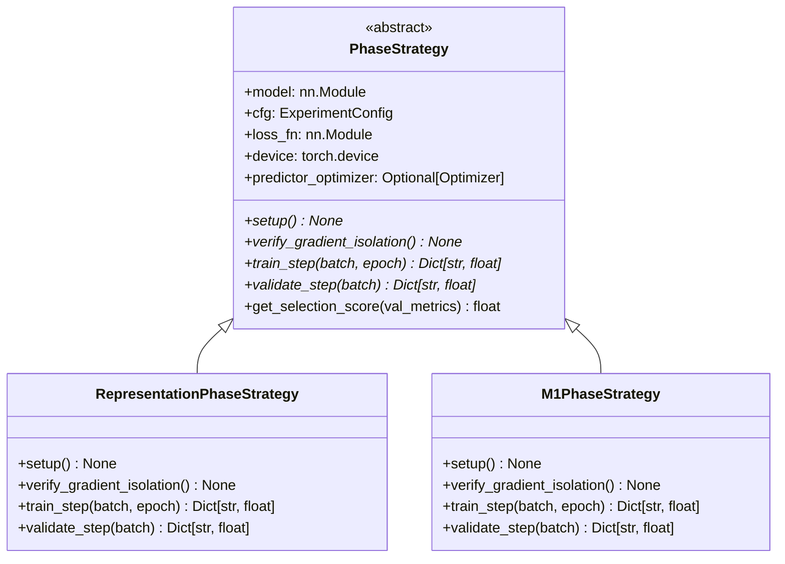

# Loss Formulations, Isolated Phase Strategies & Checkpoint Scoping (`spwm/training/`)

This document details the mathematical formulations, gradient isolation guarantees, and checkpoint scoping rules implemented in Layer 2 ([`spwm/training/`](file:///Users/Mattia/Desktop/Studies/Temp/spwm/training/__init__.py)) for **SPWM (6-DOF Active Perception Grasping & Action-Conditioned Attractor Dynamics)**.

---

## 1. Isolated Phase Strategy Architecture (`spwm/training/phases/`)

SPWM decouples representation learning from action-conditioned latent predictive dynamics, isolating each phase into a dedicated `< 150`-line strategy class inheriting from [`PhaseStrategy`](file:///Users/Mattia/Desktop/Studies/Temp/spwm/contracts/protocols.py):

---

## 2. Granular Breakdown of Training Strategies

### 2.0 Phase 0: `RepresentationPhaseStrategy` ([`spwm/training/phases/representation.py`](file:///Users/Mattia/Desktop/Studies/Temp/spwm/training/phases/representation.py))
- **Purpose**: Train the Spiking Network to act as a grounded, continuous state estimator on sensory input streams $t \in [0, T_{\text{obs}}]$. Zero autoregressive mental rollouts are permitted in this phase.
- **Parameter Mask**:
  - **Active (`requires_grad=True`)**: `model.encoder`, `model.dynamics` (`SpikingLatentDynamics`), `model.sensory_predictor`, `model.physical_decoder`.
  - **Frozen / Inactive (`requires_grad=False`)**: `model.predictor` (`model.m1`) (must not receive gradients or participate in the forward pass of Phase 0).
- **Optimizer Groups**:
  - `model.encoder`, `model.dynamics`, `model.sensory_predictor`: `lr = cfg.training.learning_rate`, `weight_decay = cfg.training.weight_decay`.
  - `model.physical_decoder`: `lr = cfg.training.probe_lr`, `weight_decay = cfg.training.probe_weight_decay`.
- **Forward Pass**:
  Executes `model.forward_representation(events, actions=actions)` over $t \in [0, T_{\text{obs}}]$ computing $\mathbf{z}_t = (\mathbf{q}_t, \mathbf{p}_t)$ directly from sensory input streams.
  > [!NOTE] Dynamics Action Coupling in Phase 0 & Gradient Flow Verification
  > Because `action_proj` ($W_u$) in `SpikingLatentDynamics` is zero-initialized (`nn.init.zeros_`), decoding gradients initially flow primarily through the visual pathway ($\epsilon_t$ and $\mathbf{k}_t^{\text{sensory}}$). Empirical norm verification on trained checkpoints confirms that BPTT activates and converges $W_u$ to a magnitude comparable to $W_{\text{in}}$ (`seed_42`: $\|W_u\|_2 = 1.3653$, $\|W_{\text{in}}\|_2 = 1.3388$, ratio $\approx 1.020$; `seed_101`: ratio $\approx 0.521$; `seed_2024`: ratio $\approx 0.434$), ensuring immediate motor-torque awareness during closed-loop MPPI control.
- **Strict Loss Constraints**:
  1. **$\mathcal{L}_{\text{kinematic}}$**: Supervised loss decoding articulated joint angles $\mathbf{q}^*$, angular velocities $\mathbf{p}^*$ ($J=6$), and differentiable Forward Kinematics end-effector pose ($\mathbf{p}_{\text{ee}}(\hat{\mathbf{q}}) = T_{\text{FK}}(\hat{\mathbf{q}})_{:3, 3}$, $R = T_{\text{FK}}(\hat{\mathbf{q}})_{:3, :3}$):
     $$\mathcal{L}_{\text{kinematic}} = \mathcal{L}_{\text{pos\_kin}} + \mathcal{L}_{\text{vel\_kin}} + \lambda_{\text{cart}} \cdot \mathcal{L}_{\text{cartesian}}$$
     where:
     $$\mathcal{L}_{\text{pos\_kin}} = \frac{1}{BT}\sum_{b=0}^{B-1}\sum_{t=0}^{T-1} \|\text{decode\_pos}(\mathbf{q}_{b, t}) - \mathbf{q}_{b, t}^*\|_2^2, \quad \mathcal{L}_{\text{vel\_kin}} = \frac{1}{BT s_v^2}\sum_{b=0}^{B-1}\sum_{t=0}^{T-1} \|\text{decode\_vel}(\mathbf{p}_{b, t}) - \mathbf{p}_{b, t}^*\|_2^2$$
     $$\mathcal{L}_{\text{cartesian}} = \frac{1}{BT}\sum_{b=0}^{B-1}\sum_{t=0}^{T-1} \left(\|\mathbf{p}_{\text{ee}}(\hat{\mathbf{q}}_{b, t}) - \mathbf{p}_{\text{ee}}(\mathbf{q}^*_{b, t})\|_2^2 + \lambda_{\text{rot}} \cdot \|R_{\text{pred}} - R_{\text{true}}\|_F^2\right)$$
     with $s_v = \text{velocity\_loss\_scale} = 1.0\,\text{rad/s}$, $\lambda_{\text{cart}} = \text{cartesian\_weight} = 40.0$, and $\lambda_{\text{rot}} = \text{ee\_rot\_weight} = 0.5$ (configurable in `LossConfig`). $\mathcal{L}_{\text{cartesian}}$ weights joint errors geometrically by their kinematic lever arm (e.g., $0.39\,\text{m}$ distal lever on J2 `Elbow_Flex` along inclined axis $\vec{a} = [0.5375, -0.2756, -0.7969]^T$) while supervising $SO(3)$ orientation.
  2. **$\mathcal{L}_{\text{derivative}}$**: Strict phase-space factorization constraint:
     $$\mathcal{L}_{\text{derivative}} = \frac{1}{B(T-1)}\sum_{b=0}^{B-1}\sum_{t=0}^{T-2} \|(\mathbf{q}_{b, t+1} - \mathbf{q}_{b, t}) - \Delta t \cdot \mathbf{p}_{b, t}[..., :q\_dim]\|_2^2$$
  3. **$\mathcal{L}_{\text{smoothness}}$**: High-frequency noise suppression with Huber loss on ALIF outputs:
     $$\mathcal{L}_{\text{smoothness}} = \frac{1}{B(T-1)}\sum_{b=0}^{B-1}\sum_{t=0}^{T-2} \text{Smooth}_{L1}(\mathbf{p}_{b, t+1} - \mathbf{p}_{b, t}, \beta=0.1)$$
  4. **$\mathcal{L}_{\text{kinematic\_smooth}}$** (`lambda_kinematic_smooth = 0.5`): Temporal velocity, kinematic integration ($\Delta\hat{\mathbf{q}}/\Delta t$ vs $\frac{1}{2}(\hat{\mathbf{p}}_{t+1} + \hat{\mathbf{p}}_t)$), and second-order acceleration consistency on decoded physical joints.
  5. **$\mathcal{L}_{\text{spike\_balance}}$** (`lambda_spike_balance = 0.25`, `target_spike_rate = 0.12`): Per-neuron ALIF population firing-rate homeostasis (`forward_representation_with_spikes`) penalizing silent collapse ($< 0.02$) and hyperactivity ($> 0.45$).
  6. **$\mathcal{L}_{\text{sensory}}$**: Top-down sensory reconstruction loss from `sensory_predictor`:
     $$\mathcal{L}_{\text{sensory}} = \frac{1}{BT}\sum_{b=0}^{B-1}\sum_{t=0}^{T-1} \|\boldsymbol{\epsilon}_{b, t}\|_2^2$$
  $$\mathcal{L}_{\text{Phase 0}} = \lambda_{\text{kinematic}} \mathcal{L}_{\text{kinematic}} + \lambda_{\text{derivative}} \mathcal{L}_{\text{derivative}} + \lambda_{\text{smoothness}} \mathcal{L}_{\text{smoothness}} + \lambda_{\text{kinematic\_smooth}} \mathcal{L}_{\text{kinematic\_smooth}} + \lambda_{\text{spike\_balance}} \mathcal{L}_{\text{spike\_balance}} + \lambda_{\text{sensory}} \mathcal{L}_{\text{sensory}}$$
  with default weights $\lambda_{\text{kinematic}} = 5.0, \; \lambda_{\text{derivative}} = 1.0, \; \lambda_{\text{smoothness}} = 0.1, \; \lambda_{\text{kinematic\_smooth}} = 0.5, \; \lambda_{\text{spike\_balance}} = 0.25, \; \lambda_{\text{sensory}} = 1.0$, alongside cosine LR annealing ($1.0\times \to 0.20\times$) over `epochs`.

### 2.1 Phase 1: `M1PhaseStrategy` ([`spwm/training/phases/m1_nominal.py`](file:///Users/Mattia/Desktop/Studies/Temp/spwm/training/phases/m1_nominal.py)) & Closed-Loop DAgger Blending
- **Purpose**: Train the Action-Conditioned Latent Attractor Predictor ($M_1$) conditioned on continuous motor commands $\mathbf{u}_t \in \mathbb{R}^6$, incorporating Active Perception sensory injection during Phase 1.5 heft (flag == 1), while blending demonstration open-loop batches with closed-loop rollouts (DAgger replay) to eliminate exposure bias.
- **State Pre-condition**:
  - `encoder`, `dynamics`, `sensory_predictor`, and `physical_decoder` **MUST BE FROZEN** (`requires_grad = False`).
  - Optimizer updates **only `model.predictor`** (`model.m1`).
- **Forward Pass & Active Perception Injection**:
  1. Identifies trajectory phases from `phase_flags`:
     - Flag `0`: Blind Approach
     - Flag `1`: Sensory Grounding Injection (initiated `pre_contact_sensory_steps = 7` prior to contact, ramping to 100% injection over 4 steps, held across grasp contact through `post_contact_sensory_steps = 7`, then released)
     - Flag `2`: Blind Transport
  2. Computes the canonical schedule `(t_start, horizon)` via `compute_rollout_schedule(phase_flags, T)`.
  3. Grounds the initial state and dynamics memory $\hat{\mathbf{z}}_0$ through frozen Encoder & Dynamics over initial frames $t \in [0, t_{\text{start}}]$ via `ground_initial_state` conditioned on motor actions $\mathbf{u}_t$.
  4. Delegates multi-step unrolling to [`rollout_latent`](file:///Users/Mattia/Desktop/Studies/Temp/spwm/models/rollout.py) (`with_grad=True`, `fixed_predictor=model.m1`):
     - $M_1$ unrolls continuously across all horizon steps.
     - When active perception events are present (`flag == 1`), `step_grounded` evaluates the sensory representation and softly blends the latent state: $\mathbf{z}_{t+1} = (1 - w_t) \cdot \mathbf{z}_{\text{pred}} + w_t \cdot \mathbf{z}_{\text{grounded}}$ with blend authority $w_t \in [0, 0.60]$ ramping up over 4 frames ($0.15 \to 0.30 \to 0.45 \to 0.60$), and ramping down over 2 frames ($0.30 \to 0.00$) upon releasing into Phase 2 blind transport.
     - When `w_t == 0` (Blind Approach / Transport): $\mathbf{z}_{t+1} = \mathbf{z}_{\text{pred}}$ unrolls autoregressively conditioned on motor command $\mathbf{u}_t$.

- **Open-Loop & Closed-Loop Trajectory Blending (DAgger Replay in `BaseTrainer`)**:
  Pure teacher-forced training on open-loop demonstration trajectories suffers from compounding autoregressive drift ("exposure bias") during downstream closed-loop MPPI control. To counteract this, [`BaseTrainer`](file:///Users/Mattia/Desktop/Studies/Temp/spwm/training/engine.py) seamlessly integrates an on-policy / off-policy closed-loop buffer:
  1. **Trajectory Collection at Tier 2 Validation**: Every `tier2_frequency` epochs (default `5`), [`LatentMPPIController`](file:///Users/Mattia/Desktop/Studies/Temp/spwm/evaluation/mppi_controller.py) evaluates candidate models in closed loop. Full executed closed-loop trajectory sequences (initial state $\mathbf{z}_{\text{init}}$, executed actions $\mathbf{u}_{0:H-1}$, and resulting ground-truth latent targets $\mathbf{z}^*_{1:H}$) are captured and ingested into [`ClosedLoopBuffer`](file:///Users/Mattia/Desktop/Studies/Temp/spwm/training/replay_buffer.py).
  2. **Fresh Initialization & Anti-Contamination**: New training runs initialize completely fresh buffers; cross-run buffer globbing from older directories is strictly prohibited. Only explicit path inputs or resuming an interrupted checkpoint (`is_resuming=True`) within `save_dir` loads existing buffers via [`resolve_closed_loop_buffer`](file:///Users/Mattia/Desktop/Studies/Temp/spwm/training/checkpoints.py).
  3. **Strict Generational FIFO Rolling Window**: To prevent distributional drift from obsolete early policies, [`ClosedLoopBuffer`](file:///Users/Mattia/Desktop/Studies/Temp/spwm/training/replay_buffer.py) enforces a rolling window of Tier 2 evaluation generations (`max_eval_generations=3`). When a new Tier 2 evaluation occurs, trajectories from generation `N-3` are cleanly discarded before ingesting the new ones.
  4. **State-Machine 4-Phase Curriculum via Irreversible Latch (`LatchCurriculumState`)**:
     - Controlled by [`LatchCurriculumState`](file:///Users/Mattia/Desktop/Studies/Temp/spwm/training/noise.py#L16-L105) in [`BaseTrainer.train_epoch`](file:///Users/Mattia/Desktop/Studies/Temp/spwm/training/engine.py#L645-L725). Transitions are strictly irreversible (latch) and evaluated **strictly against $\mathcal{L}_{M1,\text{latent}}$** (excluding $\mathcal{L}_{\text{critic}}$ and $\mathcal{L}_{\text{kin\_M1}}$):
       1. **Phase 1 (Warmup Nominal)**: 100% Open-Loop (`dagger_ratio = 0.0`), MPPI Noise `alpha = 0.0`, Active Perception `w_t = 0.60`. Transitions to Phase 2 when `loss_m1_latent < phase1_loss_threshold` (`0.10` in `TrainingConfig`).
       2. **Phase 2 (Sensory Fade-Out)**: 100% Open-Loop, `alpha = 0.0`, linearly decays `w_t` from `0.60` down to `0.0` over 7 epochs. Transitions to Phase 3 when `w_t == 0.0` and `loss_m1_latent < phase2_loss_threshold` (`0.095` in `TrainingConfig`).
       3. **Phase 3 (Noise Ramp-Up)**: 100% Open-Loop, `w_t = 0.0`, linearly ramps MPPI Noise `alpha` from `0.0` to `mppi_noise_target_alpha` (`0.25`) over `mppi_noise_ramp_epochs` (`20`). Transitions to Phase 4 when `alpha == mppi_noise_target_alpha`.
       4. **Phase 4 (Fast DAgger Integration)**: Mixed batch scaling `dagger_ratio` from `10%` (`0.10`) to `50%` (`0.50`) over `2 * tier2_frequency` epochs while keeping `w_t = 0.0` and `alpha = mppi_noise_target_alpha` (injected into the open-loop portion of the batch). Runs indefinitely until Tier 2 Early Stopping halts training.
  5. **Full-Subset Natural Evaluation with Partial `ClosedLoopBuffer` Expert Blending**:
     - `MPPIStructuralScorer` always evaluates **all 6** fixed validation trajectories in natural MPPI mode across Phases 1–4 (`mppi_evaluated_trajectories == 6.0`), so `best_model.pt` selection compares full 6-trajectory natural scores apples-to-apples from Phase 1 onward.
     - For `ClosedLoopBuffer` ingestion, Phases 1–3 still supply 4 expert trajectories (`u_t`) + 2 rotating natural trajectories `(eval_idx + i) % 6`, decaying expert buffer entries `4 -> 3 -> 2 -> 1 -> 0` across Phase 4 evaluations.
     - **Strict Metric Isolation**: All returned validation metrics (`mppi_score`, `mppi_success_rate`, `mppi_mean_error_cm`, `mppi_rot_err_rad`, etc.) are computed **exclusively** on the 6 natural MPPI trajectories; expert buffer rollouts never pollute validation scores.
     - **Full-Subset `best_model.pt` Gating & Resume State Persistence**: `BaseTrainer` gates `best_model.pt` / `model.pt` selection, `best_score`, and Tier 2 early stopping patience on full natural coverage (`num_mppi_eval >= len(cl_trajectories)` when trajectories are present, or `num_expert_eval == 0`). Evaluators implementing `StatefulTier2EvaluatorProtocol` serialize (`eval_count`, `phase4_eval_count`, `last_natural_success_rate`) into `checkpoint.pt` under `"tier2_evaluator_state"` so resumed runs continue seamlessly without resetting the Phase 4 decay schedule.
  5. **Multi-Step Closed-Loop BPTT**: In `_compute_m1_objectives`, the closed-loop batch is unrolled autoregressively via $M_1$:
     $$\hat{\mathbf{z}}_{b, h+1} = M_1(\hat{\mathbf{z}}_{b, h}, \mathbf{u}_{b, h}), \quad \hat{\mathbf{z}}_{b, 0} = \mathbf{z}_{\text{init}, b}$$
     The resulting predictions $\hat{\mathbf{z}}_{b, 1:H}$ and real targets $\mathbf{z}^*_{b, 1:H}$ are concatenated directly with the flattened open-loop trajectory predictions and targets. Dynamically sized batch dimensions are handled cleanly without shape mismatches.
  6. **Combined Objective & Weight Balancing**:
     The mixed batch loss applies coordinate and velocity weighting across both open-loop and closed-loop data points:
     $$\mathcal{L}_{\text{pos}} = \frac{1}{N_{\text{total}}} \sum_{i=1}^{N_{\text{total}}} w_{\text{pos}}(i) \cdot \|\hat{\mathbf{q}}_i - \mathbf{q}^*_i\|_2^2, \quad \mathcal{L}_{\text{vel}} = \frac{1}{N_{\text{total}}} \sum_{i=1}^{N_{\text{total}}} w_{\text{vel}}(i) \cdot \|\hat{\mathbf{p}}_i - \mathbf{p}^*_i\|_2^2$$
     where open-loop steps retain the contact-heft weight profiles ($w_t^{\text{pos}} = 2.0$ over $[t_{\text{heft\_start}} - 5, t_{\text{heft\_end}} + 10]$, $w_t^{\text{vel}} = 3.0$ over $[t_{\text{heft\_start}}, t_{\text{heft\_end}} + 12]$, and $1.0$ otherwise), while closed-loop transitions receive uniform weight $1.0$.
  7. **Telemetry & Tracking**: Epoch metrics record `closed_loop_trajs_epoch`, `closed_loop_trans_epoch`, active buffer capacities, and `dagger_ratio`, confirming continuous exposure correction.

- **Loss Constraint, Kinematic Supervision & Monte Carlo Critic Bootstrapping**:
  $$\mathcal{L}_{M1,\text{latent}} = \lambda_{\text{position}} \mathcal{L}_{\text{pos}} + \lambda_{\text{velocity}} \mathcal{L}_{\text{vel}}$$
  - **Kinematic Supervision for M1 ($\mathcal{L}_{\text{kin\_M1}}$)**: Predicted latents $(\hat{\mathbf{q}}_t, \hat{\mathbf{p}}_t)$ are passed through the frozen `PhysicalDecoder` heads (`pos_head`, `vel_head`) and `DifferentiableForwardKinematics`:
    $$\hat{\mathbf{q}}^*_t = \text{pos\_head}(\hat{\mathbf{q}}_t), \quad \hat{\mathbf{p}}^*_t = \text{vel\_head}(\hat{\mathbf{p}}_t)$$
    $$\mathcal{L}_{\text{kin\_M1}} = \frac{1}{B \cdot H \cdot J} \sum_{b,t,j} (\hat{q}^*_{b,t,j} - q^*_{b,t,j})^2 + \frac{0.5}{B \cdot H \cdot J} \sum_{b,t,j} (\hat{p}^*_{b,t,j} - p^*_{b,t,j})^2 + \frac{\lambda_{\text{cart}}}{B \cdot H} \sum_{b,t} \|\text{FK}(\hat{\mathbf{q}}^*_{b,t}) - \text{FK}(\mathbf{q}^*_{b,t})\|_2^2$$
    $$\mathcal{L}_{M1,\text{total}} = \mathcal{L}_{M1,\text{latent}} + 1.0 \cdot \mathcal{L}_{\text{kin\_M1}}$$
  - **Monte Carlo Critic Value Loss (`compute_critic_mc_loss`)**: Predicted latent states are strictly detached ($\hat{\mathbf{z}}_{b,t}.\text{detach}()$) so critic value gradients never corrupt the $M_1$ attractor backbone:
    $$\mathcal{L}_{\text{critic}} = \text{MSE}\left(V(\hat{\mathbf{z}}_t.\text{detach}()), \text{stop\_grad}(V_{\text{target}, t})\right)$$
    $$V_{\text{target}, t} = \left(\|\mathbf{x}_{\text{ee}}(\hat{\mathbf{z}}_t) - \mathbf{x}^*_{\text{ee}}(t)\|_2 + w_{\text{rot\_critic}} (1 - \cos(\theta_{\text{error}}(t)))\right) + \gamma V_{\text{target}, t+1}$$
    $$\mathcal{L}_{\text{total}} = \mathcal{L}_{M1,\text{total}} + w_{\text{critic}} \mathcal{L}_{\text{critic}}$$
    with discount factor $\gamma = 0.95$, rotational critic weight $w_{\text{rot\_critic}} = 1.0$, and $w_{\text{critic}} = \lambda_{\text{critic}} \times (5.0 \text{ if curriculum\_phase} \ge 3 \text{ else } 1.0)$ evaluated across both demonstration rollouts and `ClosedLoopBuffer` trajectories. Both training and [`RolloutEvaluator`](file:///Users/Mattia/Desktop/Studies/Temp/spwm/evaluation/evaluator.py) share the identical Active Perception unrolling logic from `rollout_latent`.
- **Dynamic Learning Rate**: Base learning rate is initialized at $0.0001$ (`cfg.training.learning_rate`), dynamically dropping to $0.00005$ upon entering curriculum Phase 4 (DAgger closed-loop blending) across predictor optimizer parameter groups.

---

## 3. Action-Conditioned Attractor Vector Field Learning

When continuous robotic systems operate in real physical worlds, interactions with ground contact friction, gravity, and motor torques create dissipative vector fields and limit-cycle attractors.

In [`LatentPredictor`](file:///Users/Mattia/Desktop/Studies/Temp/spwm/models/predictors.py):
1. State $\mathbf{z}_t$ is concatenated with continuous action $\mathbf{u}_t \in \mathbb{R}^{D_u}$:
   $$\mathbf{h}_t = \text{Backbone}([\mathbf{z}_t, \mathbf{u}_t])$$
2. The network decomposes the update into state-dependent dissipation $\gamma_t = \sigma(\text{Head}_{\text{diss}}(\mathbf{h}_t))$, momentum force head $\mathbf{f}_p = \text{Head}_p(\mathbf{h}_t)$, and coordinate velocity head $\mathbf{f}_q = \text{Head}_q(\mathbf{h}_t)$:
   $$\mathbf{p}_{t+1} = (1 - \Delta t \cdot \gamma_t) \mathbf{p}_t + \mathbf{f}_p$$
   $$\mathbf{q}_{t+1} = \mathbf{q}_t + \Delta t \cdot (\mathbf{p}_{t+1}[..., :q\_dim] + \mathbf{f}_q)$$
   $$\hat{\mathbf{z}}_{t+1} = [\mathbf{q}_{t+1}, \mathbf{p}_{t+1}]$$

This construction enables the model to natively stabilize around CPG walking limit cycles and fixed-point posture equilibria without requiring artificial manifold denoisers or external projection steps.

---

## 4. Scoped `strict=True` Checkpoint Protocol

To prevent silent weight corruption or partial state-dict mismatches across phases, [`spwm/training/checkpoints.py`](file:///Users/Mattia/Desktop/Studies/Temp/spwm/training/checkpoints.py) and [`spwm/training/engine.py`](file:///Users/Mattia/Desktop/Studies/Temp/spwm/training/engine.py) provide dedicated scoped loaders:

| Function | Source Checkpoint | Target Sub-Modules Loaded (`strict=True`) | Untouched Modules |
| :--- | :--- | :--- | :--- |
| [`load_representation_checkpoint(model, path)`](file:///Users/Mattia/Desktop/Studies/Temp/spwm/training/checkpoints.py) | Phase 0 (`train_representation`) `model.pt` | `model.encoder`, `model.dynamics`, `model.sensory_predictor`, `model.physical_decoder` | `model.predictor` |
| [`BaseTrainer.load_checkpoint(path)`](file:///Users/Mattia/Desktop/Studies/Temp/spwm/training/engine.py) | Full `SPWM` `checkpoint.pt` / `model.pt` | Full `model` (`model.load_state_dict(..., strict=True)`) + optimizer state | None |
| [`enforce_phase_prerequisites(model, cfg, ...)`](file:///Users/Mattia/Desktop/Studies/Temp/spwm/training/checkpoints.py) | Prerequisite checkpoints auto-resolved by version | Loads Phase 0 for Phase 1 (`train_m1`) | Unrelated phase modules |

---

## 5. Two-Tiered Validation Strategy & Zero-Stochasticity Guarantee

Phase 1 (`train_m1`) employs a decoupled **Two-Tiered Validation Strategy** orchestrated by [`BaseTrainer`](file:///Users/Mattia/Desktop/Studies/Temp/spwm/training/engine.py) and [`MPPIStructuralScorer`](file:///Users/Mattia/Desktop/Studies/Temp/spwm/evaluation/mppi_scorer.py):

### 5.1 Tier 1: High-Frequency, Open-Loop Validation (Every Epoch)
- **Objective**: Drives gradient updates during training and monitors general numerical convergence across all validation batches every single epoch.
- **Metrics**: Standard open-loop MSE on `LatentPredictor` ($\mathcal{L}_{\text{pos}}$, $\mathcal{L}_{\text{vel}}$, $\mathcal{L}_{M_1}$) and `PhysicalDecoder` joint position/velocity tracking MAE:
  $$\text{MAE}_{\text{pos}} = \frac{1}{B \cdot T \cdot J} \sum |\hat{q}^* - q^*|, \quad \text{MAE}_{\text{vel}} = \frac{1}{B \cdot T \cdot J} \sum |\hat{p}^* - p^*|$$
- **Decoupling Guarantee**: Tier 1 open-loop validation loss does **not** trigger checkpoint selection or advance early-stopping patience when Tier 2 is active, isolating model selection from open-loop teacher-forcing overfitting.

### 5.2 Tier 2: Low-Frequency, Closed-Loop MPPI Validation (Every 5 to 10 Epochs)
- **Objective**: Evaluates downstream closed-loop Model Predictive Path Integral (MPPI) control execution strictly for **checkpoint selection** (`is_best`, saving `best_model.pt` and `model.pt`) and **early stopping**, completely ignoring Tier 1 open-loop MSE.
- **Fixed Validation Subset**: Evaluates a balanced subset of 6 fixed trajectories spanning **Low** ($< 1.08\,\text{m}$), **Mid** ($1.08 \le y < 1.18\,\text{m}$), and **High** ($\ge 1.18\,\text{m}$) elevation planes, pre-selected at initialization.
- **Sequential Trajectory Target Definition (`target_pose_seq`)**:
  The pose reference supplied to `LatentMPPIController` supports both a static $SE(3)$ waypoint $\mathbf{T}_{\text{target}} \in \mathbb{R}^{4 \times 4}$ and a time-indexed prediction horizon sequence $\mathbf{T}_{\text{target},\tau} \in \mathbb{R}^{H \times 4 \times 4}$ for $\tau \in \{1, \dots, H\}$ (padded at the sequence boundary):
  - **Two-Stage Tier 2 Validation (`MPPIStructuralScorer`)**: Evaluates reaching toward the grasp pose $\mathbf{T}_{\text{grasp}}$ ($t \le t_c$) and subsequent lift to $\mathbf{T}_{\text{final}}$ ($t > t_c$).
  - **Full-Horizon Closed-Loop Simulation Export (`experiments/export_mppi_trajectory.py`)**: Supplies the time-indexed slice `target_pose_seq[t + 1 : t + 1 + H]` across approach, sensory handover (with smooth `gate_ramp_steps` ramp-in and 2-step Phase 2 fade-out), upward heft lift, and post-grasp wrist transport.
- **Lifting-Aware Physics-Grounded MPPI Cost Formulation**:
  Evaluates $K$ candidate trajectories across horizon $H$ via $M_1$ latent rollout, `PhysicalDecoder`, and `DifferentiableForwardKinematics` against `target_pose_seq[tau]`:
  - **Positional Cost**: $w_{\text{pos}} \sum_{\tau=1}^H \|\mathbf{p}_{\text{ee},\tau} - \mathbf{p}_{\text{target},\tau}\|_2$
  - **Rotational Cost**: $w_{\text{rot}} \sum_{\tau=1}^H ((1 - \cos \theta_{\text{err},\tau}) + 0.5\,\theta_{\text{err},\tau})$ (geodesic $SO(3)$ error)
  - **Action Smoothness / Jerk Penalty**: $w_{\text{jerk}} \sum_{\tau=1}^H \|\mathbf{u}_\tau - \mathbf{u}_{\tau-1}\|_2^2$
  - **Directional Progress Reward**: $-w_{\text{progress}} \sum_{\tau=1}^H (\Delta \mathbf{p}_\tau \cdot \hat{\mathbf{d}}_{\text{target},\tau}) \cdot \text{dist\_factor}$ (modulated by deadband)
  - **Cartesian Velocity Damping**: $w_{\text{damping}} \sum_{\tau=1}^H \|\Delta \mathbf{p}_\tau - \Delta \mathbf{p}_{\text{ref},\tau}\|_2 \cdot (1 - \text{dist\_factor})$ when tracking a time-indexed trajectory ($\Delta \mathbf{p}_{\text{ref},\tau} = \mathbf{0}$ for static point goals), damping velocity relative to the reference trajectory within the $13\,\text{cm}$ target deadband without braking moving lift/transport trajectories.
  - **Terminal Value Bootstrapping (`LatentCritic`)**: Forced to $w_{\text{critic}} = 0.0$ for online control until goal-conditioning is introduced.
  - Tracks raw physical metrics: `Mean Cartesian Err (cm)`, `Rotational Err (rad)`, and `Success Rate`.
- **Autonomous vs. Teacher-Forced Mode (`is_expert`)**:
  - **`is_expert = False` (Natural MPPI)**: Closed-loop execution uses `LatentMPPIController` actions; all official benchmark metrics (`mppi_score`, `mppi_success_rate`, `mppi_mean_error_cm`, etc.) and early-stopping/checkpointing decisions are computed **exclusively** on natural trials (*Strict Metric Isolation*), with `best_model.pt` / `model.pt` updates gated until `num_expert_eval == 0`.
  - **`is_expert = True` (Teacher-Forced / Expert Override)**: Bypasses MPPI with recorded expert actions $u_t^*$ to verify oracle kinematic response and populate `ClosedLoopBuffer` without corrupting natural MPPI statistics.
- **Ground-Truth-Relative Terminal Velocity Stability Criterion**:
  - Standard low-speed trajectories enforce `final_vel < 1.5 rad/s` at $t_{\text{grasp}}$. For high-speed trajectories whose ground-truth grasp angular velocity exceeds $1.5\,\text{rad/s}$ (e.g., validation trajectory `3201` where $t_{\text{grasp}} = 15$ coincides with peak acceleration $\|\dot{\mathbf{q}}^*_{15}\|_2 = 3.419\,\text{rad/s}$), `resolve_effective_vel_threshold` scales the velocity threshold to $\max(1.5, 1.1 \cdot \|\dot{\mathbf{q}}^*_{t_{\text{grasp}}}\|_2)$ in both `compute_structural_score` and `experiments/benchmark_mppi_control.py`.

### 5.3 Zero-Stochasticity Guarantee
In downstream stochastic sampling controllers, pseudo-random exploration jitter across epochs corrupts the signal-to-noise ratio of validation metrics. SPWM guarantees zero stochasticity:
1. The MPPI controller maintains a dedicated [`torch.Generator`](file:///Users/Mattia/Desktop/Studies/Temp/spwm/evaluation/mppi.py#L135-L145) on the active device.
2. For each trajectory in the fixed validation subset, [`LatentMPPIController.reset`](file:///Users/Mattia/Desktop/Studies/Temp/spwm/evaluation/mppi.py#L146-L160) explicitly re-seeds the generator to `tier2_seed + trajectory_id` prior to unrolling.
3. Every step $t \in [t_{\text{start}}, t_{\text{grasp}}]$ evaluates the **exact identical sequence of action perturbations** across validation epochs, ensuring that any metric change reflects true neural weight improvement rather than stochastic sampling variance.

### 5.4 Candidate Model Selection (Exponential Moving Average Default)
To resolve pathological divergence and high-frequency parameter oscillations between open-loop validation and downstream closed-loop control, [`BaseTrainer`](file:///Users/Mattia/Desktop/Studies/Temp/spwm/training/engine.py) tracks weights using an Exponential Moving Average ([`EMATracker`](file:///Users/Mattia/Desktop/Studies/Temp/spwm/training/replay_buffer.py)) with `tier2_candidate_selection = "ema"`:
1. **Continuous Weight Smoothing**: On each training step, shadow weights are updated via $\theta_{\text{EMA}} \leftarrow \tau \theta_{\text{EMA}} + (1 - \tau) \theta$ (default decay $\tau = 0.99$), filtering high-frequency gradient noise.
2. **Targeted Closed-Loop Evaluation**: At each Tier 2 evaluation epoch ($k\cdot 10$), the trainer temporarily loads the smoothed EMA weights into the model and evaluates closed-loop MPPI control against the fixed validation subset.
3. **Decoupled Model Checkpointing**: If the EMA candidate improves the global MPPI structural score, it is saved to `model.pt`.
4. **Seamless Resume**: Current active training weights are restored immediately after Tier 2 evaluation, preserving gradient momentum and Adam optimizer statistics.

### 5.5 Tier 2 Early Stopping Criteria & Check Cadence
Early stopping under Two-Tiered Validation is matched strictly to the closed-loop MPPI structural score rather than noisy open-loop MSE:
1. **Zero Intermediate Stoppage**: Tier 1 open-loop validation fluctuations on intermediate epochs ($t \not\equiv 0 \pmod{\text{tier2\_frequency}}$) **never** trigger early stopping.
2. **Consecutive Tier 2 Evaluation Checks**: Early stopping is evaluated strictly at the end of each Tier 2 epoch against `tier2_patience` (default: 5 checks, spanning 25 epochs under the default 5-epoch frequency).
3. **Improvement Delta Guard (`tier2_min_delta`)**: A candidate's `mppi_score` must strictly improve over `best_score` by more than `tier2_min_delta` (default: 0.001) to reset the patience counter (`tier2_checks_without_improvement = 0`). Minor variations below this threshold are rejected as stagnation.
4. **Single-Tier Mode**: When running Phase 0 representation learning or when `--no-tier2` is specified, `BaseTrainer` uses epoch-by-epoch early stopping governed by `early_stopping_patience`.

### 5.6 MPPI-Aware Training: Action AR(1) Perturbation with Curriculum Scheduling
To prevent off-distribution covariate shift during closed-loop MPPI unrolls, Phase 1 (`train_m1`) injects temporally correlated AR(1) Gaussian noise into demonstration actions during autoregressive predictor unrolls:
1. **AR(1) Process Matching MPPI**: Action perturbations follow an identical stationary Gauss-Markov process matching [`LatentMPPIController`](file:///Users/Mattia/Desktop/Studies/Temp/spwm/evaluation/mppi_controller.py) ($\beta = 0.90$, $\sigma = 0.08$, anisotropic $1.6\times$ shoulder / $1.4\times$ elbow, clamped to $[-1, 1]$).
2. **Linear Curriculum Scheduling**: Noise intensity $\alpha \in [0.0, 0.25]$ is scheduled via `LatchCurriculumState` / [`compute_mppi_noise_alpha`](file:///Users/Mattia/Desktop/Studies/Temp/spwm/training/noise.py). Training starts at $\alpha = 0$ during warmup, linearly ramping to `mppi_noise_target_alpha = 0.25` over `mppi_noise_ramp_epochs = 20` to give the dynamic DAgger schedule time to mitigate drift.
3. **Pure Open-Loop Validation**: In Tier 1 validation (`validate_step`), noise injection is disabled ($\alpha = 0$), maintaining uncorrupted open-loop benchmark metrics.
