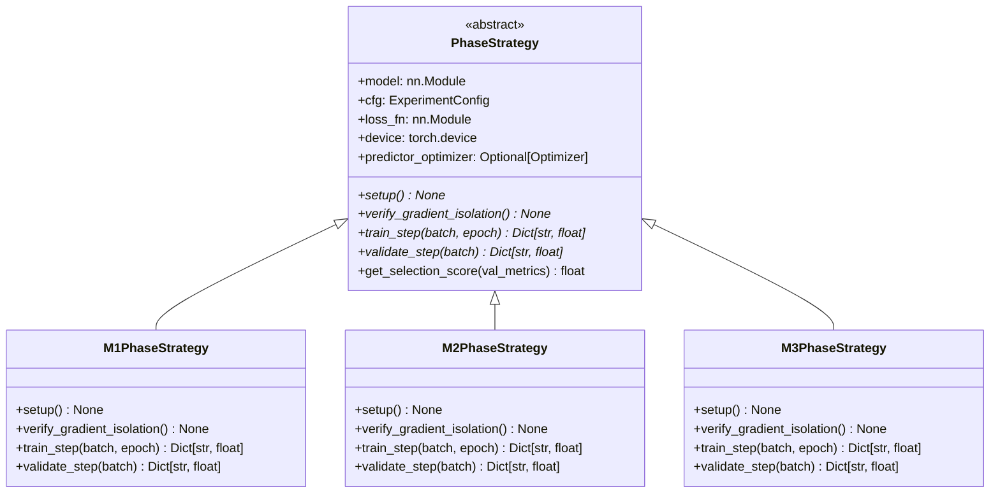

# Loss Formulations, Isolated Phase Strategies & Checkpoint Scoping (`spwm/training/`)

This document details the mathematical formulations, gradient isolation guarantees, and checkpoint scoping rules implemented in Layer 2 ([`spwm/training/`](file:///Users/Mattia/Desktop/Studies/Temp/spwm/training/__init__.py)).

---

## 1. Isolated Phase Strategy Architecture (`spwm/training/phases/`)

Instead of a monolithic conditional handler, SPWM-v0.2.0 isolates each phase of the Cascaded Temporal Relay curriculum into a dedicated `< 150`-line strategy class inheriting from [`PhaseStrategy`](file:///Users/Mattia/Desktop/Studies/Temp/spwm/contracts/protocols.py):

---

## 2. Granular Breakdown of `m1`, `m2`, and `m3` Training Strategies

### 2.1 Phase 1: `M1PhaseStrategy` ([`spwm/training/phases/m1_nominal.py`](file:///Users/Mattia/Desktop/Studies/Temp/spwm/training/phases/m1_nominal.py))
- **Purpose**: Establish a grounded symplectic latent representation $\mathbf{z}_t = [\mathbf{q}_t, \mathbf{p}_t]$, optimize top-down sensory prediction and recurrent spiking dynamics, and train the nominal physics predictor $M_1$ over short horizons $t \in [0, H-1]$.
- **Parameter Mask**:
  - **Active (`requires_grad=True`)**: `model.m1`, `model.encoder` (both `conv` and `proj`), `model.dynamics`, `model.sensory_predictor`, `model.physical_decoder`.
  - **Frozen (`requires_grad=False`)**: `model.m2`, `model.m3`.
- **Optimizer Groups**:
  - Group 1 (`model.m1`): `lr = cfg.training.learning_rate`, `weight_decay = cfg.training.weight_decay`.
  - Group 2 (`model.encoder`): `lr = cfg.training.learning_rate`, `weight_decay = cfg.training.weight_decay`.
  - Group 3 (`model.dynamics`): `lr = cfg.training.learning_rate`, `weight_decay = cfg.training.weight_decay`.
  - Group 4 (`model.sensory_predictor`): `lr = cfg.training.learning_rate`, `weight_decay = cfg.training.weight_decay`.
  - Group 5 (`model.physical_decoder`): `lr = cfg.training.probe_lr`, `weight_decay = cfg.training.probe_weight_decay`.
- **Step Execution**:
  1. Runs `seq_out = self.model(events)` in the active grad context, generating latents $\mathbf{z}_{0:T-1}^*$, keypoints $\mathbf{k}_{0:T-1}$, immediate kinematic readouts $\hat{\mathbf{y}}_{0:T-1}^{\text{imm}}$, and top-down sensory prediction errors $\boldsymbol{\epsilon}_{0:T-1} = \mathbf{x}_{0:T-1} - \hat{\mathbf{x}}_{0:T-1}$.
  2. Detaches $\mathbf{z}_0 = \text{stop\_grad}(\mathbf{z}_0^*)$ and target latents $\mathbf{z}_{1:H}^* = \text{stop\_grad}(\mathbf{z}_{1:H})$.
  3. Executes `rollout_latent(model, z_init=z_0, horizon=H, with_grad=True, fixed_predictor=model.m1)` to obtain $\hat{\mathbf{z}}_{1:H}^{(M_1)}$.
  4. Minimizes $\mathcal{L}_{M_1} = \lambda_{\text{latent}}\mathcal{L}_{\text{latent}} + \lambda_{\text{enc}}\mathcal{L}_{\text{encoder}} + \lambda_{\text{dec}}\mathcal{L}_{\text{decoder}} + \lambda_{\text{sensory}}\mathcal{L}_{\text{sensory}}$, where:
     $$\mathcal{L}_{\text{latent}} = \lambda_{\text{position}} \cdot \text{MSE}(\hat{\mathbf{q}}, \mathbf{q}^*) + \lambda_{\text{velocity}} \cdot \text{MSE}(\hat{\mathbf{p}}, \mathbf{p}^*)$$
     updating $M_1$, `encoder`, `dynamics`, `sensory_predictor`, and `physical_decoder`.

### 2.2 Phase 2: `M2PhaseStrategy` ([`spwm/training/phases/m2_recovery.py`](file:///Users/Mattia/Desktop/Studies/Temp/spwm/training/phases/m2_recovery.py))
- **Purpose**: Train the recovery predictor $M_2$ to pull drifted off-manifold latent states back onto the true physical manifold without velocity discontinuities.
- **Parameter Mask**:
  - **Active (`requires_grad=True`)**: `model.m2` **only**.
  - **Frozen (`requires_grad=False`)**: `model.encoder`, `model.dynamics`, `model.sensory_predictor`, `model.physical_decoder`, `model.m1`, `model.m3`.
- **Step Execution**:
  1. Under `with torch.no_grad():`, extracts ground-truth latents $\mathbf{z}_{0:T-1}^*$ and rolls out frozen $M_1$ for $H$ steps from $\mathbf{z}_0^*$ to obtain the dirty anchor $\hat{\mathbf{z}}_H$ and its predecessor $\hat{\mathbf{z}}_{H-1}$.
  2. Rolls out trainable $M_2$ for $H$ steps starting from $\hat{\mathbf{z}}_H$ (`rollout_latent(..., fixed_predictor=model.m2, with_grad=True)`).
  3. Computes [`ConvergenceFunnelLoss`](file:///Users/Mattia/Desktop/Studies/Temp/spwm/training/losses.py) against the blended trajectory $\tilde{\mathbf{z}}_{H+1:2H}^*$, parameterized with identical symplectic subspace weights:
     $$\mathcal{L}_{M_2} = \lambda_{\text{position}} \cdot \text{MSE}(\hat{\mathbf{q}}^{(M_2)}, \tilde{\mathbf{q}}^*) + \lambda_{\text{velocity}} \cdot \text{MSE}(\hat{\mathbf{p}}^{(M_2)}, \tilde{\mathbf{p}}^*)$$

### 2.3 Phase 3: `M3PhaseStrategy` ([`spwm/training/phases/m3_sustained.py`](file:///Users/Mattia/Desktop/Studies/Temp/spwm/training/phases/m3_sustained.py))
- **Purpose**: Initialize $M_3$ from $M_1$ (`model.relay.init_m3_from_m1()`) and jointly fine-tune $M_2$ and $M_3$ across multi-cycle alternating rollouts $t \in [H, H_{\max}]$.
- **Parameter Mask**:
  - **Active (`requires_grad=True`)**: `model.m2` and `model.m3`.
  - **Frozen (`requires_grad=False`)**: `model.encoder`, `model.dynamics`, `model.sensory_predictor`, `model.physical_decoder`, `model.m1`.
- **Step Execution**:
  1. Under `with torch.no_grad():`, extracts $\mathbf{z}_{0:T-1}^*$ and rolls out frozen $M_1$ for $H$ steps to obtain $\hat{\mathbf{z}}_H$.
  2. Calls `rollout_latent(model, z_init=z_anchor, horizon=H_max - H, start_step=H, with_grad=True)`, which automatically routes steps $[H, 2H-1] \to M_2$, $[2H, 3H-1] \to M_3$, etc.
  3. Minimizes decomposed latent loss between the multi-cycle trajectory $\hat{\mathbf{z}}_{H+1:H_{\max}}$ and $\mathbf{z}_{H+1:H_{\max}}^*$:
     $$\mathcal{L}_{M_3} = \lambda_{\text{position}} \cdot \text{MSE}(\hat{\mathbf{q}}^{\text{relay}}, \mathbf{q}^*) + \lambda_{\text{velocity}} \cdot \text{MSE}(\hat{\mathbf{p}}^{\text{relay}}, \mathbf{p}^*)$$

---

## 3. Convergence Funnel Mathematical Specification

Given a terminal anchor state $\hat{\mathbf{z}}_{t_a} \in \mathbb{R}^{B \times D}$ at step $t_a$, its preceding state $\hat{\mathbf{z}}_{t_a - 1} \in \mathbb{R}^{B \times D}$, and the ground-truth latent trajectory $\mathbf{z}_{t_a+1 : t_a+H}^* \in \mathbb{R}^{B \times H \times D}$:

1. **Linear Kinematic Extrapolation** ([`extrapolate_latent`](file:///Users/Mattia/Desktop/Studies/Temp/spwm/models/predictors.py)):
   $$\text{Extrapolate}(\hat{\mathbf{z}}_{t_a}, t) = \hat{\mathbf{z}}_{t_a} + (t - t_a)\left(\hat{\mathbf{z}}_{t_a} - \hat{\mathbf{z}}_{t_a - 1}\right)$$
2. **Asymptotic Funnel Interpolation** ([`compute_convergence_funnel_target`](file:///Users/Mattia/Desktop/Studies/Temp/spwm/models/predictors.py)):
   For step offset $k \in \{0, 1, \dots, H-1\}$ where $t = t_a + k + 1$:
   $$\tau_k = \text{clip}\!\left(\frac{k + 1}{H},\, 0.0,\, 1.0\right)$$
   $$\tilde{\mathbf{z}}_t^* = (1 - \tau_k)\,\text{Extrapolate}(\hat{\mathbf{z}}_{t_a}, t) + \tau_k\,\mathbf{z}_t^*$$
3. **Convergence Funnel Loss** ([`ConvergenceFunnelLoss`](file:///Users/Mattia/Desktop/Studies/Temp/spwm/training/losses.py)):
   $$\mathcal{L}_{\text{funnel}} = \lambda_{\text{position}} \cdot \text{MSE}(\hat{\mathbf{q}}, \tilde{\mathbf{q}}^*) + \lambda_{\text{velocity}} \cdot \text{MSE}(\hat{\mathbf{p}}, \tilde{\mathbf{p}}^*)$$

---

## 4. Scoped `strict=True` Checkpoint Protocol

To prevent silent weight corruption or partial state-dict mismatches across phases, [`spwm/training/engine.py`](file:///Users/Mattia/Desktop/Studies/Temp/spwm/training/engine.py) provides dedicated scoped loaders:

| Function | Source Checkpoint | Target Sub-Modules Loaded (`strict=True`) | Untouched Modules |
| :--- | :--- | :--- | :--- |
| [`load_m1_checkpoint(model, path)`](file:///Users/Mattia/Desktop/Studies/Temp/spwm/training/engine.py) | Phase 1 (`train_m1`) `model.pt` | `model.encoder`, `model.sensory_predictor`, `model.dynamics`, `model.predictor.m1`, `model.physical_decoder` | `model.predictor.m2`, `model.predictor.m3` |
| [`model.relay.init_m3_from_m1()`](file:///Users/Mattia/Desktop/Studies/Temp/spwm/models/predictors.py) | In-memory `model.predictor.m1` | `model.predictor.m3` | All other modules |
| [`load_m2_checkpoint(model, path)`](file:///Users/Mattia/Desktop/Studies/Temp/spwm/training/engine.py) | Phase 2 (`train_m2`) `model.pt` | `model.predictor.m2` | All other modules |
| [`BaseTrainer.load_checkpoint(path)`](file:///Users/Mattia/Desktop/Studies/Temp/spwm/training/engine.py) | Any full `SPWM` `checkpoint.pt` / `model.pt` | Full `model` (`model.load_state_dict(..., strict=True)`) + optimizer state | None |
