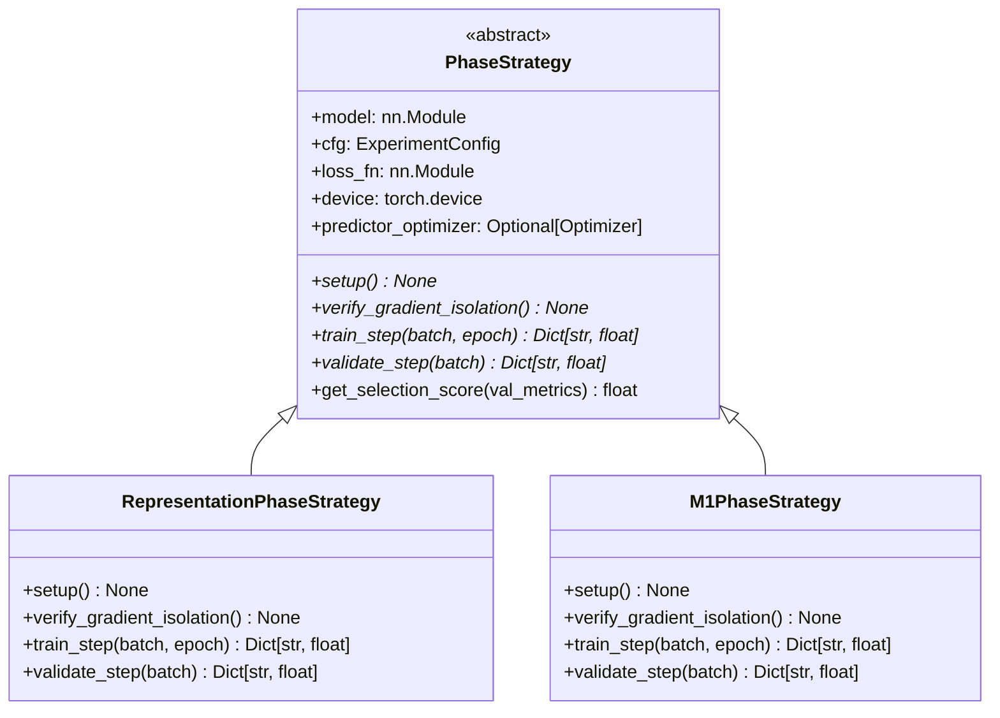

# Loss Formulations, Isolated Phase Strategies & Checkpoint Scoping (`spwm/training/`)

This document details the mathematical formulations, gradient isolation guarantees, and checkpoint scoping rules implemented in Layer 2 ([`spwm/training/`](file:///Users/Mattia/Desktop/Studies/Temp/spwm/training/__init__.py)) for **SPWM-v0.7.3 (6-DOF Active Perception Grasping & Action-Conditioned Attractor Dynamics)**.

---

## 1. Isolated Phase Strategy Architecture (`spwm/training/phases/`)

SPWM-v0.7.3 decouples representation learning from action-conditioned latent predictive dynamics, isolating each phase into a dedicated `< 150`-line strategy class inheriting from [`PhaseStrategy`](file:///Users/Mattia/Desktop/Studies/Temp/spwm/contracts/protocols.py):

---

## 2. Granular Breakdown of Training Strategies

### 2.0 Phase 0: `RepresentationPhaseStrategy` ([`spwm/training/phases/representation.py`](file:///Users/Mattia/Desktop/Studies/Temp/spwm/training/phases/representation.py))
- **Purpose**: Train the Spiking Network to act as a grounded, continuous state estimator on sensory input streams $t \in [0, T_{\text{obs}}]$. Zero autoregressive mental rollouts are permitted in this phase.
- **Parameter Mask**:
  - **Active (`requires_grad=True`)**: `model.encoder`, `model.dynamics` (`SpikingLatentDynamics`), `model.sensory_predictor`, `model.physical_decoder`.
  - **Frozen / Inactive (`requires_grad=False`)**: `model.predictor` (`model.m1`) (must not receive gradients or participate in the forward pass of Phase 0).
- **Optimizer Groups**:
  - `model.encoder`, `model.dynamics`, `model.sensory_predictor`: `lr = cfg.training.learning_rate`, `weight_decay = cfg.training.weight_decay`.
  - `model.physical_decoder`: `lr = cfg.training.probe_lr`, `weight_decay = cfg.training.probe_weight_decay`.
- **Forward Pass**:
  Executes `model.forward_representation(events)` over $t \in [0, T_{\text{obs}}]$ computing $\mathbf{z}_t = (\mathbf{q}_t, \mathbf{p}_t)$ directly from sensory input streams.
- **Strict Loss Constraints**:
  1. **$\mathcal{L}_{\text{kinematic}}$**: Supervised loss decoding articulated joint angles $\mathbf{q}^*$ and angular velocities $\mathbf{p}^*$ ($J=6$):
     $$\mathcal{L}_{\text{kinematic}} = \frac{1}{BT}\sum_{b=0}^{B-1}\sum_{t=0}^{T-1} \left( \|\text{decode\_pos}(\mathbf{q}_{b, t}) - \mathbf{q}_{b, t}^*\|_2^2 + \frac{1}{s_v^2} \|\text{decode\_vel}(\mathbf{p}_{b, t}) - \mathbf{p}_{b, t}^*\|_2^2 \right)$$
     where $s_v = \text{velocity\_loss\_scale} = 1.0\,\text{rad/s}$ (configurable in `LossConfig`, default 1.0) normalizes angular velocity magnitudes relative to normalized joint coordinates.
  2. **$\mathcal{L}_{\text{derivative}}$**: Strict phase-space factorization constraint:
     $$\mathcal{L}_{\text{derivative}} = \frac{1}{B(T-1)}\sum_{b=0}^{B-1}\sum_{t=0}^{T-2} \|(\mathbf{q}_{b, t+1} - \mathbf{q}_{b, t}) - \Delta t \cdot \mathbf{p}_{b, t}[..., :q\_dim]\|_2^2$$
  3. **$\mathcal{L}_{\text{smoothness}}$**: High-frequency noise suppression with Huber loss on ALIF outputs:
     $$\mathcal{L}_{\text{smoothness}} = \frac{1}{B(T-1)}\sum_{b=0}^{B-1}\sum_{t=0}^{T-2} \text{Smooth}_{L1}(\mathbf{p}_{b, t+1} - \mathbf{p}_{b, t}, \beta=0.1)$$
  4. **$\mathcal{L}_{\text{sensory}}$**: Top-down sensory reconstruction loss from `sensory_predictor`:
     $$\mathcal{L}_{\text{sensory}} = \frac{1}{BT}\sum_{b=0}^{B-1}\sum_{t=0}^{T-1} \|\boldsymbol{\epsilon}_{b, t}\|_2^2$$
  $$\mathcal{L}_{\text{Phase 0}} = \lambda_{\text{kinematic}} \mathcal{L}_{\text{kinematic}} + \lambda_{\text{derivative}} \mathcal{L}_{\text{derivative}} + \lambda_{\text{smoothness}} \mathcal{L}_{\text{smoothness}} + \lambda_{\text{sensory}} \mathcal{L}_{\text{sensory}}$$
  with default weights $\lambda_{\text{kinematic}} = 5.0, \; \lambda_{\text{derivative}} = 1.0, \; \lambda_{\text{smoothness}} = 0.1, \; \lambda_{\text{sensory}} = 1.0$.

### 2.1 Phase 1: `M1PhaseStrategy` ([`spwm/training/phases/m1_nominal.py`](file:///Users/Mattia/Desktop/Studies/Temp/spwm/training/phases/m1_nominal.py)) & Closed-Loop DAgger Blending
- **Purpose**: Train the Action-Conditioned Latent Attractor Predictor ($M_1$) conditioned on continuous motor commands $\mathbf{u}_t \in \mathbb{R}^6$, incorporating Active Perception sensory injection during Phase 1.5 heft (flag == 1), while blending demonstration open-loop batches with closed-loop rollouts (DAgger replay) to eliminate exposure bias.
- **State Pre-condition**:
  - `encoder`, `dynamics`, `sensory_predictor`, and `physical_decoder` **MUST BE FROZEN** (`requires_grad = False`).
  - Optimizer updates **only `model.predictor`** (`model.m1`).
- **Forward Pass & Active Perception Injection**:
  1. Identifies trajectory phases from `phase_flags`:
     - Flag `0`: Blind Approach
     - Flag `1`: Sensory Grounding Injection (initiated `pre_contact_sensory_steps = 7` prior to contact, ramping to 100% injection over 4 steps, held across grasp contact through `post_contact_sensory_steps = 7`, then released)
     - Flag `2`: Blind Transport
  2. Computes the canonical schedule `(t_start, horizon)` via `compute_rollout_schedule(phase_flags, T)`.
  3. Grounds the initial state and dynamics memory $\hat{\mathbf{z}}_0$ through frozen Encoder & Dynamics over initial frames $t \in [0, t_{\text{start}}]$ via `ground_initial_state` conditioned on motor actions $\mathbf{u}_t$.
  4. Delegates multi-step unrolling to [`rollout_latent`](file:///Users/Mattia/Desktop/Studies/Temp/spwm/models/rollout.py) (`with_grad=True`, `fixed_predictor=model.m1`):
     - $M_1$ unrolls continuously across all horizon steps.
     - When active perception events are present (`flag == 1`), `step_grounded` evaluates the sensory representation and softly blends the latent state: $\mathbf{z}_{t+1} = (1 - w_t) \cdot \mathbf{z}_{\text{pred}} + w_t \cdot \mathbf{z}_{\text{grounded}}$ with blend authority $w_t \in [0, 0.60]$ ramping up over 4 frames ($0.15 \to 0.30 \to 0.45 \to 0.60$), and ramping down over 2 frames ($0.30 \to 0.00$) upon releasing into Phase 2 blind transport.
     - When `w_t == 0` (Blind Approach / Transport): $\mathbf{z}_{t+1} = \mathbf{z}_{\text{pred}}$ unrolls autoregressively conditioned on motor command $\mathbf{u}_t$.

- **Open-Loop & Closed-Loop Trajectory Blending (DAgger Replay in `BaseTrainer`)**:
  Pure teacher-forced training on open-loop demonstration trajectories suffers from compounding autoregressive drift ("exposure bias") during downstream closed-loop MPPI control. To counteract this, [`BaseTrainer`](file:///Users/Mattia/Desktop/Studies/Temp/spwm/training/engine.py) seamlessly integrates an on-policy / off-policy closed-loop buffer:
  1. **Trajectory Collection at Tier 2 Validation**: Every `tier2_frequency` epochs (e.g., every 10 epochs), [`LatentMPPIController`](file:///Users/Mattia/Desktop/Studies/Temp/spwm/evaluation/mppi.py) evaluates candidate models in closed loop. Full executed closed-loop trajectory sequences (initial state $\mathbf{z}_{\text{init}}$, executed actions $\mathbf{u}_{0:H-1}$, and resulting ground-truth latent targets $\mathbf{z}^*_{1:H}$) are captured and ingested into [`ClosedLoopBuffer`](file:///Users/Mattia/Desktop/Studies/Temp/spwm/training/engine.py#L270-L450).
  2. **Fresh Initialization & Anti-Contamination**: New training runs initialize completely fresh buffers; cross-run buffer globbing from older directories is strictly prohibited. Only explicit path inputs or resuming an interrupted checkpoint (`is_resuming=True`) within `save_dir` loads existing buffers via [`resolve_closed_loop_buffer`](file:///Users/Mattia/Desktop/Studies/Temp/spwm/training/engine.py#L120-L160).
  3. **Strict Generational FIFO Rolling Window**: To prevent distributional drift from obsolete early policies, [`ClosedLoopBuffer`](file:///Users/Mattia/Desktop/Studies/Temp/spwm/training/engine.py#L260-L460) enforces a rolling window of Tier 2 evaluation generations (`max_eval_generations=3`). When a new Tier 2 evaluation occurs, trajectories from generation `N-3` are cleanly discarded before ingesting the new ones.
  4. **State-Machine 4-Phase Curriculum via Irreversible Latch (`LatchCurriculumState`)**:
     - Controlled by [`LatchCurriculumState`](file:///Users/Mattia/Desktop/Studies/Temp/spwm/training/noise.py#L16-L105) in [`BaseTrainer.train_epoch`](file:///Users/Mattia/Desktop/Studies/Temp/spwm/training/engine.py#L645-L725). Transitions are strictly irreversible (latch):
       1. **Phase 1 (Warmup Nominal)**: 100% Open-Loop (`dagger_ratio = 0.0`), MPPI Noise `alpha = 0.0`, Active Perception `w_t = 0.60`. Transitions to Phase 2 when `train_loss < 0.01`.
       2. **Phase 2 (Sensory Fade-Out)**: 100% Open-Loop, `alpha = 0.0`, linearly decays `w_t` from `0.60` down to `0.0` over 7 epochs. Transitions to Phase 3 when `w_t == 0.0` and `train_loss < 0.008`.
       3. **Phase 3 (Noise Ramp-Up)**: 100% Open-Loop, `w_t = 0.0`, linearly ramps MPPI Noise `alpha` from `0.0` to `0.4` over 20 epochs (`mppi_noise_ramp_epochs = 20`). Transitions to Phase 4 when `alpha == 0.4`.
       4. **Phase 4 (Fast DAgger Integration)**: Mixed batch scaling `dagger_ratio` from `10%` (`0.10`) to `50%` (`0.50`) over `2 * tier2_frequency` epochs while keeping `w_t = 0.0` and `alpha = 0.4` (injected into the open-loop portion of the batch). Runs indefinitely until Tier 2 Early Stopping halts training.
  5. **Teacher-Forced Action Blending, Metric Isolation & Stratified Round-Robin in Tier 2**:
     - During Phases 1–3, `MPPIStructuralScorer` executes 4 out of 6 fixed validation trajectories using ground-truth expert actions (`u_t`) while running 2 trajectories with natural pure MPPI. Once Phase 4 begins, the expert trajectory count decays by 1 on every subsequent Tier 2 evaluation step ($4 \to 3 \to 2 \to 1 \to 0$).
     - **Strict Metric Isolation**: All returned validation metrics (`mppi_score`, `mppi_success_rate`, `mppi_mean_error_cm`, `mppi_rot_err_rad`, etc.) are computed **exclusively** on the natural MPPI trajectories; expert trajectories only populate the `ClosedLoopBuffer`.
     - **Stratified Round-Robin Rotation**: Natural trajectory indices rotate circularly via `(eval_idx + i) % 6`, dynamically sweeping natural MPPI evaluations across Low, Mid, and High elevation planes.
  5. **Multi-Step Closed-Loop BPTT**: In `_compute_m1_objectives`, the closed-loop batch is unrolled autoregressively via $M_1$:
     $$\hat{\mathbf{z}}_{b, h+1} = M_1(\hat{\mathbf{z}}_{b, h}, \mathbf{u}_{b, h}), \quad \hat{\mathbf{z}}_{b, 0} = \mathbf{z}_{\text{init}, b}$$
     The resulting predictions $\hat{\mathbf{z}}_{b, 1:H}$ and real targets $\mathbf{z}^*_{b, 1:H}$ are concatenated directly with the flattened open-loop trajectory predictions and targets. Dynamically sized batch dimensions are handled cleanly without shape mismatches.
  6. **Combined Objective & Weight Balancing**:
     The mixed batch loss applies coordinate and velocity weighting across both open-loop and closed-loop data points:
     $$\mathcal{L}_{\text{pos}} = \frac{1}{N_{\text{total}}} \sum_{i=1}^{N_{\text{total}}} w_{\text{pos}}(i) \cdot \|\hat{\mathbf{q}}_i - \mathbf{q}^*_i\|_2^2, \quad \mathcal{L}_{\text{vel}} = \frac{1}{N_{\text{total}}} \sum_{i=1}^{N_{\text{total}}} w_{\text{vel}}(i) \cdot \|\hat{\mathbf{p}}_i - \mathbf{p}^*_i\|_2^2$$
     where open-loop steps retain the contact-heft weight profiles ($w_{\text{heft}} = 2.0$, $w_{\text{vel\_heft}} = 3.0$), while closed-loop transitions receive uniform weight $1.0$.
  7. **Telemetry & Tracking**: Epoch metrics record `closed_loop_trajs_epoch`, `closed_loop_trans_epoch`, active buffer capacities, and `dagger_ratio`, confirming continuous exposure correction.

- **Loss Constraint & Monte Carlo Critic Bootstrapping**:
  $$\mathcal{L}_{M_1} = \lambda_{\text{position}} \mathcal{L}_{\text{pos}} + \lambda_{\text{velocity}} \mathcal{L}_{\text{vel}}$$
  $$\mathcal{L}_{\text{critic}} = \text{MSE}\left(V(\hat{\mathbf{z}}_t), \text{stop\_grad}(V_{\text{target}, t})\right)$$
  $$V_{\text{target}, t} = \left(\|\mathbf{x}_{\text{ee}}(\hat{\mathbf{z}}_t) - \mathbf{x}^*_{\text{ee}}(t)\|_2 + w_{\text{rot\_critic}} (1 - \cos(\theta_{\text{error}}(t)))\right) + \gamma V_{\text{target}, t+1}$$
  with discount factor $\gamma = 0.95$, rotational critic weight $w_{\text{rot\_critic}} = 1.0$, and critic loss weight $\lambda_{\text{critic}} = 1.0$ (`cfg.loss.lambda_critic`) evaluated across both demonstration rollouts and `ClosedLoopBuffer` trajectories. No kinematic or sensory backpropagation occurs into representation modules in Phase 1; $M_1$ trains in latent phase space to reproduce the driven attractor vector field while `LatentCritic` learns the expected discounted composite Cartesian and geodesic rotational cost-to-go. Both training and [`RolloutEvaluator`](file:///Users/Mattia/Desktop/Studies/Temp/spwm/evaluation/evaluator.py) share the identical Active Perception unrolling logic from `rollout_latent`.
- **Dynamic Learning Rate**: Base learning rate is initialized at $0.0001$ (`cfg.training.learning_rate`), dynamically dropping to $0.00005$ upon entering curriculum Phase 4 (DAgger closed-loop blending) across predictor optimizer parameter groups.

---

## 3. Action-Conditioned Attractor Vector Field Learning

When continuous robotic systems operate in real physical worlds, interactions with ground contact friction, gravity, and motor torques create dissipative vector fields and limit-cycle attractors.

In [`LatentPredictor`](file:///Users/Mattia/Desktop/Studies/Temp/spwm/models/predictors.py):
1. State $\mathbf{z}_t$ is concatenated with continuous action $\mathbf{u}_t \in \mathbb{R}^{D_u}$:
   $$\mathbf{h}_t = \text{Backbone}([\mathbf{z}_t, \mathbf{u}_t])$$
2. The network decomposes the update into state-dependent dissipation $\gamma_t = \sigma(\text{Head}_{\text{diss}}(\mathbf{h}_t))$, momentum force head $\mathbf{f}_p = \text{Head}_p(\mathbf{h}_t)$, and coordinate velocity head $\mathbf{f}_q = \text{Head}_q(\mathbf{h}_t)$:
   $$\mathbf{p}_{t+1} = (1 - \Delta t \cdot \gamma_t) \mathbf{p}_t + \mathbf{f}_p$$
   $$\mathbf{q}_{t+1} = \mathbf{q}_t + \Delta t \cdot (\mathbf{p}_{t+1}[..., :q\_dim] + \mathbf{f}_q)$$
   $$\hat{\mathbf{z}}_{t+1} = [\mathbf{q}_{t+1}, \mathbf{p}_{t+1}]$$

This construction enables the model to natively stabilize around CPG walking limit cycles and fixed-point posture equilibria without requiring artificial manifold denoisers or external projection steps.

---

## 4. Scoped `strict=True` Checkpoint Protocol

To prevent silent weight corruption or partial state-dict mismatches across phases, [`spwm/training/engine.py`](file:///Users/Mattia/Desktop/Studies/Temp/spwm/training/engine.py) provides dedicated scoped loaders:

| Function | Source Checkpoint | Target Sub-Modules Loaded (`strict=True`) | Untouched Modules |
| :--- | :--- | :--- | :--- |
| [`load_representation_checkpoint(model, path)`](file:///Users/Mattia/Desktop/Studies/Temp/spwm/training/engine.py) | Phase 0 (`train_representation`) `model.pt` | `model.encoder`, `model.dynamics`, `model.sensory_predictor`, `model.physical_decoder` | `model.predictor` |
| [`BaseTrainer.load_checkpoint(path)`](file:///Users/Mattia/Desktop/Studies/Temp/spwm/training/engine.py) | Full `SPWM` `checkpoint.pt` / `model.pt` | Full `model` (`model.load_state_dict(..., strict=True)`) + optimizer state | None |
| [`enforce_phase_prerequisites(model, cfg, ...)`](file:///Users/Mattia/Desktop/Studies/Temp/spwm/training/engine.py) | Prerequisite checkpoints auto-resolved by version | Loads Phase 0 for Phase 1 (`train_m1`) | Unrelated phase modules |

---

## 5. Two-Tiered Validation Strategy & Zero-Stochasticity Guarantee

Phase 1 (`train_m1`) employs a decoupled **Two-Tiered Validation Strategy** orchestrated by [`BaseTrainer`](file:///Users/Mattia/Desktop/Studies/Temp/spwm/training/engine.py) and [`MPPIStructuralScorer`](file:///Users/Mattia/Desktop/Studies/Temp/spwm/evaluation/mppi.py):

### 5.1 Tier 1: High-Frequency, Open-Loop Validation (Every Epoch)
- **Objective**: Drives gradient updates during training and monitors general numerical convergence across all validation batches every single epoch.
- **Metrics**: Standard open-loop MSE on `LatentPredictor` ($\mathcal{L}_{\text{pos}}$, $\mathcal{L}_{\text{vel}}$, $\mathcal{L}_{M_1}$) and `PhysicalDecoder` joint position/velocity tracking ($L_2$ position and velocity errors).
- **Decoupling Guarantee**: Tier 1 open-loop validation loss does **not** trigger checkpoint selection or advance early-stopping patience when Tier 2 is active, isolating model selection from open-loop teacher-forcing overfitting.

### 5.2 Tier 2: Low-Frequency, Closed-Loop MPPI Validation (Every 5 to 10 Epochs)
- **Objective**: Evaluates downstream closed-loop Model Predictive Path Integral (MPPI) control execution strictly for **checkpoint selection** (`is_best`, saving `best_model.pt` and `model.pt`) and **early stopping**, completely ignoring Tier 1 open-loop MSE.
- **Fixed Validation Subset**: Evaluates a balanced subset of 6 fixed trajectories spanning **Low** ($< 1.08\,\text{m}$), **Mid** ($1.08 \le y < 1.18\,\text{m}$), and **High** ($\ge 1.18\,\text{m}$) elevation planes, pre-selected at initialization.
- **Lifting-Aware Physics-Grounded MPPI Cost Formulation**:
  Evaluates candidate and closed-loop trajectories by passing $M_1$'s latent predictions through `PhysicalDecoder` and `DifferentiableForwardKinematics`:
  $$\mathcal{C} = \sum_{t=1}^H \left[ W_{\text{pos}} \|\mathbf{x}_t - \mathbf{x}_{\text{target}}\|_2 + W_{\text{rot}} (1 - \cos(\theta_{\text{error}, t})) + W_{\text{jerk}} \|\mathbf{u}_t - \mathbf{u}_{t-1}\|_2^2 - W_{\text{success}} \mathbb{I}(z_t > z_{\text{table}}) \right]$$
  while explicitly tracking raw physical metrics: `Mean Cartesian Err (cm)`, `Rotational Err (rad)`, and `Success Rate`.

### 5.3 Zero-Stochasticity Guarantee
In downstream stochastic sampling controllers, pseudo-random exploration jitter across epochs corrupts the signal-to-noise ratio of validation metrics. SPWM guarantees zero stochasticity:
1. The MPPI controller maintains a dedicated [`torch.Generator`](file:///Users/Mattia/Desktop/Studies/Temp/spwm/evaluation/mppi.py#L135-L145) on the active device.
2. For each trajectory in the fixed validation subset, [`LatentMPPIController.reset`](file:///Users/Mattia/Desktop/Studies/Temp/spwm/evaluation/mppi.py#L146-L160) explicitly re-seeds the generator to `tier2_seed + trajectory_id` prior to unrolling.
3. Every step $t \in [t_{\text{start}}, t_{\text{grasp}}]$ evaluates the **exact identical sequence of action perturbations** across validation epochs, ensuring that any metric change reflects true neural weight improvement rather than stochastic sampling variance.

### 5.4 Candidate Model Selection (Exponential Moving Average Default)
To resolve pathological divergence and high-frequency parameter oscillations between open-loop validation and downstream closed-loop control, [`BaseTrainer`](file:///Users/Mattia/Desktop/Studies/Temp/spwm/training/engine.py#L270-L330) tracks weights using an Exponential Moving Average ([`EMATracker`](file:///Users/Mattia/Desktop/Studies/Temp/spwm/training/engine.py#L164-L225)) with `tier2_candidate_selection = "ema"`:
1. **Continuous Weight Smoothing**: On each training step, shadow weights are updated via $\theta_{\text{EMA}} \leftarrow \tau \theta_{\text{EMA}} + (1 - \tau) \theta$ (default decay $\tau = 0.99$), filtering high-frequency gradient noise.
2. **Targeted Closed-Loop Evaluation**: At each Tier 2 evaluation epoch ($k\cdot 10$), the trainer temporarily loads the smoothed EMA weights into the model and evaluates closed-loop MPPI control against the fixed validation subset.
3. **Decoupled Model Checkpointing**: If the EMA candidate improves the global MPPI structural score, it is saved to `model.pt`.
4. **Seamless Resume**: Current active training weights are restored immediately after Tier 2 evaluation, preserving gradient momentum and Adam optimizer statistics.

### 5.5 Tier 2 Early Stopping Criteria & Check Cadence
Early stopping under Two-Tiered Validation is matched strictly to the closed-loop MPPI structural score rather than noisy open-loop MSE:
1. **Zero Intermediate Stoppage**: Tier 1 open-loop validation fluctuations on intermediate epochs ($t \not\equiv 0 \pmod{\text{tier2\_frequency}}$) **never** trigger early stopping.
2. **Consecutive Tier 2 Evaluation Checks**: Early stopping is evaluated strictly at the end of each Tier 2 epoch against `tier2_patience` (default: 3 checks, spanning 30 epochs under the default 10-epoch frequency).
3. **Improvement Delta Guard (`tier2_min_delta`)**: A candidate's `mppi_score` must strictly improve over `best_score` by more than `tier2_min_delta` (default: 0.001) to reset the patience counter (`tier2_checks_without_improvement = 0`). Minor variations below this threshold are rejected as stagnation.
4. **Graceful Fallback for Single-Tier Mode**: When running Phase 0 representation learning or when `--no-tier2` is specified, `BaseTrainer` falls back cleanly to epoch-by-epoch early stopping governed by `early_stopping_patience`.

### 5.6 MPPI-Aware Training: Action AR(1) Perturbation with Curriculum Scheduling
To prevent off-distribution covariate shift during closed-loop MPPI unrolls, Phase 1 (`train_m1`) injects temporally correlated AR(1) Gaussian noise into demonstration actions during autoregressive predictor unrolls:
1. **AR(1) Process Matching MPPI**: Action perturbations follow an identical stationary Gauss-Markov process matching [`LatentMPPIController`](file:///Users/Mattia/Desktop/Studies/Temp/spwm/evaluation/mppi.py#L210-L245) ($\beta = 0.75$, anisotropic $\boldsymbol{\Sigma}$, clamped to $[-1, 1]$).
2. **Linear Curriculum Scheduling**: Noise intensity $\alpha \in [0.0, 0.5]$ is scheduled via [`compute_mppi_noise_alpha`](file:///Users/Mattia/Desktop/Studies/Temp/spwm/training/noise.py#L38-L50). Training starts at $\alpha = 0$ during initial warmup epochs (`mppi_noise_warmup_epochs = 10`) to learn base dynamics, linearly ramping to target level (`mppi_noise_target_alpha = 0.5`) over `mppi_noise_ramp_epochs = 40` to give the dynamic DAgger schedule time to mitigate drift.
3. **Pure Open-Loop Validation**: In Tier 1 validation (`validate_step`), noise injection is disabled ($\alpha = 0$), maintaining uncorrupted open-loop benchmark metrics.
