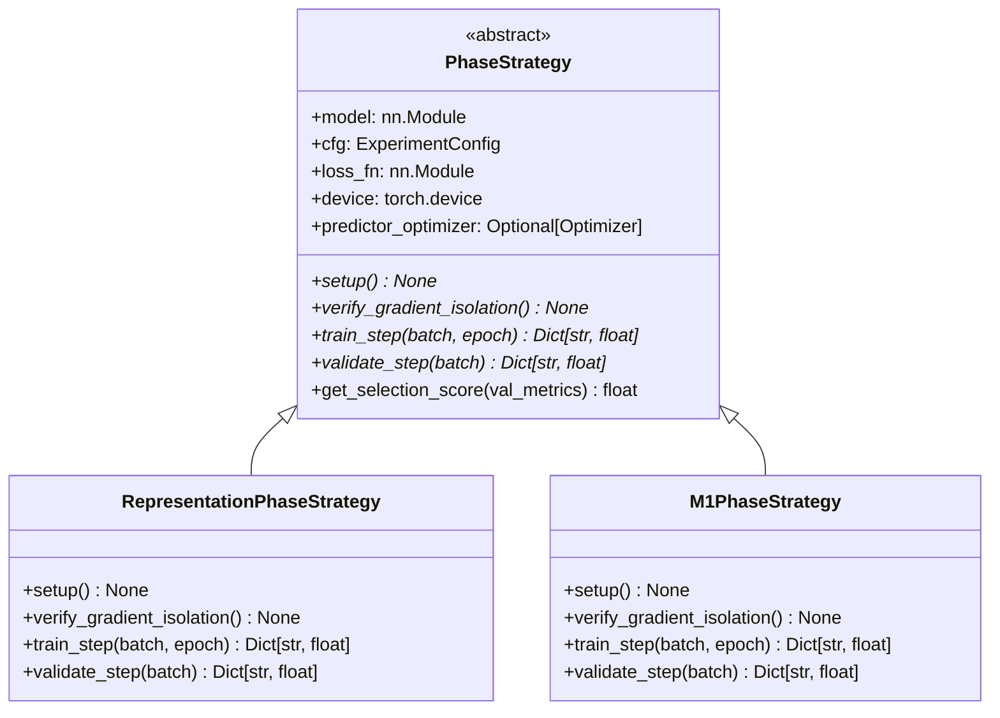

# Loss Formulations, Isolated Phase Strategies & Checkpoint Scoping (`spwm/training/`)

This document details the mathematical formulations, gradient isolation guarantees, and checkpoint scoping rules implemented in Layer 2 ([`spwm/training/`](file:///Users/Mattia/Desktop/Studies/Temp/spwm/training/__init__.py)) for **SPWM-v0.3.1**.

---

## 1. Isolated Phase Strategy Architecture (`spwm/training/phases/`)

Instead of a monolithic conditional handler, SPWM-v0.3.1 completely decouples representation learning from autoregressive latent predictive dynamics, isolating each phase into a dedicated `< 150`-line strategy class inheriting from [`PhaseStrategy`](file:///Users/Mattia/Desktop/Studies/Temp/spwm/contracts/protocols.py):

---

## 2. Granular Breakdown of Training Strategies

### 2.0 Phase 0: `RepresentationPhaseStrategy` ([`spwm/training/phases/representation.py`](file:///Users/Mattia/Desktop/Studies/Temp/spwm/training/phases/representation.py))
- **Purpose**: Train the Spiking Network to act as a grounded, continuous state estimator on sensory input streams $t \in [0, T_{\text{obs}}]$. Zero autoregressive mental rollouts are permitted in this phase.
- **Parameter Mask**:
  - **Active (`requires_grad=True`)**: `model.encoder`, `model.dynamics` (`SpikingLatentDynamics`), `model.sensory_predictor`, `model.physical_decoder`.
  - **Frozen / Inactive (`requires_grad=False`)**: `model.predictor` (`model.m1`) (must not receive gradients or participate in the forward pass of Phase 0).
- **Optimizer Groups**:
  - `model.encoder`, `model.dynamics`, `model.sensory_predictor`: `lr = cfg.training.learning_rate`, `weight_decay = cfg.training.weight_decay`.
  - `model.physical_decoder`: `lr = cfg.training.probe_lr`, `weight_decay = cfg.training.probe_weight_decay`.
- **Forward Pass**:
  Executes `model.forward_representation(events)` over $t \in [0, T_{\text{obs}}]$ computing $\mathbf{z}_t = (\mathbf{q}_t, \mathbf{p}_t)$ directly from sensory input streams.
- **Strict Loss Constraints**:
  1. **$\mathcal{L}_{\text{kinematic}}$**: Supervised loss against ground-truth physics:
     $$\mathcal{L}_{\text{kinematic}} = \text{MSE}(\text{decode\_pos}(\mathbf{q}_t), \mathbf{y}_{\text{pos}, t}^*) + \text{MSE}(\text{decode\_vel}(\mathbf{p}_t), \mathbf{y}_{\text{vel}, t}^*)$$
  2. **$\mathcal{L}_{\text{derivative}}$**: Strict phase-space factorization constraint (raw derivative mapping without `clamp` or `tanh`):
     $$\mathcal{L}_{\text{derivative}} = \text{MSE}((\mathbf{q}_{t+1} - \mathbf{q}_t), dt \cdot \mathbf{p}_t)$$
  3. **$\mathcal{L}_{\text{smoothness}}$**: High-frequency noise suppression on ALIF outputs:
     $$\mathcal{L}_{\text{smoothness}} = \text{MSE}(\mathbf{p}_{t+1}, \mathbf{p}_t)$$
  4. **$\mathcal{L}_{\text{sensory}}$**: Top-down sensory reconstruction loss from `sensory_predictor`:
     $$\mathcal{L}_{\text{sensory}} = \text{MSE}(\boldsymbol{\epsilon}_t, \mathbf{0})$$
  $$\mathcal{L}_{\text{Phase 0}} = \lambda_{\text{kinematic}} \mathcal{L}_{\text{kinematic}} + \lambda_{\text{derivative}} \mathcal{L}_{\text{derivative}} + \lambda_{\text{smoothness}} \mathcal{L}_{\text{smoothness}} + \lambda_{\text{sensory}} \mathcal{L}_{\text{sensory}}$$

### 2.1 Phase 1: `M1PhaseStrategy` ([`spwm/training/phases/m1_nominal.py`](file:///Users/Mattia/Desktop/Studies/Temp/spwm/training/phases/m1_nominal.py))
- **Purpose**: Train the Symplectic Latent Predictor ($M_1$) strictly on pristine, Markovian phase-space vectors generated by the frozen representation.
- **State Pre-condition**:
  - `encoder`, `dynamics`, `sensory_predictor`, and `physical_decoder` **MUST BE FROZEN** (`requires_grad = False`).
  - Optimizer updates **only `model.predictor`** (`model.m1`).
- **Forward Pass**:
  1. Generates ground-truth latent trajectory $\mathbf{z}_{0:T}^*$ using frozen Phase 0 modules (`model.forward_representation`).
  2. Detaches $\mathbf{z}^*$: $\mathbf{z}_{\text{target}} = \text{stop\_grad}(\mathbf{z}^*)$.
  3. Runs $M_1$ autoregressively across horizon $H$:
     $$\hat{\mathbf{z}}_{t+1} = M_1(\hat{\mathbf{z}}_t)$$
- **Loss Constraint**:
  $$\mathcal{L}_{M_1} = \text{MSE}(\hat{\mathbf{z}}_{t+1}, \mathbf{z}_{\text{target}, t+1})$$
  No kinematic or sensory backpropagation occurs in Phase 1; $M_1$ trains purely in latent phase space.

---

## 3. Symplectic Semi-Implicit Euler Integration

When `cfg.model.symplectic = True`, [`LatentPredictor`](file:///Users/Mattia/Desktop/Studies/Temp/spwm/models/predictors.py) implements symplectic semi-implicit Euler integration on the partitioned phase space $\mathbf{z}_t = [\mathbf{q}_t, \mathbf{p}_t]$:

1. **Momentum Update**:
   $$\Delta \mathbf{p}_t = \text{MLP}(\mathbf{z}_t) \in \mathbb{R}^{B \times p\_dim}$$
   $$\mathbf{p}_{t+1} = \mathbf{p}_t + \Delta \mathbf{p}_t$$

2. **Coordinate Update (Semi-Implicit)**:
   The coordinates $\mathbf{q}$ are updated using the *new* momentum $\mathbf{p}_{t+1}$:
   $$\mathbf{q}_{t+1} = \mathbf{q}_t + \Delta t \cdot \mathbf{p}_{t+1}[..., :q\_dim]$$

3. **Recombination**:
   $$\mathbf{z}_{t+1} = [\mathbf{q}_{t+1}, \mathbf{p}_{t+1}]$$

This construction preserves the canonical symplectic 2-form $d\mathbf{p} \wedge d\mathbf{q}$, preventing artificial numerical energy dissipation or explosion across long autonomous rollouts ($H \ge 100$).

---

## 4. Scoped `strict=True` Checkpoint Protocol

To prevent silent weight corruption or partial state-dict mismatches across phases, [`spwm/training/engine.py`](file:///Users/Mattia/Desktop/Studies/Temp/spwm/training/engine.py) provides dedicated scoped loaders:

| Function | Source Checkpoint | Target Sub-Modules Loaded (`strict=True`) | Untouched Modules |
| :--- | :--- | :--- | :--- |
| [`load_representation_checkpoint(model, path)`](file:///Users/Mattia/Desktop/Studies/Temp/spwm/training/engine.py) | Phase 0 (`train_representation`) `model.pt` | `model.encoder`, `model.dynamics`, `model.sensory_predictor`, `model.physical_decoder` | `model.predictor` |
| [`BaseTrainer.load_checkpoint(path)`](file:///Users/Mattia/Desktop/Studies/Temp/spwm/training/engine.py) | Full `SPWM` `checkpoint.pt` / `model.pt` | Full `model` (`model.load_state_dict(..., strict=True)`) + optimizer state | None |
| [`enforce_phase_prerequisites(model, cfg, ...)`](file:///Users/Mattia/Desktop/Studies/Temp/spwm/training/engine.py) | Phase 0 checkpoint auto-resolved by version | Strictly loads Phase 0 representation into Phase 1 model | `model.predictor` |
