# Simulation Environment & Event Camera Specification (`WORLD.md`)

This document provides the authoritative mathematical and computational specification of the simulation environment and neuromorphic sensor pipeline utilized to train and benchmark **SPWM-v0.4.0 (Action-Conditioned Spiking Predictive World Model for 3D Articulated Robotics)**.

All code implementations reside in Layer 1 of the architecture ([`spwm/data/`](file:///Users/Mattia/Desktop/Studies/Temp/spwm/data/__init__.py)) and Unity C# physics assets ([`sim/Assets/Scripts/`](file:///Users/Mattia/Desktop/Studies/Temp/sim/Assets/Scripts/ArticulatedRobotRig.cs)), governed strictly by Layer 0 contracts ([`spwm/contracts/config.py`](file:///Users/Mattia/Desktop/Studies/Temp/spwm/contracts/config.py)).

---

## 1. Overview & 3D Unity Robotics Environment

The simulation environment transitions from synthetic 2D toy billiard worlds to a **PhysX 4 Featherstone ArticulationBody continuous 3D robotics simulation** implemented in Unity C# with Python streaming interop. The system models articulated kinematic chains (bipedal humanoid walkers, quadrupeds, manipulator arms) driven by continuous motor action vectors $\mathbf{u}_t \in \mathbb{R}^{D_u}$, observed by a differential neuromorphic vision sensor ([`EventCameraSimulator`](file:///Users/Mattia/Desktop/Studies/Temp/spwm/data/event_camera.py) / [`NeuromorphicEventBridge`](file:///Users/Mattia/Desktop/Studies/Temp/sim/Assets/Scripts/NeuromorphicEventBridge.cs)).

```mermaid
flowchart LR
    subgraph Unity["Unity 3D Continuous Articulated Robotics Engine (sim/)"]
        Rig["ArticulatedRobotRig\nFeatherstone Multi-DOF Kinematic Chain\n(Joint count J = 8)"]
        Ctrl["ActionConditionedController\nMotor Target PD / Joint Torques u_t\n(Limit-Cycle CPG & Postural Attractors)"]
        Phys["PhysX 4 Physics Integration\ndt = 0.05s, Contact Friction, Gravity"]
        Ctrl --> Rig
        Rig --> Phys
        Phys --> Rig
    end

    subgraph Sensor["Neuromorphic Vision Bridge (Compute Shader & EventCameraSimulator)"]
        Phys -.->|"Visual Luminance / Scene Projections"| Render["Log-Intensity Field L(u, v; t)\n(Resolution H x W = 32 x 32)"]
        Render --> Diff["Temporal Differential\nΔL = L(t) - L(t - Δt)"]
        Diff --> Spikes["Threshold Polarity Spike Generation\n(Threshold θ = 0.08)"]
    end

    subgraph Output["Dataset & Training Pipeline"]
        Spikes --> Dense["Dense Event Tensor\n[B, T, 2, H, W]"]
        Phys -.->|"Ground-Truth Telemetry"| Kin["Joint Angles q* & Velocities p*\nMotor Actions u_t"]
        Dense & Kin --> Dataset["EventWorldDataset\nStrict Trajectory Partitioning\n(Zero Temporal Leakage)"]
    end
```

### 1.1 Robotic Kinematic Morphology & Archetypes

The core robotic rig ([`ArticulatedRobotRig`](file:///Users/Mattia/Desktop/Studies/Temp/sim/Assets/Scripts/ArticulatedRobotRig.cs)) is configured for:
- **Humanoid Biped (Default, $J=8$ actuated joints)**: Root pelvis body connected via spherical/revolute articulation joints:
  - Left / Right Hips (Pitch & Roll)
  - Left / Right Knees (Pitch)
  - Left / Right Ankles (Pitch)
- **Quadruped / Manipulator Arm**: Adaptable via `RobotArchetype` enumeration.
- **Physical Quantities**:
  - Global joint friction: $\mu_{\text{joint}} = 0.08\,\text{N}\cdot\text{s}$
  - Angular damping: $0.15\,\text{s}^{-1}$
  - Ground static/dynamic friction: $\mu_s = 0.85, \mu_k = 0.75$
  - Gravity: $\mathbf{g} = [0, -9.81, 0]^T\,\text{m/s}^2$

---

## 2. Action Conditioning & Attractor Dynamics ([`ActionConditionedController`](file:///Users/Mattia/Desktop/Studies/Temp/sim/Assets/Scripts/ActionConditionedController.cs))

### 2.1 State Representation & Motor Actions

At discrete time index $t \in \{0, 1, \dots, T-1\}$ with physics step $\Delta t = \text{dt} = 0.05\,\text{s}$:
- **Joint Positions (Generalized Coordinates)**: $\mathbf{q}_t^* \in [-1.0, 1.0]^J$ (joint angles normalized to radians/limits)
- **Joint Angular Velocities (Generalized Momenta)**: $\mathbf{p}_t^* \in \mathbb{R}^J$ (angular rates $\dot{\mathbf{q}}$)
- **Applied Motor Action Vector**: $\mathbf{u}_t \in [-1.0, 1.0]^{D_u}$ ($D_u = \text{action\_dim} = 8$ by default)

### 2.2 Dual Attractor Regimes

The environment natively induces rich physical attractors in the continuous state space:
1. **Limit-Cycle Walking Gaits (CPG Rhythmic Attractor, Even Trajectory IDs)**:
   A Central Pattern Generator (CPG) provides harmonic motor target drives with bilateral anti-phase limb coupling:
   $$\mathbf{u}_t^{(j)} = 0.75 \sin(\omega t + \phi_j) + 0.20 \cos(2\omega t + \phi_j)$$
   where $\omega = 2\pi f$ ($f \approx 1.2 - 1.8\,\text{Hz}$), producing stable, dissipative orbital limit cycles where the robotic system balances energy injection and viscous dissipation.
2. **Fixed-Point Postural Balancing (Odd Trajectory IDs)**:
   A target equilibrium posture $\mathbf{q}_{\text{eq}}$ with restorative PD motor control:
   $$\mathbf{u}_t = \text{clip}\left(1.2 (\mathbf{q}_{\text{target}}(t) - \mathbf{q}_t) - 0.35 \mathbf{p}_t, -1.0, 1.0\right)$$
   decaying into a stable fixed-point attractor under joint friction and gravity.

### 2.3 Numerical Physics Integration

Dynamics follow second-order dissipative equations integrated via PhysX 4 Featherstone solver (or Python fallback simulation [`simulate_articulated_trajectory`](file:///Users/Mattia/Desktop/Studies/Temp/spwm/data/datasets.py)):
$$\mathbf{p}_{t+1} = \mathbf{p}_t + \Delta t \left[ K_{\text{stiff}}(\mathbf{u}_t - \mathbf{q}_t) - \mathbf{\tau}_{\text{gravity}}(\mathbf{q}_t) - \mu_c \tanh(5 \mathbf{p}_t) - \gamma \mathbf{p}_t \right]$$
$$\mathbf{q}_{t+1} = \text{clip}\left(\mathbf{q}_t + \Delta t \cdot \mathbf{p}_{t+1}, -1.0, 1.0\right)$$
where $\gamma = \text{viscous\_damping} = 0.25$, $K_{\text{stiff}} = 6.5$.

---

## 3. Neuromorphic Event Camera Sensor ([`EventCameraSimulator`](file:///Users/Mattia/Desktop/Studies/Temp/spwm/data/event_camera.py) & `NeuromorphicEventBridge`)

The neuromorphic visual pipeline captures dynamic scene motion without emitting synchronous frame matrices.

### 3.1 Dual Pipeline Execution: GPU Compute Shader & Continuous Projection

1. **Unity GPU Compute Shader ([`EventCameraLogDiff.compute`](file:///Users/Mattia/Desktop/Studies/Temp/sim/Assets/Shaders/EventCameraLogDiff.compute))**:
   - Renders high-speed camera frames into a `RenderTexture`.
   - Computes logarithmic luminance $L(u, v; t) = \ln(\text{luminance}(I(u, v; t)) + \epsilon)$.
   - Emits asynchronous ON/OFF polarity spikes into a structured compute buffer at native physics FPS.
2. **Layer 1 Python Simulator ([`EventCameraSimulator`](file:///Users/Mattia/Desktop/Studies/Temp/spwm/data/event_camera.py))**:
   - Supports direct ingestion of Unity pre-rendered event tensors or high-FPS grayscale luminance sequences.
   - For standalone testing and synthetic benchmarking, generates forward-kinematic projected articulated link intensities across normalized coordinates $(u, v) \in [-1, 1]^2$.

### 3.2 Temporal Log-Intensity Differencing & Event Generation

Events are triggered when temporal changes exceed the contrast sensitivity threshold $\theta$:
$$\Delta L(u, v; t) = L(u, v; t) - L(u, v; t - \Delta t)$$
$$S_{\text{pos}}(u, v; t) = \mathbb{I}\left( \Delta L(u, v; t) > \theta \right) \quad (\text{Channel 0: Brightening})$$
$$S_{\text{neg}}(u, v; t) = \mathbb{I}\left( \Delta L(u, v; t) < -\theta \right) \quad (\text{Channel 1: Dimming})$$
Default threshold $\theta = \text{event\_threshold} = 0.08$.

### 3.3 Event Stream Formats

- **Dense Event Tensor** (`dense_events`): $\mathbf{E} \in \{0, 1\}^{B \times T \times 2 \times H \times W}$ ($H=W=32$ by default).
- **Sparse Event List** (`sparse_events`): Tuples of $(t, p, y, x)$ for neuromorphic neuromorphic backends.

---

## 4. Dataset Partitioning & Zero Temporal Leakage ([`spwm/data/datasets.py`](file:///Users/Mattia/Desktop/Studies/Temp/spwm/data/datasets.py))

### 4.1 Strict Trajectory-Level Partitioning

To strictly prevent temporal leakage, partitioning is performed strictly at the **trajectory index** level via [`partition_trajectories`](file:///Users/Mattia/Desktop/Studies/Temp/spwm/data/datasets.py):

| Split | Trajectory ID Range | Default Fraction | Trajectory Count (out of 4,000) | Dynamics Regime |
| :--- | :--- | :--- | :--- | :--- |
| **Train** | $[0, N_{\text{train}})$ | $80\%$ | 3,200 trajectories | Standard joint velocities $[-1.0, 1.0]$, mixed limit-cycle/fixed-point attractors |
| **Validation** | $[N_{\text{train}}, N_{\text{train}} + N_{\text{val}})$ | $10\%$ | 400 trajectories | Standard joint velocities $[-1.0, 1.0]$, alternating attractors |
| **Test** | $[N_{\text{train}} + N_{\text{val}}, N_{\text{total}})$ | $10\%$ | 400 trajectories | Standard joint velocities $[-1.0, 1.0]$, alternating attractors |
| **Extrapolation** | $[N_{\text{total}}, N_{\text{total}} + 100)$ | Held-out | 100 trajectories | Higher velocity bounds $[-2.0, 2.0]$ for out-of-distribution dynamic stress testing |

### 4.2 Determinism & Reproducibility

Every trajectory $k$ is deterministically generated or replayed from exported Unity logs using `np.random.default_rng(seed=k)` or Unity `trajectory_id` initialization, ensuring exact bitwise consistency.

---

## 5. Configuration Contract Parameters (`EnvironmentConfig` & `DataConfig`)

Defined in [`spwm/contracts/config.py`](file:///Users/Mattia/Desktop/Studies/Temp/spwm/contracts/config.py):

### 5.1 [`EnvironmentConfig`](file:///Users/Mattia/Desktop/Studies/Temp/spwm/contracts/config.py#L68-L90)

| Parameter | Type | Default | Description | Invariants / Constraints |
| :--- | :--- | :--- | :--- | :--- |
| `joint_count` | `int` | `8` | Number of articulated joints $J$ in robotic kinematic chain | Must be $> 0$ |
| `action_dim` | `int` | `8` | Dimensionality $D_u$ of continuous motor action vectors $\mathbf{u}_t$ | Must be $> 0$ |
| `height` | `int` | `32` | Sensor pixel height | Must be $> 0$ and divisible by 4 |
| `width` | `int` | `32` | Sensor pixel width | Must be $> 0$ and divisible by 4 |
| `dt` | `float` | `0.05` | Simulation timestep duration (seconds) | $\Delta t = 50\,\text{ms}$ per discrete step |
| `event_threshold`| `float` | `0.08` | Log-intensity change threshold $\theta$ | Positive float |

### 5.2 [`DataConfig`](file:///Users/Mattia/Desktop/Studies/Temp/spwm/contracts/config.py#L93-L128)

| Parameter | Type | Default | Description |
| :--- | :--- | :--- | :--- |
| `dataset_dir` | `str` | `"sim/ExportedTrajectories"` | Path to exported Unity robotic trajectory JSON files |
| `joint_count` | `int` | `8` | Articulated joint count expected in dataset trajectories |
| `action_dim` | `int` | `8` | Motor action vector dimensionality |
| `total_trajectories` | `int` | `4000` | Total number of trajectories generated across all splits |
| `train_split` | `float` | `0.8` | Fraction of dataset allocated to training ($\text{train} + \text{val} < 1.0$) |
| `val_split` | `float` | `0.1` | Fraction of dataset allocated to validation |
| `sequence_length` | `int` | `105` | Number of timesteps per trajectory ($T$) |
| `batch_size` | `int` | `32` | Batch size $B$ for PyTorch DataLoaders |
| `standard_velocity_range` | `(float, float)`| `(-1.0, 1.0)` | Joint angular velocity scaling range for standard trajectories |
| `extrapolation_velocity_range` | `(float, float)`| `(-2.0, 2.0)` | Velocity range for out-of-distribution stress testing |
| `cache_data` | `bool` | `True` | Whether to pre-render and cache event tensors in memory |

---

## 6. Batch Collation & Contract Shapes

Each item returned by [`EventWorldDataset`](file:///Users/Mattia/Desktop/Studies/Temp/spwm/data/datasets.py) and batched by `collate_event_batches` adheres to the following contract shapes:

| Key | Tensor Shape | Dtype | Semantic Meaning |
| :--- | :--- | :--- | :--- |
| `"events"` | `[B, T, 2, H, W]` | `torch.float32` | Sparse binary event frames (Channel 0: $+$, Channel 1: $-$) |
| `"positions"` | `[B, T, joint_count]` | `torch.float32` | Ground-truth joint angles $\mathbf{q}^*$ in radians / normalized |
| `"velocities"` | `[B, T, joint_count]` | `torch.float32` | Ground-truth joint angular velocities $\mathbf{p}^*$ |
| `"actions"` | `[B, T, action_dim]` | `torch.float32` | Motor action commands $\mathbf{u}_t$ |
| `"flat_kinematics"` | `[B, T, 2 * joint_count]` | `torch.float32` | Concatenated $[\mathbf{q}^*, \mathbf{p}^*]$ vectors per robotic rig |
| `"trajectory_ids"` | `[B]` | `torch.int64` | Globally unique trajectory index |

These kinematic tensors serve as ground-truth supervision targets for representation learning ([`RepresentationPhaseStrategy`](file:///Users/Mattia/Desktop/Studies/Temp/spwm/training/phases/representation.py)), joint angle/velocity probing, and action-conditioned multi-horizon physical rollout evaluation ([`RolloutEvaluator`](file:///Users/Mattia/Desktop/Studies/Temp/spwm/evaluation/evaluator.py)).
