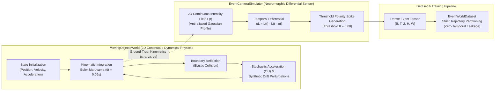

# Simulation Environment & Event Camera Specification (`WORLD.md`)

This document provides the authoritative mathematical and computational specification of the synthetic simulation environment and neuromorphic sensor pipeline utilized to train and benchmark **SPWM-v0.3.1 (Spiking Predictive World Model)**.

All code implementations reside in Layer 1 of the architecture ([`spwm/data/`](file:///Users/Mattia/Desktop/Studies/Temp/spwm/data/__init__.py)) and are governed by Layer 0 contracts ([`spwm/contracts/config.py`](file:///Users/Mattia/Desktop/Studies/Temp/spwm/contracts/config.py)).

---

## 1. Overview & Physical Arena

The simulation consists of a continuous 2D dynamical environment ([`MovingObjectsWorld`](file:///Users/Mattia/Desktop/Studies/Temp/spwm/data/synthetic_world.py)) simulating circular billiard objects moving within a bounded square arena, observed by a differential neuromorphic vision sensor ([`EventCameraSimulator`](file:///Users/Mattia/Desktop/Studies/Temp/spwm/data/event_camera.py)).

### 1.1 Arena Coordinates & Geometry

- **Coordinate System**: Continuous 2D Cartesian plane $(x, y) \in [-B, B]^2$, where $B = \text{box\_size} = 1.0$ by default.
- **Object Geometry**: $N$ circular bodies ($\text{num\_objects} \ge 1$, default $N = 1$). Each object $i$ has radius $r_i = \text{default\_radius} = 0.12$.
- **Interior Margin**: Objects are spawned strictly within $[-B + r + 0.05, B - r - 0.05]^2$ to ensure non-colliding initial placement away from boundaries.

---

## 2. Dynamical Physics & Kinematics ([`MovingObjectsWorld`](file:///Users/Mattia/Desktop/Studies/Temp/spwm/data/synthetic_world.py))

### 2.1 State Representation

At any discrete time index $t \in \{0, 1, \dots, T-1\}$ with sampling interval $\Delta t = \text{dt} = 0.05\,\text{s}$:
- **Positions**: $\mathbf{x}_t \in [-1.0, 1.0]^{N \times 2}$
- **Velocities**: $\mathbf{v}_t \in \mathbb{R}^{N \times 2}$
- **Accelerations**: $\mathbf{a}_t \in \mathbb{R}^{N \times 2}$
- **Radii**: $\mathbf{r} \in \mathbb{R}^N$ ($r_i = 0.12$)

### 2.2 Initial Conditions & Speed Regularization

1. **Positions**: Drawn uniformly at random within valid interior margins:
   $$\mathbf{x}_0^{(i)} \sim \mathcal{U}(-B + r_i + 0.05, B - r_i - 0.05)$$
2. **Velocities**: Drawn uniformly within $\text{velocity\_range} = (v_{\min}, v_{\max})$:
   $$\mathbf{v}_0^{(i)} \sim \mathcal{U}(v_{\min}, v_{\max})^2$$
   - **Nominal Range**: $[-1.0, 1.0]$
   - **Extrapolation Range**: $[-2.0, 2.0]$ (used for OOD generalization benchmarks)
   - **Minimum Speed Clamp**: To prevent static or near-static objects that emit no neuromorphic events, if $\|\mathbf{v}_0^{(i)}\|_2 < v_{\text{floor}}$ (where $v_{\text{floor}} = 0.2 \cdot \max(|v_{\max}|, 0.5)$), the velocity direction is redrawn isotropically from a normal distribution and scaled to exactly $v_{\text{floor}}$:
     $$\mathbf{v}_0^{(i)} \leftarrow \frac{\boldsymbol{\xi}}{\|\boldsymbol{\xi}\|_2} \cdot v_{\text{floor}}, \quad \boldsymbol{\xi} \sim \mathcal{N}(\mathbf{0}, \mathbf{I})$$
3. **Accelerations**: Initialized as $\mathbf{a}_0^{(i)} \sim \mathcal{N}(\mathbf{0}, \sigma_a^2 \mathbf{I})$, where $\sigma_a = \text{acceleration\_std} = 0.1$.

### 2.3 Numerical Integration (Euler-Maruyama)

The system evolves under second-order stochastic dynamics:
1. **Acceleration Dynamics (Ornstein-Uhlenbeck Perturbation)**:
   Slow mean-reverting acceleration drift modeling continuous environmental disturbances:
   $$\mathbf{a}_{t+1} = 0.95 \, \mathbf{a}_t + \boldsymbol{\eta}_t^a, \quad \boldsymbol{\eta}_t^a \sim \mathcal{N}\left(\mathbf{0}, (0.1 \sigma_a)^2 \mathbf{I}\right)$$
2. **Position Update**:
   $$\mathbf{x}_{t+1} = \mathbf{x}_t + \mathbf{v}_t \Delta t + \frac{1}{2} \mathbf{a}_t (\Delta t)^2$$
3. **Velocity Update with Linear Damping & Stochastic Noise**:
   $$\mathbf{v}_{t+1} = (1 - \gamma \Delta t) \mathbf{v}_t + \mathbf{a}_t \Delta t + \boldsymbol{\eta}_t^v, \quad \boldsymbol{\eta}_t^v \sim \mathcal{N}\left(\mathbf{0}, \sigma_{\text{noise}}^2 \mathbf{I}\right)$$
   where:
   - $\gamma = \text{damping} = 0.0$ (conservative nominal physics, no drag)
   - $\sigma_{\text{noise}} = \text{noise\_std} = 0.01$

### 2.4 Boundary Reflection (Elastic Collisions)

The arena borders act as ideal specular reflectors. For each object $i$ and Cartesian axis $d \in \{x, y\}$:
$$\begin{cases}
x_{t+1}^{(i, d)} \leftarrow B - r_i, \quad v_{t+1}^{(i, d)} \leftarrow -|v_{t+1}^{(i, d)}| & \text{if } x_{t+1}^{(i, d)} + r_i > B \\
x_{t+1}^{(i, d)} \leftarrow -B + r_i, \quad v_{t+1}^{(i, d)} \leftarrow |v_{t+1}^{(i, d)}| & \text{if } x_{t+1}^{(i, d)} - r_i < -B
\end{cases}$$

### 2.5 Out-Of-Distribution (OOD) Perturbations & Synthetic Drift Injection

To evaluate and train the model for robust recovery from unannounced state shifts (e.g., Phase 2 / $M_2$ recovery):
- **Drift Injection Probability**: $p_{\text{drift}} = \text{drift\_injection\_prob} \in [0.0, 1.0]$.
- **Impulsive Perturbation**: At each timestep $t$, with probability $p_{\text{drift}}$, an unannounced kick is added directly to position and velocity:
  $$\mathbf{x}_t \leftarrow \mathbf{x}_t + \boldsymbol{\delta}^x, \quad \boldsymbol{\delta}^x \sim \mathcal{N}\left(\mathbf{0}, \sigma_{\text{drift}}^2 \mathbf{I}\right)$$
  $$\mathbf{v}_t \leftarrow \mathbf{v}_t + \boldsymbol{\delta}^v, \quad \boldsymbol{\delta}^v \sim \mathcal{N}\left(\mathbf{0}, (2 \sigma_{\text{drift}})^2 \mathbf{I}\right)$$
  where $\sigma_{\text{drift}} = \text{drift\_magnitude} = 0.05$ by default.
- **50/50 Mixed Drift Sampling**: When `mixed_drift = True` in [`DataConfig`](file:///Users/Mattia/Desktop/Studies/Temp/spwm/contracts/config.py):
  - Trajectories with even IDs ($0, 2, 4, \dots$) are strictly nominal ($p_{\text{drift}} = 0.0$) for precise Hamiltonian phase-space estimation.
  - Trajectories with odd IDs ($1, 3, 5, \dots$) have active drift injection for out-of-distribution tracking and recovery.

---

## 3. Neuromorphic Event Camera Sensor ([`EventCameraSimulator`](file:///Users/Mattia/Desktop/Studies/Temp/spwm/data/event_camera.py))

Instead of emitting synchronous RGB/grayscale video matrices, biological retinas and silicon event cameras (e.g., Prophesee, iniVation DVS) emit asynchronous spike packets in response to temporal logarithmic intensity changes.

### 3.1 Continuous Intensity Field Rendering

At each timestep $t$, continuous object coordinates $\mathbf{x}_t^{(i)} = (c_{x, i}, c_{y, i})$ with radii $r_i$ are projected onto a 2D spatial sensor grid of resolution $H \times W$ (default $32 \times 32$ pixels):
- Coordinate grid $(u, v)$ spans normalized coordinates $[-1.0, 1.0]^2$.
- Each object is rendered as an anti-aliased Gaussian intensity profile with width $\sigma = r_i \cdot \text{smooth\_sigma\_ratio}$ ($\text{smooth\_sigma\_ratio} = 0.8$):
  $$L_i(u, v; t) = \exp\left( - \frac{(u - c_{x, i})^2 + (v - c_{y, i})^2}{2 \sigma^2 + 10^{-8}} \right)$$
- The overall scene log-intensity field $L(u, v; t) \in [0, 1]$ is the maximum across all objects:
  $$L(u, v; t) = \max_{i=1 \dots N} L_i(u, v; t)$$

### 3.2 Temporal Log-Intensity Differencing & Event Generation

Event cameras trigger when the temporal change in intensity surpasses a contrast threshold $\theta$:
$$\Delta L(u, v; t) = L(u, v; t) - L(u, v; t - \Delta t), \quad \text{for } t \ge 1$$
For $t = 0$, $\Delta L(u, v; 0) = 0$ (no previous baseline).

Events are separated into two binary polarity channels (+1: brightening, -1: dimming):
$$S_{\text{pos}}(u, v; t) = \mathbb{I}\left( \Delta L(u, v; t) > \theta \right)$$
$$S_{\text{neg}}(u, v; t) = \mathbb{I}\left( \Delta L(u, v; t) < -\theta \right)$$
where $\theta = \text{event\_threshold} = 0.08$ by default.

### 3.3 Event Stream Formats

The simulator supports two complementary representations:
1. **Dense Event Tensor** (`dense_events`):
   $$\mathbf{E} \in \{0, 1\}^{B \times T \times 2 \times H \times W}$$
   - Channel 0: $S_{\text{pos}}$ (leading edges along motion direction)
   - Channel 1: $S_{\text{neg}}$ (trailing edges along motion direction)
   - Typical event sparsity: $\sim 1\% - 15\%$ active pixels per step.
2. **Sparse Event List** (`sparse_events`):
   List of tuples $(t, p, y, x)$ where $t \in [0, T-1]$, $p \in \{0, 1\}$, $y \in [0, H-1]$, and $x \in [0, W-1]$.

---

## 4. Dataset Partitioning & Zero Temporal Leakage ([`spwm/data/datasets.py`](file:///Users/Mattia/Desktop/Studies/Temp/spwm/data/datasets.py))

### 4.1 Strict Trajectory-Level Partitioning

To strictly prevent temporal leakage, data is never split across the time axis of a shared trajectory. Instead, partitioning is performed strictly at the **trajectory index** level via [`partition_trajectories`](file:///Users/Mattia/Desktop/Studies/Temp/spwm/data/synthetic_world.py):

| Split | Trajectory ID Range | Default Fraction | Trajectory Count (out of 4,000) | Dynamics Regime |
| :--- | :--- | :--- | :--- | :--- |
| **Train** | $[0, N_{\text{train}})$ | $80\%$ | 3,200 trajectories | Standard velocity $[-1.0, 1.0]$, mixed drift if enabled |
| **Validation** | $[N_{\text{train}}, N_{\text{train}} + N_{\text{val}})$ | $10\%$ | 400 trajectories | Standard velocity $[-1.0, 1.0]$, strictly nominal ($p_{\text{drift}} = 0$) |
| **Test** | $[N_{\text{train}} + N_{\text{val}}, N_{\text{total}})$ | $10\%$ | 400 trajectories | Standard velocity $[-1.0, 1.0]$, strictly nominal ($p_{\text{drift}} = 0$) |
| **Extrapolation** | $[N_{\text{total}}, N_{\text{total}} + 100)$ | Held-out | 100 trajectories | Higher velocity bounds $[-2.0, 2.0]$ for out-of-distribution stress testing |

### 4.2 Determinism & Seed Guarantees

Every trajectory $k$ is deterministically generated using:
$$\text{rng} = \text{np.random.default\_rng}(\text{seed}=k)$$
This guarantees bitwise reproducibility of positions, velocities, and neuromorphic event frames across runs, platforms, and cache regenerations.

---

## 5. Configuration Contract Parameters (`EnvironmentConfig` & `DataConfig`)

The simulation environment and dataset generator are configured via immutable `@dataclass(frozen=True)` schemas defined in [`spwm/contracts/config.py`](file:///Users/Mattia/Desktop/Studies/Temp/spwm/contracts/config.py):

### 5.1 [`EnvironmentConfig`](file:///Users/Mattia/Desktop/Studies/Temp/spwm/contracts/config.py#L68-L88)

| Parameter | Type | Default | Description | Invariants / Constraints |
| :--- | :--- | :--- | :--- | :--- |
| `num_objects` | `int` | `1` | Number of moving billiard balls in arena | Must be $> 0$ |
| `height` | `int` | `32` | Sensor pixel height | Must be $> 0$ and divisible by 4 (for 2-stage stride-2 encoder) |
| `width` | `int` | `32` | Sensor pixel width | Must be $> 0$ and divisible by 4 (for 2-stage stride-2 encoder) |
| `box_size` | `float` | `1.0` | Arena boundary $[-B, B]$ | Normalized coordinate space $[-1.0, 1.0]$ |
| `dt` | `float` | `0.05` | Simulation timestep duration (seconds) | $\Delta t = 50\,\text{ms}$ per discrete step |
| `event_threshold`| `float` | `0.08` | Log-intensity change threshold $\theta$ | Positive float |

### 5.2 [`DataConfig`](file:///Users/Mattia/Desktop/Studies/Temp/spwm/contracts/config.py#L91-L113)

| Parameter | Type | Default | Description |
| :--- | :--- | :--- | :--- |
| `total_trajectories` | `int` | `4000` | Total number of trajectories generated across all splits |
| `train_split` | `float` | `0.8` | Fraction of dataset allocated to training ($\text{train} + \text{val} < 1.0$) |
| `val_split` | `float` | `0.1` | Fraction of dataset allocated to validation |
| `sequence_length` | `int` | `105` | Number of timesteps per trajectory ($T$) |
| `batch_size` | `int` | `32` | Batch size $B$ for PyTorch DataLoaders |
| `drift_injection_prob` | `float` | `0.0` | Probability per step of injecting an impulsive velocity/position kick |
| `drift_magnitude` | `float` | `0.05` | Standard deviation of synthetic impulse kicks |
| `mixed_drift` | `bool` | `False` | 50/50 alternating nominal and drift trajectories |
| `standard_velocity_range` | `(float, float)`| `(-1.0, 1.0)` | Initial velocity interval for standard trajectories |
| `extrapolation_velocity_range` | `(float, float)`| `(-2.0, 2.0)` | Initial velocity interval for out-of-distribution evaluation |
| `cache_data` | `bool` | `True` | Whether to pre-render and cache event tensors in memory |

---

## 6. Batch Collation & Contract Shapes

Each item returned by [`EventWorldDataset`](file:///Users/Mattia/Desktop/Studies/Temp/spwm/data/datasets.py) and batched by `collate_event_batches` adheres to the following contract shapes:

| Key | Tensor Shape | Dtype | Semantic Meaning |
| :--- | :--- | :--- | :--- |
| `"events"` | `[B, T, 2, H, W]` | `torch.float32` | Sparse binary event frames (Channel 0: $+$, Channel 1: $-$) |
| `"positions"` | `[B, T, N, 2]` | `torch.float32` | Ground-truth 2D $(x, y)$ positions in $[-1.0, 1.0]$ |
| `"velocities"` | `[B, T, N, 2]` | `torch.float32` | Ground-truth 2D $(v_x, v_y)$ velocities |
| `"flat_kinematics"` | `[B, T, 4 * N]` | `torch.float32` | Concatenated $[x, y, v_x, v_y]$ vectors per object |
| `"trajectory_ids"` | `[B]` | `torch.int64` | Globally unique trajectory index |

These kinematic tensors serve as ground-truth supervision targets for representation learning ([`RepresentationPhaseStrategy`](file:///Users/Mattia/Desktop/Studies/Temp/spwm/training/phases/representation.py)), kinematic probing, and multi-horizon physical rollout evaluation ([`RolloutEvaluator`](file:///Users/Mattia/Desktop/Studies/Temp/spwm/evaluation/evaluator.py)).
